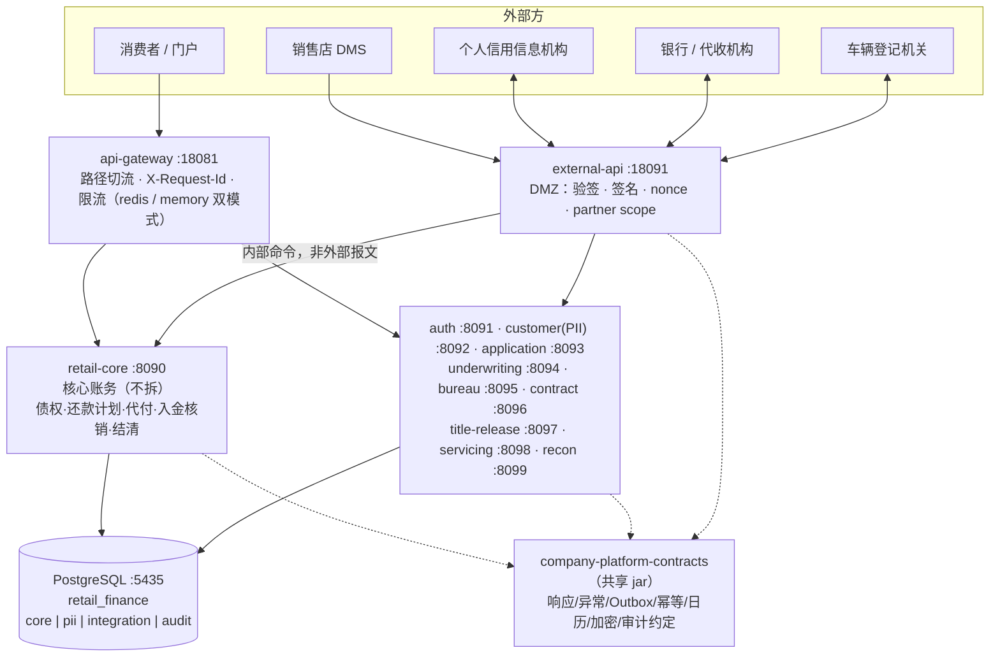

# 新车零售金融核心系统（RF）· 项目总览

> 日本第三方信贩公司 · 面向消费者（C 端）的新车零售金融 · 与 `floorplan-system` 同公司、共享中台能力
> **架构：Spring Cloud 微服务，直接对齐 floorplan 的微服务形态**（10 个业务服务 + 网关 + DMZ）。
> **当前状态：计划内 S0–S5 全部完成（W9 放行，tag `w9-accepted`）；18 模块代码 + Flyway V1–V22 + 构建 661 测试 0 失败 + 走网关冒烟 33/33 + 全链路 E2E 104/104。文档全文使用中文。**
> 先读 [`AGENTS.md`](AGENTS.md)（怎么干活），进度以 [`PROGRESS.md`](PROGRESS.md)（唯一事实源）为准，
> 设计理由见 [`docs/00-文档索引.md`](docs/00-文档索引.md)。

---

## 0. 一句话业务

消费者在销售店（4S 店）买新车 → 通过店端 DMS 或线上门户向信贩公司提交申请 →
信贩做**个人审查**（个人信用信息机构查询 + 收入证明 + 支付能力预估额）→ 签订合同 →
信贩**向销售店代付车款** → 交车，车辆检验合格证「所有者」栏登记为信贩公司（**所有权保留**）→
消费者按月分期（账户自动扣款 / 缴款单）→ 结清或提前结清 → 出具**所有权解除文件**并办理**名义变更** →
车辆真正归消费者。

> ✅ **C-01 已定源（2026-11-22）：双形态并行**——个品分期（个别信用购买斡旋）与汽车贷款同时做。
> 两者差异极大：个品分期是信贩「代付 + 分期债权」的信用购买斡旋（担保为**所有权保留**，
> 「解押」= 所有权保留解除 + 名义变更）；汽车贷款是直接贷付（贷金业法体系）。资金流、适用法规、
> 法定书面文件、额度上限算法、征信报送口径完全不同，差异收敛进 4 个策略点，详见
> [`docs/R01-业务定源与法务裁决清单.md`](docs/R01-业务定源与法务裁决清单.md) 与
> [`docs/adr/ADR-RF-002-交易形态定源.md`](docs/adr/ADR-RF-002-交易形态定源.md)（Accepted）。
> **适用法规与业者登记形态仍属 `[待定源 C-02]`，须法务意见书确认。**

---

## 1. 与 floorplan-system 的关系（同一家公司的两条业务线）

| 维度 | floorplan-system（既有，微服务） | retail-finance-system（本项目，微服务） |
|---|---|---|
| 借款人 | **B 端法人**经销商 | **C 端自然人**消费者 |
| 资金流向 | 信贩 → 经销商（垫付进车款） | 信贩 → 销售店（代付车款），消费者 → 信贩（分期） |
| 核心风控 | 经销商资质 / 车辆残值 / 在库台账 | **个人信用 / 收入证明 / 支付能力预估额** |
| 担保 | 让与担保 · 法务局登记 · 在库车辆 | **所有权保留** · 车辆检验合格证 · 已交付车辆 |
| 外部对接 | 厂家 / 银行 / 登记（人工）/ 企业征信 | **销售店 DMS / 个人信用信息机构（CIC·JICC·全国银行中心）/ 账户自动扣款 / 身份核验 / 登记代办** |
| 放行解押 | 放车放证指令给经销商/凭证库 | **所有权解除文件 + 名义变更**给消费者/车辆登记机关 |
| 个人信息 | **Q12 定源：本轮不采集个人身份信息** | **必须采集**（个人信息保护法全域适用） |
| 征信报送 | **Q15 定源：日本征信报送本轮不接** | **必须双向对接**（查询 + 报送 + 异议申诉） |
| 架构 | 网关 + 9 服务 + DDD 四层共享 jar | **同构**：网关 + 10 服务 + DMZ + DDD 四层共享 jar |
| 共享 | — | 公司级中台：**机制层共享、语义层隔离** |

**交汇点（唯一真实共享的业务主数据）**：销售店既是 floorplan 的**债务人**，又是本项目的
**加盟店 / 代付对象 / 申请代办**。主数据共享，角色与账户**必须隔离**，见
[`docs/R03-中台共享能力契约.md`](docs/R03-中台共享能力契约.md) 与
[`docs/adr/ADR-RF-010-经销商主数据共享角色隔离.md`](docs/adr/ADR-RF-010-经销商主数据共享角色隔离.md)。

> 🔴 复用红线：floorplan 已把「不采集个人信息 / 不接个人征信 / 主体是法人」写进定源 ADR（Q12/Q15）
> 与法人假设。这三处是**看起来能跑、合规上已经出事**的隐性冲突点，必须在共享库分叉时显式切断。

---

## 2. 技术栈与端口（与 floorplan 对齐，便于中台复用）

| 项 | 基线 | 说明 |
|---|---|---|
| 语言 / 构建 | Java 17 / Maven 3.9.x | 父工程 `pom` 打包，多模块 |
| 框架 | Spring Boot 3.2.5 · Spring Cloud 2023.0.5 · Spring Cloud Alibaba 2023.0.3.3 | BOM 顺序沿用 floorplan（spring-framework-bom 6.1.15 在 boot-dependencies 之前） |
| 网关 | Spring Cloud Gateway（WebFlux） | `${ROUTE_*:lb://服务名}` 双模 URI，本地无 Nacos 时用环境变量覆盖直连 |
| 持久化 | PostgreSQL 16 + Flyway + MyBatis（注解 SQL，无 XML） | 无 JPA；SQL / 索引 / 锁语义完全可控，行映射统一走共享 `RowValues` |
| 领域分层 | `domain` / `application` / `infrastructure` / `common` | `domain` 零 Spring 依赖、可纯单测；事务边界只在 application |
| 服务装配 | 精确装配 | 每服务只扫自身包 + `@Import` 按类注入，不做全包扫描 |
| 事务一致性 | 本地事务 + 行锁 + 唯一约束；Transactional Outbox（数据库轮询） | **不引入 MQ / Seata / 分布式事务** |
| 缓存 | **两级缓存**：Caffeine L1（进程内，默认 10s）+ Redis L2（默认 60s） | 只缓存**只读业务配置**（产品档位等）；Redis 不可用自动降级直读；**绝不缓存余额 / 核销流水 / 个人信息 / 征信与审查结果**（`ADR-RF-012`） |
| 网关限流 | **双模式 + 一个开关**：`redis` = Redis 令牌桶（Lua 原子扣减，**缺省**）／`memory` = 进程内令牌桶 | 开关 `retail.gateway.rate-limit.mode`（`redis` \| `memory`），两套**互斥装配**（同一时刻只注册一个限流过滤器，不会双重限流）；`redis` 模式键取 `Authorization` 头 SHA-256 哈希（不存凭据）、超限 429 + `Retry-After` + 统一 `ApiResponse`、Redis 不可用 **生产 fail-closed（503）**（本地 dev 显式 fail-open）；`memory` 模式零外部依赖但为**单实例口径**（`ADR-RF-012` §12、`R02 §3.3`） |
| 分布式锁 | Redisson 3.27.2（按业务键加锁，锁在**事务提交后**释放） | 只收敛并发窗口，**正确性仍由 DB 唯一索引 + `ON CONFLICT` 保证**；Redis 不可达即 fail-closed 拒写（`RF_LOCK_002`/503），不降级放行；锁键不落明文业务标识（`ADR-RF-015`） |
| 同步调用 | Feign，仅用于门禁（fail-closed） | 必须透传 JWT；fallback 一律拒绝而非放行 |
| 认证 | JWT 同密钥本地验签、零信任（网关不验签） | 员工侧与客户侧**两套密钥**，见 ADR-RF-004 |
| 文件 / 附件 | **本地文件系统** | 按公司既定口径，不引入对象存储（ADR-RF-008） |
| 金额 / 时间 | `BIGINT` 整数日元（Java `long`）/ `TIMESTAMPTZ` + JST | 比率用 `NUMERIC(7,4)`，落到金额必须量化 |
| 审计 | `audit_events` 只追加，`actor` 取验签身份 | 禁止从请求体或客户端头取操作人 |

### 跨项目资源隔离（避免本机并行冲突）

| 资源 | floorplan 已占 | 本项目分配 |
|---|---|---|
| 业务服务端口 | 8080–8088 | **8090–8099** |
| 内部网关 | 18080 | **18081** |
| 外部 DMZ | 18090 | **18091** |
| 数据库端口 | 5434 | **5435**（容器 `retail-finance-db`） |
| Redis 宿主端口 | — | **6382**（容器 `retail-finance-redis`；6379 被本机 WSL 侧进程占用，不复用） |
| 数据库 / schema | `floorplan` / `public` | `retail_finance` / `core` `pii` `integration` `audit` |
| Flyway 号段 | V1–V26 已执行，V27–V31 预分配 | **独立库、独立号段 V1 起** |
| 配置键前缀 | `floorplan.*` | **`retail.*`** |
| 错误码前缀 | `ADVANCE_*` / `CREDIT_*` 等 | **`RF_*`** |
| JWT 环境变量 | `FLOORPLAN_JWT_SECRET` | `RETAIL_JWT_SECRET`（员工侧）/ `RETAIL_CUSTOMER_JWT_SECRET`（客户侧） |

> 端口段与号段是**跨项目共享资源**，任何改动必须在 `PROGRESS.md §2` 登记，见 `AGENTS.md §6`。

---

## 3. 微服务架构（12 个部署单元）

| 服务 | 端口 | 职责 |
|---|---|---|
| `api-gateway` | 18081 | 按路径切流（精确规则在前、`/api/**` 兜底在后）、`X-Request-Id`；**限流已实现**（双模式一个开关：`retail.gateway.rate-limit.mode` = `redis`（缺省，Redis 令牌桶：键取 `Authorization` 头哈希、规则按路径 Ant 最具体优先、Redis 不可用生产 fail-closed）／`memory`（进程内令牌桶，零依赖、单实例口径）；两套互斥装配，配置见 `retail.gateway.rate-limit.*` 与 `retail.gateway.rate-limit.memory.*`） |
| `external-api` | 18091 | DMZ：DMS / 征信机构 / 支付回调的入站验签、出站签名、nonce、partner scope |
| `retail-core` | 8090 | **核心账务（不拆）**：债权、还款计划、代付、入金核销、结清；**运行期不跑 Flyway**（迁移由独立作业执行） |
| `auth-service` | 8091 | 员工侧 + 客户侧双主体 JWT 签发/验签 |
| `customer-service` | 8092 | 自然人主数据 + 个人信息金库 + 身份核验 + 同意管理 |
| `application-service` | 8093 | 申请受理 + DMS 申请代办 + 审查结果回传 + 销售店主数据唯一投影 |
| `underwriting-service` | 8094 | 审查授信、支付能力评估、决定、职责分离 |
| `bureau-service` | 8095 | 征信机构防腐上下文：查询 / 报送 / 异议申诉 |
| `contract-service` | 8096 | 合同 + 法定书面文件交付留痕 |
| `title-release-service` | 8097 | 所有权保留 + 解除八步 + 外部登记回执 |
| `servicing-service` | 8098 | 贷后逾期天数 / 催收 / 征信报送触发 |
| `recon-service` | 8099 | INV-1~5 对拍与差异 |

> **非长驻部署单元**：`db-migration`（独立 Flyway 迁移作业，无端口；发布前先执行，`R11 P0-10`）。
> 所有服务（含 `retail-core`）`spring.flyway.enabled=false`。

**四条与 floorplan 对齐的工程范式**：

1. **精确装配**：每服务只扫自身包 + `@Import` 按类注入所需用例与仓储；四层共享 jar 被复用，隔离靠装配而非复制代码。
2. **网关切流**：精确路由在前、兜底在后；URI 双模，本地无 Nacos 时用环境变量覆盖直连；外部接口走 **DMZ 独立端口**，不经过内部网关。
3. **零信任**：网关本阶段不验签，鉴权下沉各服务；Feign 调用必须由拦截器透传 JWT，否则门禁会走 fallback 拒付。
4. **第一版共用一个库**：服务拆开、数据不拆 —— 同库内按 4 个 schema 分组，不跨库关联、不引入分布式事务；
   每类数据只有一个权威写者，跨服务只读走 Feign 或事件。独立实例是**相对 floorplan** 而言。

**通信**：同步 Feign 只用于门禁（代付前问合同 / 审查；同意门禁由 bureau / underwriting / servicing 合规链路消费，任一超时或 UNKNOWN 即拒付）；
事后同步走 outbox 事件（允许秒级最终一致）；不使用 MQ / Seata。核心账务不拆，因为入金核销、
余额与债权终态是同一笔强一致事务。

---

## 4. 文档体系（本轮交付，全文中文）

| 编号 | 文档 | 定位 |
|---|---|---|
| — | `AGENTS.md` / `PROGRESS.md` / `README.md` | 怎么干活 / 做到哪一步 / 是什么 |
| `00` | [`docs/00-文档索引.md`](docs/00-文档索引.md) | 文档地图与阅读顺序 |
| `R00` | 设计基线与命名定源 | **必读第一份**：术语、命名、号段、端口、原则、待定源权威源 |
| `R01` | 业务定源与法务裁决清单 | **签字用**：C-01~C-12、法务问题清单、参数默认值 |
| `R02` | 总体架构设计 | C4 三层、限界上下文、上下文映射、不变式、服务边界再调整触发器 |
| `R03` | 中台共享能力契约 | **最该先读**：复用/扩展/新建/废弃四分类与三处切断点 |
| `R04` | 领域模型与状态机设计 | 聚合、状态机穷举、领域事件、不变式 |
| `R05` | 业务流程设计 | 12 步泳道、11 道闸门、补偿矩阵、所有权解除闭环 |
| `R06` | 数据库设计 | schema 分区、字段级规格、个人信息加密、号段 |
| `R07` | 外部集成接口文档 | DMS / 征信机构 / 账户自动扣款 / 身份核验 / 登记代办 / DMZ |
| `R08` | 权限与合规矩阵 | 双主体、权限点、职责分离、个人信息保护、访问控制 |
| `R09` | 接口与事件契约 | 端点、错误码、Feign 契约、事件白名单（禁个人信息） |
| `R10` | 测试与验收设计 | 验收红线、A1–A36 断言、测试留白 |
| `R11` | 演进路线图与开工门禁 | S0–S4、工作包、并行窗口、门禁、返工量评估 |
| `ADR` | [`docs/adr/`](docs/adr/) 14 份 | 每个决策的背景 / 选项 / 结论 / 后果 |

一致性自检：`python scripts/check_docs.py`（编号唯一、引用存在、待定源登记、端口不冲突、
术语全中文、架构口径一致、三节/四节齐备）。

---

## 5. 诚实的边界（防止把文档读成已实现）

1. **已交付文档、工程约定与全部计划内代码**：18 模块（四层共享 + 状态机引擎底座 + 独立迁移作业 + 10 业务服务 + 网关 + DMZ）、
   Flyway V1–V22（62 张表实测）、构建 661 测试 0 失败、走网关冒烟 33/33、全链路 E2E 104/104（`PROGRESS §6`）。
   实现范围以 `PROGRESS.md`（唯一事实源）为准；外部自动对接未实现（见第 3 条）。
2. **C-01~C-12 系统口径已定源（2026-11-22）**：`C-01` 用户签（双形态并行）；`C-02`~`C-12` 架构 AI 裁决（用户授权
   「先定合理方向，后续可按新需求改动」），裁决值与外部核实项见 `R01 §6 §7`。**法务效力判断不实现**——系统实现
   可配置的业务规则与默认公式，合规效力始终是人工/外部职责，核实不符走配置覆盖或变更回灌。
   法定书面文件、冷静期等，本文只列「适用可能性与影响」，**不冒充法务结论**。
3. **外部方接口能力：已内部裁决**（2026-11-22：DMS 项初期数据集成商模式，四类业务接口与安全规范已回填
   `R07 §3 §4`，见 `ADR-RF-011`）；**2026-11-23 各通道「我方提议协议 v1」已定稿（`R07 §4.1–§4.16`）**；
   **2026-11-24 `R07 §7` 调研清单已全部由我方内部裁决回填完成（`☑`，🟦 待联调复核，不等于对方确认）**。
   联调前系统按「人工路径是一等公民」预留，不实现自动对接；联调差异只改 Adapter。
4. **中台共享 jar 已抽取（W1）**：`../company-platform-contracts`（`mvn install`，34 单测全绿），
   RF 全仓依赖 `com.company:company-platform-contracts:1.0.0-SNAPSHOT`；floorplan 基线未触碰。
5. **中间件边界**：文件本地、**不接 Seata / 分布式事务 / 对象存储**（与 floorplan 现行约束一致）；
   **2026-11-23 起引入 RocketMQ 作为 outbox 之上的削峰缓冲层**（`ADR-RF-014`）——outbox 仍是唯一事务真相源，
   MQ 不参与事务，且 **MQ 上只允许出现密文信封**（含个人信息的载荷先加密再入队）。默认关闭（`retail.mq.enabled=false`）。
   **Redis 仅两类用途**——只读业务配置的 L2 缓存 + 网关限流状态，**不缓存**余额 / 核销流水 / 个人信息 / 征信与审查结果（`ADR-RF-012`）。
6. **文档语言**：全文中文；法律与机构名采用中文译名，必要的拉丁缩写（CIC、JICC、DMS、VIN、JWT 等）
   与代码标识符保留原样。

---

## 6. 相关仓库

- 中台基线 / B 端库存融资：`../floorplan-system`（其 `AGENTS.md`、`PROGRESS.md`、
  `docs/00-文档索引.md`、定源 ADR 是本项目的对齐样板；**它已是微服务架构，本项目直接对齐**）。
- 本文档体系的编号、四状态标（✅ 已落地 / ⚙️ 默认参数 / 📌 待工程实现 / 🌐 外部事实）、
  「文档控制 + 引用口径 + 自检」三节，沿用公司既定范式以保持跨项目可读。
