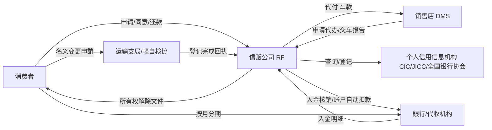

# R01 · 业务定源与法务裁决清单

> **签字用文档**。本文件是全仓 `[待定源 C-01~C-12]` 的**唯一登记处与签字视图**（编号权威源见 `R00 §9`）。
> ⚠️ **本文只列「适用可能性与影响」，不冒充法务结论**。凡涉及适用法规、登记形态、总量规制、
> 法定书面文件、冷静期、APPI 效力判断的，必须取得法务/合规书面意见后方可进入 S1（见 `R11 §6` 门禁）。

---

## 0. 文档控制

| 项 | 值 |
|---|---|
| 文档编号 | `DES-RF-R01` |
| 版本 | v1.0（待评审） |
| 日期 | 2026-11-22 |
| 上游输入 | 用户需求（日本第三方信贩 / 新车零售金融 / C 端 / DMS + 征信局 / 还清解押）、`README §0`、`R00 §2` 术语表、2026-11-22 日本法务术语核实（CIC 官网 / 金融厅 Q&A / 日本贷金业协会 / 分期付款销售法英文概要 / 所有权保留实务资料） |
| 交付性质 | **业务定源草案（签字用）· 非实现** |
| 状态 | 🟢 **系统口径已定源**：`C-01` 用户签字（双形态并行）；`C-02`~`C-12` 由架构 AI 裁决（2026-11-22，用户授权「先定合理方向，后续可按新需求改动」）；**外部事实核实项**逐条标注假设与不符触发器，核实不符走配置覆盖或变更，不悬空 |
| 适用域 | 全仓；`ADR-RF-002` 的上位输入 |

---

## 1. 引用口径

- 法律名称、条文号、期限仅作**「需核实的适用可能性」**列出，不作为本系统已确认的义务。
- 「默认参数」标记为 ⚙️，AI 裁决生效（2026-11-22），核实不符走配置覆盖，**不悬空**；**法务效力判断**（合同效力、合规义务履行）不实现，系统只留痕与闸门提示（分界见 `§8`）。
- 与 floorplan 的口径对照一律写「floorplan 侧（B2B）」，禁止把其已裁决结论平移到 C 端。
- 资金流、狀態、风控口径以本文为准；表与接口分别在 `R06` / `R07` / `R09` 展开。

---

## 2. 头号定源：交易形态（C-01）

### 2.1 为什么必须先定这个

用户描述是「**借给 C 端消费者（买新车）**」+「**还清贷款后解除抵押**」。
但日本信贩公司做新车零售金融的主流实务是 **个品分期（个别信用购买斡旋）**：

> 消费者与销售店签订买卖契约 → 信贩公司**向销售店代付**（代付车款）→ 消费者向信贩**分期支付**
> → 结清前车辆检验合格证「所有者」为信贩公司（**所有权保留**）→ 结清/提前结清后发行解除文件 + **名义变更**。

这与「直接借钱给消费者 + 设定抵押权」在**资金流、法律主体、适用法规、担保登记、额度上限算法、
法定书面文件、征信报送口径**上全部不同。若不先定源，合同模型、审查规则、解押链路都会做错，且属于**合规事故级返工**。

### 2.2 差异矩阵（维度 → 影响）

| 维度 | 形态 A：个品分期（个别信用购买斡旋）✅ 双形态之一 | 形态 B：汽车贷款（汽车贷款）✅ 双形态之一 | 对系统的影响 |
|---|---|---|---|
| 法律关系 | 信贩＝信用购买斡旋业者；消费者＝购买人（分期支付） | 信贩/贷金业者＝出借方；消费者＝借款方 | `Contract` 聚合的条款类型、债权性质字段 |
| **资金流** | 信贩 → **销售店**（代付）；消费者 → 信贩 | 信贩 → **消费者**（或指定销售店账户）→ 消费者还款 | 代付对象、付款指令、收款账户路由完全不同 |
| 适用法规 | 分期付款销售法（个别信用购买斡旋） | 贷金业法（＋分期付款销售法贷款合作销售） | 法定书面文件、标示项目、业者登记 |
| 担保 | **所有权保留**（车辆检验合格证所有者栏），非抵押权 | 原则上无担保 / 或所有权保留 / 例外 | `TitleRetention` 模型、解押链路 |
| 额度上限 | **个别支付能力预估额**（分期付款销售法防止过度授信，需查询指定信用信息机构） | **总量规制 年收入 1/3**（但汽车贷款可能属**除外贷款**；收入证明在单笔 >50 万 / 合计 >100 万日元时要求） | `AffordabilityAssessment` 策略点、收入证明门槛 |
| 征信机关 | CIC（分期付款销售法指定）为主，可并 JICC | CIC / JICC / 全国银行协会（贷金业法指定信用信息机构，**加入与查询为义务**） | 机关组合、报文格式、报送触发 |
| 征信报送 | 合同内容/还款状况的登记（分期付款销售法体系） | 个人信用信息提供义务（贷金业法） | `CreditBureauReport` 报文与周期 |
| 法定书面文件 | 缔约前书面文件 / 交付书面文件（现金価格/支付回数/手续费率等） | 缔约前书面文件 / 合同书（金利/还款期間等） | 书面文件模板与交付留痕 |
| 冷静期 | 个品分期下有适用可能（期间/例外需法务定源） | 原则上不适用 | 契约状态机需 `COOLING_OFF` 分支 |
| 结清 / 解押 | 所有权保留解除 → 名义变更 | 若有所有权保留则同左，否则无解押 | `ReleaseOrder` 是否必经 |
| 提前结清 | 剩余本金 − 约定减免额 + 事务手续费 | 繰上还款（可能無手续费） | 结清金额计算策略 |
| 催收 | 分期付款销售法 + 贷金业法催收規制（時間帯/第三者查阅禁止） | 贷金业法第 21 条 | 催收时段、话术、留痕 |

### 2.3 架构裁决（ADR-RF-002）

**✅ C-01 已定源（2026-11-22 业务方裁决）：双形态并行。**
`TransactionScheme` 枚举两个值**同时首发**——`INSTALLMENT_CREDIT`（个品分期）与 `MONEY_LENDING`（汽车贷款），
**每笔申请必填形态字段，不设兜底默认**；不写两套系统，差异收敛进 **4 个策略点**（Strategy + 配置，不扩散到全链路）：

| 策略点 | 位置 | 说明 |
|---|---|---|
| `StatutoryDocumentPolicy` | `contract` 上下文 | 法定书面文件模板、交付时点、记载事项 |
| `AffordabilityPolicy` | `underwriting` 上下文 | 支付能力预估额 / 总量规制 / 除外贷款判定 |
| `CreditBureauReportingPolicy` | `reporting` 上下文 | 机关组合、报文、周期、异议路径 |
| `SettlementCalculationPolicy` | `loan` 上下文 | 结清/提前结清金额、减免额、手续费 |

**共同链路（不受形态影响，可先行设计）**：申请受理 → 身份核验 → 取得同意 → 征信查询 → 审查判断 →
合同 → 代付/放款执行 → 交车 → 所有权保留（若有）→ 还款计划 → 入金核销 → 结清 → 解除 → 报送。
这也是 S0 阶段可以把 `R02`–`R11` 全部写完的原因。

### 2.4 一个关键核实结论（影响 C-03 / C-05）

无论 A 还是 B，**征信查询都不是可选项**：

- CIC 官网明确：CIC 是**分期付款销售法与贷金业法双方**的指定信用信息机构。
- 分期付款销售法下「个别信用购买斡旋业者」在每笔信用契约前负有**个别支付能力预估额**调查义务，须使用指定信用信息机构保有的信息并记录。
- 贷金业法下面向个人的贷款业者**必须加入**指定信用信息机构、查询总借入余额，并在契约/变更时及时提供个人信用信息。

⟹ **「个人征信局双向对接」是本项目的刚性需求，与 floorplan 的 Q15「本轮不接」正好相反**，见 `R03 §4`、`ADR-RF-005`。

### 2.5 C-02 推定分析（双形态 ⇒ 双登记并存；待登记簿核实）

> **性质声明**：本节是**法律必然性推理**（公开法条可查证），不是公司登记事实。
> 公司实际持有哪些登记属于外部事实，须法务核对登记簿后在 §6 签认。系统按本节推定建模。

**推定 1：C-01 双形态已定源 ⇒ 法律上必须双登记并存。**

- 形态 A（个品分期）：割赋销售法第 35 条之 3 之 23——个别信用购买斡旋业**只有经产省登记簿上的登记法人**才能经营；
  新车金额远超登记豁免基准额（70 万円），**无豁免空间**，未登记经营直接违法。
- 形态 B（汽车贷款）：贷金业法——以业之形态对个人放贷必须登记为**贷金业者**（财务局管辖，登记有效期 3 年，需持续满足
  纯资产额 5,000 万円以上等要件）；信贩公司直贷未登记即属无登记营业。

⟹ 公司若只持其一，另一形态**不能合法营业**。作为同时经营两类产品的信贩，最可能的登记组合是
**「经济产业省：登记个别信用购买斡旋业者」+「财务局：贷金业登记」双登记**，且两个指定信用信息机构（CIC / JICC）均已加入。

**推定 2（连带发现，影响 C-03 / C-04）：自动车担保贷付是总量规制的「除外贷付」。**

- 贷金业法施行规则第 10 条之 21 第 1 项②：**自动车购入时的自动车担保贷付（自动车贷款）属除外贷付**，
  车辆担保覆盖返还额约 1/2 以上时可**不受年收入 1/3（总量规制）限制**，且不计入借入余额。
- **我们的所有权保留模型正是激活该除外贷付的担保要件**——车辆检验合格证「所有者」栏登记为信贩，就是标准意义的自动车担保。
- 由此产生一个**此前未识别的耦合**：`C-04` 若选 `CONTRACTUAL_ONLY`（合同保留所有权但不在合格证上登记），
  担保要件可能不充分 ⇒ `MONEY_LENDING` 形态落入总量规制 ⇒ `AffordabilityPolicy` 的 `MONEY_LENDING` 分支算法完全不同
  （是否计入总量、收入证明门槛、拒绝码都会变）。**C-04 的选择直接改变 C-03 的 B 形态算法前提**，两案须同批裁决。

**除外贷付 ≠ 不受监管**：`MONEY_LENDING` 形态即使适用除外贷付，仍受上限金利（返还期 5 年以内按法定区间 15–20%）、
指定信用信息机构加入与查询义务、收入证明提交义务（约定额 50 万/100 万円门槛）约束。

**法务核实清单（签字前须逐项核对）**：
1. 两个登记的**登记番号与有效期**（贷金业登记 3 年一更新，注意是否临期）；
2. 登记簿**业种区分栏**是否同时覆盖「个品分期斡旋」与「贷金业」；
3. 加入的**指定信用信息机构**清单（CIC / JICC / 全国银行个人信用信息中心）与成员类别；
4. 贷金业登记的**持续适格要件**（纯资产额、内控体制）是否满足。

**对系统的兜底影响**：若核实后发现只持单一登记，缺登记的形态在网关/闸门层禁用即可
（收缩配置 `retail.scheme.enabled`，架构与 4 策略点不变）——这也是双形态策略点设计的又一次价值兑现。

---

## 3. 「解押」口径纠正（C-04 / C-11）

用户所说「解除抵押」在日中实务里对应的是：

```
结清 / 提前结清
   → 信贩発行「所有权解除文件」（所有权解除同意书/转让证明书/授权委托书/印鉴证明书）
   → 销售店 / 行政书士 / 消费者向运输支局（轻型车为轻型汽车检查协会）提出申请
   → 车辆检验合格证的「所有者」由信贩变更为消费者（所有者变更 / 转移登记）
   → 以登记完成的回执作为「解押完成」的唯一依据
```

| 常见误解 | 纠正 |
|---|---|
| 「设定抵押权、还清后抹消抵押登记」 | 自動車金融实务以**所有权保留**为主，`车辆检验合格证` 所有者栏为载体；不是抵押权設定/抹消 |
| 「发行解除文件 = 解押完成」 | **两态分离**：`RELEASE_DOCUMENTS_ISSUED`（文件出具）→ `TITLE_RELEASE_REGISTERED`（登记完成）。实务中「所有权解除」一词常被销售店理解为「出具文件的准备」即止 |
| 「所有权保留一定要登记」 | 存在「合同上保留所有权但不在车辆检验合格证上登记」做法；登记范围需 `[待定源 C-04]` |
| 「结清当天就能解押」 | 需要末回入金核销 + 文件出具 + 外部登记 + 回执，存在跨机构时延 |

系统落地：`R04 §4` 的 `TitleRetentionStatus` / `ReleaseOrderStatus` 双状态机、`R05 §6` 的八步闭环与证据链。

---

## 4. 业务全景（12 步，共同链路）

| # | 环节 | 主体 | 系统动作 | 关键闸门 |
|---|---|---|---|---|
| 1 | **申请** | 消费者 / 销售店 DMS / 门户 | 受理 `Application`，生成 `applicationId`，幂等去重 | G1 身份核验材料 + 同意 |
| 2 | **身份核验** | eKYC / 店端 | 核验身份文件、反社会势力排查 | G2 身份核验完成 |
| 3 | **取得同意** | 消费者 | APPI 使用目的、向第三方提供（征信局）同意留痕 | G3 同意有效 |
| 4 | **征信查询** | 征信局 CIC/JICC/全国银行协会 | 查询 + 结果留痕 + 查询频率控制 | G4 查询成功且授权在有效期内 |
| 5 | **收入证明 / 支付能力** | 消费者 | 工资薪金扣缴凭单/工资单/纳税申报表等受理、`AffordabilityAssessment` | G5 不超上限 |
| 6 | **审查判断** | 审查岗 / 规则引擎 | 承認 / 否決 / 保留（人工复核） | G6 决定留痕 + SOD |
| 7 | **合同/法定书面文件** | 消费者 + 信贩 | 书面文件交付、签订、冷静期期间管理 | G7 书面文件交付留痕 |
| 8 | **代付 / 放款执行** | 信贩 → 销售店 | 生成付款指令，幂等 + 对账 | G8 付款成功回调 |
| 9 | **交车/所有权保留** | 销售店 | 交车报告、车辆检验合格证所有者登记（或契约保留） | G9 登记/契约保留证据 |
| 10 | **还款（账户自动扣款 / 缴款单）** | 消费者 | 还款计划生成、入金核销、DPD 计算 | — |
| 11 | **结清 / 提前结清** | 消费者 | 结清计算、债权终态、停息 | G10 末回核销 + 无未决异议 |
| 12 | **所有权解除/名义变更** | 信贩 → 消费者/运输支局 | 文件出具 → 外部登记 → 回执 → 解押完成 + 征信报送终态 | G11 回执权威确认 |

**资金流（Mermaid）**：



> 注意「代付」方向：**钱给销售店，不是给消费者**。这是 C-01 最容易被画错的一笔。

---

## 5. 风控三支柱与法务问题清单

### 5.1 三支柱（`[待定源 C-03]`、`C-05`、`C-07`）

| 支柱 | 输入 | 系统落点 |
|---|---|---|
| **个人信用** | 征信局查询结果（余额/延滞/异议/申请履歴） | `CreditInquiry` + `DecisionRule`，结果留痕与快照 |
| **收入证明** | 工资薪金扣缴凭单 / 支付报酬明细表 / 工资单(最近 2 个月) / 纳税申报表 / 蓝色申报决算表 / 纳税通知书 / 纳税证明书 / 所得证明书 / 年金证书 等 | `IncomeDocument` 附件（本地存储）+ OCR/人工录入 + 有效期 |
| **支付能力** | 年收入 + 他社借入余额 + 生活費控除 → 支付能力预估额 / 总量规制 | `AffordabilityAssessment`，**公式需 C-03 签字**，系统只给可配置框架 |

补充控制：在职确认（工作单位）、反社会势力排查、身份核验材料有效期、多重申请检出、年龄/国内居住等准入。

### 5.2 日本法务问题清单（**只列问题与影响，不冒充结论**）

> 沿用公司既定范式（floorplan D10 §12）：法务结论必须由法务意见书给出，系统侧标注裁决状态、影响面与外部核实项。

| # | 问题 | 若适用，对系统的影响 | 关联 |
|---|---|---|---|
| L-1 | 分期付款销售法（个别信用购买斡旋业者）是否适用、登记形态 | 书面文件项目、防止过度授信、冷静期、标示义务 | C-01/C-02/C-08 |
| L-2 | 贷金业法是否适用、贷金业者登记 | 总量规制、指定信用信息机构加入/查询/提供义务、上限金利 | C-01/C-02/C-03 |
| L-3 | 总量规制（年收入 1/3）与**除外贷款**（汽车贷款等）的边界 | 上限算法是否启用、收入证明门槛（50万/100万） | C-03 |
| L-4 | 个别支付能力预估额 / 综合支付能力预估额 的计算口径 | 审查规则、系数配置、拒绝码 | C-03 |
| L-5 | 所有权保留的对抗要件与车辆检验合格证登记范围 | 是否每条契约都登记、解押链路是否必经 | C-04/C-11 |
| L-6 | 犯罪収益移転防止法（身份核验/交易时确认）与 eKYC 可接受性 | 身份核验流程、文件种类、保存年限 | C-07 |
| L-7 | 个人信息保護法（APPI）：使用目的特定、向第三方提供同意、查阅/更正/停止使用、保留期限、削除 | `Consent` 模型、PII 访问控制、`pii_access_logs`、跨境与委托方管理 | C-06 |
| L-8 | 个人编号（个人编号）能否采集、可用范围 | 原则上**不采集**，如需则另建隔离域 | C-06/C-07 |
| L-9 | 反社会势力排除条款与排查方式 | 审查闸门、外部服务或人工名单 | C-07 |
| L-10 | 法定书面文件（签订前/交付）与電子合同 / 電子书面文件交付的可接受性 | 书面文件模板、交付留痕、时间戳 | C-08 |
| L-11 | 冷静期期间、例外、行使后的恢复原状 | 契约状态机分支与解约清算 | C-08 |
| L-12 | 提前结清的减免额 / 事务手续费 的合法上限 | 结清金额计算与表示 | C-10 |
| L-13 | 贷金业法第 21 条催收規制（時間帯/第三者查阅禁止） | 催收时段硬约束、话术模板、投诉记录 | C-05 |
| L-14 | 个人信用信息机构的异议申诉/查阅请求对应 SLA | 异议流程、报送订正、客户通知 | C-05/C-06 |
| L-15 | 消費税 / 印紙税 / 手续费表示（実質年率/支付総額） | 书面文件与接口字段 | C-08 |
| L-16 | 与销售店的加盟店合同/代办合同（个人信息委托/共同使用） | `DealerAgreement`、责任分界、数据提供边界 | C-12 |

---

## 6. `[待定源 C-01 ~ C-12]` 签认表（**全仓唯一登记处**）

> 状态标：✅ 已签字 / 🟦 **AI 裁决**（2026-11-22 用户授权，系统口径生效；标注「待核实」的外部事实不符时按触发器改）。
> **签认进度**：`C-01` 用户签字；`C-02`~`C-12` AI 裁决。法务/合规后续核实结论**优先级高于 AI 裁决**，核实不符 → 改配置或按 §8 变更流程回灌，不重开阻塞。
> 登记新 C 项必须同批进本表，否则 `scripts/check_docs.py` 判失败。

| 编号 | 事项 | 裁决值（系统口径生效） | 若改口径的影响面 | 原裁决角色 | 状态 |
|---|---|---|---|---|---|
| `C-01` | **交易形态** | **双形态并行**——`TransactionScheme` 首发双值 `INSTALLMENT_CREDIT` / `MONEY_LENDING`，每笔申请必填 | 形态差异已收敛进 4 策略点（`ADR-RF-002` Accepted） | 业务（用户裁决） | ✅ 已签字 |
| `C-02` | 适用法规清单与业者登记形态 | **系统按双登记建模**（经济产业省 登记个别信用购买斡旋业者 + 财务局 贷金业登记，推定见 `§2.5`）；网关/闸门按「形态 × 登记」矩阵放行；**核实缺登记 → 收缩 `retail.scheme.enabled` 禁用该形态**，架构不变 | 书面文件项目、金利上限、登记番号表示 | AI（推定 + 兜底设计） | 🟦 AI 裁决（登记簿 4 项待核实） |
| `C-03` | 总量规制 / 个别支付能力预估额 适用与算法 | **A 形态**按个别支付能力预估额框架实现（调查义务、系数可配、拒绝码枚举预留）；**B 形态按自动车担保除外贷付建模**（不计总量规制，依据 `§2.5`），保留上限金利与收入证明义务门槛（50 万/100 万日元）；**默认公式实现 + 配置覆盖**，不悬空等签字 | 审查规则、拒绝码、收入证明门槛；C-04 改变 B 形态算法前提 | AI（法条依据已核实） | 🟦 AI 裁决（官方系数待核实） |
| `C-04` | 所有权保留登记范围 | **`REGISTERED`（每条契约登记）**——三重理由：①自动车担保除外贷付的担保要件（`§2.5`）②解押链路唯一依据 ③对抗要件。`CONTRACTUAL_ONLY` 保留配置位但 S1 不实现、不测试 | `TitleRetention` 状态机、解押链路；若改 → 触发 `C-03` B 形态算法重算 | AI（与 C-03 耦合，须同批改） | 🟦 AI 裁决 |
| `C-05` | 征信局组合 / 报送周期 / 异议 SLA | **CIC + JICC 双机构成员**（双形态两法各自强制，`§2.4`）；查询双机构，报送主 CIC；报送 T+1；异议 30 日（可配） | 集成链路、报文、定时任务、合规审计 | AI（法条依据已核实） | 🟦 AI 裁决（成员类别与接口待核实） |
| `C-06` | APPI 使用目的 / 向第三方提供同意 / 保留期限 / 查阅请求 | 使用目的逐项登记；征信提供**单独同意**；保留期 5 年（可配）；**不采集个人编号**；查阅/订正/停止使用 30 日内响应 | PII 模型、同意管理、删除/匿名化、审计 | AI | 🟦 AI 裁决 |
| `C-07` | 身份核验 / eKYC / 反社会势力排查 | **文件 + 人工核验起步**（犯罪收益转移防止法交易时确认）；eKYC 端口预留不实现；反社会势力排查排查走名单 + 人工，不接外部排查服务 | 申请闸门、附件类型、外部集成 | AI | 🟦 AI 裁决 |
| `C-08` | 法定书面文件与冷静期 | 书面文件模板可配置 + 交付留痕 + 时间戳；**冷静期按 8 日实现**（占位参数，核实不符改配置即生效） | 契约状态机、书面文件交付留痕 | AI | 🟦 AI 裁决（期间与例外待法务核实） |
| `C-09` | 收款渠道与首期兜底 | **账户自动扣款为主 + 缴款单兜底**；设定前置期 60 日（可配） | 还款计划、首期收款、入金核销 | AI | 🟦 AI 裁决 |
| `C-10` | 提前结清计算与解押触发 | **剩余本金 − 减免额 + 手续费**（公式默认实现，参数可配）；末回核销后触发解除 | 结清金额、解押闸门、报送终态 | AI | 🟦 AI 裁决（减免上限待核实） |
| `C-11` | 所有权解除的确认权威方与回执效力 | **外部登记回执为唯一权威**；`MANUAL` 代录仅中间态不等于完成；回执超时 30 日升级人工跟进 | 解押状态机、证据链、审计 | AI | 🟦 AI 裁决 |
| `C-12` | 销售店主数据共享方式 / 加盟店合同 | 与 floorplan **共享主数据、隔离角色与账户**；只读接口同步（`ADR-RF-010`） | `DealerPartner`、账户、额度归户、数据提供边界 | AI | 🟦 AI 裁决 |

**签认记录**：

| 日期 | 编号 | 角色 | 结论 | 影响文档 |
|---|---|---|---|---|
| 2026-11-22 | `C-01` | 业务（用户裁决） | **双形态并行**：个品分期 + 汽车贷款同时做；`TransactionScheme` 双值首发，每笔申请必填形态 | `ADR-RF-002`（Proposed→Accepted）、`R00 §3.8 §9`、`R01 §2 §6 §7`、`R02 §0 §8`、`R04 §0`、`R10 §0 §7`、`R11 §2 §5 §6 §8`、`README`、`PROGRESS`、`00` |
| 2026-11-22 | `C-02`~`C-12` | 架构 AI（用户授权「先定合理方向，后续可按新需求改动」） | **系统口径全部裁决**为 §6 表列值；外部事实项按标注假设建模（登记簿、征信接口、冷静期期间、减免上限），**核实不符 → 配置覆盖或按 §8 变更流程回灌，不悬空、不阻塞**；法务/合规核实结论优先级高于 AI 裁决 | `R01 §6 §7`、`R02`、`R04`、`R05`、`R07`、`R08`、`R09`、`R10`、`R11`、`PROGRESS`（同步见各文档本轮变更记录） |

后续签字在此追加行，并同步 `PROGRESS §4` 与对应 ADR 状态。

---

## 7. 参数默认值汇总（⚙️，可直接配置，不阻塞运行）

> 这些是**系统默认参数**（AI 裁决，2026-11-22 生效），不是法务结论。业务/法务后续给不同书面口径 → 走配置覆盖，不改代码、不重开「待确认」状态。

| 参数键 | 默认值 | 出处 |
|---|---|---|
| `retail.scheme.enabled` | `INSTALLMENT_CREDIT,MONEY_LENDING` | ✅ C-01 已签（2026-11-22 双形态并行） |
| `retail.scheme.required-on-application` | `true`（每笔申请必填形态，无兜底默认） | ✅ C-01 已签 |
| `retail.scheme.registration-matrix-strict` | `true`（网关按「形态 × 登记」矩阵放行，缺登记形态禁用） | 🟦 C-02 |
| `retail.underwriting.bureau-combination` | `CIC,JICC`（查询双机构；报送主 CIC） | 🟦 C-05 |
| `retail.underwriting.affordability-threshold` | A 形态个别支付能力预估额框架（系数可配）；B 形态除外贷付路径（不计总量） | 🟦 C-03 |
| `retail.underwriting.income-doc-required-single` | 500000 日元 | 🟦 C-03 / L-3 |
| `retail.underwriting.income-doc-required-total` | 1000000 日元 | 🟦 C-03 / L-3 |
| `retail.consent.retention-years` | 5 | 🟦 C-06 |
| `retail.contract.cooling-off-days` | 8（占位参数，核实不符改配置） | 🟦 C-08 |
| `retail.payment.direct-debit-lead-days` | 60 | 🟦 C-09 |
| `retail.bureau.report-cron` | T+1 每日 | 🟦 C-05 |
| `retail.bureau.dispute-sla-days` | 30 | 🟦 C-05 |
| `retail.title.release-require-last-payment` | `true` | 🟦 C-10/C-11 |
| `retail.title.registration-receipt-timeout-days` | 30 | 🟦 C-11 |
| `retail.core.strict-sod` | `false`（**生产须置 true**） | `R08 §4` |
| `retail.collection.allowed-hours` | 法定时间带（L-13 核实后配置；S1 先按 21:00–09:00 禁止催收占位） | L-13 |

---

## 8. 「定口径」≠「已实现」（防止假绿）

| 标记 | 本文中的用法 |
|---|---|
| ✅（签字） | 用户裁决（C-01），最高优先级 |
| 🟦 | **AI 裁决**（2026-11-22 用户授权）：系统口径生效，默认公式/参数可据以实现；标注「待核实」的外部事实不符时 → 配置覆盖或变更流程，法务/合规核实结论优先级更高 |
| ⚙️ | 可配置参数，核实不符时改配置即生效，不改代码 |
| 📌 | 系统骨架（接口、留痕、状态字段）可先行 |
| 🌐 | 真实外部事实（接入审查周期、对方确认状态）——协议口径已于 2026-11-24 内部裁决（`R07 §3 §7`）；系统不凭空对接，接口预留 + 人工留痕 |

**「实现业务规则」≠「实现法务效力判断」**：S1 起按本表实现的是**可配置的业务规则与默认公式**
（预估额计算、书面文件模板、冷静期倒计时、报送排程）；**法务效力判断**（合同是否合法成立、
冷静期是否合法行使、报送义务是否合规履行）始终是人工/外部职责，系统只留痕与闸门提示。

**明确不改变的事实**：
- 不把 `C-xx` 的 AI 裁决值说成已签字；法务/合规核实结论优先级高于 AI 裁决；不改 floorplan 任何既有 ADR；不把「双形态」写死成不可变更的法律结论。
- 不引入 MQ / Seata / 对象存储；文件/附件继续本地。
- 系统实现业务规则与默认公式，但不实现**法务效力判断**（见 §8 分界说明）。

---

## 9. 自检

| 检查项 | 结果 |
|---|---|
| 是否含「文档控制 / 引用口径 / 自检」三节 | ✅ §0 / §1 / §9 |
| `C-01~C-12` 是否 12 项齐全且与 `R00 §9` 一一对应（双向差集 ∅） | ✅ §6 |
| 是否明确「只列问题与影响，不冒充法务结论」 | ✅ §0 / §5.2 |
| 头号口径 C-01 是否给出差异矩阵、架构裁决、共同链路 | ✅ §2 |
| 是否解释「解押」= 所有权保留解除 + 名义变更，且两态分离 | ✅ §3 |
| 资金流是否画对「代付 → 销售店」 | ✅ §4 Mermaid |
| 是否标明征信查询在两种形态下均为刚性需求 | ✅ §2.4 |
| 参数默认值是否逐项标注裁决状态、可配置覆盖 | ✅ §7（C-01 用户签；C-02~C-12 AI 裁决；外部核实项标注） |
| 是否与 `PROGRESS §3 §4 §5` 的状态一致 | ✅ S0 系统口径已定源，外部核实项转非阻塞跟踪 |
| 是否声明本文件是规格而非实现 | ✅ §0 §8 |
