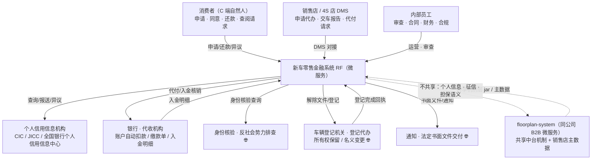
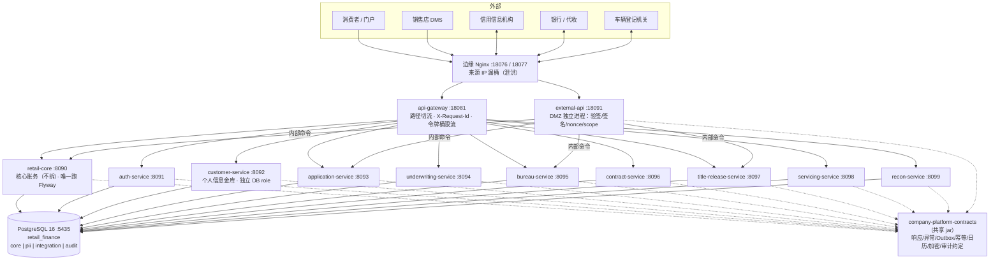
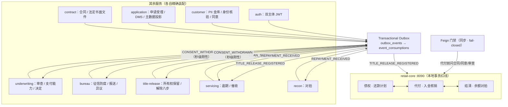

# R02 · 总体架构设计（C4）

> **定位**：微服务架构的目标态全貌（架构规格）。**该目标态已由 S1–S5 落地并经走网关冒烟 + E2E 验证**
> （16 模块、Flyway V1–V17 共 60 表、构建 389 测试 0 失败、冒烟 26/26、E2E 98/98，见 `PROGRESS §6`）。
> 用户已明确：floorplan 已是微服务架构，本项目**直接对齐**，不做「先单体后演进」。
> 核心判断：**拆分的判据是一致性边界和数据归属，不是业务名词是否像一个域**；
> 因此外围按限界上下文拆成独立服务，**核心账务留在一个服务里守住事务红线**。

---

## 0. 文档控制

| 项 | 值 |
|---|---|
| 文档编号 | `DES-RF-R02` |
| 版本 | v2.0（按微服务架构重写） |
| 日期 | 2026-11-22 |
| 上游输入 | `R00`（命名）、`R01`（业务定源，C-01 待签）、`R03`（中台边界）、`../floorplan-system/README.md` 与 `docs/库存融资核心系统-目标微服务架构设计.md`（微服务基线）、用户 2026-11-22 指示 |
| 交付性质 | **目标态架构设计（规格，非实现）** |
| 状态 | 设计完成；`C-01` 用户签（双形态并行）；`C-02`~`C-12` AI 裁决（2026-11-22，`R01 §6`），外部核实项不改变本架构 |
| 关联 ADR | `ADR-RF-001`（微服务）、`ADR-RF-003`（中台边界）、`ADR-RF-009`（独立库） |

---

## 1. 引用口径

- 「部署单元 / 服务 / 进程」在本文同义；「上下文」是逻辑边界，按 §5 落到服务。
- 引用外部方一律标 🌐（能力未核实）；引用 floorplan 一律标「基线事实」。
- 所有「为什么这样拆」必须给被拒选项，见 §12；没有权衡的架构结论一律不写。
- 端口、号段、前缀以 `R00 §6 §7` 为准；文档全文中文。

---

## 2. C4 · L1 系统上下文



| 外部方 | 方向 | 本系统必须守住的边界 |
|---|---|---|
| 消费者 | 入站（门户/BFF）+ 出站（书面文件/通知） | 客户身份自成体系；个人信息最小化；法定书面文件交付留痕 |
| 销售店 DMS | 双向 | **必经防腐层**；申请代办 ≠ 债务人；加盟店合同与 floorplan 融资合同分开 |
| 信用信息机构 | 双向 | 独立防腐上下文；查询须有同意；报送/异议全留痕 |
| 银行 / 代收 | 双向 | 入金明细以文件/接口两路并存；人工路径一等公民 |
| 身份核验 / 反社会势力排查 | 出站 | 接口预留，人工核验起步（C-07） |
| 车辆登记机关 / 登记代办 | 出站 + 回执入站 | **出具文件 ≠ 登记完成**；回执是唯一权威（C-11） |
| 通知 / 书面文件 | 出站 | 法定书面文件交付留痕，不假定有服务商 |
| floorplan | 共享 | 只共享机制层与主数据；**语义层显式切断**（`R03 §4`） |

---

## 3. C4 · L2 容器（12 个部署单元）



| # | 服务 | 端口 | 职责 | 数据真相源 |
|---|---|---|---|---|
| 1 | `api-gateway` | 18081 | 路径切流、`X-Request-Id`、客户/员工 BFF 入口、**令牌桶限流**（`retail.ratelimit.*`，见 §3.3） | — |
| 2 | `external-api` | 18091 | **DMZ**：入站验签、出站签名、nonce、partner scope、调用留痕 | `integration.*` |
| 3 | `retail-core` | 8090 | **核心账务（不拆）**：债权、还款计划、代付、入金核销、结清；**唯一跑 Flyway** | `loans` `repayment_plans` `schedule_items` `disbursements` `payments` `payment_allocations` |
| 4 | `auth-service` | 8091 | 员工侧 + 客户侧双主体 JWT 签发/验签 | `users` `user_roles` `pii.customer_identities` |
| 5 | `customer-service` | 8092 | 自然人主数据 + **个人信息金库** + 身份核验 + 同意 | `pii.*` |
| 6 | `application-service` | 8093 | 申请受理 + DMS 代办 + 审查结果回传 + **销售店主数据唯一投影** | `applications` `application_items` `dealer_partners` `dealer_agreements` |
| 7 | `underwriting-service` | 8094 | 审查授信、支付能力评估、决定、职责分离 | `underwriting_cases` `affordability_assessments` `income_documents` `decision_rules` |
| 8 | `bureau-service` | 8095 | 征信机构防腐：查询 / 报送 / 异议申诉 | `credit_inquiries` `integration.credit_bureau_reports` `bureau_disputes` |
| 9 | `contract-service` | 8096 | 合同 + 法定书面文件交付留痕 | `contracts` `statutory_documents` |
| 10 | `title-release-service` | 8097 | 所有权保留 + 解除八步 + 外部登记回执 | `title_retentions` `release_orders` `release_documents` `registration_receipts` |
| 11 | `servicing-service` | 8098 | 贷后逾期天数 / 催收 / 征信报送触发 | `collection_cases` `dpd_snapshots` |
| 12 | `recon-service` | 8099 | INV-1~5 对拍与差异 | `recon_runs` `recon_diffs` |

> **边缘层（部署形态件，非 12 部署单元之一）**：入口 Nginx（18076 前置内部网关、18077 前置外部 DMZ），
> 配置见 `nginx/nginx.conf`。它不占 Java 部署位，但**限流能力的一半在它身上**（§3.3）。

### 3.1 与 floorplan 对齐的四条工程范式

1. **精确装配**：每服务 `@SpringBootApplication(scanBasePackages = 自身包)` + `@Import` 按类注入
   所需用例与仓储；`application` / `infrastructure` 是共享 jar，但每服务只装自己那几个类。
2. **网关切流**：精确规则在前、`/api/**` 兜底到 `retail-core` 在后，首个匹配即命中；
   URI 双模 `${ROUTE_*:lb://服务名}`，本地无 Nacos 时用环境变量覆盖直连。
   `/external/**` 走 **DMZ 独立端口 18091**，不经过内部网关（网络隔离不能靠同一应用加路径）。
   典型切流：`/api/auth/**`→auth、`/api/customers|identity|consents/**`→customer、
   `/api/applications/**`→application、`/api/underwriting/**`→underwriting、
   `/api/credit-inquiries|bureau-reports|bureau-disputes/**`→bureau、`/api/contracts/**`→contract、
   `/api/release-orders|title-retentions/**`→title-release、`/api/collection-cases/**`→servicing、
   `/api/recon/**`→recon，其余 `/api/**`→retail-core。
3. **JWT 零信任**：员工侧全服务同密钥本地验签，客户侧独立密钥；**网关本阶段不验签**，鉴权下沉各服务；
   Feign 调用必须由 `RequestInterceptor` **透传 JWT**（floorplan 曾出现「契约写了但没透传」导致门禁走 fallback）。
4. **第一版共用一个库**：服务拆开、数据不拆 —— 库 `retail_finance:5435` 内按
   `core` / `pii` / `integration` / `audit` 四个 schema 分组，**不跨库关联、不引入分布式事务**。
   独立实例是**相对 floorplan** 而言（`ADR-RF-009`）。每类数据只有一个权威写者（§6），
   跨服务只读走 Feign 或事件，**禁止跨域直写他表**。

> ⚠️ 「微服务」不等于「每个服务一个库」。对齐 floorplan 的务实做法：先划清边界，数据隔离留到后面。

### 3.2 明确不建的东西

不建「只有启动类、没有业务能力」的空服务骨架（floorplan Wave 0 的真实教训，被其 `AGENTS.md`
列为反模式第 1 条）；不预先每服务独立库；不引 MQ / Seata；不把网关当验签点。

### 3.3 限流设计（双层：边缘 Nginx + 网关令牌桶）

**结论**：限流分两层——**网关层管业务配额，边缘层管连接级泄洪**。两层不是重复建设。

| 层 | 实现 | 算法 | 计数维度 | 落点 |
|---|---|---|---|---|
| 边缘 | Nginx `limit_req` / `limit_conn` | 漏桶 + 突发队列 | 来源 IP | `nginx/nginx.conf`（18076 / 18077） |
| 网关 | 令牌桶（进程内） | token bucket | 路由段 × 客户端 IP | `gateway/.../ratelimit/`（`retail.ratelimit.*`） |

**网关层口径**：

- 计数键 = 命中的**路由段**（最长前缀匹配：`/api/auth/`、`/api/applications/`、`/api/consents/` …）
  + **客户端 IP**；同段不同客户端各算各的，同一客户端不同段互不挤占。
- 桶容量 = 突发额度，补充速率 = 稳态吞吐；被拒返回 **429 + `RF_GATEWAY_001`** +
  `Retry-After` + `X-RateLimit-Limit/Remaining/Reset`，响应体沿用统一 `ApiResponse` 结构。
- 限流在**路由转发之前**判定：被限流的请求不打到下游，不占数据库连接。
- **可信代理口径**：默认**不采信** `X-Forwarded-For`（`trusted-proxy-cidrs` 默认为空），
  直连来源不在可信网段时只认 TCP 直连地址——否则「换一个头就能重置限流」。
  边缘 Nginx 部署时**必须**把 Nginx 网段登记进去，否则所有客户端共享同一个桶
  （正常流量被误伤、攻击流量共享额度，等于没限）。
- **不写个人信息**：429 响应体与网关日志都不含客户端 IP（IP 属可识别个人信息的标识符，`R08 §5`）；
  要定位来源看边缘 Nginx 的访问日志。
- 桶在进程内存里 → **单实例口径**：网关多副本时实际放行量 ≈ 单副本额度 × 副本数。
  演进触发器：网关副本数 ≥ 2 且单副本额度已按总量校准 → 届时评审分布式桶（本轮不引 Redis，`AGENTS.md` B-10）。

**边缘层口径**：`limit_req_zone $binary_remote_addr` 按来源 IP 限速（`burst` = 突发额度，
`nodelay` = 突发额度直接放行不排队），`limit_conn` 限制单来源并发连接；
429 响应体同样走统一响应结构（`details.layer=edge`）。**两层参数各自独立**，
不要指望一层的配额替另一层兜底。

**验收**：`scripts/smoke_ratelimit.py`（真起网关进程打真实 HTTP）覆盖 429 语义、`Retry-After`、
计数键隔离、伪造转发头无效、路径级分级、限流开关、令牌恢复，共 26 条断言；
`scripts/smoke_ratelimit_edge.py`（WSL + 真实 nginx 1.28.3）覆盖边缘层与**双层联动**，共 13 条断言
（`nginx -t` 校验交付配置 → 突发放行/超额 429 统一响应体 → 代理头透传 → 真实 nginx 前置真实网关时
同客户端被**网关层**拒绝、换客户端独立放行）。

---

## 4. C4 · L3 组件（服务内部与服务间）



**服务内部**：四层 DDD（`controller → application → domain ← infrastructure`），
`domain` 零 Spring；状态变更走聚合方法；事务边界只在 application。
**服务间**：同步只用于门禁，异步只用于事后同步；模块/服务间**不共享仓储实例、不跨域直写表**。

---

## 5. 限界上下文与上下文映射

### 5.1 上下文清单（10 个业务上下文 + 2 个横切层 → 服务归属）

| # | 上下文 | 聚合根（`R04`） | 归属服务 | 真相源 |
|---|---|---|---|---|
| BC-1 | 申请受理 | `Application` | `application-service` | `core.applications` |
| BC-2 | 身份核验与同意 | `Customer` / `IdentityVerification` / `Consent` | `customer-service` | `pii.*` |
| BC-3 | 审查授信 | `UnderwritingCase` / `AffordabilityAssessment` | `underwriting-service` | `core.underwriting_cases` |
| BC-4 | 征信集成（防腐层） | `CreditInquiry` / `CreditBureauReport` | `bureau-service` | `core.credit_inquiries` + `integration.*` |
| BC-5 | 合同与法定书面文件 | `Contract` / `StatutoryDocument` | `contract-service` | `core.contracts` |
| BC-6 | 债权与代付 | `Loan` / `RepaymentPlan` / `Disbursement` | **`retail-core`** | `core.loans` |
| BC-7 | 还款与入金核销 | `Payment` / `PaymentAllocation` | **`retail-core`** | `core.payments` |
| BC-8 | 所有权保留与解除 | `TitleRetention` / `ReleaseOrder` | `title-release-service` | `core.title_retentions` |
| BC-9 | 贷后与催收 | `CollectionCase` / `DpdSnapshot` | `servicing-service` | `core.collection_cases` |
| BC-10 | 销售店渠道 | `DealerPartner` / `DealerAgreement` | `application-service`（唯一投影） | `core.dealer_partners` |
| X-1 | 合规与审计（横切） | `AuditEvent` / `PiiAccessLog` | 各服务 + `audit` schema | `audit.*` |
| X-2 | 平台机制（横切，共享 jar） | 响应/异常/Outbox/幂等/日历/加密 | `company-platform-contracts` | — |

> BC-6 与 BC-7 在**同一本地事务**内协同（核销必须同步改债权余额），因此落到**同一个服务**
> `retail-core` —— 这正是「核心账务不拆」的判据：一致性边界 > 业务名词。
> `title-release-service` 独立，因为它是跨机构异步协同，节奏与核心账本完全不同
> （对齐 floorplan 把放车放证从核心账务拆出的判据）。

### 5.2 上下文映射矩阵

| 关系 | 上游 | 下游 | 说明 |
|---|---|---|---|
| **共享内核** | `company-platform-contracts` | RF + floorplan | 只含**机制**：响应/异常骨架/Outbox/幂等/日历/加密端口/金额时间审计约定。两项目共同维护，变更需双方评审 |
| **客户—供应商** | floorplan 的**销售店主数据**（权威写者） | RF `application-service`（只读投影 / 遵从者） | 同一批法人，RF 只读同步、**不反向写**；角色/账户/额度隔离见 `ADR-RF-010` |
| **防腐层** | DMS / 征信机构 / 银行 / 身份核验 / 登记代办 | 各业务服务 | 每个外部方一个适配器，外部报文 → 内部命令；见 `R07` |
| **伙伴关系** | RF 架构侧 | floorplan 架构侧 | 中台 jar 版本、端口段、号段、前缀共同登记；见 `R03 §6` |
| **各行其道** | — | — | floorplan 的**让与担保登记 / 担保门禁 / 放车放证 / 经销商额度 / 在库计息 / 对拍规则**在 C 端无对应物，**明确废弃**，见 `ADR-RF-006` |
| **服务间（内部）** | 各服务 | 各服务 | Feign 门禁（同步）+ outbox 事件（异步）；不跨域直写表 |

### 5.3 唯一真实业务交汇点：销售店

> floorplan 的「经销商（法人债务人）」与本项目的「销售店（加盟店/代付对象/申请代办）」**是同一批法人**。
> - ✅ 共享：法人识别、名称、住址、联系方式、营业状态。
> - ❌ 隔离：floorplan 的额度 / 垫款 / 担保登记；RF 的加盟店合同 / 代付收款账户 / 代办权限。
> - 规则：**RF 不写 floorplan 库**；主数据由 `application-service` 做**唯一投影**，其余服务通过
>   `DealerPartnerQueryClient` 读取；同步失败降级为「人工录入 + 标记未同步」，不阻塞申请。

---

## 6. 数据真相源（每类数据只有一个权威写者）

| 数据 | 权威写者（服务） | 其他方怎么访问 | 禁止 |
|---|---|---|---|
| 客户个人信息 | `customer-service` | 只经个人信息服务接口，返回脱敏/按需解密 | 其他服务直查 `pii.*` 表 |
| 申请 | `application-service` | 只读接口 | 外部报文直落 |
| 审查决定 | `underwriting-service` | 事件 `UNDERWRITING_*` | 其他服务改判定 |
| 征信查询 / 报送留痕 | `bureau-service` | 只读 + 事件 | 业务服务直接调征信机构 |
| 合同与书面文件 | `contract-service` | 只读 | 跳过书面文件交付留痕 |
| 债权 / 还款计划 / 余额 | `retail-core` | **同事务内** BC-7；外部只读 | 缓存余额字段（必然漂移） |
| 入金 / 核销 | `retail-core` | 事件 `REPAYMENT_RECEIVED` | 重复核销 |
| 所有权保留 / 解除 | `title-release-service` | 事件 `TITLE_*` | 把出具文件当解除完成 |
| 逾期天数 / 催收 | `servicing-service` | 只读 | 其他服务改逾期天数 |
| 销售店主数据 | **floorplan（外部权威）** | RF 只读投影 | RF 反向写 |
| 审计 | 横切 | 只追加 | 更新 / 删除 |

**Redis 边界**：若将来引入，只做幂等去重与短时锁，**绝不缓存债权余额 / 个人信息 / 审查结果**。

---

## 7. 通信设计

### 7.1 同步：只用于门禁（fail-closed）

```
retail-core 代付前 ──Feign──> contract-service    合同已生效且书面文件已交付？
                  ──Feign──> customer-service    同意有效且未撤回？
                  ──Feign──> underwriting-service 审查已批准？
              三者 OK → retail-core 本地事务代付（行锁 + 唯一约束）
```

- 调用失败、超时、返回 UNKNOWN、fallback 一律**拒绝代付** —— 金融门禁宁可误拒不可放过。
- 超时 2s，不重试或最多一次幂等重试；长重试会拖垮代付链路。
- Feign 必须透传 JWT（`RequestInterceptor`）；契约一律返回 `ApiResponse<T>`；
  `contextId` 与属性键按 `R09 §7` 冻结。
- 征信查询**不在代付同步链路上**：查询发生在审查阶段，结果落库快照；代付时读本地快照。

### 7.2 异步：事后状态同步（Transactional Outbox）

| 事件 | 生产方 | 消费方 | 允许时延 |
|---|---|---|---|
| `REPAYMENT_RECEIVED` | `retail-core` | `servicing-service` / `recon-service` | 秒级 |
| `LOAN_SETTLED` | `retail-core` | `title-release-service` / `servicing-service` | 秒级 |
| `RELEASE_DOCUMENTS_ISSUED` | `title-release-service` | 审计 / 通知 | 分钟级 |
| `TITLE_RELEASE_REGISTERED` | `title-release-service` | `retail-core` / `servicing-service` / 通知 | 跨机构，小时~日 |
| `CONSENT_WITHDRAWN` | `customer-service` | `underwriting-service` / `bureau-service` | **秒级，合规刚性** |
| `UNDERWRITING_APPROVED` | `underwriting-service` | `application-service` / `contract-service` | 秒级 |

- outbox 本地消息表 + `@Scheduled` 投递；消费幂等键 `(event_id, consumer)`；3 次失败置 DEAD。
- **不引 MQ / Seata**：AT 模式全局锁 + 回滚日志在金融账务上风险过高；每环可验证、可排障、可重放。
- **事件载荷禁个人信息**（`ADR-RF-007`、`R09 §5`）；聚合键一次发生一个值。

### 7.3 明确不用 Seata

对齐 floorplan 的结论：Feign 门禁（即时拦截）+ outbox 幂等补偿（事后同步）足够，
每一环都可验证，不需要分布式事务框架。

---

## 8. 五条可证伪不变式（INV-1 ~ INV-5）

| # | 不变式 | 证伪实验 |
|---|---|---|
| **INV-1** | 一份合同的代付**只发生一次**，金额 = 合同约定金额 | 同一合同号 + 不同幂等键重复请求，第二笔必须被拒且账本无第二条 |
| **INV-2** | 债权余额 ≡ 代付金额 + 手续费/利息 − 已核销本金（**精确相等，不容差**） | 构造部分还款 / 提前结清 / 超额入金，逐笔对拍，不等即报差异 |
| **INV-3** | `RELEASE_DOCUMENTS_ISSUED` 只能在债权终态之后；`TITLE_RELEASE_REGISTERED` 必须有**外部登记回执** | 未结清触发解除 → 必须 422；伪造内部代录回执 → 不得进入已登记 |
| **INV-4** | 任何 outbox 事件载荷**不含个人信息字段** | 扫描白名单外的键（姓名/住址/生日/年收入/账号/证件号），命中即失败 |
| **INV-5** | 任何征信查询/报送都有**未撤销的同意**与留痕 | 撤回同意后发起查询 → 必须被拒；留痕表缺行 → 报差异 |

> INV-2 的「精确相等」沿用公司硬口径：对拍判定两数**精确相等才无差异**，不做容差、不做舍入猜测。

---

## 9. 质量属性分析

| 属性 | 目标 | 手段 | 权衡（放弃了什么） |
|---|---|---|---|
| **正确性 / 一致性** | 账务零差异 | 核心账务单服务单事务、行锁、唯一约束、INV-2 对拍 | 放弃账务层水平扩展；靠纵向扩容与读分离 |
| **合规性 / 隐私** | 个人信息保护法可审计 | 个人信息独立 schema + 字段级加密 + 访问日志 + 双主体 + 事件禁个人信息 | 放弃「一个通用用户表」的便利；查询需经个人信息服务 |
| **可靠性** | 外部方故障不拖垮主链路 | 查询异步化 / 防腐层 / 人工路径一等公民 / outbox 重试 + DEAD / fail-closed 门禁 | 放弃「全流程实时自动化」 |
| **可维护性** | 边界清晰、依赖单向 | DDD 四层 + 精确装配 + 命名定源 `R00` + 反模式清单 | 放弃「快速全包扫描」的便利 |
| **可观测性** | 跨服务可排障 | `traceId` 贯穿、`audit_events`、`call_logs`、`batch_runs`、outbox 消费游标 | 审计只追加，存储增长 |
| **可逆性** | 法务形态变更可回灌 | 4 个策略点、配置化参数 | 放弃「一步到位的完美架构」 |
| **可伸缩性** | 按服务独立扩容 | 双层限流（边缘 Nginx + 网关令牌桶，§3.3）；读侧可加只读副本 / BFF | 网关桶为单实例口径；第一版共库；个人信息与账务不缓存 |
| **独立发布** | 服务可单独上线 | 精确装配 + 契约冻结 + 每服务独立断言 | 放弃「一次发布全部」的简单 |

---

## 10. 服务边界再调整触发器（何时合并 / 再拆）

> 架构已按微服务落地；本节不再是「什么时候拆」，而是**边界不对时怎么调整**。

| 触发条件（满足任一即启动评审） | 建议动作 |
|---|---|
| 某两个服务每周因同一需求同步发布 ≥2 次且无独立伸缩需求 | 评审合并为一个服务 |
| 某服务峰值流量 ≥ 核心账务 5 倍且拖累共库 | 评审独立 schema / 只读副本 |
| 合规要求个人信息独立网络分区或独立密钥托管 | `customer-service` 已在独立进程，进一步做网络与密钥隔离 |
| 贷后批处理导致核心账务事务耗时 P99 超阈值 | `servicing-service` 已独立，进一步优化批处理窗口 |
| 跨机构协同 SLA 与账务事务耦合导致阻塞 | `title-release-service` 已独立，检查事件链路 |
| 单表行数 / 写入量达到单机瓶颈且读写分离仍不足 | 才考虑分库；**不预先分库** |

**任何再调整的前置条件**：① 该上下文已有独立表组；② 跨上下文调用已经走事件或 Feign（无共库直写）；
③ 有独立验收断言。不满足则「拆了也是分布式单体」。

---

## 11. 架构级遗留风险 R-1 ~ R-8

| # | 风险 | 影响 | 缓解 |
|---|---|---|---|
| **R-1** | ~~C-01 法务形态未签字~~ ✅ 已裁决（2026-11-22：双形态并行） | 已解除 | 形态差异由 4 策略点承接；适用法规与登记形态已裁决（`C-02` AI 裁决：按双登记建模 + 缺证形态禁用兜底） |
| **R-2** | 征信机构接入需审查与专线，周期长 | 高 | S0 启动调研；人工路径一等公民；接口先预留 |
| **R-3** | 抽取中台 jar 可能动摇 floorplan 稳定性 | 中高 | 新增 artifact，floorplan 不改包；双方版本共同登记 |
| **R-4** | 名义变更登记完成依赖外部机构，回执时延/丢失不可控 | 中高 | 两态分离 + 超时工单 + 我方见证代录（**不得自证**） |
| **R-5** | 个人信息边界被「图方便直查 `pii.*`」侵蚀 | 高（合规事故） | DB role 授权 + 个人信息服务唯一入口 + INV-4 + `R08 §5` |
| **R-6** | 服务已拆但数据共库，退化为「分布式单体」 | 中高 | 禁跨域直写、Feign/outbox 真实接线、网关路由与冒烟断言证明链路已通 |
| **R-7** | 账户自动扣款设定需约 2 个月，首期可能收不到款 | 中 | 缴款单兜底 + 首期收款分支（`R05 §7`） |
| **R-8** | 12 个进程的启动、端口、日志、冒烟编排复杂度 | 中 | `run-microservices.sh` 编排 + 端口段登记 + 同生命周期内启动/测试/清理 |

---

## 12. 被拒方案与权衡

| 方案 | 为什么被拒 |
|---|---|
| **模块化单体起步、按触发器演进为微服务**（v1.0 旧方案） | 用户明确否决：floorplan 已是微服务，本项目直接对齐；再走一遍单体→拆分是重复建设 |
| **全量照搬 floorplan 的 9 个服务名**（额度 / 风控 / 银行 / 担保登记 …） | 语义层不可复用（`ADR-RF-003`）：C 端没有经销商额度、在库台账、让渡担保、放车放证；服务名按 C 端上下文重定 |
| **把核心账务也拆成多个服务** | 入金核销 + 余额 + 债权终态是强一致事务，拆开必须上分布式事务 —— 金融账务红线 |
| **一步到位每服务独立库 / 分库分表** | 跨库关联与分布式一致性成本过高；对齐 floorplan「服务拆开、第一版共用一个库」 |
| **共享同一个 PostgreSQL 实例（与 floorplan 共库）** | 「每类数据一个权威写者」失效，且个人信息无法独立授权；`ADR-RF-009` |
| **引入 MQ / Seata 解决一致性** | 金融账务上全局锁与回滚日志成本过高；outbox 每环可验证可重放 |
| **客户与员工共用一套 JWT / RBAC** | 把自然人当内部员工发角色 token，审计与个人信息保护都过不了（`ADR-RF-004`） |
| **把「所有权解除文件出具」当作解除完成** | 实务上销售店常把「所有权解除」理解为文件办理止步；必须有外部登记回执（`R01 §3`） |

---

## 13. 自检

| 检查项 | 结果 |
|---|---|
| 是否含「文档控制 / 引用口径 / 自检」三节 | ✅ §0 / §1 / §13 |
| C4 三层是否齐全且与 `R00 §6` 端口一致 | ✅ §2 §3 §4（18081 / 18091 / 8090–8099 / 5435） |
| 是否明确按微服务架构、不做单体演进 | ✅ §0 §3 §12，与 `ADR-RF-001` 一致 |
| 12 个部署单元是否各有职责与真相源 | ✅ §3 表 |
| 限界上下文是否落到具体服务且含映射矩阵与交汇点 | ✅ §5 |
| 数据真相源是否每类一个权威写者并标禁止项 | ✅ §6 |
| 通信是否 Feign 门禁 + outbox + 不用 Seata/MQ | ✅ §7 |
| 是否给出 5 条**可证伪**不变式与证伪实验 | ✅ §8 |
| 是否每个质量属性都写了「放弃了什么」 | ✅ §9 |
| 边界触发器是否从「何时拆」改为「何时合并/再拆」 | ✅ §10 |
| 是否列被拒方案（含旧单体方案）与理由 | ✅ §12 |
| 全文是否使用中文 | ✅ |
