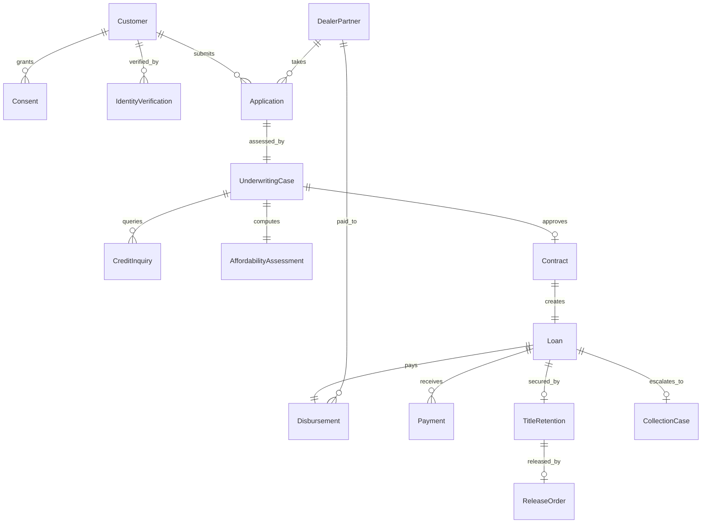

# R04 · 领域模型与状态机设计

> **定位**：聚合边界、状态机穷举、不变式与领域策略。所有领域逻辑写在 `domain` 层，**零 Spring 注解、可纯单测**。
> 业务口径来源 `R01`；命名来源 `R00`；真相源与上下文边界来源 `R02 §5 §6`。

---

## 0. 文档控制

| 项 | 值 |
|---|---|
| 文档编号 | `DES-RF-R04` |
| 版本 | v1.1 |
| 日期 | 2026-11-23 |
| 上游输入 | `R00`（命名/枚举）、`R01`（业务定源）、`R02`（上下文与真相源）、`R03`（复用切断点） |
| 交付性质 | **领域设计规格 + 状态机引擎落地口径**（§5.3 的引擎部分已实现并有实测记录，见 `PROGRESS §6`） |
| 状态 | 设计完成；`C-01` 用户签（双形态并行，`TransactionScheme` 双值首发）；`C-02`~`C-12` AI 裁决（2026-11-22，`R01 §6`）——策略按裁决值实现默认公式，法务效力判断不实现；**2026-11-23 状态机引擎落地**（Spring StateMachine 4.0.0，领域为状态图唯一事实源，见 §5.3） |
| 关联 ADR | `ADR-RF-002`（4 策略点）、`ADR-RF-006`（两态分离）、`ADR-RF-007`（事件禁 PII） |

---

## 1. 引用口径

- 状态值一律 `UPPER_SNAKE`（`R00 §3.4`）；表名以 `R00 §3.3` / `R06` 为准。
- **状态变更只能走聚合方法**，禁止直接 `UPDATE ... SET status`（`R00 §5`）。
- 「终态」必须显式列出；`SETTLED` / `EARLY_SETTLED` / `WRITTEN_OFF` / `CANCELLED` 是四个不同的债权终态（`AGENTS.md` B-7）。
- 所有法务相关策略标 `[待定源 C-xx]`，只定义接口，不写死公式。
- 事件名以 `R00 §3.6` 为准，payload 白名单见 `R09 §5`。

---

## 2. 聚合清单（14 个聚合根）

| # | 聚合根 | 上下文 | 关键实体 / 值对象 | 不变式 |
|---|---|---|---|---|
| A-1 | `Customer` | BC-2 | `CustomerPii`(加密) / `Contact` / `Address` | 一个自然人一个 `customer_id`；PII 只经 `PiiService` 暴露 |
| A-2 | `IdentityVerification` | BC-2 | `IdentityDocument` / `VerificationResult` | 身份核验完成前不得进入审查；文件有効期校验 |
| A-3 | `Consent` | BC-2 | `ConsentPurpose` / `ConsentVersion` / `WithdrawalRecord` | **每次征信查询/报送前必须存在未撤销的同意**（INV-5）；撤回立即生效 |
| A-4 | `Application` | BC-1 | `ApplicationItem`(车辆) / `ApplicantSnapshot` / `AttachmentRef` | 申请幂等（同一人+同一車+短期窗口去重）；提交后不可改关键项 |
| A-5 | `UnderwritingCase` | BC-3 | `DecisionRule` / `ReviewerAction` / `DecisionOutcome` | 决定必须留痕 + 复核人 ≠ 申请人（SOD）；`OVERRIDE` 需更高权限 |
| A-6 | `AffordabilityAssessment` | BC-3 | `IncomeDocument` / `ExistingDebt` / `AffordabilityResult` | 公式 `[待定源 C-03]`，只存输入与结果快照，不重算历史 |
| A-7 | `CreditInquiry` | BC-4 | `BureauResponse` / `InquiryPurpose` / `ConsentRef` | 一次查询一条留痕；`consentRef` 必填；频率控制 |
| A-8 | `Contract` | BC-5 | `StatutoryDocument` / `ContractTerms` / `CoolingOffWindow` | 书面文件交付留痕在 `SIGNED` 之前；`TransactionScheme` 决定条款类型 |
| A-9 | `Loan` | BC-6 | `RepaymentPlan` / `ScheduleItem` / `BalanceSnapshot` | **INV-2 余额精确相等**；`DISBURSEMENT` 只发生一次（INV-1） |
| A-10 | `Disbursement` | BC-6 | `PaymentInstruction` / `PayeeAccountRef` | 幂等键唯一；收款账户只传引用码不传明文 |
| A-11 | `Payment` | BC-7 | `PaymentAllocation` / `DirectDebitMandate` / `PaymentSlip` | 一笔入金只核销一次；超额入金转工单不自动分摊 |
| A-12 | `TitleRetention` | BC-8 | `VehicleRegistration` / `ReleaseOrder` | **两态分离**：文件出具不改保留状态；`RELEASE_REGISTERED` 须外部回执（INV-3） |
| A-13 | `CollectionCase` | BC-9 | `DpdSnapshot` / `CollectionAction` / `DisputeRecord` | DPD 按自然日；催收时段受 `[待定源 C-05]` 约束 |
| A-14 | `DealerPartner` | BC-10 | `DealerAgreement` / `PayeeAccountRef` / `ChannelScope` | 只读投影自 floorplan 主数据；**不是债务人**；账户独立 |

> `CreditBureauReport`（BC-4/报送）、`AuditEvent`（X-1）为**记录型实体**，非聚合根；`R06` 有对应表。

**聚合关系图**：



---

## 3. 状态机穷举（7 组主状态机 + 3 组辅助）

### 3.1 `ApplicationStatus`

| 状态 | 允许迁移到 | 触发 | 守卫 | 发布事件 |
|---|---|---|---|---|
| `DRAFT` | `SUBMITTED` | 消费者/店端提交 | 必填项齐 + 同意已取得 | `APPLICATION_SUBMITTED` |
| `SUBMITTED` | `DOCUMENTS_PENDING` / `WITHDRAWN` | 系统初检 / 客户撤回 | 幂等去重通过 | — |
| `DOCUMENTS_PENDING` | `VERIFIED` / `CANCELLED` | 文件受理 | 身份核验材料 + 收入证明齐 | — |
| `VERIFIED` | `UNDER_REVIEW` | 进入审查 | `IdentityVerification=VERIFIED` + `Consent` 有效 | `IDENTITY_VERIFIED` |
| `UNDER_REVIEW` | `APPROVED` / `DECLINED` / `REFERRED` | 审查决定 | 决定留痕 + SOD | `UNDERWRITING_APPROVED/DECLINED` |
| `REFERRED` | `APPROVED` / `DECLINED` | 人工复核 | 复核人 ≠ 申请人 | 同上 |
| `APPROVED` | `CONTRACTING` / `EXPIRED` | 进入契约 | 承認有効期内 | — |
| `CONTRACTING` | `CONTRACTED` / `CANCELLED` | 合同签订 | 书面文件交付留痕 | `CONTRACT_SIGNED` |
| **终态** | `DECLINED` / `WITHDRAWN` / `CANCELLED` / `EXPIRED` / `CONTRACTED` | — | 不可再迁移 | — |

### 3.2 `UnderwritingStatus` / `ConsentStatus` / `IdentityVerificationStatus`

| 状态机 | 状态流转 | 备注 |
|---|---|---|
| `UnderwritingStatus` | `PENDING → INQUIRY_IN_PROGRESS → INQUIRY_DONE → ASSESSING → (APPROVED / DECLINED / REFERRED) → EXPIRED(终态)` | 查询失败→ `INQUIRY_FAILED` 可重试 3 次后转人工；不得跳过 `INQUIRY_DONE` |
| `ConsentStatus` | `GRANTED → WITHDRAWN / EXPIRED`（**终态**） | 撤回即刻阻断后续查询/报送（INV-5）；撤回不删除历史留痕 |
| `IdentityVerificationStatus` | `PENDING → DOCUMENTS_RECEIVED → VERIFYING → VERIFIED / REJECTED`（终态） | `REJECTED` 可重新发起新的一次核验（新 ID），不改旧记录 |

### 3.3 `ContractStatus`

| 状态 | 允许迁移到 | 守卫 |
|---|---|---|
| `DRAFT` | `DOCUMENTS_DELIVERED` | 法定书面文件模板按 `TransactionScheme` 选定（`[待定源 C-08]`） |
| `DOCUMENTS_DELIVERED` | `SIGNED` / `CANCELLED` | 交付留痕（时间/方式/版本）存在 |
| `SIGNED` | `COOLING_OFF` / `EFFECTIVE` | 是否进入冷却期由 `[待定源 C-08]` 决定，配置化，不写死 |
| `COOLING_OFF` | `EFFECTIVE` / `CANCELLED` | 冷却期内行使解约 → `CANCELLED`，触发恢复原状清算 |
| `EFFECTIVE` | `TERMINATED`（终态） | 结清/解约后 |
| **终态** | `CANCELLED` / `TERMINATED` | — |

### 3.4 `LoanStatus`（**核心账务**）

| 状态 | 允许迁移到 | 触发 | 守卫 |
|---|---|---|---|
| `CREATED` | `DISBURSING` / `CANCELLED` | 代付执行 | `Contract=EFFECTIVE` + 门禁全通过（`R02 §7.1`） |
| `DISBURSING` | `ACTIVE` / `DISBURSE_FAILED` | 付款回调 | 幂等键唯一；失败可重放一次 |
| `ACTIVE` | `DELINQUENT` / `SETTLED` / `EARLY_SETTLED` / `WRITTEN_OFF` | 入金 / DPD / 结清 | 结清须末回核销 + 无未决异议 |
| `DELINQUENT` | `ACTIVE`（补救）/ `WRITTEN_OFF` / `SETTLED` | 入金 / 核销 | DPD 重算 |
| `DISBURSE_FAILED` | `DISBURSING`（重放）/ `CANCELLED` | 人工重触发 | 不自动无限重试 |
| **终态** | `SETTLED`(结清) / `EARLY_SETTLED`(提前结清) / `WRITTEN_OFF` / `CANCELLED` | — | **四者不可合并**（B-7） |

> `SETTLED` 与 `EARLY_SETTLED` 分开的原因：结清金额计算（`SettlementCalculationPolicy`，`[待定源 C-10]`）、
> 征信报送终态码、解押触发时点都不同。

### 3.5 `TitleRetentionStatus` 与 `ReleaseOrderStatus`（**两态分离，见 §4**）

| `TitleRetentionStatus` | 允许迁移到 | 守卫 |
|---|---|---|
| `NOT_REQUIRED` | —（终态） | `[待定源 C-04]` 判定为 `CONTRACTUAL_ONLY` 时 |
| `PENDING_REGISTRATION` | `REGISTERED` / `CONTRACTUAL_ONLY` / `CANCELLED` | 交车报告 + 车辆检验合格证登记证据 |
| `REGISTERED` | `RELEASE_REGISTERED` | **仅当** `ReleaseOrder=REGISTRATION_CONFIRMED` 且回执权威 = `EXTERNAL_REGISTRY` |
| `CONTRACTUAL_ONLY` | `CLOSED` | 契约保留未登记，结清即关闭（无需外部登记） |
| `RELEASE_REGISTERED` | `CLOSED`（终态） | 证据链闭合 |
| **终态** | `NOT_REQUIRED` / `CANCELLED` / `CLOSED` | — |

| `ReleaseOrderStatus` | 允许迁移到 | 守卫 |
|---|---|---|
| `CREATED` | `DOCUMENTS_PREPARED` / `REJECTED` | `LoanStatus ∈ {SETTLED, EARLY_SETTLED}`（**INV-3**） |
| `DOCUMENTS_PREPARED` | `DOCUMENTS_ISSUED` / `REJECTED` | 解除文件四件套齐 |
| `DOCUMENTS_ISSUED` | `EXTERNAL_SUBMITTED` / `EXPIRED` | **文件出具 ≠ 解押完成** |
| `EXTERNAL_SUBMITTED` | `REGISTRATION_CONFIRMED` / `EXPIRED` | 必须有**外部登记回执**；`MANUAL` 代录只能落 `MANUAL_RECORDED`，不得直达 |
| `MANUAL_RECORDED` | `REGISTRATION_CONFIRMED` / `REJECTED` | 需我方见证 + 后续补外部回执，否则超时工单 |
| `REGISTRATION_CONFIRMED` | `CLOSED`（终态） | 证据链八条闭合（`R05 §6`） |
| **终态** | `CLOSED` / `REJECTED` / `EXPIRED` | — |

### 3.6 `ScheduleItemStatus` / `PaymentStatus` / `DirectDebitMandateStatus`

| 状态机 | 流转 |
|---|---|
| `ScheduleItemStatus` | `SCHEDULED → DUE → (PAID / PARTIAL / OVERDUE / WAIVED)`；`OVERDUE → PAID` 允许补救 |
| `PaymentStatus` | `RECEIVED → MATCHED → ALLOCATED`；`RECEIVED → UNMATCHED → (MANUAL_MATCHED / IGNORED / REFUNDED)`；终态 `ALLOCATED / IGNORED / REFUNDED` |
| `DirectDebitMandateStatus` | `PENDING → ACTIVE / FAILED / SUSPENDED`；`FAILED` 不自动转 `ACTIVE`，需重新申请 |

---

## 4. 所有权保留与解除：两态分离（核心设计）

> 对应 `R01 §3` 的实务纠正与 `ADR-RF-006`。**这是本项目最容易做错的地方**。

```
Loan: ACTIVE ──结清──> SETTLED
                        │
                        ├──> ReleaseOrder.CREATED ──> DOCUMENTS_ISSUED ──> EXTERNAL_SUBMITTED
                        │                                   │                      │
                        │                          （文件出具，保留状态不变）   外部登记回执
                        │                                                          ▼
                        │                                          REGISTRATION_CONFIRMED
                        │                                                          │
                        └──────────────────────────────────────────────────────┘
                                              ▼
                          TitleRetention.REGISTERED ──> RELEASE_REGISTERED ──> CLOSED
```

**四条硬规则**：

1. `DOCUMENTS_ISSUED` **不得**改写 `TitleRetentionStatus`（保留仍然有效）。
2. `TitleRetention → RELEASE_REGISTERED` 的唯一入口是 `ReleaseOrder=REGISTRATION_CONFIRMED`。
3. 回执权威源分级：`EXTERNAL_REGISTRY`（运输支局/代办机构回执）> `INTERNAL_WITNESS`（我方见证代录，**仅能落 `MANUAL_RECORDED`**）> `PARTNER_SELF_REPORT`（**不得采信**，经销商/消费者自证无效）。
4. 未取得外部回执前，系统只能说「解除文件已出具」，**不得说「解押完成」**；对外文书与接口文案必须区分。

**为什么**：实务中「所有权解除」被销售店常理解为「出具文件的准备」即止；若系统把发文书当完成，
会出现「债权已结清、车辆检验合格证所有者仍是信贩」的账实不符，后续转卖/廃車全部卡住。

---

## 5. 不变式与领域策略（Spring-free，纯 JUnit 可测）

> §5.1 / §5.2 的状态图与策略**全部写在领域层**（零 Spring 注解、可纯 JUnit 跑）。
> §5.3 的状态机引擎在**领域之外**（共享 `statemachine` 模块 + 各服务 `*.application`），
> 只做编排，不改变本节的任何领域口径。

### 5.1 不变式

| # | 不变式 | 归属聚合 | 对应 `R02 §8` |
|---|---|---|---|
| I-1 | 一份 `Contract` 只允许一个成功 `Disbursement` | `Loan` / `Disbursement` | INV-1 |
| I-2 | `Loan.balance ≡ disbursement + fees + interest − allocated_principal`（精确相等） | `Loan` | INV-2 |
| I-3 | `ReleaseOrder.CREATED` 要求 `Loan ∈ {SETTLED, EARLY_SETTLED}` | `ReleaseOrder` | INV-3 |
| I-4 | `TitleRetention.RELEASE_REGISTERED` 要求外部权威回执 | `TitleRetention` | INV-3 |
| I-5 | `CreditInquiry` / `CreditBureauReport` 要求未撤销 `Consent` | `Consent` / `CreditInquiry` | INV-5 |
| I-6 | 审查 `OVERRIDE` 与 `DECIDED` 不可同一自然人 | `UnderwritingCase` | SOD（`R08 §4`） |
| I-7 | 终态不可再迁移；终态集合显式且互斥 | 全部 | `AGENTS B-7` |
| I-8 | 事件 payload 不含 PII（发布前校验） | 横切 | INV-4 |

### 5.2 领域策略（裁决值实现，可配置覆盖）

> `C-01` 用户签 + `C-02`~`C-12` AI 裁决（2026-11-22，`R01 §6`）：S1 起按裁决值实现**默认公式与业务规则**，
> 全部走配置覆盖；**法务效力判断不实现**（留痕 + 闸门提示，分界见 `R01 §8`）。

| 策略 | 职责 | 裁决状态 |
|---|---|---|
| `AffordabilityPolicy` | A 形态：个别支付能力预估额框架（系数可配）；B 形态：自动车担保除外贷付路径（不计总量） | 🟦 `C-03` 已裁决（官方系数待核实，改配置） |
| `StatutoryDocumentPolicy` | 按 `TransactionScheme` 选书面文件模板与交付时点；模板可配置 + 交付留痕 | 🟦 `C-08` 已裁决 |
| `SettlementCalculationPolicy` | 结清 / 提前结清金额（剩余本金 − 减免额 + 手续费，参数可配） | 🟦 `C-10` 已裁决（减免上限待核实） |
| `CreditBureauReportingPolicy` | CIC+JICC 查询、报送主 CIC、T+1、异议 30 日 | 🟦 `C-05` 已裁决 |
| `RepaymentScheduleGenerator` | 等额本息 / 等额本金 / 奖金还款 生成计划 | 可实现（与法务无关） |
| `DpdCalculator` | 自然日 DPD / M1–M3 分层 | ⚠️ 复用 floorplan 算法，**报送口径另定** |
| `PaymentAllocationPolicy` | 入金按「費用 → 利息 → 本金」顺序核销，可配 | 可实现 |
| `TitleReleaseGuard` | I-3 / I-4 门禁 | 可实现 |
| `ConsentGuard` | I-5 门禁 | 可实现 |
| `DuplicateApplicationDetector` | 同一人 + 同一車 + 窗口期去重 | 可实现 |

### 5.3 状态机引擎落地口径（Spring StateMachine 4.0.0）

> 状态图与不变式仍在 `domain`（零 Spring、纯 JUnit 可跑）；**引擎只做编排**：
> 事件分发、非法事件 fail-closed 拒绝、守卫执行、动作调用领域方法。

#### 5.3.1 为什么引入引擎

手写状态机的三个痛点：迁移表与用例两处手写、容易漂移；非法迁移靠每个变更方法各写一遍断言；
状态推进没有统一入口。本轮引入 **Spring StateMachine 4.0.0**（进程内，不引外部中间件，不违反 B-10）
解决前两项；第三项由「领域方法仍是唯一变更入口」保持不变。

#### 5.3.2 版本选型（与本仓 Spring 版本对齐）

| 版本 | 依赖的 Spring | 结论 |
|---|---|---|
| 3.x 线 | Spring 5.3（对应 Boot 2.x 线） | ✗ 与 Boot 3.2.5 不兼容 |
| **4.0.0** | **Spring 6.0.14** | ✅ **采用**：本仓锁定 Spring Framework 6.1.15（对 6.0 向后兼容） |
| 4.0.1 / 4.0.2 | Spring 6.2.x | ✗ 与本仓 BOM（6.1.15）打架 |

#### 5.3.3 分层口径：领域是状态图唯一事实源

| 层 | 职责 | 纪律 |
|---|---|---|
| 各服务 `*.domain` | 状态图（`*.Status.graph()`）、不变式、变更入口 | **零 Spring**，纯 JUnit 可跑 |
| `statemachine`（共享模块） | 引擎底座：配置基类、执行器、结果类型 | 只放机制，不放业务语义 |
| 各服务 `*.application` | 引擎配置（边→事件映射、守卫、动作）、用例接线 | 精确装配，不做全包扫描 |

**迁移边一律由领域图生成**，引擎侧不另写一份状态图——不存在「两份图漂移」。
领域图里存在、但领域尚未提供变更入口的边（如 `ACTIVE->DELINQUENT`），必须在配置类的
`unsupportedEdges()` 里**显式登记**；既不登记也不接事件 → **启动装配期 fail-fast**。

#### 5.3.4 本轮迁移范围（核心链路 3 组）

| 状态机 | 所属服务 | 引擎配置 | 用例接线 |
|---|---|---|---|
| `LoanStatus`（9 态） | retail-core | `LoanStateMachineConfigurer` | 代付两段迁移、结清 / 提前结清、逾期补救 |
| `ReleaseOrderStatus`（9 态） | title-release-service | `ReleaseOrderStateMachineConfigurer` | 解除八步中的 6 段迁移 |
| `TitleRetentionStatus`（8 态） | title-release-service | `TitleRetentionStateMachineConfigurer` | 第 7 步改写 + 第 8 步关闭 |

**解除链路分两台机器**：订单推进与保留推进互不代劳——「出具文件」永远碰不到保留状态
（B-6 / `ADR-RF-006`）。

未迁移（保持手写，后续按同一范式迁移）：`ApplicationStatus`、`UnderwritingStatus`、`ContractStatus`、
`ConsentStatus`、`IdentityVerificationStatus`、`CollectionCaseStatus`、`ScheduleItemStatus`。

#### 5.3.5 引擎不改变的东西（对外语义不变）

- 领域方法仍是唯一变更入口，仍是合法性的**最终裁决者**（引擎动作调用领域方法，领域方法内部再断言一次）；
- 事务边界不变（入金核销 + 余额 + 债权终态同一本地事务，B-11）；
- 对外接口、错误码与消息**一字不改**：领域异常经引擎动作原样透传（收集后原样重抛）；
- 引擎**不落库**：状态权威始终在数据库（聚合状态 + 乐观锁），内存状态机不是真相源。

---

## 6. 领域事件（生产方 / 消费方 / 聚合键）

> 名称以 `R00 §3.6` 为准；**payload 白名单见 `R09 §5`，禁止 PII**。

| 事件 | 生产方 | 消费方 | `aggregate_key` |
|---|---|---|---|
| `APPLICATION_SUBMITTED` | A-4 | BC-2 / 审计 | `applicationId` |
| `IDENTITY_VERIFIED` | A-2 | BC-3 / 审计 | `verificationId` |
| `CONSENT_GRANTED` / `CONSENT_WITHDRAWN` | A-3 | BC-3 / BC-4 / 审计 | `consentId` |
| `CREDIT_INQUIRY_COMPLETED` | A-7 | BC-3 / 审计 | `inquiryId` |
| `UNDERWRITING_APPROVED` / `DECLINED` | A-5 | BC-5 / 通知 / 审计 | `caseId` |
| `CONTRACT_SIGNED` | A-8 | BC-6 / 审计 | `contractId` |
| `DISBURSEMENT_PAID` | A-10 | BC-6 / 对账 / 审计 | `disbursementId` |
| `VEHICLE_DELIVERED` | A-14(投影) | BC-8 / 审计 | `applicationId` |
| `TITLE_RETENTION_REGISTERED` | A-12 | 审计 | `titleId` |
| `REPAYMENT_RECEIVED` | A-11 | BC-6 / BC-9 / 审计 | `paymentRef` |
| `LOAN_SETTLED` | A-9 | BC-8 / 报送 / 审计 | `loanId` |
| `RELEASE_DOCUMENTS_ISSUED` | A-12 | 通知 / 审计 | `releaseOrderId` |
| `TITLE_RELEASE_REGISTERED` | A-12 | 通知 / 报送 / 审计 | `releaseOrderId` |
| `DPD_CHANGED` | A-13 | 报送 / 审计 | `loanId` |
| `CREDIT_BUREAU_REPORT_SENT` | BC-4 | 审计 | `reportId` |

**硬规则**：`aggregate_key` 一次发生一个值；禁用 `vin` / `traceId` / `event_type` 单键；
消费幂等 `(event_id, consumer)`；消费者三铁律（必须幂等 / 不吞异常 / 不跨服务调用）。

**`TITLE_RETENTION_REGISTERED` 的发布口径（用户裁决 2026-11-23）**：登记事件只在**操作员正式登记**发生时发布一次。
若该债权此前已由 `LOAN_SETTLED` 兜底建单（**挡板占位行**，`vin=UNKNOWN-<loanId>`），正式登记命中该行时
**订正 VIN（+ 登记模式）并补发一次**登记事件（同一 `titleId`）——占位行不是「已登记」的业务事实，
不补发则证据链缺「所有权保留登记」这一环。订正走**乐观锁 + 占位 VIN 条件**，
**并发/重放只订正一次、只补发一次**（`R09 §5.4` 幂等铁律）；**真实登记行不受影响**
（重复登记幂等返回、不重复发事件）。订正只作用于占位行，故不弱化 INV-3
「`REGISTERED → RELEASE_REGISTERED` 的唯一入口是外部登记回执（C-11）」。

---

## 7. Domain 层用例清单（纯单测，约 42 条）

| 组 | 用例（示例） | 条数 |
|---|---|---|
| U-1 申请状态机 | 提交需同意；重复申请被去重；终态不可再迁移；撤回后不可审查 | 6 |
| U-2 同意 | 撤回后查询被拒；同意版本变更需重新取得；撤回不删历史 | 5 |
| U-3 审查 | 查询未完成不得决定；OVERRIDE 同一人硬阻断；决定留痕 | 5 |
| U-4 契约 | 未交付书面文件不得 SIGNED；冷却期可配置；`CANCELLED` 触发清算 | 5 |
| U-5 债权/代付 | 重复代付拒绝；余额精确相等；部分还款；超额入金；四终态互斥 | 8 |
| U-6 还款计划 | 三种还款方式生成；奖金月；首期与账户自动扣款前置期 | 4 |
| U-7 所有权 | 未结清不得建 ReleaseOrder；文件出具不改保留；MANUAL 不得直达完成；外部回执才解押 | 6 |
| U-8 DPD / 催收 | 自然日跨周末；宽限期；时段约束 | 3 |

> 全部在 `domain` 模块用 JUnit 5 跑，**不启动 Spring、不连库**。这是「领域层不被框架污染」的验收方式。

---

## 8. 自检

| 检查项 | 结果 |
|---|---|
| 是否含「文档控制 / 引用口径 / 自检」三节 | ✅ §0 / §1 / §8 |
| 聚合清单是否与 `R02 §5.1` 上下文一一对应 | ✅ §2（14 个） |
| 状态机是否穷举状态、迁移、触发、守卫、事件 | ✅ §3（7 主 + 3 辅助） |
| 是否显式区分 `SETTLED` / `EARLY_SETTLED` / `WRITTEN_OFF` / `CANCELLED` 四终态 | ✅ §3.4（B-7） |
| 是否实现「文件出具 ≠ 登记完成」两态分离并给四条硬规则 | ✅ §4（INV-3） |
| 是否给出 8 条不变式且能映射到 `R02 §8` 的 INV | ✅ §5.1 |
| 法务相关策略是否只给接口、标 `[待定源]`、不写死公式 | ✅ §5.2 |
| 事件名/聚合键是否与 `R00 §3.6` 一致且禁 PII | ✅ §6 |
| domain 用例是否零 Spring、可纯单测 | ✅ §7 |
| 是否与 `ADR-RF-002/006/007` 一致 | ✅ |
