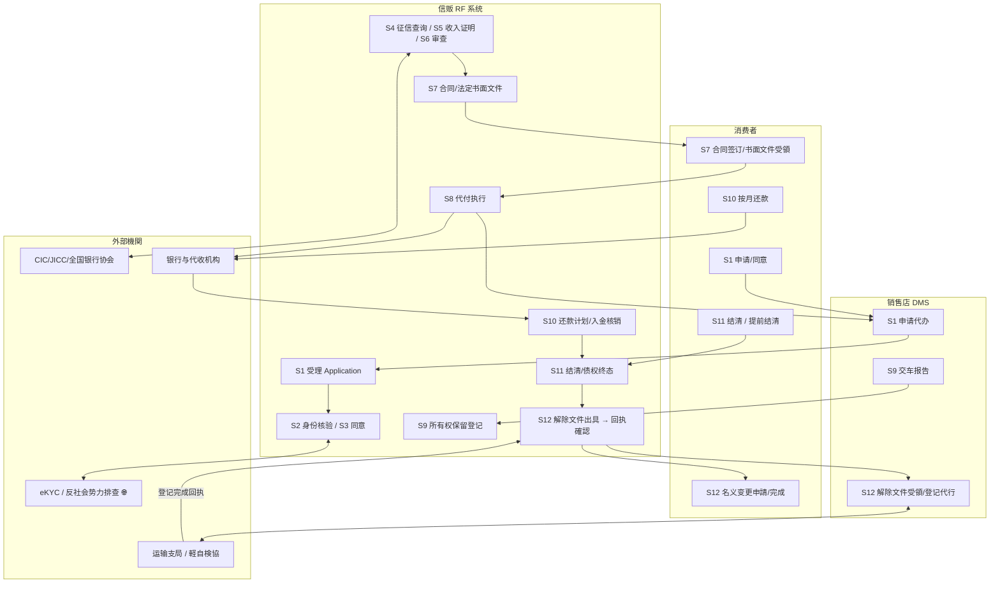
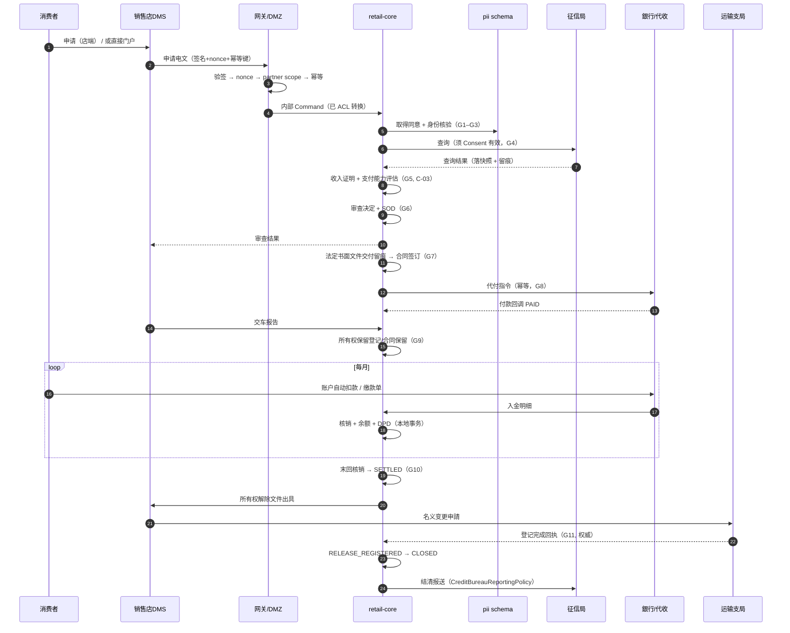

# R05 · 业务流程设计

> **定位**：一笔新车零售金融业务从申请到所有权解除的端到端流程、闸门、补偿与 SLA。
> 状态机定义见 `R04`；命名见 `R00`；外部契约见 `R07`；断言见 `R10`。

---

## 0. 文档控制

| 项 | 值 |
|---|---|
| 文档编号 | `DES-RF-R05` |
| 版本 | v1.0 |
| 日期 | 2026-11-22 |
| 上游输入 | `R01 §4`（12 步全景与资金流）、`R04`（状态机）、`R02 §7`（通信与门禁）、`R07`（外部集成） |
| 交付性质 | **流程设计规格（非实现）** |
| 状态 | 设计完成；含 `[待定源 C-xx]` 的闸门只定义校验骨架，不实现法务效力判断 |
| 关联 ADR | `ADR-RF-002`、`ADR-RF-006`、`ADR-RF-007` |

---

## 1. 引用口径

- 步骤编号 **S1–S12** 与 `R01 §4` 一一对应，不另起一套。
- 闸门 **G1–G11** 共 11 道（与 `R01 §4` 表格一致）；补偿项 **X-1–X-12**。
- 「人工路径」不是降级方案而是**正式支持的一等公民**（沿用公司外部集成约束）。
- 「文件出具」与「登记完成」两词严格区分（`R01 §3`、`R04 §4`）。
- 所有跨机构步骤允许最终一致，但**账务写入与债权状态迁移必须同一本地事务**（`R02 §7`）。

---

## 2. 端到端泳道（S1–S12）

**资金流再强调**：`R5 代付` 的方向是 **信贩 → 销售店**，不是 → 消费者（`R01 §4`）。

---

## 3. 分阶段时序（核心链路）

---

## 4. 十一道闸门（G1–G11）

> 闸门是 **fail-closed**：校验失败 / 超时 / 返回 UNKNOWN 一律**拒绝推进**，宁可误拒不可放过（`R02 §7.1`）。

| # | 闸门 | 位置 | 校验内容 | 失败处理 | 关联 |
|---|---|---|---|---|---|
| **G1** | 申请受理 | S1 | 必填项、身份核验材料、取得同意、幂等去重、加盟店 scope | 退回补件 / `RF_APP_001` | C-06/C-07/C-12 |
| **G2** | 身份核验 | S2 | 文件有效期、eKYC 结果、反社会势力排查 | `RF_IDV_001`，转人工核验 | C-07 |
| **G3** | 同意有效 | S3 | 使用目的、向第三方提供（征信局）同意存在且未撤销 | `RF_UW_003`，**硬阻断** | C-06 / INV-5 |
| **G4** | 征信查询 | S4 | 查询成功、授权在有效期内、查询频率未超 | `RF_UW_001`，3 次重试后转人工，不留空结果 | C-05 / INV-5 |
| **G5** | 支付能力 | S5–S6 | 收入证明齐全、不超支付能力预估额/总量规制上限 | `RF_UW_002`，可转 `REFERRED` 人工复核 | C-03 |
| **G6** | 审查决定 | S6 | 决定留痕、复核人 ≠ 申请人、`OVERRIDE` 权限 | `RF_AUTH_003`（SOD 硬阻断） | `R08 §4` |
| **G7** | 合同/书面文件 | S7 | 法定书面文件已交付并留痕、冷却期状态正确 | `RF_CTR_001` | C-08 |
| **G8** | 代付执行 | S8 | 合同 EFFECTIVE、收款账户引用码有效、幂等键未用、门禁全过 | `RF_LOAN_001/002`，整体回滚 | INV-1 |
| **G9** | 所有权保留 | S9 | 交车报告 + 车辆检验合格证登记证据（或 `CONTRACTUAL_ONLY` 判定） | 生成待办工单，不阻塞债权 | C-04 |
| **G10** | 结清 | S11 | 末回入金核销、无未决异议、余额精确为 0 | 不得进入 SETTLED；转差异工单 | INV-2 / C-10 |
| **G11** | 解押回执 | S12 | **外部登记回执**且权威 = `EXTERNAL_REGISTRY` | 只到 `DOCUMENTS_ISSUED` / `MANUAL_RECORDED`，超时工单 | INV-3 / C-11 |

**闸门与状态机的对应**：G1→`ApplicationStatus`、G3→`ConsentStatus`、G6→`UnderwritingStatus`、
G7→`ContractStatus`、G8→`LoanStatus`、G10→`LoanStatus`、G11→`ReleaseOrderStatus`/`TitleRetentionStatus`（`R04 §3`）。

---

## 5. 分阶段要点

| 阶段 | 关键动作 | 一致性要求 | 人工路径 |
|---|---|---|---|
| S1–S3 申请/身份核验/同意 | 外部 DTO 经 ACL → 内部 Command；同意逐项登记版本 | 同意写入与申请创建同事务 | 店端纸质文件 → 运营录入 + 扫描件（本地存储） |
| S4–S6 审查 | 查询结果落**快照**（不重算历史）；决定留痕 | 快照 append-only | 征信局专线中断 → 人工查询 + 结果录入 + 标记来源 |
| S7–S8 合同/代付 | 书面文件交付留痕 → 签订 → 付款指令（幂等） | **付款回调与债权创建同事务** | 銀行无 API → 生成汇出文件 + 人工复核送出 + 回执录入 |
| S9–S10 交车/还款 | 所有权保留证据；还款计划生成；每月入金核销 | **核销 + 余额 + DPD 同本地事务** | 入金明细 CSV / 網銀导出 → 导入 + 逐行报错可修正 |
| S11–S12 结清/解除 | 结清计算 → 解除文件 → 外部登记 → 回执 | 结清与 ReleaseOrder 创建同事务；**登记回执异步** | 无外部回执 → `MANUAL_RECORDED` + 我方见证 + 超时工单，**不得自证完成** |

---

## 6. 所有权解除八步闭环与证据链（S12 展开）

| 步 | 动作 | 状态 | 证据 |
|---|---|---|---|
| 1 | 债权 `SETTLED` / `EARLY_SETTLED` | `LoanStatus` 终态 | 末回核销流水 + 余额 0 |
| 2 | 生成 `ReleaseOrder` | `CREATED` | G10 闸门记录 |
| 3 | 备齐解除文件四件套 | `DOCUMENTS_PREPARED` | 所有权解除同意书 / 转让证明书 / 授权委托书 / 印鉴证明书 |
| 4 | **発行**文件并交付 | `DOCUMENTS_ISSUED` | 交付记录（时间/方式/接收方） |
| 5 | 外部提交登记申請 | `EXTERNAL_SUBMITTED` | 申请受理编号 |
| 6 | 取得**外部**登记完成回执 | `REGISTRATION_CONFIRMED` | 回执原文 + `confirmation_authority=EXTERNAL_REGISTRY` |
| 7 | 改写保留状态 | `TitleRetention.RELEASE_REGISTERED` | 证据链闭合校验 |
| 8 | 关闭并报送结清 | `CLOSED` + `CREDIT_BUREAU_REPORT_SENT` | 报送留痕 |

**证据链八条闭合条件**（全部满足才可进第 7 步）：
① 债权终态 ② 余额为 0 ③ 无未决异议 ④ 解除文件齐 ⑤ 交付留痕 ⑥ 外部申请受理
⑦ **外部登记回执** ⑧ 回执验真/权威性判定（非 `PARTNER_SELF_REPORT`）。

> `MANUAL_RECORDED`（我方见证代录）**不是**第 6 步的替代：它只能作为回执未到时的中间态，
> 必须补外部回执才能进第 7 步（INV-3、`R04 §4`）。

---

## 7. 四个必处理的分支

| 分支 | 触发 | 处理 |
|---|---|---|
| **提前结清** | 消费者中途一次性结清 | `SettlementCalculationPolicy`（`[待定源 C-10]`）：剩余本金 − 减免额 + 事务手续费；`LoanStatus=EARLY_SETTLED`（**不等于 `SETTLED`**）；照样走解除八步 |
| **首期缴款单** | 账户自动扣款设定需约 2 个月，首期可能赶不上 | 首期生成 `PaymentSlip`（汇款单 / 便利店代收），入金按 `contractId` 匹配；`retail.payment.direct-debit-lead-days=60`（⚙️）。见 `R02 §11 R-7` |
| **同意撤回** | 消费者行使 APPI 权利 | `CONSENT_WITHDRAWN` 秒级广播；阻断后续查询/报送（INV-5）；**不删除历史留痕**；已进入的合同按 `[待定源 C-06]` 处理 |
| **冷静期 / 解约** | 冷却期内行使（若适用） | `ContractStatus=CANCELLED`；触发恢复原状清算（已代付金额追回 / 车辆返还）；期间与例外 `[待定源 C-08]`，**系统不写死** |

---

## 8. 补偿矩阵（X-1 ~ X-12）

| # | 异常 | 补偿动作 | 幂等保证 | 人工兜底 |
|---|---|---|---|---|
| X-1 | DMS 申请重复推送 | 按 `Idempotency-Key` + `(customer,vehicle,window)` 去重，返回首次结果 | 唯一索引 | 工单核对 |
| X-2 | 征信查询超时/UNKNOWN | 3 次指数退避 → 转人工查询，**不写空结果** | 查询 ID 唯一 | 人工录入 + `source=MANUAL` |
| X-3 | 同意在审查中被撤回 | 立即中止查询与决定，申请转 `WITHDRAWN` | `consentId` | 通知客户 |
| X-4 | 代付付款回调丢失 | `PaymentGateway.query(orderNo)` 查单收敛（三态：SUCCESS/FAIL/UNKNOWN） | 幂等键 | 人工重触发 + 对账 |
| X-5 | 代付成功但债权创建失败 | 同事务回滚（不会出现半截）；若已跨系统则走对账差异工单 | 本地事务 | 银企对拍 |
| X-6 | 入金重复明细 | `uk(account_ref, transaction_id)` 去重 | 唯一索引 | 差异工单 |
| X-7 | 入金无法匹配合同 | `UNMATCHED` → 人工匹配工作台，不自动猜测分摊 | `paymentRef` | 人工匹配 |
| X-8 | 超额入金 | 转工单 + 退款/预收，不自动改还款计划 | — | 财务处理 |
| X-9 | 文件出具后登记迟迟无回执 | 超时（`retail.title.registration-receipt-timeout-days`）→ 工单 + 催办；状态停留 | `releaseOrderId` | 我方见证代录（仅中间态） |
| X-10 | 消费者自证「已解押」 | **拒绝采信**（`PARTNER_SELF_REPORT` 无效），要求外部回执 | — | 合规复核 |
| X-11 | 征信报送被拒/字段不全 | 重试 + 保留失败报文 + 差异工单，不静默丢弃 | `reportId` | 合规介入 |
| X-12 | 中台主数据同步失败 | `DealerPartner` 标记 `UNSYNCED`，允许人工录入，**不阻塞申请** | 门店代码 | 主数据对账 |

---

## 9. SLA（⚙️ 默认参数，可配置）

| 环节 | 目标 | 超时动作 |
|---|---|---|
| 申请受理 → 受理回执 | 秒级 | 告警 |
| 征信查询 | 分钟级（外部依赖） | 3 次重试后转人工 |
| 审查决定（自动） | 分钟级；人工 `REFERRED` 1 营业日 | 工单升级 |
| 代付执行 | 合同签订后 1 营业日 | 对账差异 |
| 入金核销 | 入金明细到着当日 | 批处理补跑（幂等） |
| 结清 → 解除文件出具 | 3 营业日 | 工单 |
| 外部登记回执 | `[待定源 C-11]` 默认 30 日 | 超时催办，`MANUAL_RECORDED` 不得代替 |
| 征信报送 | T+1（`retail.bureau.report-cron`） | 差异工单 |
| 异议申诉 | 默认 30 日（C-05） | 合规升级 |

---

## 10. 与既有裁决 / 不变式的衔接

| 流程点 | 对应裁决 |
|---|---|
| 资金流「代付 → 销售店」 | `R01 §2` / `ADR-RF-002` |
| 门禁 fail-closed | `R02 §7.1` / `ADR-RF-001` |
| 征信查询须同意 | INV-5 / `ADR-RF-005` |
| 结清与解押两态分离 | INV-3 / `ADR-RF-006` / `R04 §4` |
| 事件不带 PII | INV-4 / `ADR-RF-007` / `R09 §5` |
| 本地事务守住账务 | `R02 §3` / P-4 |
| 人工路径一等公民 | `R07 §2` / 公司外部集成约束 |
| 所有 `[待定源 C-xx]` | 唯一登记 `R01 §5` |

---

## 11. 自检

| 检查项 | 结果 |
|---|---|
| 是否含「文档控制 / 引用口径 / 自检」三节 | ✅ §0 / §1 / §11 |
| S1–S12 是否与 `R01 §4` 一一对应 | ✅ §2 |
| 闸门是否 G1–G11 共 11 道且与 `R01 §4` / `R04 §3` 对应 | ✅ §4 |
| 资金流方向是否画对（信贩 → 销售店） | ✅ §2 §3 |
| 解除八步 + 证据链八条 + MANUAL 限制是否完整 | ✅ §6（INV-3） |
| 四个分支是否覆盖提前结清/首期缴款单/同意撤回/冷静期 | ✅ §7 |
| 补偿矩阵是否 X-1~X-12 共 12 项且带幂等与人工兜底 | ✅ §8 |
| 是否每个 `[待定源]` 引用都能在 `R01 §5` 查到 | ✅ C-03/04/05/06/07/08/10/11/12 |
| 是否声明流程是规格而非实现 | ✅ §0 §1 |
