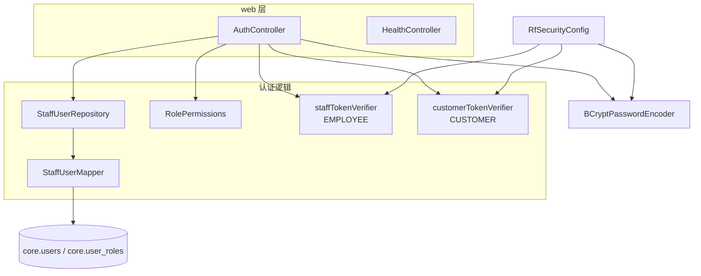
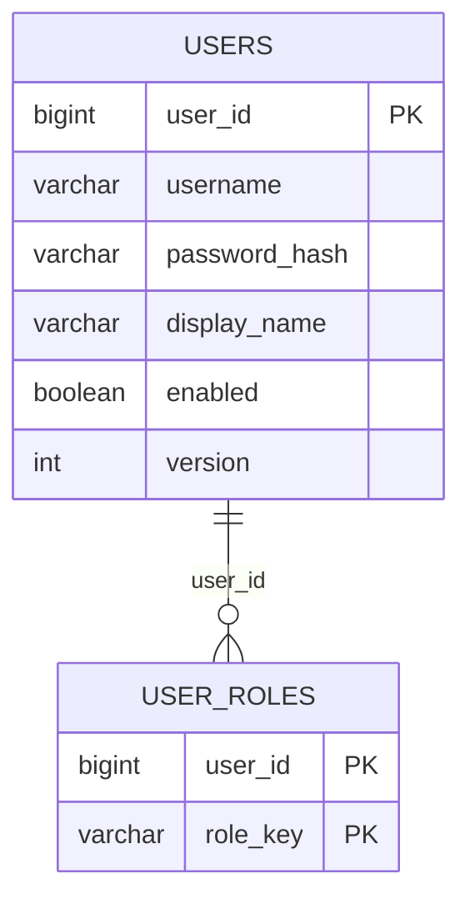
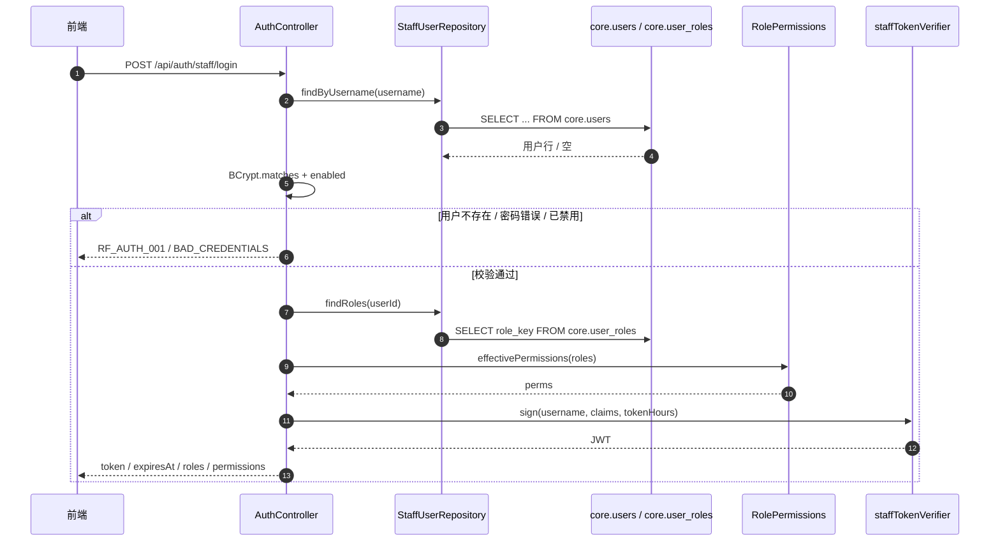
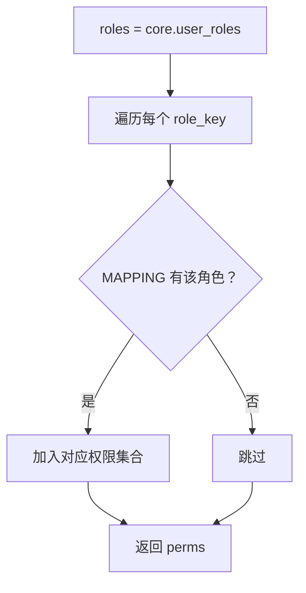
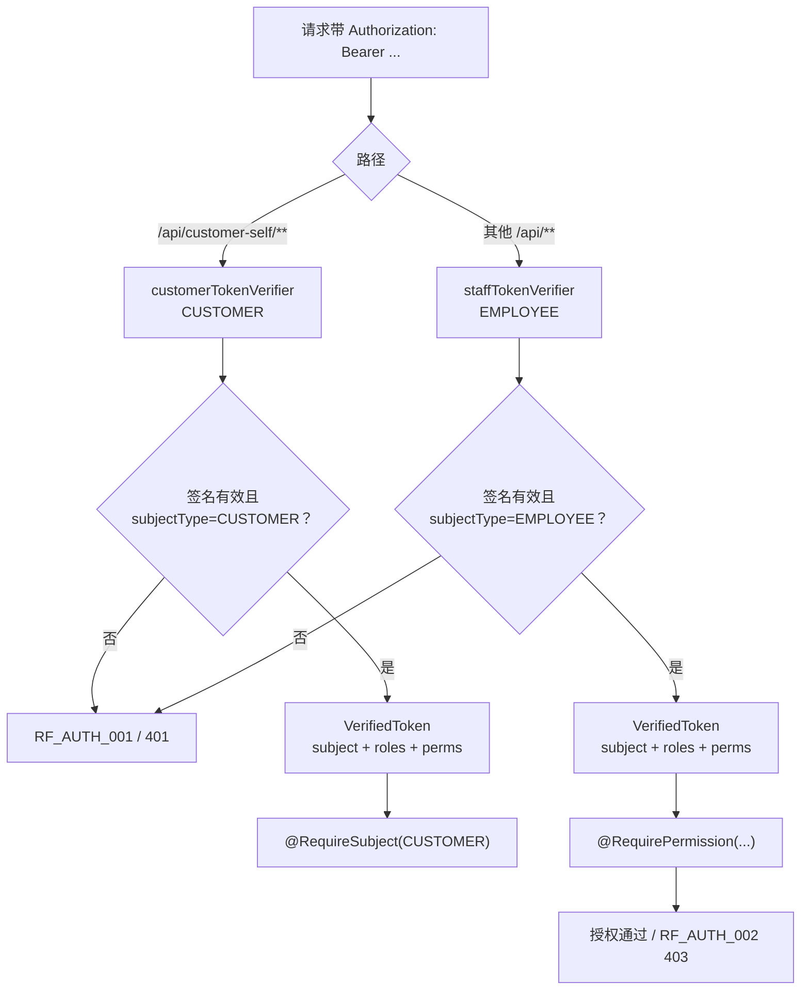
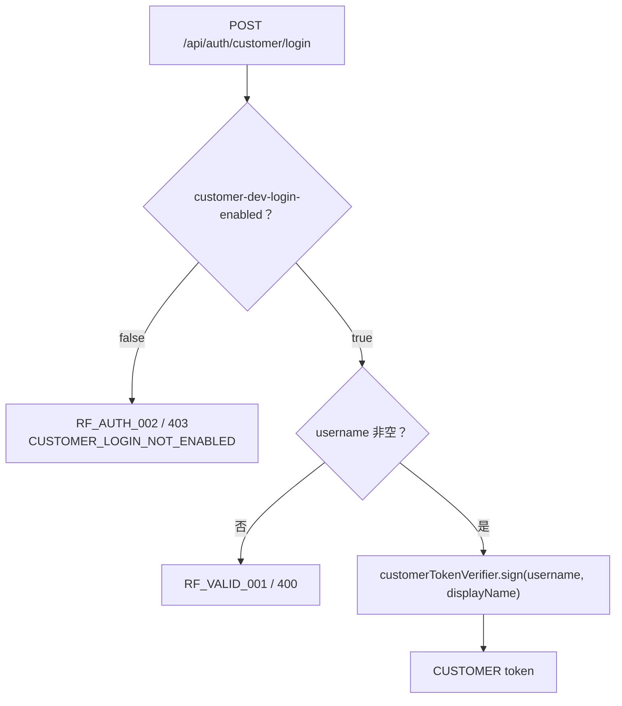

# auth-service 代码流程：双主体 JWT 签发与鉴权

> **文档性质**：代码走读 / 流程图材料，不是设计定源。
> **依据**：当前 `master` 工作区代码（`auth-service` 模块，2026-11-28 走读）。
> **放置说明**：本文件放在 `interview/` 下，属于代码讲解材料，**不纳入 `docs/` 的 R00–R11 登记**，
> 不影响 `scripts/check_docs.py` 的文件计数护栏。
> **口径优先级**：`PROGRESS.md` > `AGENTS.md` > `docs/` > 代码与本文；本文只解释代码，不替代设计文档。
> **配套材料**：
> - HTML 图集：[auth-service-代码流程图集.html](auth-service-代码流程图集.html)
>   （图目录可向左收起为窄栏，右侧流程图区域自动加宽；收起后点左侧「目录」恢复）
> - 参照材料：[retail-core-代码流程.md](retail-core-代码流程.md)、
>   [customer-service-代码流程.md](customer-service-代码流程.md)、
>   [underwriting-service-代码流程.md](underwriting-service-代码流程.md)

---

## 0. 一句话定位

`auth-service` 是**双主体 JWT 签发服务**，端口 `8091`。

它负责：

```text
员工登录：用户名 + 密码 → BCrypt 校验 → 角色/权限展开 → 员工 JWT
客户登录：仅开发桥（显式开关）→ 客户 JWT
健康检查
```

它**不负责**：

- 客户真实登录 / OTP / 身份核验 —— `customer-service`（W3）
- 用户 CRUD、角色维护、权限配置 —— 当前没有管理端点
- 业务接口的授权判断 —— 由各业务服务 `RfSecurityConfig` 拦截器执行
- 刷新 token、登出、token 撤销 —— 当前没有
- 审计、登录失败锁定、登录限流 —— 本服务没有；网关有全局限流

它的核心边界：

> **员工和客户是两套主体、两套密钥、两种 `subjectType`；员工 token 带角色/权限，客户 token 不带 RBAC。**

---

## 1. 代码地图

### 1.1 包结构与职责

| 包/类 | 职责 |
|---|---|
| `auth.AuthController` | 员工登录、客户开发桥登录、JWT 签发 |
| `auth.RolePermissions` | 角色 → 权限点展开（当前只映射 `ADMIN`） |
| `auth.repository.StaffUserRepository` | 员工账号读取（`core.users` + `core.user_roles`） |
| `auth.repository.StaffUser` | 员工账号视图记录 |
| `auth.mapper.StaffUserMapper` | MyBatis 注解 SQL |
| `auth.config.AuthServiceConfig` | `@MapperScan("com.company.retail.auth.mapper")` |
| `common.security.JwtTokenVerifier` | 签发 / 验签；`subjectType` 强校验 |
| `common.config.RfSecurityConfig` | 员工/客户验签器、拦截器、密码编码器、CORS |

`HealthController` 提供 `/api/auth/health`；auth-service **没有** `/whoami`。

### 1.2 组件与依赖方向



---

## 2. 启动与装配

`AuthServiceApplication`：

```java
@SpringBootApplication(scanBasePackages = "com.company.retail.auth")
@EnableDiscoveryClient
@EnableFeignClients(basePackages = "com.company.retail.common.contract")
@Import({RfDataSourceGuardConfig.class, RfSecurityConfig.class})
```

要点：

- 只扫本服务包
- `AuthServiceConfig` 显式 `@MapperScan("com.company.retail.auth.mapper")`
- 只导入数据源守卫与安全配置；**没有导入 outbox / MQ**，auth-service 不发事件
- Flyway 关闭，迁移由 `db-migration` 作业执行

### 2.1 配置

`auth-service/src/main/resources/application.yml`：

| 配置 | 默认 | 说明 |
|---|---|---|
| `server.port` | `8091` | 服务端口 |
| `spring.datasource.username` | `retail_app_rw` | 运行期受限角色 |
| `retail.auth.secret` | 无默认值 | 员工 JWT 密钥 |
| `retail.customer-auth.secret` | 无默认值 | 客户 JWT 密钥 |
| `retail.auth.token-hours` | `8` | token 有效期（小时） |
| `retail.auth.customer-dev-login-enabled` | `false` | 客户登录开发桥开关；生产必须 false |

密钥纪律：

- 员工密钥和客户密钥都必须存在、强度足够、**彼此不同**
- `SecretPolicy.requireStrong` / `requireDistinct` 在启动期 fail-fast
- `JwtTokenVerifier` 要求密钥至少 32 字节（HS256）
- 两套密钥签发的 token 互不通过对方验签

### 2.2 网关路由

```text
/api/auth/** → auth-service :8091
```

登录端点本身在 `RfSecurityConfig.PERMIT_ALL` 中：

```text
/api/health
/api/*/health
/api/auth/staff/login
/api/auth/customer/login
```

---

## 3. 数据模型与角色

### 3.1 表关系



### 3.2 表说明

`core.users`：

| 字段 | 说明 |
|---|---|
| `user_id` | 主键 |
| `username` | 唯一，登录名 |
| `password_hash` | BCrypt 散列 |
| `display_name` | 展示名 |
| `enabled` | 是否启用 |

`core.user_roles`：

| 字段 | 说明 |
|---|---|
| `user_id` | 员工 ID |
| `role_key` | 岗位角色键，如 `ADMIN` |

约束：

- `uk_users_username`：用户名唯一
- `PRIMARY KEY (user_id, role_key)`：同一员工同一角色只一行
- 客户不进入 `core.user_roles`；客户侧没有 RBAC

### 3.3 种子数据

V2 迁移为开发环境写入：

```text
admin / ADMIN
```

仅用于本地/开发；密码散列由 PostgreSQL `crypt(..., gen_salt('bf', 10))` 生成。

---

## 4. 员工登录

### 4.1 入口

```text
POST /api/auth/staff/login
请求：{"username":"...","password":"..."}
```

### 4.2 时序图



### 4.3 登录逻辑

1. `findByUsername` 查 `core.users`
2. `BCryptPasswordEncoder.matches` 校验密码
3. `enabled=true` 过滤
4. 用户不存在、密码错误、已禁用**同一出口** `RF_AUTH_001`，防枚举
5. 查 `core.user_roles` 得到角色列表
6. `RolePermissions.effectivePermissions` 展开权限
7. `staffTokenVerifier.sign` 签发员工 token

### 4.4 token claims

员工 token 包含：

```text
sub           = username
subjectType   = EMPLOYEE
iat / exp     = 签发时间 / 过期时间
displayName   = 展示名
roles         = ["ADMIN", ...]
perms         = ["APPLICATION_REVIEW", ...]
```

注意：

- 当前 token **没有 `iss` / `aud` claim**；双主体隔离靠“密钥不同 + `subjectType` 强校验”
- `roles` 和 `perms` 是登录时快照；角色变更不会即时影响已签发 token，最长等到 token 过期
- token 不含密码、个人信息

### 4.5 响应示例

```json
{
  "code": "OK",
  "data": {
    "token": "eyJhbGciOiJIUzI1NiJ9...",
    "tokenType": "Bearer",
    "expiresAt": "2026-11-28T18:00:00Z",
    "subjectType": "EMPLOYEE",
    "displayName": "系统管理员",
    "roles": ["ADMIN"],
    "permissions": ["APPLICATION_REVIEW", "UNDERWRITING_DECIDE", "PII_VIEW_FULL"]
  },
  "traceId": "trace-20261128-0001"
}
```

`permissions` 示例只列了部分；`ADMIN` 实际会展开 `Permission.ALL`。

---

## 5. 角色 → 权限展开

### 5.1 当前映射

`RolePermissions`：

```java
ADMIN → Permission.ALL
其他角色 → 无预置权限
```

这意味着：

- `ADMIN` 登录后拿到全部权限点
- 其他岗位角色即使存在于 `core.user_roles`，当前 token 的 `perms` 也是空集合
- 业务端点上的 `@RequirePermission` 会因此返回 403

### 5.2 展开流程



注意：

- 角色→权限映射当前是**代码里的静态 Map**，不是数据库表
- W2 只保证机制可用；完整岗位角色清单与 SOD 对由 `R08` / W7 收口
- 客户侧没有角色，也没有权限点

---

## 6. JWT 验签与授权链路

### 6.1 双主体分流



### 6.2 三道关

```text
① 认证：JwtTokenVerifier 校验签名、过期、subjectType
② 主体：@RequireSubject(EMPLOYEE / CUSTOMER)
③ 授权：@RequirePermission("...")
```

关键点：

- 主体类型在**验签层**强制，不是「先认证再用注解挡」
- 员工密钥签的客户 token / 客户密钥签的员工 token → 401
- 合法 token 但主体类型不符 → 401
- 合法主体但权限不足 → 403 `RF_AUTH_002`
- token 的 `roles` / `perms` 直接从 claims 读取，不查库

### 6.3 拦截器路径

`RfSecurityConfig`：

```text
/api/customer-self/**  → 客户侧拦截器
其他 /api/**           → 员工侧拦截器
```

客户自助路径优先挂客户拦截器；员工拦截器排除这些路径，避免双挂。

---

## 7. 客户登录开发桥

### 7.1 入口

```text
POST /api/auth/customer/login
请求：{"username":"1001"}
```

### 7.2 流程



### 7.3 重要说明

这**不是客户真实登录**：

- 没有密码校验
- 不查客户主数据
- 不校验身份核验/同意
- 只用于双主体链路冒烟

生产默认：

```text
retail.auth.customer-dev-login-enabled=false
→ /api/auth/customer/login 一律 403
```

客户真实认证由 `customer-service` 在 W3 交付。

### 7.4 subject 口径

客户 token 的 `sub` 是 `username`。

`customer-service` 的 `/api/customer-self/me` 会把 subject 解析为 `customerId`：

```text
Long.parseLong(authSubject)
```

因此开发桥调用时应传**数字 customerId**，例如：

```json
{"username": "1001"}
```

如果传 `cust-001`，token 能签发，但 customer-service 会因 `NumberFormatException` 返回 `RF_AUTH_001`。

---

## 8. 对外接口

| 方法 | 路径 | 身份/权限 | 说明 |
|---|---|---|---|
| POST | `/api/auth/staff/login` | 免鉴权 | 员工登录，签发 EMPLOYEE token |
| POST | `/api/auth/customer/login` | 免鉴权，开发桥开关 | 签发 CUSTOMER token；生产默认 403 |
| GET | `/api/auth/health` | 免鉴权 | 健康检查 |

### 8.1 员工登录

```json
POST /api/auth/staff/login
{
  "username": "admin",
  "password": "<password>"
}
```

成功响应见 §4.5。

### 8.2 客户开发桥

```json
POST /api/auth/customer/login
{
  "username": "1001"
}
```

```json
{
  "code": "OK",
  "data": {
    "token": "eyJhbGciOiJIUzI1NiJ9...",
    "tokenType": "Bearer",
    "subjectType": "CUSTOMER",
    "expiresAt": "2026-11-28T18:00:00Z"
  },
  "traceId": "trace-20261128-0002"
}
```

### 8.3 错误示例

```json
{
  "code": "RF_AUTH_001",
  "message": "<统一错误消息>",
  "details": {
    "reason": "BAD_CREDENTIALS"
  },
  "traceId": "trace-20261128-0003"
}
```

HTTP `401`。

```json
{
  "code": "RF_AUTH_002",
  "message": "<统一错误消息>",
  "details": {
    "reason": "CUSTOMER_LOGIN_NOT_ENABLED",
    "note": "客户自助登录由 customer-service 于 W3 交付；开发桥需显式开启配置"
  },
  "traceId": "trace-20261128-0004"
}
```

HTTP `403`。

---

## 9. 安全与当前边界

### 9.1 已实现的保护

| 机制 | 落点 |
|---|---|
| 密码散列 | BCrypt，成本因子默认 10 |
| 防枚举 | 用户不存在 / 密码错误 / 禁用统一 `BAD_CREDENTIALS` |
| 双密钥 | 员工/客户密钥不同，启动期校验 |
| 主体类型 | `JwtTokenVerifier` 验签层强校验 `subjectType` |
| 密钥强度 | `SecretPolicy` + 32 字节最小长度 |
| token 过期 | `exp` 由 tokenHours 控制，默认 8 小时 |
| 401/403 区分 | `RF_AUTH_001` / `RF_AUTH_002` |
| actor 来源 | 下游从验签主体取，不信请求体 |

### 9.2 当前没有的能力

1. **客户真实登录未实现**：只有开发桥；OTP / 身份核验 / 同意会话归 customer-service。
2. **没有刷新 token / 登出 / 撤销**：JWT 无状态，签发后只能等过期。
3. **没有 token 吊销列表 / jti**：无法主动踢下线。
4. **角色权限是静态代码映射**：`RolePermissions` 只映射 `ADMIN`，其他角色权限为空；没有角色-权限数据库表。
5. **没有用户/角色管理端点**：`core.users` / `core.user_roles` 是真相源，但本服务只读，不提供创建/修改。
6. **没有登录审计 / 失败锁定 / 验证码**：本服务不写 `audit.*`，也没有锁定计数器；只有网关全局限流。
7. **没有 `iss` / `aud` claim**：双主体隔离靠密钥和 `subjectType`；如果未来跨系统共享 token，需要补 issuer/audience。
8. **CORS 是开发口径**：`allowedOriginPatterns("*")`；生产必须收紧。
9. **开发桥没有密码校验**：一旦 `customer-dev-login-enabled=true`，任何非空 username 都能拿到客户 token；生产必须保持 false。
10. **客户 subject 必须是数字 customerId**：开发桥传非数字会在 customer-service 解析失败。

---

## 10. 测试

| 测试类 | 覆盖点 |
|---|---|
| `AuthControllerCustomerSignerTest` | 客户登录必须复用客户侧验签器；客户 token 不能过员工验签 |

当前 auth-service 只有这一组单测；员工登录、角色展开、错误分支主要靠冒烟脚本覆盖：

```text
POST /api/auth/staff/login
POST /api/auth/customer/login
GET  /api/auth/health
```

本地验证：

```bash
mvn -B test -pl auth-service -am
python scripts/check_docs.py
```

---

## 11. 建议的读代码顺序

```text
① AuthServiceApplication + RfSecurityConfig
② AuthController
③ StaffUserRepository + StaffUserMapper
④ RolePermissions + Permission
⑤ JwtTokenVerifier
⑥ AuthControllerCustomerSignerTest
⑦ V2 迁移中的 core.users / core.user_roles
```

---

## 12. 当前实现边界

1. **auth-service 只做登录签发**：不做客户真实认证、不做用户管理、不做权限配置。
2. **客户登录是开发桥**：`customer-dev-login-enabled=false` 时 403；生产不得开启。
3. **角色权限只有 ADMIN**：其他角色没有权限映射；业务端点会 403。
4. **token 没有撤销机制**：授权变更要等 token 过期；默认 8 小时。
5. **token 没有 issuer/audience**：当前靠双密钥 + `subjectType` 隔离。
6. **没有登录审计/锁定**：仅有网关全局限流。
7. **客户 subject 必须数字**：customer-service 用它解析 customerId。
8. **CORS 为开发口径**：生产需收紧。

---

## 13. 自检

- 本文只解释 `auth-service` 当前代码，不新增业务口径
- 双主体、密钥、token claims、401/403 语义按代码与 `RfSecurityConfig` 描述
- 客户登录明确标注为开发桥，不冒充真实客户认证
- 本文放在 `interview/`，不改变 `docs/` 文件计数，不影响 `check_docs.py`
