# bureau-service 代码流程：征信查询 / 报送 / 异议的防腐层

> **文档性质**：代码走读 / 流程图材料，不是设计定源。
> **依据**：当前 `master` 工作区代码（`bureau-service` 模块，2026-11-28 走读）。
> **放置说明**：本文件放在 `interview/` 下，属于代码讲解材料，**不纳入 `docs/` 的 R00–R11 登记**，
> 不影响 `scripts/check_docs.py` 的文件计数护栏。
> **口径优先级**：`PROGRESS.md` > `AGENTS.md` > `docs/` > 代码与本文；本文只解释代码，不替代设计文档。
> **配套材料**：
> - HTML 图集：[bureau-service-代码流程图集.html](bureau-service-代码流程图集.html)
>   （图目录可向左收起为窄栏，右侧流程图区域自动加宽；收起后点左侧「目录」恢复）
> - 参照材料：[retail-core-代码流程.md](retail-core-代码流程.md)、
>   [servicing-service-代码流程.md](servicing-service-代码流程.md)、
>   [customer-service-代码流程.md](customer-service-代码流程.md)

---

## 0. 一句话定位

`bureau-service` 是 **BC-4 征信机构防腐上下文**，端口 `8095`。

它把外部征信机构的能力收在一个服务里：

```text
征信查询（CreditInquiry）    —— 审查前查征信，结果留痕 + 快照引用
征信报送（CreditBureauReport）—— 合同内容/还款状况的登记与更新，T+1 口径
征信异议（BureauDispute）     —— 异议受理、处理、订正报送留痕，SLA 30 日
```

它**不负责**：

- 贷款申请、审查决定、合同、债权、放款、入金核销
- 逾期 DPD 计算和催收案件 —— `servicing-service`
- 同意本身的登记与撤回 —— `customer-service`
- 触发登记的创建 —— `servicing-service` 是 `core.bureau_report_triggers` 的真相源

它的核心红线：

> **无有效同意不查询、不报送；查不到/已撤回/校验不可用一律拒绝（fail-closed）；报文原文只进 append-only 留痕，不进事件、不进应用日志。**
>
> 现状注意：人工重触发 `resend` 与人工结果录入 `manual-result` 当前没有重新校验同意，`resend` 也未重新检查策略点开关；详见 §16。

### 0.1 先说明「实现到哪一步」

当前代码实现的是**业务闭环 + 防腐层 + 挡板/HTTP 模拟器**：

- 查询、报送、异议、人工通道、日批、事件消费、同意前置校验、报文留痕都已落地
- 默认走 `CicStubAdapter` / `JiccStubAdapter` 挡板
- 配置 `retail.bureau.cic-url` 后，CIC 走 `HttpCicAdapter`，对端可以是 `external-simulator` 或未来真实专线
- **真实 CIC / JICC 生产专线尚未接入**；JICC 始终是挡板
- 因此本文说「已实现」时，指的是**内部闭环和可联调适配器已实现**，不是「已和真实征信机构生产对接」

---

## 1. 代码地图

### 1.1 包结构与职责

| 包 | 职责 | 关键类 |
|---|---|---|
| `bureau.web` | HTTP 端点、权限点、traceId | `CreditInquiryController`、`BureauReportController`、`BureauDisputeController` |
| `bureau.application` | 用例编排、事务边界、事件消费、批处理 | `CreditInquiryAppService`、`BureauReportAppService`、`BureauReportExecutionService`、`ManualReportAppService`、`BureauDisputeAppService`、`DpdChangedReportConsumer`、`LoanSettledReportConsumer`、`BureauReportBatchJob`、`ConsentGateGuard` |
| `bureau.domain` | 纯领域：机构枚举、状态、策略点 | `CreditBureau`、`InquiryStatus`、`ReportStatus`、`DisputeStatus`、`CreditBureauReportingPolicy`、`DefaultCreditBureauReportingPolicy` |
| `bureau.acl` | 外部机构防腐层 | `BureauAdapter`、`CicStubAdapter`、`JiccStubAdapter`、`HttpCicAdapter`、`BureauInquiryCommand`、`BureauReportCommand`、`BureauDisputeCommand`、三种 `*Outcome` |
| `bureau.mapper` | MyBatis 注解 SQL | `CreditInquiryMapper`、`BureauReportMapper`、`BureauTriggerMapper`、`BureauDisputeMapper`、`BureauMessageLogMapper`、`BureauBatchRunMapper`、`SettlementConsentAnchorMapper` |
| `bureau.infrastructure` | 仓储实现、行映射 | `CreditInquiryRepository`、`BureauReportRepository`、`BureauDisputeRepository`、`BureauMessageLogRepository`、`BureauTriggerRepository`、`SettlementConsentAnchor` |
| `bureau.messaging` | 征信链路 MQ 密文信封消费 | `BureauReportEnvelopeConsumer` |
| `bureau.config` | 精确装配 | `BureauServiceConfig`、`BureauMqConfig` |
| `common.contract` | 同意前置校验桥接（本服务自持） | `ConsentGateFacade`、`W4GateFacadeConfig` |

`HealthController` 在 `bureau` 根包，提供 `/api/credit-inquiries/health` 与 `/whoami`。

### 1.2 组件与依赖方向

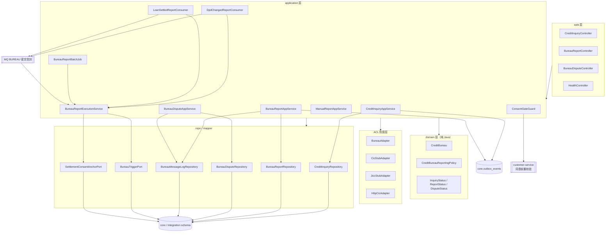

---

## 2. 启动与装配

`BureauServiceApplication`：

```java
@SpringBootApplication(scanBasePackages = "com.company.retail.bureau")
@EnableDiscoveryClient
@EnableFeignClients(basePackages = "com.company.retail.common.contract")
@Import({
    RfDataSourceGuardConfig.class,
    RfSecurityConfig.class,
    RfOutboxConfig.class,
    MqEnvelopeConfig.class,
    BureauMqConfig.class,
    RfFeignConfig.class,
    W4GateFacadeConfig.class
})
```

要点：

- 只扫 `bureau` 包，共享机制通过 `@Import` 精确装配
- `BureauServiceConfig` 显式 `@MapperScan("com.company.retail.bureau.mapper")`
- 运行期不跑 Flyway：`spring.flyway.enabled=false`
- 数据源角色 `retail_app_rw`，不是 `postgres` 超管

### 2.1 启动配置

`bureau-service/src/main/resources/application.yml`：

| 配置 | 默认 | 说明 |
|---|---|---|
| `server.port` | `8095` | 服务端口 |
| `spring.datasource.username` | `retail_app_rw` | 运行期受限角色 |
| `retail.bureau.enabled` | `true` | 策略点总开关；关闭后查询拒绝、报送转人工 PENDING |
| `retail.bureau.primary-report-bureau` | `CIC` | 报送主机构 |
| `retail.underwriting.bureau-combination` | `CIC,JICC` | 查询/人工报送的机构组合 |
| `retail.bureau.dispute-sla-days` | `30` | 异议 SLA 天数 |
| `retail.bureau.report-lead-days` | `1` | 报送业务日期 T+1 |
| `retail.bureau.report-schedule-enabled` | `false` | 报送日批开关；默认不跑 |
| `retail.bureau.report-cron` | `0 0 8 * * *` | 日批 cron，`Asia/Tokyo` |
| `retail.bureau.cic-url` | 空 | 空 = CIC 挡板；非空 = `HttpCicAdapter` |
| `retail.mq.enabled` | `false` | MQ 削峰通道 |
| `retail.mq.relay-consumer-enabled` | `false` | 是否由 `RF_EVENT_RELAY` 接管事件消费 |

### 2.2 适配器双模

`BureauServiceConfig#bureauAdapters`：

```text
CIC：retail.bureau.cic-url 为空 → CicStubAdapter
     非空                    → HttpCicAdapter
JICC：始终 JiccStubAdapter
ZENGIN：枚举存在，但当前没有装配适配器
```

默认组合是 `CIC,JICC`，所以正常路径不会碰到 ZENGIN；如果配置把 ZENGIN 加进组合，`adapters.get(ZENGIN)` 会是 null。

### 2.3 同意前置校验的装配

`W4GateFacadeConfig` 创建 `ConsentGateFacade`：

- 注入冻结契约 `FeignContracts.ConsentGateClient`
- 注入 `retail.clients.customer.url`（本地直连用）
- 注入 `retail.auth.secret`（机器场景签服务 token 用）
- `ConsentGateGuard` 再包一层，失败统一抛 `RF_UW_003`

---

## 3. 领域模型与数据表

### 3.1 机构与状态

`CreditBureau`：

```text
CIC
JICC
ZENGIN   // 枚举保留；当前未装配适配器
```

`InquiryStatus`：

```text
REQUESTED → COMPLETED / FAILED
```

`ReportStatus`：

```text
PENDING → SENT / REJECTED
```

`DisputeStatus`：

```text
OPEN → RESOLVED
```

注意：

- `InquiryStatus.FAILED` 是查询失败留痕，不是「空结果 COMPLETED」
- `ReportStatus.REJECTED` 是机构拒收/调用失败，保留报文后人工重触发
- `DisputeStatus` 没有 `OVERDUE`；超期是 `handle` 时的判定，抛 `RF_BUREAU_002`，不落库为新状态

### 3.2 策略点

`CreditBureauReportingPolicy`：

| 方法 | 含义 | 默认 |
|---|---|---|
| `enabled()` | 查询/报送开关 | `true` |
| `inquiryTargets()` | 查询机构组合 | `[CIC, JICC]` |
| `primaryReportBureau()` | 报送主机构 | `CIC` |
| `disputeSlaDays()` | 异议 SLA | `30` |
| `nextReportBizDate(receivedDate)` | 报送业务日期 | `receivedDate + 1` |
| `policyVersion()` | 策略版本 | `C05-DEFAULT-1.0` |

口径来源是 `C-05` 的裁决值，全部可配置覆盖；本文只解释代码，不把配置值写成新的法务结论。

### 3.3 数据表关系（ER）

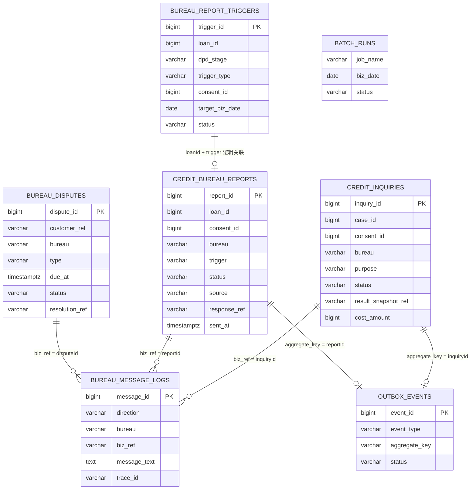

> ER 表达业务关系；当前迁移没有给这些跨表关系建物理外键。
> `bureau_message_logs.biz_ref` 是业务引用字符串，不是外键；`outbox_events.aggregate_key` 也是逻辑关联。

### 3.4 表数量与真相源边界

| 类别 | 数量 | 表 |
|---|---:|---|
| bureau 直接写的业务表 | 4 | `core.credit_inquiries`、`integration.credit_bureau_reports`、`integration.bureau_disputes`、`integration.bureau_message_logs` |
| 跨域触发表 | 1 | `core.bureau_report_triggers`（servicing 登记；bureau 只读 + 推进状态） |
| 共享支撑表 | 4 | `core.batch_runs`、`core.holidays`、`core.outbox_events`、`integration.mq_envelope_inbox`（MQ 开启时） |
| 结清锚点只读表 | 3 | `core.loans`、`core.contracts`、`core.underwriting_cases` |

关键边界：

- `core.bureau_report_triggers` **不是 bureau 的真相源**；servicing 创建触发，bureau 只把 `REGISTERED` 推进到 `CONSUMED` / `BLOCKED`
- `pii.consents` **不由 bureau 读写**；bureau 通过 customer-service 的 `/api/consents/{id}/disbursement-gate` 实时校验（`resend` / `manual-result` 例外见 §16）
- `bureau_message_logs` 是 append-only；Mapper 只有 INSERT 和 COUNT，没有 UPDATE / DELETE
- `bureau-message-logs.message_text` 是机构报文原文，可能包含业务敏感内容；只允许在受限留痕表内，不通过 GET 接口全文返回

---

## 4. 主流程一：征信查询

### 4.1 入口

```text
POST /api/credit-inquiries
权限点：CREDIT_INQUIRY_EXEC
请求：caseId / consentId / bureau / purpose
```

`caseId` 是审查案件 ID；`consentId` 是客户同意 ID；`bureau` 必须在策略点组合内；`purpose` 必填。

### 4.2 时序图

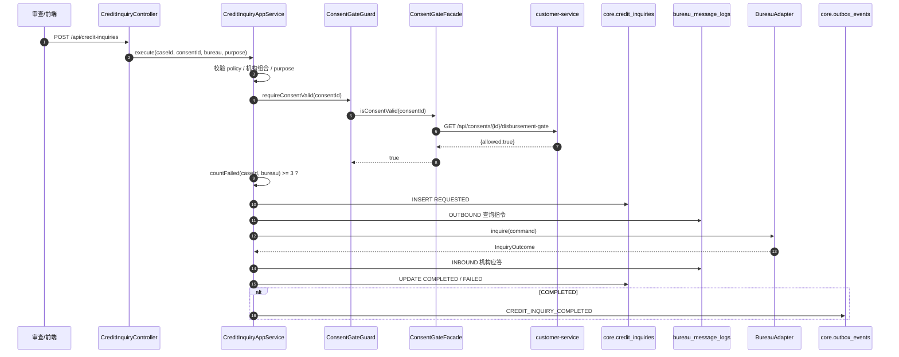

### 4.3 查询判定流程

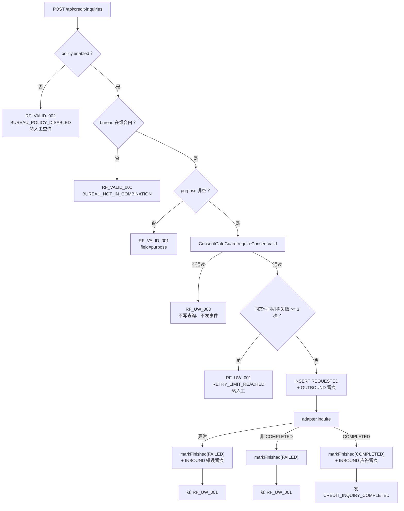

### 4.4 状态与留痕

| 阶段 | 表/状态 | 说明 |
|---|---|---|
| 发起 | `core.credit_inquiries.status=REQUESTED` | 先落查询留痕，再调外部机构 |
| 成功 | `COMPLETED` + `result_snapshot_ref` + `cost_amount` | 结果摘要只存引用，不把明文报告塞领域对象 |
| 失败 | `FAILED` | 不写空结果、不伪造 `COMPLETED` |
| 报文 | `bureau_message_logs` | OUTBOUND 指令 + INBOUND 应答；失败也尝试留痕 |
| 事件 | `CREDIT_INQUIRY_COMPLETED` | 聚合键 `inquiryId`；payload 见 §10 |

重试口径：

```text
同一 caseId + 同一 bureau 的 FAILED 达到 3 次
→ 第 4 次请求直接 RF_UW_001
→ 提示转人工查询 + 结果录入
```

### 4.5 与审查服务的衔接

`underwriting-service` 的 `InquiryCompletedConsumer` 消费 `CREDIT_INQUIRY_COMPLETED`：

```text
event.caseId
→ 找 core.underwriting_cases
→ 仅当案件状态 = INQUIRY_IN_PROGRESS 才推进
→ COMPLETED → completeInquiry()
→ FAILED    → failInquiry()
```

这样查询执行在 bureau，审查状态推进在 underwriting，二者只通过事件和业务主键衔接。

---

## 5. 主流程二：征信报送

### 5.1 入口

```text
POST /api/bureau-reports
权限点：BUREAU_REPORT_EXEC
请求：loanId / consentId / trigger
```

注意：这个入口**不接收 bureau 参数**；自动报送机构由策略点 `primaryReportBureau()` 决定，默认 CIC。

### 5.2 发送时序

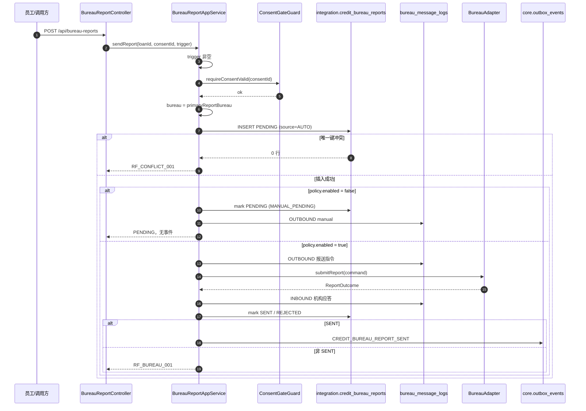

### 5.3 幂等：`uk_report_loan_trigger`

`integration.credit_bureau_reports`：

```sql
UNIQUE (loan_id, trigger)
```

`BureauReportMapper.insertPending` 使用：

```sql
INSERT ... ON CONFLICT DO NOTHING
```

- 唯一冲突返回 0 行，仓储返回 `false`
- `sendReport` 转成 `RF_CONFLICT_001`（`REPORT_DUPLICATE`）
- 不采用「捕获唯一键异常再重读」：PostgreSQL 事务触发唯一键错误后会进入 aborted 状态

### 5.4 策略点关闭

`retail.bureau.enabled=false` 时：

- 查询：直接拒绝，提示走人工查询 + 结果录入
- 报送：先插入 PENDING，再置 `PENDING` + payload `MANUAL_PENDING`，写 OUTBOUND 人工留痕，**不发事件**
- 人工通道：仍要求同意有效、机构在组合内；登记 `source=MANUAL`、`trigger=MANUAL`

### 5.5 报送执行核心

`BureauReportExecutionService` 同时服务三种入口：

```text
DPD_CHANGED 事件消费
LOAN_SETTLED 事件消费
报送日批扫描
```

`executeTrigger` 的幂等决策：

| 已有 `(loan, trigger)` 留痕 | 行为 |
|---|---|
| 无 | `sendReport` |
| `SENT` | 触发置 `CONSUMED`，返回 `SKIP_ALREADY_SENT`，不重复报送 |
| `REJECTED` | `resend`；重送成功后触发置 `CONSUMED` |
| `PENDING` | 保持人工 PENDING，返回 `PENDING`，不自动重报 |

异常语义：

| 异常 | 处理 |
|---|---|
| `RF_UW_003` 同意不通过 | 触发置 `BLOCKED`，正常返回 `BLOCKED`，不进框架重试 |
| `RF_CONFLICT_001` 并发冲突 | 视为幂等跳过，返回 `SKIP_ALREADY_SENT` |
| 其它异常 | 向上抛，交事件调度器重试/DEAD |

### 5.6 报送执行决策图

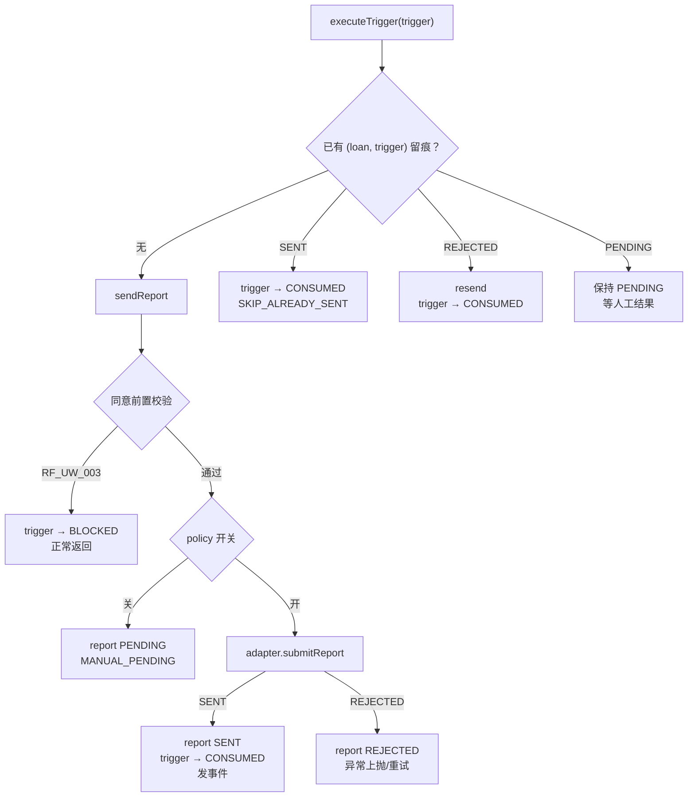

### 5.7 人工报送通道

人工通道是 `ADR-RF-005 §5` 的降级通道，和自动通道汇入同一张表：

```text
integration.credit_bureau_reports
trigger = MANUAL
source  = MANUAL
```

流程：

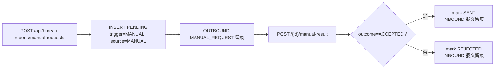

关键点：

- 登记人工请求时同样做同意前置校验（fail-closed）
- `bureau` 缺省用主机构；显式传入时必须在策略点组合内
- `manual-result` 只接受 `PENDING` 的 report；已 `SENT` / `REJECTED` 再录入 → `RF_VALID_002`
- 人工通道**不发** `CREDIT_BUREAU_REPORT_SENT`；事件语义是「自动通道机器回执」
- 录入的 `rawMessage` 只进 `bureau_message_logs`，不返回给 GET 接口

---

## 6. 主流程三：事件驱动与报送日批

### 6.1 `DPD_CHANGED` 事件链

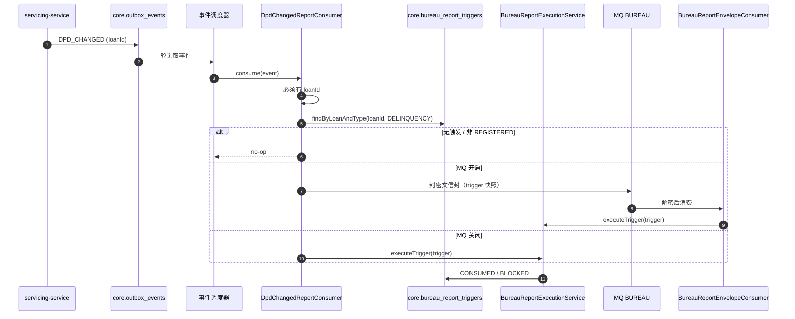

要点：

- `DPD_CHANGED` 的 payload 只需要 `loanId`
- 触发登记由 servicing 预先写入；bureau 不在事件消费时「顺手创建」触发
- 找不到触发或触发已不是 `REGISTERED`：幂等 no-op，不报错
- MQ 分支只封**业务键快照**，不含个人信息

### 6.2 `LOAN_SETTLED` 结清报送

`LOAN_SETTLED` payload 只有 `loanId` 等业务主键，没有 `consentId`。`executeSettlement` 通过锚点链解析：

```text
core.loans.contract_id
→ core.contracts.application_id
→ core.underwriting_cases.consent_id
```

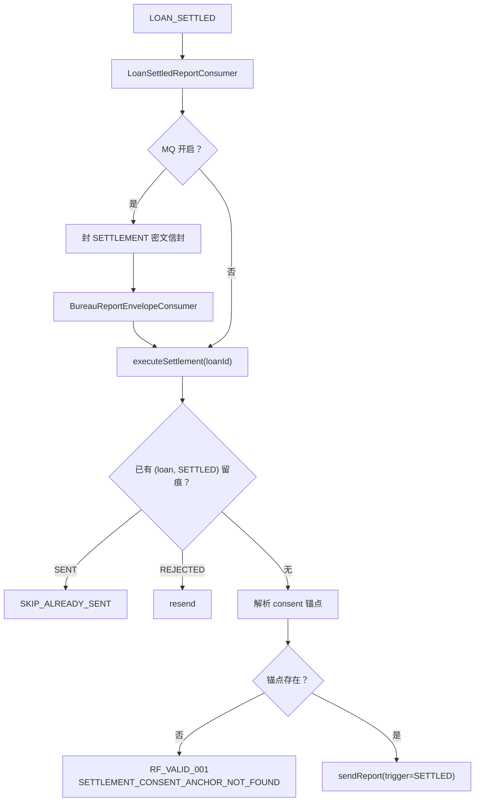

注意：锚点解析成功后，`sendReport` 仍会再次做同意前置校验；解析不等于同意有效。

### 6.3 报送日批

`BureauReportBatchJob` 是事件消费之外的兜底执行器：

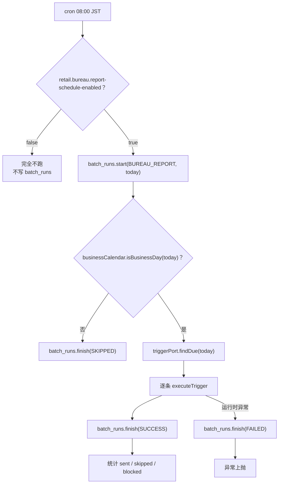

口径：

- 开关默认 `false`，不跑是正常状态
- 非营业日留 `SKIPPED`，可审计
- 同日重跑通过 `core.batch_runs` 的 `(job_name, biz_date)` 唯一键复用同一行
- 日批与事件消费调用**同一个** `executeTrigger`，幂等由 `uk_report_loan_trigger` 兜底
- 日批本身不走 MQ；MQ 分支只在事件消费者里

---

## 7. 主流程四：征信异议

### 7.1 入口

```text
POST /api/bureau-disputes
权限点：BUREAU_DISPUTE_HANDLE
请求：customerRef / bureau / type
```

`customerRef` 是客户引用码，不是姓名/电话；`bureau` 缺省 CIC；`type` 必填。

```text
POST /api/bureau-disputes/{id}/handle
请求：resolutionRef
```

### 7.2 异议流程

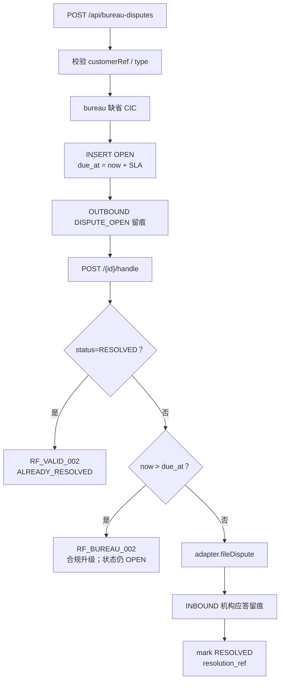

要点：

- SLA 由策略点 `disputeSlaDays()` 给出，默认 30 日
- `due_at` 是受理时间 + SLA；超期不是定时任务改状态，而是 `handle` 时判断
- 处理成功写 `resolution_ref`，报文原文进 `bureau_message_logs`
- 异议不发布 outbox 事件；它的留痕靠工单 + 报文表
- GET 不返回 `customer_ref`

---

## 8. ACL 与外部机构

### 8.1 端口

`BureauAdapter` 是唯一外部出口：

```java
CreditBureau bureau();
InquiryOutcome inquire(BureauInquiryCommand command);
ReportOutcome submitReport(BureauReportCommand command);
DisputeOutcome fileDispute(BureauDisputeCommand command);
```

三个 `*Outcome` 把机构报文翻译成内部形状：

| 输出 | 字段 |
|---|---|
| `InquiryOutcome` | `status` / `resultSummary` / `rawMessage` / `costAmount` |
| `ReportOutcome` | `status` / `responseRef` / `rawMessage` |
| `DisputeOutcome` | `accepted` / `registryRef` / `rawMessage` |

机构编码、字段名、错误码不进入 domain；domain 只认 `CreditBureau` 和内部状态。

### 8.2 挡板与 HTTP 双模

| 实现 | 行为 |
|---|---|
| `CicStubAdapter` | 全部受理成功，返回确定性合成报文，含 `STUB` 标记，不含真实个人信息 |
| `JiccStubAdapter` | 同 CIC 挡板口径，返回 `JICC` 合成报文 |
| `HttpCicAdapter` | 按提议协议 v1 POST `/cic/v1/inquiries`、`/reports`、`/disputes`；可接外部模拟器/未来专线 |

`HttpCicAdapter` 的关键纪律：

- 查询走 `OutboundProfile.QUERY`，默认不重试，可配置重试
- 报送/异议走 `OutboundProfile.WRITE`，**强制不重试**
- 同一业务对象重发共享稳定幂等键（`IdempotencyKeys.of(...)`）
- 网络异常 / 非 2xx / `code != OK` / 解析失败 → 返回 `FAILED` / `REJECTED` / `accepted=false`
- 不抛异常给上层；故障语义收敛在 `Outcome`
- 挡板/HTTP 都只返回合成或机构报文引用；真实报文原文进 `bureau_message_logs`

### 8.3 真实接入边界

```text
当前：CIC 默认挡板；配置 cic-url 后走 HTTP 模拟器；JICC 始终挡板
未来：按机构替换 Adapter 实现，BureauAdapter 接口不变
```

因此：

- 「内部报送闭环已实现」成立
- 「已接入真实 CIC/JICC 生产专线」不成立
- 真实接入前，人工报送通道是正式降级路径（`source=MANUAL`）

---

## 9. MQ 削峰通道

`retail.mq.enabled=false` 时全部走同步路径，行为和没有 MQ 时一致。

打开后，两个事件消费者的分支：

```text
DpdChangedReportConsumer
  → 封 BUREAU 密文信封（trigger 快照）
  → BureauReportEnvelopeConsumer
  → executeTrigger

LoanSettledReportConsumer
  → 封 BUREAU 密文信封（kind=SETTLEMENT）
  → BureauReportEnvelopeConsumer
  → executeSettlement
```

要点：

- MQ 主题：`RF_ENVELOPE_BUREAU`（`EnvelopeTopics.BUREAU`）
- 信封载荷只有业务键：`triggerId`、`loanId`、`dpdStage`、`triggerType`、`consentId`、`targetBizDate`、`status`、`traceId`
- 不含姓名、电话、地址、证件号
- broker 上只出现密文信封；消费端解密后调用**同一个**执行服务
- `BureauReportEnvelopeConsumer` 按 `kind` 分流：`SETTLEMENT` → 结清报送，其它 → 逾期触发
- `BureauMqConfig` 只在 `retail.mq.relay-consumer-enabled=true` 时注册中继消费者；不注册就不订阅 `RF_EVENT_RELAY`
- 消费幂等仍由 `uk_report_loan_trigger` 与 `integration.mq_envelope_inbox` 兜底

> MQ 只是 outbox 之上的削峰层；outbox 仍是事件真相源，broker 不可用不能静默降级为同步执行。

---

## 10. 事件与 outbox

### 10.1 本服务发布的事件

| 事件 | 触发 | 聚合键 | payload 关键字段 |
|---|---|---|---|
| `CREDIT_INQUIRY_COMPLETED` | 查询 `COMPLETED` | `inquiryId` | `inquiryId` / `caseId` / `status` / `occurredAt` / `schemaVersion` / `traceId` |
| `CREDIT_BUREAU_REPORT_SENT` | 自动报送 `SENT` | `reportId` | `reportId` / `status` / `source=AUTO` / `occurredAt` / `schemaVersion` / `traceId` |

规则：

- payload 过 `EventPayloadGuard` 白名单
- 禁止 `customerName`、`name`、`address`、`phoneNumber`、`birthday`、`customerId` 等 PII 键
- 报文原文不进事件，只进 `bureau_message_logs`
- 人工通道不发 `CREDIT_BUREAU_REPORT_SENT`

### 10.2 本服务消费的事件

| 事件 | 消费者 | 行为 |
|---|---|---|
| `DPD_CHANGED` | `DpdChangedReportConsumer` | 找 `DELINQUENCY` 触发，执行/入队报送 |
| `LOAN_SETTLED` | `LoanSettledReportConsumer` | 解析同意锚点，执行/入队结清报送 |

本服务**没有** `CONSENT_WITHDRAWN` 消费者：同意状态不落本地副本，查询与 `sendReport` 前实时调用 customer-service 的同意前置校验；撤回后下一次查询/新报送直接 fail-closed。注意：`resend` 与 `manual-result` 当前没有重新校验同意，详见 §16。

### 10.3 outbox 与事件状态

- 业务写和 outbox 行在同一个本地事务
- 事件由共享 outbox 中继/调度器投递
- 投递是 at-least-once，消费端必须幂等
- `CREDIT_INQUIRY_COMPLETED` 由 underwriting 消费，用于推进审查案件
- `CREDIT_BUREAU_REPORT_SENT` 当前在本仓没有业务消费者；它作为报送完成事件供审计/对拍/后续服务使用

---

## 11. 幂等 / 并发 / 安全

| 机制 | 落点 |
|---|---|
| 报送业务幂等 | `integration.credit_bureau_reports.uk_report_loan_trigger (loan_id, trigger)` |
| 报送插入原子性 | `INSERT ... ON CONFLICT DO NOTHING`，冲突返回 false |
| 触发登记幂等 | `core.bureau_report_triggers.uk_brt_loan_type (loan_id, trigger_type)` |
| 事件消费幂等 | `core.event_consumptions` + MQ `integration.mq_envelope_inbox` |
| 日批重跑幂等 | `core.batch_runs (job_name, biz_date)` 复用同一行 |
| 同意校验 | 查询 / `sendReport` / 人工登记实时调用；不缓存结果；异常/超时一律拒绝；`resend` / `manual-result` 目前未重新校验 |
| 报文留痕 | `bureau_message_logs` append-only，无 UPDATE/DELETE |
| 外部写幂等 | `HttpCicAdapter` 用稳定 `Idempotency-Key`；写动作绝不自动重试 |
| PII 边界 | 查询/报送事件只带业务主键；报文原文不进日志/事件 |

并发注意：

- `core.credit_inquiries` 没有业务唯一键；同一案件重复查询会新增行，失败次数按 `case_id + bureau` 统计
- `markFinished` / `markResolved` / `updateStatus` 当前都是按主键更新，没有 `version` 条件；并发下最后写入者生效
- `uk_report_loan_trigger` 只保证「同 loan + trigger 一条」，不保证同一 loan 的不同 trigger 不并发
- 同意前置校验与真正报送之间仍有时间窗；这是外部调用无法和本地事务合并的固有限制，当前靠「实时校验 + 不缓存」收窄

---

## 12. 数据表、迁移与关联示例

### 12.1 迁移

| 迁移 | 内容 |
|---|---|
| `V4` | `core.credit_inquiries` |
| `V9` | `integration.credit_bureau_reports`、`integration.bureau_disputes` |
| `V11` | `integration.bureau_message_logs` |
| `V14` | `core.bureau_report_triggers`、`core.recon_diffs` 等 |
| `V15` | `credit_bureau_reports.source`、触发表到期扫描索引 |
| `V20` | MQ 密文信封收件箱（共享） |

### 12.2 一组关联数据示例

> 以下 ID 与报文内容仅为关联示意，不是生产数据。

**查询**：

`core.credit_inquiries`

| inquiry_id | case_id | consent_id | bureau | purpose | status | cost_amount |
|---:|---:|---:|---|---|---|---:|
| 7001 | 6001 | 4001 | CIC | CREDIT_INQUIRY | COMPLETED | 500 |

`integration.bureau_message_logs`

| message_id | direction | bureau | biz_ref | message_text |
|---:|---|---|---|---|
| 1 | OUTBOUND | CIC | 7001 | `<查询指令合成报文>` |
| 2 | INBOUND | CIC | 7001 | `<机构应答合成报文>` |

**报送**：

`core.bureau_report_triggers`（servicing 写入，bureau 推进）

| trigger_id | loan_id | dpd_stage | trigger_type | consent_id | target_biz_date | status |
|---:|---:|---|---|---:|---|---|
| 7501 | 1001 | M1 | DELINQUENCY | 4001 | 2026-11-25 | CONSUMED |

`integration.credit_bureau_reports`

| report_id | loan_id | consent_id | bureau | trigger | status | source | response_ref |
|---:|---:|---:|---|---|---|---|---|
| 8001 | 1001 | 4001 | CIC | DELINQUENCY | SENT | AUTO | CIC-STUB-RPT-... |

`integration.bureau_message_logs`

| message_id | direction | bureau | biz_ref | message_text |
|---:|---|---|---|---|
| 3 | OUTBOUND | CIC | 8001 | `<报送指令合成报文>` |
| 4 | INBOUND | CIC | 8001 | `<报送应答合成报文>` |

**异议**：

`integration.bureau_disputes`

| dispute_id | customer_ref | bureau | type | due_at | status | resolution_ref |
|---:|---|---|---|---|---|---|
| 9001 | CUST-REF-001 | CIC | CONTENT_ERROR | 2026-12-28 | RESOLVED | CIC-STUB-DSP-... |

**批处理**：

`core.batch_runs`

| job_name | biz_date | status |
|---|---|---|
| BUREAU_REPORT | 2026-11-25 | SUCCESS |

**outbox**：

| event_type | aggregate_key | 说明 |
|---|---|---|
| `CREDIT_INQUIRY_COMPLETED` | 7001 | 查询完成，underwriting 消费 |
| `CREDIT_BUREAU_REPORT_SENT` | 8001 | 报送完成，供审计/对拍 |

### 12.3 关联视图

```text
审查案件 6001
  └── 征信查询 7001
        ├── 报文留痕 biz_ref=7001
        └── outbox aggregate_key=7001

债权 1001
  ├── 触发登记 7501 (servicing)
  ├── 报送 8001 (bureau)
  │     ├── 报文留痕 biz_ref=8001
  │     └── outbox aggregate_key=8001
  └── 结清报送 (trigger=SETTLED, 可另建一条 report)

客户引用 CUST-REF-001
  └── 异议工单 9001
        └── 报文留痕 biz_ref=9001
```

---

## 13. 对外接口

| 方法 | 路径 | 权限/身份 | 说明 |
|---|---|---|---|
| GET | `/api/credit-inquiries/health` | 免鉴权 | 健康检查 |
| GET | `/api/credit-inquiries/whoami` | 员工 JWT | 回显验签主体 |
| POST | `/api/credit-inquiries` | `CREDIT_INQUIRY_EXEC` | 发起征信查询 |
| GET | `/api/credit-inquiries/{id}` | 员工 JWT | 查询留痕 |
| POST | `/api/bureau-reports` | `BUREAU_REPORT_EXEC` | 发起自动报送 |
| POST | `/api/bureau-reports/{id}/resend` | `BUREAU_REPORT_EXEC` | 人工重触发 |
| POST | `/api/bureau-reports/manual-requests` | `BUREAU_REPORT_EXEC` | 登记人工报送 |
| POST | `/api/bureau-reports/{id}/manual-result` | `BUREAU_REPORT_EXEC` | 录入人工结果 |
| GET | `/api/bureau-reports/{id}` | 员工 JWT | 报送留痕 + 报文条数 |
| POST | `/api/bureau-disputes` | `BUREAU_DISPUTE_HANDLE` | 受理异议 |
| POST | `/api/bureau-disputes/{id}/handle` | `BUREAU_DISPUTE_HANDLE` | 处理异议 |
| GET | `/api/bureau-disputes/{id}` | 员工 JWT | 异议状态 |

### 13.1 请求/响应示例

**查询**：

```json
POST /api/credit-inquiries
{
  "caseId": 6001,
  "consentId": 4001,
  "bureau": "CIC",
  "purpose": "CREDIT_INQUIRY"
}
```

```json
{
  "code": "OK",
  "data": {
    "inquiryId": 7001,
    "caseId": 6001,
    "bureau": "CIC",
    "purpose": "CREDIT_INQUIRY",
    "status": "COMPLETED"
  },
  "traceId": "trace-..."
}
```

**报送**：

```json
POST /api/bureau-reports
{
  "loanId": 1001,
  "consentId": 4001,
  "trigger": "DELINQUENCY"
}
```

**人工报送结果**：

```json
POST /api/bureau-reports/8001/manual-result
{
  "rawMessage": "<机构返回报文原文>",
  "responseRef": "CIC-RCPT-001",
  "outcome": "ACCEPTED"
}
```

**异议**：

```json
POST /api/bureau-disputes
{
  "customerRef": "CUST-REF-001",
  "bureau": "CIC",
  "type": "CONTENT_ERROR"
}
```

### 13.2 征信查询接口数据：从 HTTP 到外部报文

用一组示例 ID 串起三层数据：

```text
caseId    = 6001   审查案件
consentId = 4001   客户同意
inquiryId = 7001   本次查询
bureau    = CIC
```

#### ① 内部 HTTP 请求

```http
POST /api/credit-inquiries
Authorization: Bearer <employee-token>
Content-Type: application/json
```

```json
{
  "caseId": 6001,
  "consentId": 4001,
  "bureau": "CIC",
  "purpose": "CREDIT_INQUIRY"
}
```

字段说明：

| 字段 | 必填 | 含义 |
|---|---|---|
| `caseId` | 是 | 审查案件 ID |
| `consentId` | 是 | 客户同意 ID，必须有效且未撤回 |
| `bureau` | 是 | `CIC` / `JICC`，必须在策略点组合内 |
| `purpose` | 是 | 查询用途；`CREDIT_INQUIRY` 为示意值，实际以业务字典为准 |

#### ② 成功响应

```json
{
  "code": "OK",
  "data": {
    "inquiryId": 7001,
    "caseId": 6001,
    "bureau": "CIC",
    "purpose": "CREDIT_INQUIRY",
    "status": "COMPLETED"
  },
  "traceId": "trace-20261128-0001"
}
```

注意：

- 接口**不返回征信报告明细**，只返回本次查询的流水号和状态。
- 征信结果摘要落在 `core.credit_inquiries.result_snapshot_ref`。
- 机构报文原文落在 `integration.bureau_message_logs`。
- `status=COMPLETED` 表示本次查询完成，不表示审查通过。

查询留痕：

```http
GET /api/credit-inquiries/7001
```

```json
{
  "code": "OK",
  "data": {
    "inquiryId": 7001,
    "caseId": 6001,
    "bureau": "CIC",
    "purpose": "CREDIT_INQUIRY",
    "status": "COMPLETED",
    "messageLogCount": 2
  },
  "traceId": "trace-20261128-0002"
}
```

`messageLogCount=2` 表示一进一出两条报文留痕；GET 接口不返回报文原文。

#### ③ 失败响应

同意缺失或已撤回（HTTP 422）：

```json
{
  "code": "RF_UW_003",
  "message": "<统一错误消息>",
  "details": {
    "reason": "CONSENT_GATE_NOT_PASSED",
    "consentId": "4001",
    "note": "fail-closed：查不到/超时/已撤回一律拒绝（INV-5）"
  },
  "traceId": "trace-20261128-0003"
}
```

此时不会写 `core.credit_inquiries`，也不会发事件。

机构调用失败（HTTP 502）：

```json
{
  "code": "RF_UW_001",
  "message": "<统一错误消息>",
  "details": {
    "inquiryId": "7001",
    "reason": "ADAPTER_ERROR"
  },
  "traceId": "trace-20261128-0004"
}
```

机构不在组合内（HTTP 400）：

```json
{
  "code": "RF_VALID_001",
  "message": "<统一错误消息>",
  "details": {
    "reason": "BUREAU_NOT_IN_COMBINATION",
    "bureau": "ZENGIN",
    "combination": "[CIC, JICC]"
  },
  "traceId": "trace-20261128-0005"
}
```

#### ④ 落库数据

`core.credit_inquiries`

| 字段 | 示例值 |
|---|---|
| `inquiry_id` | `7001` |
| `case_id` | `6001` |
| `consent_id` | `4001` |
| `bureau` | `CIC` |
| `purpose` | `CREDIT_INQUIRY` |
| `status` | `COMPLETED` |
| `result_snapshot_ref` | `CIC-SIM-8f3a...` |
| `cost_amount` | `500` |
| `trace_id` | `trace-20261128-0001` |

`integration.bureau_message_logs`

| `direction` | `bureau` | `biz_ref` | `message_text` 示例 |
|---|---|---|---|
| `OUTBOUND` | `CIC` | `7001` | `{"type":"INQUIRY","caseId":6001,"purpose":"CREDIT_INQUIRY"}` |
| `INBOUND` | `CIC` | `7001` | `{"inquiryRef":"CIC-SIM-...","resultSummary":"SIM-BAND-B/...","scoreBand":"B","costAmount":500}` |

`message_text` 是机构报文留痕，只进这张 append-only 表，不进事件、不在 GET 接口返回全文。

#### ⑤ 外部 CIC 报文

配置：

```text
retail.bureau.cic-url = http://<external-simulator>:18100
```

`HttpCicAdapter` 发出：

```http
POST /cic/v1/inquiries
Idempotency-Key: CIC-INQ:6001:4001:CIC:CREDIT_INQUIRY
Content-Type: application/json
```

```json
{
  "protocolVersion": "1.0",
  "messageId": "7c9e6679-7425-3f5c-9f2a-1d2e3f4a5b6c",
  "idempotencyKey": "CIC-INQ:6001:4001:CIC:CREDIT_INQUIRY",
  "timestamp": "2026-11-28T01:00:00Z",
  "payload": {
    "caseId": 6001,
    "consentId": 4001,
    "purpose": "CREDIT_INQUIRY"
  }
}
```

> `messageId` 是由 `idempotencyKey` 派生的确定性 UUID，示例值仅作展示。
> 同一业务对象重发时，`idempotencyKey` 与 `messageId` 都保持不变。

外部模拟器返回：

```json
{
  "code": "OK",
  "message": "OK",
  "data": {
    "inquiryRef": "CIC-SIM-8f3a...",
    "resultSummary": "SIM-BAND-B/CIC-SIM-8f3a...",
    "scoreBand": "B",
    "costAmount": 500,
    "acceptedAt": "2026-11-28T01:00:01Z"
  }
}
```

要点：

- 查询走 `QUERY` 档，可配置重试；报送/异议走 `WRITE` 档，强制不重试。
- 没配置 `cic-url` 时走 `CicStubAdapter`，返回 `CIC-STUB-...` 合成报文，不访问外部。
- JICC 当前始终是挡板；真实 CIC/JICC 专线尚未接入。

#### ⑥ 查询完成事件

```text
event_type    = CREDIT_INQUIRY_COMPLETED
aggregate_key = 7001
```

payload：

```json
{
  "inquiryId": 7001,
  "caseId": 6001,
  "status": "COMPLETED",
  "occurredAt": "2026-11-28T01:00:02Z",
  "schemaVersion": "1.0",
  "traceId": "trace-20261128-0001"
}
```

`underwriting-service` 的 `InquiryCompletedConsumer` 消费后：

```text
审查案件 6001：INQUIRY_IN_PROGRESS
  → 收到 CREDIT_INQUIRY_COMPLETED
  → INQUIRY_DONE
```

payload 只带业务主键和状态，不带姓名、电话、住址、证件号。

#### ⑦ 整条链路

```text
POST /api/credit-inquiries
  {caseId=6001, consentId=4001, bureau=CIC, purpose=CREDIT_INQUIRY}
        │
        ├─ 同意校验：customer-service gate → allowed
        ├─ INSERT core.credit_inquiries (REQUESTED)
        ├─ OUTBOUND 报文留痕
        ├─ HttpCicAdapter → CIC /cic/v1/inquiries
        ├─ INBOUND 报文留痕
        ├─ UPDATE COMPLETED, result_snapshot_ref=CIC-SIM-..., cost_amount=500
        └─ outbox: CREDIT_INQUIRY_COMPLETED (aggregate_key=7001)
                │
                └─ underwriting: case 6001 → INQUIRY_DONE
```

一句话：**接口层只返回查询流水和状态；征信明细通过 `result_snapshot_ref` 与报文留痕保存；审查服务通过 `CREDIT_INQUIRY_COMPLETED` 事件推进案件状态。**

### 13.3 征信异议接口数据：从 HTTP 到外部报文

用一组示例 ID：

```text
disputeId   = 9001
customerRef = CUST-REF-001
bureau      = CIC
type        = CONTENT_ERROR
receivedAt  = 2026-11-28T10:00:00+09:00
dueAt       = 2026-12-28T10:00:00+09:00   // 受理 + 30 日 SLA
```

#### ① 受理异议

```http
POST /api/bureau-disputes
Authorization: Bearer <employee-token>
Content-Type: application/json
```

```json
{
  "customerRef": "CUST-REF-001",
  "bureau": "CIC",
  "type": "CONTENT_ERROR"
}
```

字段说明：

| 字段 | 必填 | 含义 |
|---|---|---|
| `customerRef` | 是 | 客户引用码，不落姓名/电话等 PII |
| `bureau` | 否 | `CIC` / `JICC`；缺省 `CIC` |
| `type` | 是 | 异议类型；`CONTENT_ERROR` 为示意值 |

成功响应：

```json
{
  "code": "OK",
  "data": {
    "disputeId": 9001,
    "bureau": "CIC",
    "type": "CONTENT_ERROR",
    "dueAt": "2026-12-28T10:00:00+09:00",
    "status": "OPEN"
  },
  "traceId": "trace-20261128-0001"
}
```

注意：

- 响应**不返回 `customerRef`**
- `dueAt` 是受理时间 + `disputeSlaDays()`，默认 30 日
- 受理时写一条 OUTBOUND 报文留痕：`DISPUTE_OPEN`

查询异议：

```http
GET /api/bureau-disputes/9001
```

```json
{
  "code": "OK",
  "data": {
    "disputeId": 9001,
    "bureau": "CIC",
    "type": "CONTENT_ERROR",
    "dueAt": "2026-12-28T10:00:00+09:00",
    "status": "OPEN"
  },
  "traceId": "trace-20261128-0002"
}
```

同样不返回 `customerRef`。

#### ② 处理异议

```http
POST /api/bureau-disputes/9001/handle
Authorization: Bearer <employee-token>
Content-Type: application/json
```

```json
{
  "resolutionRef": "CIC-RCPT-001"
}
```

`resolutionRef` 是处理结果引用码。

成功响应：

```json
{
  "code": "OK",
  "data": {
    "disputeId": 9001,
    "bureau": "CIC",
    "type": "CONTENT_ERROR",
    "dueAt": "2026-12-28T10:00:00+09:00",
    "status": "RESOLVED"
  },
  "traceId": "trace-20261128-0003"
}
```

状态从：

```text
OPEN → RESOLVED
```

处理动作会：

- 调用 `BureauAdapter.fileDispute(...)`
- 把机构应答原文写入 `integration.bureau_message_logs`
- 把机构返回的 `disputeRef` 写入 `resolution_ref`；机构未返回时用请求里的 `resolutionRef` 兜底
- **不发 outbox 事件**

#### ③ 失败响应

已超期（HTTP 422）：

```json
{
  "code": "RF_BUREAU_002",
  "message": "<统一错误消息>",
  "details": {
    "disputeId": "9001",
    "dueAt": "2026-12-28T10:00:00+09:00"
  },
  "traceId": "trace-20261128-0004"
}
```

关键点：

- 超期是 `handle` 时的判定，不是定时任务改状态
- 抛出 `RF_BUREAU_002` 后，异议状态仍是 `OPEN`
- 需要走合规升级流程

已处理过（HTTP 400）：

```json
{
  "code": "RF_VALID_002",
  "message": "<统一错误消息>",
  "details": {
    "reason": "ALREADY_RESOLVED"
  },
  "traceId": "trace-20261128-0005"
}
```

缺参数 / 机构非法（HTTP 400）：

```json
{
  "code": "RF_VALID_001",
  "message": "<统一错误消息>",
  "details": {
    "field": "customerRef"
  },
  "traceId": "trace-20261128-0006"
}
```

`customerRef`、`type` 为空，或 `bureau` 不是合法枚举值，都会走 `RF_VALID_001`。

#### ④ 落库数据

`integration.bureau_disputes`

| 字段 | 示例值 |
|---|---|
| `dispute_id` | `9001` |
| `customer_ref` | `CUST-REF-001` |
| `bureau` | `CIC` |
| `type` | `CONTENT_ERROR` |
| `received_at` | `2026-11-28T10:00:00+09:00` |
| `due_at` | `2026-12-28T10:00:00+09:00` |
| `status` | `RESOLVED` |
| `resolution_ref` | `CIC-SIM-DSP-8f3a...` |
| `trace_id` | `trace-20261128-0003` |

`integration.bureau_message_logs`

| `direction` | `bureau` | `biz_ref` | `message_text` 示例 |
|---|---|---|---|
| `OUTBOUND` | `CIC` | `9001` | `{"type":"DISPUTE_OPEN","disputeId":9001}` |
| `INBOUND` | `CIC` | `9001` | `{"disputeRef":"CIC-SIM-DSP-...","accepted":true,"slaDays":30}` |

报文原文只进 append-only 留痕表，GET 接口不返回全文。

#### ⑤ 外部 CIC 报文

请求：

```http
POST /cic/v1/disputes
Idempotency-Key: CIC-DSP:9001:CIC
Content-Type: application/json
```

```json
{
  "protocolVersion": "1.0",
  "messageId": "a4f0c1e2-7b3d-3e8a-9c2f-5d6e7f8a9b0c",
  "idempotencyKey": "CIC-DSP:9001:CIC",
  "timestamp": "2026-11-28T01:00:00Z",
  "payload": {
    "disputeId": 9001
  }
}
```

注意：

- 异议走 `WRITE` 档，**强制不重试**
- 同一 `disputeId + bureau` 重发时，`idempotencyKey` 和 `messageId` 相同
- 当前 `HttpCicAdapter` 的外部 payload **只放 `disputeId`**；
  `resolutionRef` 不进外部报文，它只作为本地 `resolution_ref` 的兜底值

外部机构应答：

```json
{
  "code": "OK",
  "message": "OK",
  "data": {
    "disputeRef": "CIC-SIM-DSP-8f3a...",
    "accepted": true,
    "slaDays": 30
  }
}
```

`HttpCicAdapter` 从应答中取：

- `accepted`
- `disputeRef` → `DisputeOutcome.registryRef`

原始应答整体写入 `bureau_message_logs.message_text`。

#### ⑥ 异议没有 outbox 事件

征信异议当前**不发布 outbox 事件**：

```text
OPEN
  → handle
  → adapter.fileDispute
  → INBOUND 报文留痕
  → mark RESOLVED
```

也就是说：

- 没有 `CREDIT_BUREAU_DISPUTE_RESOLVED` 之类的事件
- 下游无法通过事件感知异议完成
- 追踪靠 `integration.bureau_disputes.status` + `bureau_message_logs`

与查询/报送的对比：

| 业务 | 成功事件 |
|---|---|
| 征信查询 | `CREDIT_INQUIRY_COMPLETED` |
| 征信报送 | `CREDIT_BUREAU_REPORT_SENT` |
| 征信异议 | 无 |

#### ⑦ 当前实现的两个注意点

1. **`accepted=false` 不会阻断状态推进**
   `BureauDisputeAppService.handle` 调用 `fileDispute` 后，没有根据 `outcome.accepted()` 分支；即使机构返回未受理，代码仍会 `markResolved`。当前以报文留痕为准，业务上是否应改为 `REJECTED` 需确认。

2. **订正报送没有单独建 report 行**
   `handle` 只走 `BureauAdapter.fileDispute`，不会额外创建 `integration.credit_bureau_reports` 的 `trigger=DISPUTE_CORRECTION` 行。`R07` 设计中的“订正报送复用 P-07”在当前代码路径里体现为异议请求 + 报文留痕，而不是新的报送 row。

#### ⑧ 整条异议链路

```text
POST /api/bureau-disputes
  {customerRef=CUST-REF-001, bureau=CIC, type=CONTENT_ERROR}
        │
        ├─ INSERT integration.bureau_disputes (OPEN)
        ├─ due_at = now + 30 日
        └─ OUTBOUND DISPUTE_OPEN 报文留痕

POST /api/bureau-disputes/9001/handle
  {resolutionRef=CIC-RCPT-001}
        │
        ├─ status=RESOLVED ? → RF_VALID_002
        ├─ now > due_at ?    → RF_BUREAU_002，仍 OPEN
        ├─ BureauAdapter.fileDispute
        ├─ INBOUND 机构应答留痕
        └─ mark RESOLVED + resolution_ref
```

一句话：**异议接口返回的是 `disputeId + status + dueAt`；SLA 超期在 `handle` 时判定；处理动作只留工单和报文，不发事件；外部机构应答的 `accepted` 目前不参与状态判断。**

> 说明：以上是 `bureau-service` 的员工受理/处理接口。`R07` 设计中征信机构主动推送的 `/external/bureau/disputes` 属于 DMZ/external-api 的外部入口，不在本服务的 `BureauDisputeController` 中。

---

## 14. 测试

| 测试类 | 覆盖点 |
|---|---|
| `BureauAppServicesTest` | 查询/报送/异议主路径、同意拒绝、重试上限、策略点关闭、事件、SLA |
| `BureauReportExecutionServiceTest` | 触发执行、重复事件幂等、BLOCKED、结清锚点、PENDING |
| `BureauReportConsumersTest` | `DPD_CHANGED` / `LOAN_SETTLED` 消费、缺 loanId 不吞异常 |
| `BureauReportBatchJobTest` | 开关、营业日、节假日、未来日期、同日重跑 |
| `ManualReportAppServiceTest` | 人工登记、结果录入、重复/状态校验 |
| `BureauEventPayloadGuardTest` | 事件 payload 禁 PII |
| `DefaultCreditBureauReportingPolicyTest` | 机构组合、T+1、SLA、版本 |
| `HttpCicAdapterTest` | 查询/报送/异议协议、重试策略、稳定幂等键 |
| `StubAdaptersTest` | 挡板报文、无同意双兜底、无 PII |
| `ConsentGateRawFallbackTest` | Feign 解码失败时原始 HTTP 兜底仍 fail-closed |

本地验证：

```bash
mvn -B test -pl bureau-service -am
python scripts/check_docs.py
```

---

## 15. 建议的读代码顺序

```text
① BureauServiceApplication + BureauServiceConfig
② CreditInquiryController + CreditInquiryAppService
③ BureauReportController + BureauReportAppService
④ BureauReportExecutionService + ManualReportAppService
⑤ DpdChangedReportConsumer + LoanSettledReportConsumer
⑥ BureauReportBatchJob
⑦ BureauDisputeController + BureauDisputeAppService
⑧ acl/BureauAdapter + HttpCicAdapter + 两个 Stub
⑨ ConsentGateGuard + ConsentGateFacade
⑩ V4 / V9 / V11 / V14 / V15 迁移
```

---

## 16. 当前边界与注意

1. **真实机构未接**：默认 CIC/JICC 挡板；`HttpCicAdapter` 是模拟器/未来专线接入点，不是已上线的真实 CIC/JICC 生产通道。
2. **ZENGIN 无适配器**：枚举保留，`bureauAdapters` 只装配 CIC/JICC；配置把 ZENGIN 加入组合会导致 `adapters.get` 为 null。
3. **`resend` / `manual-result` 的同意缺口**：`BureauReportAppService.resend` 直接走 `doSend`，不重新调用 `ConsentGateGuard`，也不重新检查 `reportingPolicy.enabled()`；`ManualReportAppService.recordManualResult` 也只校验 report 处于 `PENDING`，不重新校验同意。因此撤回同意后，人工重触发/REJECTED 重送/人工结果录入可能绕过 INV-5；当前只有查询、`sendReport`、人工登记三处做了同意校验。
4. **失败留痕的事务边界**：`CreditInquiryAppService.execute` / `BureauReportAppService.sendReport` 都带 `@Transactional`，适配器异常分支先 `markFinished(FAILED/REJECTED)` 再抛 `BusinessException`（`RuntimeException`）。按 Spring 默认回滚规则，这些失败留痕可能随事务一起回滚；单测用内存仓储，不覆盖事务代理。需要以真实事务测试确认，或改成 `noRollbackFor` / 独立补偿事务。
5. **`executeSettlement` 的 PENDING**：已有 `(loan, SETTLED)` 为 `PENDING` 时，代码不进入 SENT/REJECTED 分支，继续 `sendReport`，会命中 `uk_report_loan_trigger` 冲突；当前没有专门处理。
6. **异议 accepted=false**：`BureauDisputeAppService.handle` 调用 ACL 后不检查 `outcome.accepted()`，仍会 `markResolved`；当前以报文留痕为准，是否应拒绝需确认。
7. **状态更新无乐观锁**：`markFinished` / `markResolved` / `updateStatus` 没有 `version` 条件，并发写最后写入者生效。
8. **查询无业务幂等键**：重复查询会新增 `core.credit_inquiries` 行；失败上限按 `case_id + bureau` 统计，不按请求去重。
9. **同意校验与外部调用之间的时间窗**：实时校验能挡住已撤回的同意，但外部调用与本地事务无法合并；`resend` 路径的时间窗更大（完全不重新校验）。
10. **`bureau_message_logs` 原文**：报文原文可能含业务敏感内容，只允许在受限留痕表与排障通道使用；GET 接口只返回条数，不返回全文。
11. **人工通道不发事件**：`source=MANUAL` 的 SENT 不产生 `CREDIT_BUREAU_REPORT_SENT`；下游不能把该事件当作人工通道的完成信号。
12. **日批默认关闭**：`retail.bureau.report-schedule-enabled=false` 时，只有事件驱动和手工入口会报送；这是当前默认运行口径。
13. **策略点关闭不等于「静默丢弃」**：查询会拒绝并提示人工；报送会落 PENDING 并留人工报文，不发事件。

---

## 17. 自检

- 本文只解释 `bureau-service` 当前代码，不新增业务口径
- 征信机构组合、T+1、SLA 均引用策略点与配置，不写成法务结论
- 事件 payload、报文留痕、PII 边界按代码与 `R09` 口径描述
- 本文放在 `interview/`，不改变 `docs/` 文件计数，不影响 `check_docs.py`
- 真实机构接入状态明确标注为「挡板/HTTP 模拟器」，不冒充生产已对接
