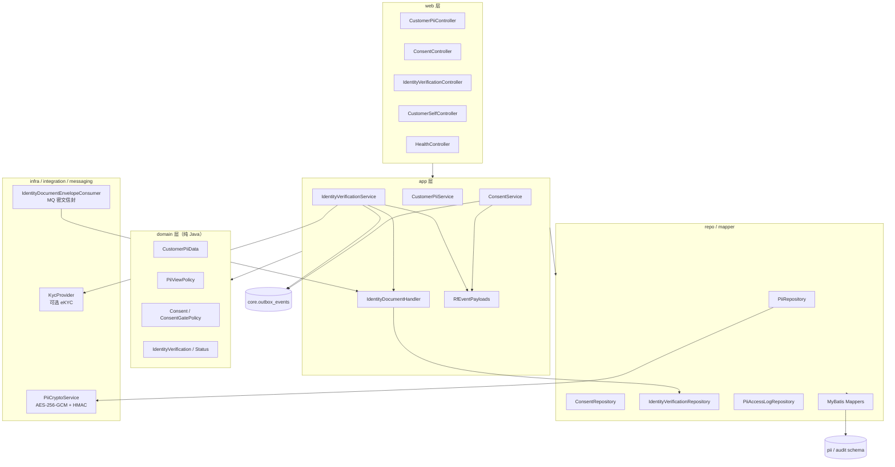
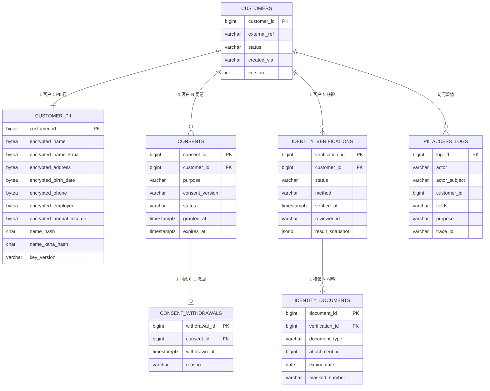
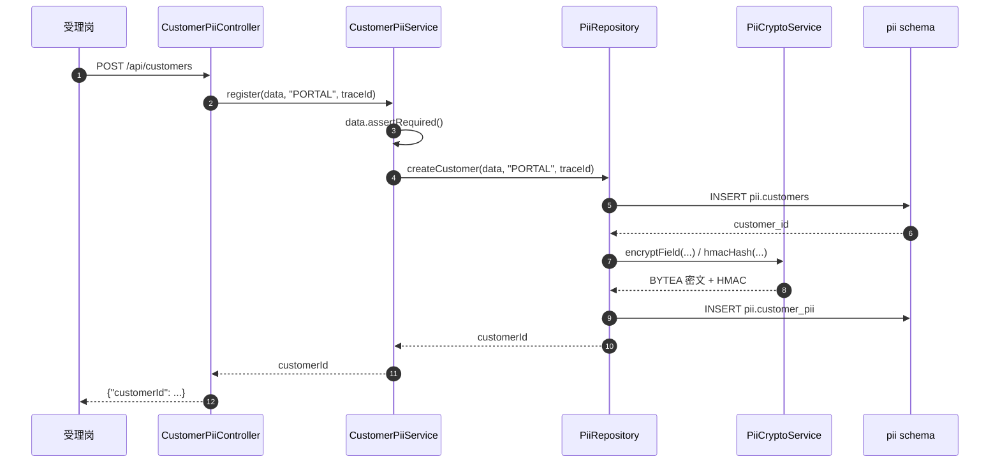
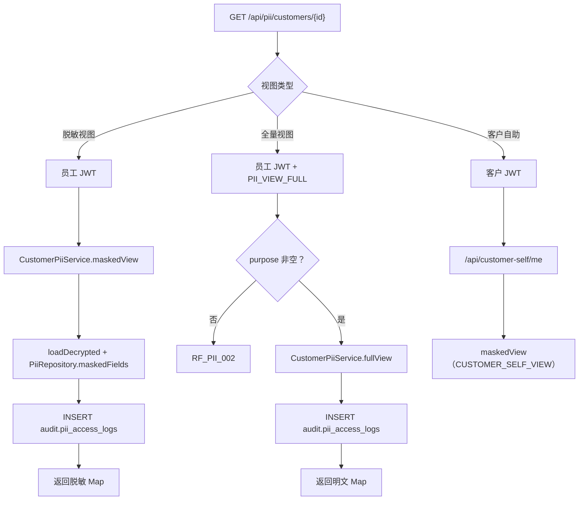
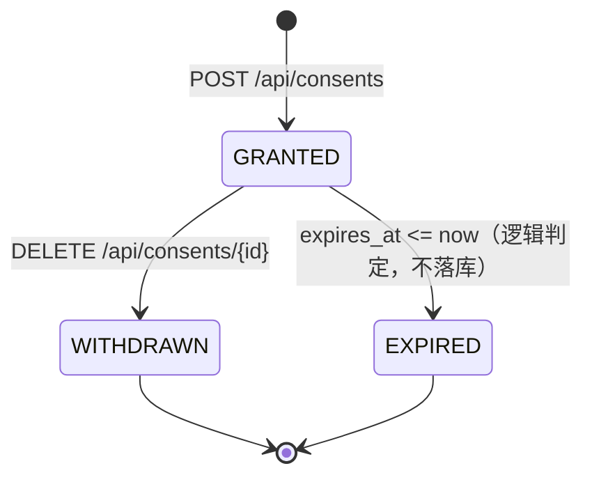
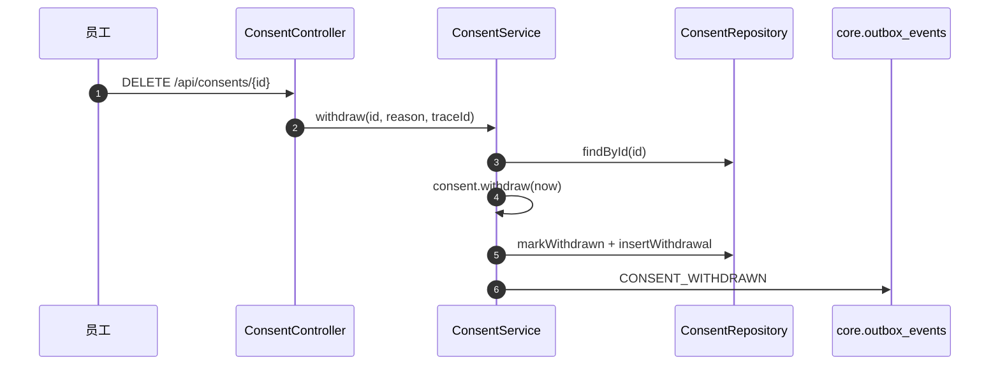
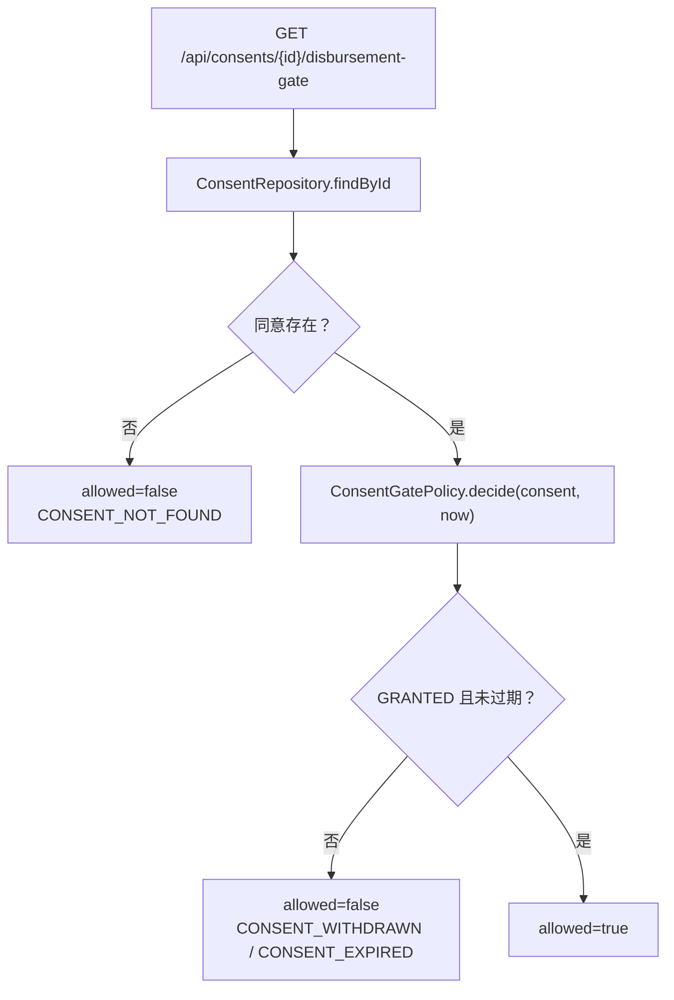
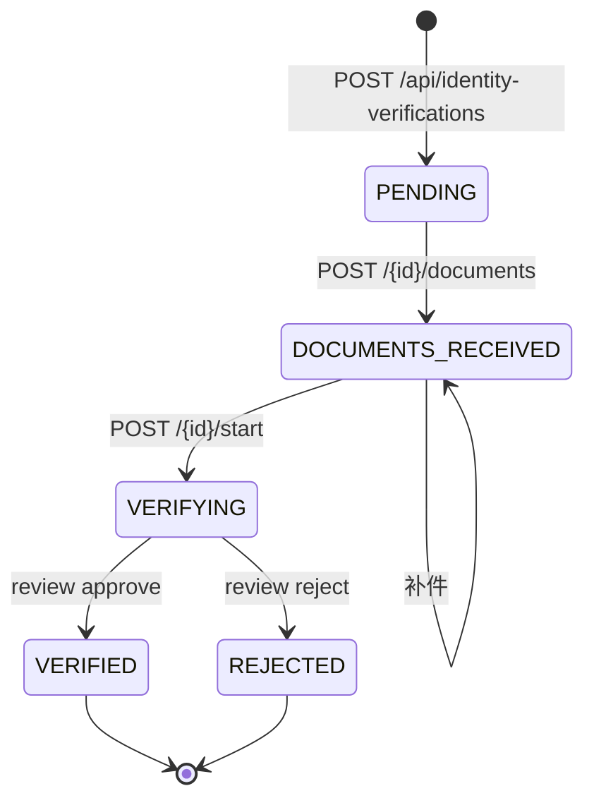
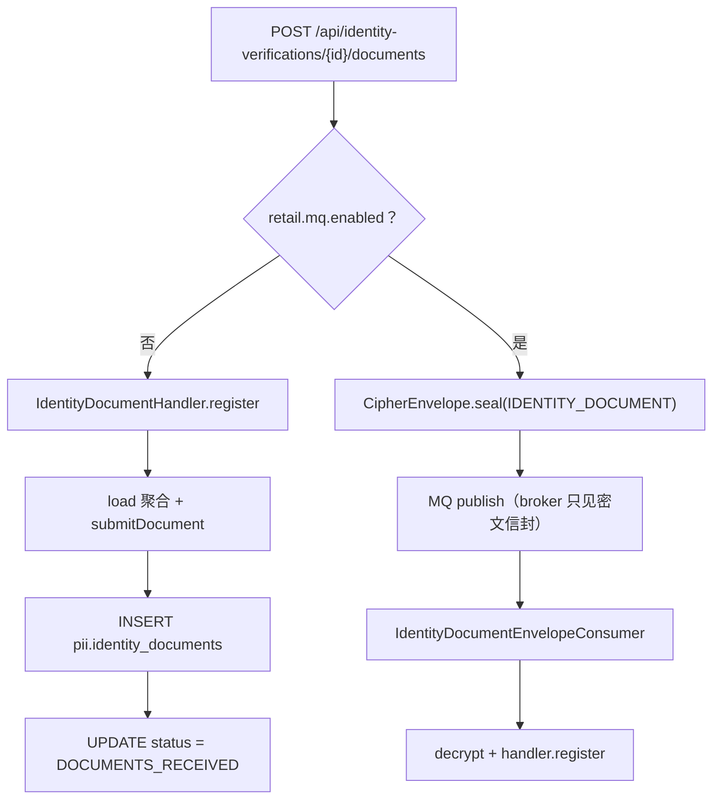

# customer-service 代码流程：个人信息金库、同意与身份核验

> **文档性质**：代码走读 / 流程图材料，不是设计定源。
> **依据**：当前 `master` 工作区代码（`customer-service` 模块，2026-11-28 走读）。
> **放置说明**：本文件放在 `interview/` 下，属于代码讲解材料，**不纳入 `docs/` 的 R00–R11 登记**，
> 不影响 `scripts/check_docs.py` 的文件计数护栏。
> **口径优先级**：`PROGRESS.md` > `AGENTS.md` > `docs/` > 代码与本文；本文只解释代码，不替代设计文档。
> **配套材料**：
> - HTML 图集：[customer-service-代码流程图集.html](customer-service-代码流程图集.html)
>   （图目录可向左收起为窄栏，右侧流程图区域自动加宽；收起后点左侧「目录」恢复）
> - 参照材料：[retail-core-代码流程.md](retail-core-代码流程.md)、
>   [servicing-service-代码流程.md](servicing-service-代码流程.md)

---

## 0. 一句话定位

`customer-service` 是**个人信息金库 + 同意管理 + 身份核验 + 客户自助**服务，端口 `8092`。

它负责：

```text
客户主数据（pii.customers）
PII 字段级加密金库（pii.customer_pii）
同意登记 / 撤回 / 代付门禁（pii.consents / pii.consent_withdrawals）
身份核验（pii.identity_verifications / pii.identity_documents）
PII 访问留痕（audit.pii_access_logs）
客户自助脱敏视图（/api/customer-self/me）
```

它**不负责**：

- 申请、审查、合同、债权、代付、入金核销、结清 —— 分别属于其他服务
- 征信查询 / 报送执行 —— `bureau-service`
- 所有权保留解除 —— `title-release-service`

它的核心红线：

> **默认脱敏；全量视图必须 `PII_VIEW_FULL` + 用途 + 留痕；明文不落日志、不进事件、不出明文库。**

---

## 1. 代码地图

### 1.1 包结构与职责

| 包 | 职责 | 关键类 |
|---|---|---|
| `customer.web` | HTTP 端点、权限点、客户/员工身份 | `CustomerPiiController`、`ConsentController`、`IdentityVerificationController`、`CustomerSelfController`；`HealthController` 在 `customer` 根包 |
| `customer.app` | 用例编排、事务边界 | `CustomerPiiService`、`ConsentService`、`IdentityVerificationService`、`IdentityDocumentHandler`、`RfEventPayloads` |
| `customer.domain` | 纯领域：同意、核验、脱敏策略 | `Consent`、`ConsentGatePolicy`、`IdentityVerification`、`IdentityVerificationStatus`、`PiiViewPolicy` |
| `customer.repo` | 仓储：Mapper 行 ↔ 领域对象 | `PiiRepository`、`ConsentRepository`、`IdentityVerificationRepository`、`PiiAccessLogRepository` |
| `customer.mapper` | MyBatis 注解 SQL | `PiiMapper`、`ConsentMapper`、`IdentityVerificationMapper`、`PiiAccessLogMapper` |
| `customer.infra` | PII 字段加密 | `PiiCryptoService` |
| `customer.integration` | eKYC 供应商（可选） | `KycProvider`、`HttpKycProvider` |
| `customer.messaging` | 核验材料 MQ 密文信封消费 | `IdentityDocumentEnvelopeConsumer` |
| `customer.config` | 精确装配 | `CustomerBeansConfig` |

### 1.2 组件与依赖方向



---

## 2. 启动与装配

`CustomerServiceApplication`：

```java
@SpringBootApplication(scanBasePackages = "com.company.retail.customer")
@EnableDiscoveryClient
@EnableFeignClients(basePackages = "com.company.retail.common.contract")
@Import({
    RfDataSourceGuardConfig.class,
    RfSecurityConfig.class,
    RfOutboxConfig.class,
    MqEnvelopeConfig.class,
    RfOutboundConfig.class
})
```

要点：

- **只扫本服务包**，不做全包扫描
- `@Import` 注入共享机制：数据源角色守卫、安全、outbox、MQ、出站客户端
- `CustomerBeansConfig` 显式 `@MapperScan("com.company.retail.customer.mapper")`
- 运行期不跑 Flyway：`spring.flyway.enabled=false`，迁移由 `db-migration` 作业执行

### 2.1 关键配置

`customer-service/src/main/resources/application.yml`：

| 配置 | 默认 | 说明 |
|---|---|---|
| `server.port` | `8092` | 服务端口 |
| `spring.datasource.username` | `retail_pii_rw` | PII 运行期受限角色 |
| `spring.flyway.enabled` | `false` | 独立迁移作业 |
| `retail.pii.data-key` | 无默认值 | PII 字段 AES-256-GCM 密钥 |
| `retail.pii.hmac-key` | 无默认值 | HMAC-SHA256 检索密钥 |
| `retail.pii.key-version` | `v1` | 密钥版本，落库支持轮换 |
| `retail.kyc.provider-url` | 空 | 空 = 纯人工 MANUAL；非空 = HTTP eKYC |
| `retail.mq.enabled` | `false` | 核验材料密文信封通道，默认关闭 |

密钥纪律：

- `retail.pii.data-key` 与 `retail.pii.hmac-key` 必须存在、长度足够、彼此不同
- 缺失 / 弱值 / 复用 → 启动失败（`SecretPolicy`，P0-8）
- 与 JWT 密钥、账号加密密钥分离

### 2.2 双主体与路径

`RfSecurityConfig`：

```text
/api/customer-self/**  → 客户侧拦截器（CUSTOMER token）
其他 /api/**           → 员工侧拦截器（EMPLOYEE token）
/api/customers/health、/api/*/health → 免鉴权
```

- 客户 token 与员工 token 由**不同密钥**签发，互不通过对方验签
- 客户自助端点只返回本人脱敏视图，永远不给全量
- 员工侧写接口按 `@RequirePermission` 鉴权

---

## 3. 领域模型与数据表

### 3.1 数据表关系（ER）



### 3.2 PII 加密与检索

`PiiCryptoService`：

| 能力 | 实现 |
|---|---|
| 字段加密 | 中台 `AesGcmFieldCipher`，AES-256-GCM |
| 落库形态 | base64 解码后 `BYTEA` 原始密文 |
| 检索 | `HMAC-SHA256` 指纹，`CHAR(64)` 列 |
| 密钥版本 | `key_version` 列，支持轮换 |
| 解密失败 | GCM 认证失败直接抛，不静默产出垃圾 |

`PiiRepository.createCustomer`：

```text
INSERT pii.customers
→ 生成 customer_id
→ 加密 name / nameKana / address / birthDate / phone / employer / annualIncome
→ HMAC name / nameKana
→ INSERT pii.customer_pii
```

两张表在同一个 `@Transactional` 里写。

### 3.3 脱敏策略

`PiiViewPolicy`：

| 字段 | 脱敏规则 |
|---|---|
| `name` / `nameKana` | 只保留首字符，其余 `*` |
| `address` | 保留到「区 / 市 / 町 / 村」，其后 `*`；找不到则保边脱中 |
| `phone` | 保留末 4 位 |
| `birthDate` | 固定 `****-**-**` |
| `employer` | 保边脱中，首尾各 2 字符 |
| `annualIncome` | 保留末 4 位 |

默认出口全部脱敏；全量视图必须额外授权 + 用途 + 留痕。

### 3.4 同意状态

`Consent`：

```text
GRANTED ──撤回──> WITHDRAWN
GRANTED ──过期──> EXPIRED（逻辑判定，不落库）
```

注意：

- `withdraw` 只允许 `status=GRANTED`；`WITHDRAWN` / `EXPIRED` → `RF_VALID_002`
- `EXPIRED` 是 `isValidAt()` 的**逻辑判定**，当前没有定时任务把 `status` 改成 `EXPIRED`
- 因此「逻辑已过期但 `status` 仍为 `GRANTED`」的记录仍可执行撤回（撤回后置 `WITHDRAWN`）；过期判定只影响 `isValidAt()` 与代付门禁，不阻断撤回动作
- 历史不删除：取得同意追加新行，撤回只改 `status` 并另表 `pii.consent_withdrawals` 留痕

### 3.5 身份核验状态

`IdentityVerificationStatus`：

```text
PENDING → DOCUMENTS_RECEIVED → VERIFYING → VERIFIED / REJECTED
```

- `VERIFIED` / `REJECTED` 是终态
- 拒绝后重新核验走新 `verification_id`，不改旧记录
- 材料：`document_type` 必填；`expiry_date` 不能早于今天

### 3.6 表数量与关联数据示例

**数量口径**：

| 类别 | 数量 | 表 |
|---|---:|---|
| 自有业务表 | 6 | `pii.customers`、`pii.customer_pii`、`pii.identity_verifications`、`pii.identity_documents`、`pii.consents`、`pii.consent_withdrawals` |
| 审计表 | 1 | `audit.pii_access_logs` |
| 共享表 | 2 | `core.outbox_events`、`integration.mq_envelope_inbox`（仅 MQ 开启时使用） |

**关联关系**：

```text
pii.customers  1 ─── 1   pii.customer_pii
pii.customers  1 ─── N   pii.identity_verifications
pii.identity_verifications  1 ─── N   pii.identity_documents

pii.customers  1 ─── N   pii.consents
pii.consents   1 ─── 0..1  pii.consent_withdrawals

pii.customers  1 ─── N   audit.pii_access_logs
core.outbox_events.aggregate_key → consent_id / verification_id
```

> ER 表达业务关系；当前 V2 迁移未建物理外键，关联完整性由应用层同一事务与仓储校验保证。
> `audit.pii_access_logs` 与 `core.outbox_events` 按追加写设计，不使用外键约束。

**示例客户 1001**（仅示意，非生产数据；`purpose` / `document_type` 为示意值）：

`pii.customers`

| customer_id | external_ref | status | created_via |
|---:|---|---|---|
| 1001 | CUST-2026-0001 | ACTIVE | PORTAL |

`pii.customer_pii`

| customer_id | encrypted_name | encrypted_phone | name_hash | key_version |
|---:|---|---|---|---|
| 1001 | `<AES-GCM 密文>` | `<AES-GCM 密文>` | `9f2c…（64 位 hex）` | v1 |

说明：该表不出现姓名、电话等明文；`name_hash` 是 HMAC-SHA256 检索指纹。

`pii.identity_verifications`

| verification_id | customer_id | status | method | reviewer_id | result_snapshot |
|---:|---:|---|---|---|---|
| 2001 | 1001 | VERIFIED | MANUAL | EMP-100 | `{"outcome":"VERIFIED","reviewer":"EMP-100"}` |

`pii.identity_documents`

| document_id | verification_id | document_type | attachment_id | expiry_date | masked_number |
|---:|---:|---|---:|---|---|
| 3001 | 2001 | ID_CARD | 9001 | 2030-12-31 | `****-****-1234` |

`pii.consents`（撤回后快照）

| consent_id | customer_id | purpose | consent_version | status | channel |
|---:|---:|---|---|---|---|
| 4001 | 1001 | CREDIT_INQUIRY | v1 | WITHDRAWN | STORE |

`pii.consent_withdrawals`

| withdrawal_id | consent_id | reason | withdrawn_at |
|---:|---:|---|---|
| 5001 | 4001 | CUSTOMER_REQUEST | 2026-11-28 11:00 |

`audit.pii_access_logs`

| log_id | actor | actor_subject | customer_id | fields | purpose | trace_id |
|---:|---|---|---:|---|---|---|
| 6001 | EMP-100 | EMPLOYEE | 1001 | name,phone | CUSTOMER_VIEW | trace-abc |

`core.outbox_events`（逻辑关联，payload 不含 PII）

| event_type | aggregate_key | payload |
|---|---|---|
| `IDENTITY_VERIFIED` | 2001 | `{"status":"VERIFIED"}` |
| `CONSENT_GRANTED` | 4001 | `{"status":"GRANTED"}` |
| `CONSENT_WITHDRAWN` | 4001 | `{"status":"WITHDRAWN","reasonCode":"CUSTOMER_REQUEST"}` |

**同一个客户的关联视图**：

```text
客户 1001
  ├── 1 行 pii.customer_pii
  ├── N 张核验单（示例 2001）
  │     └── N 份核验材料（示例 3001）
  ├── N 条同意（示例 4001）
  │     └── 0..1 条撤回（示例 5001）
  ├── N 条访问日志（示例 6001）
  └── N 条 outbox 事件（aggregate_key = 2001 / 4001）
```

---

## 4. 主流程一：客户注册与 PII 加密落库

### 4.1 入口

```text
POST /api/customers
权限点：IDENTITY_VERIFY
请求：externalRef / name / nameKana / address / birthDate / phone / employer / annualIncome
```

### 4.2 时序图



### 4.3 步骤

1. `CustomerPiiData.assertRequired()`：姓名、住址、电话必填
2. `PiiRepository.createCustomer`：
   - `INSERT pii.customers`，`status=ACTIVE`，`created_via=PORTAL`
   - 加密 7 个 PII 字段
   - HMAC 姓名/假名
   - `INSERT pii.customer_pii`
3. 两端插入在同一 `@Transactional`
4. 返回 `customerId`

### 4.4 错误与边界

| 情况 | 结果 |
|---|---|
| `name` / `address` / `phone` 为空 | `RF_VALID_001`，details 带字段名 |
| `external_ref` 重复 | `uk_customers_external_ref` 唯一约束；当前未捕获重复键异常 |
| 加密失败 | GCM 认证/加密异常，事务回滚 |
| 客户注册成功 | 不发 outbox 事件 |

> 注意：`external_ref` 有唯一约束，但当前 `PiiRepository.createCustomer` 没有把 `DuplicateKeyException` 转成 `RF_CONFLICT_001`；重复注册可能落到通用 500。接入方应按业务键先查重或统一异常映射。

---

## 5. 主流程二：PII 视图（脱敏 vs 全量）

### 5.1 端点

| 端点 | 身份/权限 | 用途 | 返回 |
|---|---|---|---|
| `GET /api/pii/customers/{id}` | 员工 JWT | 默认脱敏 | 脱敏 `Map` |
| `GET /api/pii/customers/{id}/full` | 员工 + `PII_VIEW_FULL` | 全量 | 明文 `Map` |
| `GET /api/customer-self/me` | 客户 JWT | 本人脱敏 | 脱敏 `Map` |

### 5.2 视图选择流程



### 5.3 脱敏视图

`CustomerPiiService.maskedView`：

```text
loadDecrypted(customerId)
→ PiiRepository.maskedFields(...)
→ accessLogs.record(actor, actorSubject, customerId, fields, purpose, traceId)
→ 返回 unmodifiableMap
```

- `purpose` 可空；空时按 `MASKED_VIEW` 留痕
- 读接口不设权限点，但**必须过员工 JWT**
- 每次读取都写 `audit.pii_access_logs`，只记字段名/用途，不记明文值

### 5.4 全量视图

`CustomerPiiService.fullView`：

```text
loadDecrypted(customerId)
→ purpose 为空 → RF_PII_002
→ accessLogs.record(..., "name,nameKana,address,birthDate,phone,employer,annualIncome", purpose, traceId)
→ 返回 CustomerPiiData
```

控制器层再强制：

```java
@RequirePermission(Permission.PII_VIEW_FULL)
@GetMapping("/api/pii/customers/{id}/full")
```

即：

```text
PII_VIEW_FULL 权限 + purpose 必填 + 访问留痕
三层缺一不可
```

### 5.5 客户自助

`CustomerSelfController`：

```java
@RequireSubject(SubjectType.CUSTOMER)
@GetMapping("/api/customer-self/me")
```

- token subject 必须能解析为 `customerId`，否则 `RF_AUTH_001`
- 只调用 `maskedView`，用途 `CUSTOMER_SELF_VIEW`
- 返回 `customerId / pii（脱敏） / notice`
- **永远不返回全量**

---

## 6. 主流程三：同意管理

### 6.1 取得同意

```text
POST /api/consents
权限点：CONSENT_MAINTAIN
请求：customerId / purpose / consentVersion / channel / evidenceAttachmentId / expiresAt
```

`ConsentService.grant`：

1. `purpose` 非空
2. 客户存在
3. `INSERT pii.consents`，`status=GRANTED`，`consent_version` 默认 `v1`
4. 同一本地事务写 `CONSENT_GRANTED` outbox

```text
aggregate_key = consentId
payload       = status=GRANTED
```

### 6.2 同意状态机



> `EXPIRED` 是 `Consent.isValidAt()` 的判定结果，当前不会把 `pii.consents.status` 改成 `EXPIRED`；  
> `ConsentGatePolicy` 会把“已过期但状态仍 GRANTED”的同意判为 `CONSENT_EXPIRED`。

### 6.3 撤回时序



`ConsentService.withdraw`：

- 只有 `GRANTED` 可撤回；`WITHDRAWN` / `EXPIRED` → `RF_VALID_002`
- `markWithdrawn` 只改状态，不物理删除
- `insertWithdrawal` 一同意一撤回（`uk_cw_consent`）
- 同一事务写 `CONSENT_WITHDRAWN`，payload 只带 `consentId` / `status` / `reasonCode`

### 6.4 代付门禁与有效性

**代付门禁**：

```text
GET /api/consents/{consentId}/disbursement-gate
```



`ConsentGatePolicy.decide(consent, now)`：

| 情况 | allowed | reasonCode |
|---|---|---|
| 查不到 | false | `CONSENT_NOT_FOUND` |
| 已撤回 | false | `CONSENT_WITHDRAWN` |
| 已过期 | false | `CONSENT_EXPIRED` |
| GRANTED 且未过期 | true | null |

fail-closed：查不到 / 已撤回 / 已过期一律 `allowed=false`，禁缓存门禁结果。

**有效性查询**：

```text
GET /api/consents/validity?customerId=...&purpose=...
```

`ConsentRepository.findActiveByCustomerAndPurpose`：

```sql
WHERE customer_id = ? AND purpose = ? AND status = 'GRANTED'
  AND (expires_at IS NULL OR expires_at > now())
ORDER BY granted_at DESC LIMIT 1
```

- 有 → `valid=true` + `consentId/purpose/consentVersion`
- 无 → `valid=false` + `reasonCode=NO_ACTIVE_CONSENT`

---

## 7. 主流程四：身份核验

### 7.1 入口

| 端点 | 权限 | 作用 |
|---|---|---|
| `POST /api/identity-verifications` | `IDENTITY_VERIFY` | 新建核验，`status=PENDING`，`method=MANUAL` |
| `POST /api/identity-verifications/{id}/documents` | `IDENTITY_VERIFY` | 提交材料 |
| `POST /api/identity-verifications/{id}/start` | `IDENTITY_VERIFY` | 进入 `VERIFYING` |
| `POST /api/identity-verifications/{id}/review` | `IDENTITY_VERIFY` | 人工审核 `approve/reject` |
| `GET /api/identity-verifications/{id}` | 员工 JWT | 查询状态与材料数 |

### 7.2 状态机



`IdentityVerification` 聚合保证：

- `PENDING / DOCUMENTS_RECEIVED` 可补件；`VERIFYING` / 终态不可补件
- `startVerification` 至少一份材料
- `verify` 要求 `reviewerId` 非空
- 状态变更只走聚合方法

### 7.3 材料提交：同步 vs MQ



要点：

- 同步路径：`IdentityVerificationService.submitDocument` 是 `@Transactional`，材料 + 状态同一事务
- MQ 路径：控制器把载荷封成密文信封入队后立即返回；消费端解密后调用**同一个** `IdentityDocumentHandler`
- 载荷含 `maskedNumber` / `expiryDate`（个人信息），只存在于密文内部
- MQ 默认关闭；关闭时行为与同步路径逐字一致

### 7.4 进入核验与人工审核

`start`：

1. 加载聚合
2. `startVerification`：`DOCUMENTS_RECEIVED → VERIFYING`，至少一份材料
3. 可选 eKYC：配置 `retail.kyc.provider-url` 时，取最后一份材料的脱敏号/类型提交
4. 供应商失败/未配置 → `providerSnapshot=null`，流程不中断
5. `updateStatus(VERIFYING, result_snapshot)`

`review`：

```text
approve=true  → VERIFYING → VERIFIED，发 IDENTITY_VERIFIED
approve=false → VERIFYING → REJECTED
```

- 审核结果写入 `result_snapshot`（JSONB）
- `IDENTITY_VERIFIED` 聚合键 `verificationId`，payload 只带 `status`，**不带 customerId / PII**
- 拒绝后重新核验走新 `verification_id`，不改旧记录

### 7.5 eKYC 供应商

`KycProvider` / `HttpKycProvider`：

- 默认 `provider-url` 为空 → 纯人工 MANUAL，无外部调用
- 配置后走 `OutboundProfile.ADVISORY`：单次尝试、失败不阻断主流程
- 出站只带 `verificationId / maskedNumber / documentType`，不带明文 PII
- 幂等键由 `verificationId` 派生，重发共享同一键

---

## 8. 客户自助与双主体隔离

```text
员工侧：/api/**（除 /api/customer-self/**）→ EMPLOYEE token
客户侧：/api/customer-self/** → CUSTOMER token
```

`CustomerSelfController`：

```java
@RequireSubject(SubjectType.CUSTOMER)
@GetMapping("/api/customer-self/me")
```

- token subject 必须能解析为 `customerId`，否则 `RF_AUTH_001`
- 只返回本人脱敏信息
- 用途固定 `CUSTOMER_SELF_VIEW`
- 每次访问写 `audit.pii_access_logs`

双主体红线：

- 客户 token 不能过员工侧验签
- 员工 token 不能过客户侧验签
- 客户自助端点不设 RBAC 权限点，`@RequireSubject(CUSTOMER)` 是主体闸门
- 客户自助永远不给全量

---

## 9. 事件与 outbox

| 事件 | 触发 | 聚合键 | payload |
|---|---|---|---|
| `CONSENT_GRANTED` | 取得同意 | `consentId` | status |
| `CONSENT_WITHDRAWN` | 撤回同意 | `consentId` | status / reasonCode |
| `IDENTITY_VERIFIED` | 人工审核通过 | `verificationId` | status |

规则：

- payload 只允许白名单键（`RfEventPayloads` + `EventPayloadGuard`）
- **不带姓名 / 住址 / 电话 / 证件号 / 年收入**
- 事件与业务写同一本地事务（outbox 行）
- `core.outbox_events` 由 `retail_pii_rw` 授权写入（V22 补偿授权）
- MQ 只是 outbox 之上的削峰层；broker 上只允许密文信封

身份核验材料 MQ：

```text
EnvelopeTopics.IDENTITY_DOCUMENT
payload 包含 maskedNumber / expiryDate（PII）
→ 加密后入队；broker 不可见明文
→ IdentityDocumentEnvelopeConsumer 解密后执行同一 handler
```

---

## 10. 幂等 / 并发 / 安全

| 机制 | 落点 |
|---|---|
| 客户外部引用唯一 | `uk_customers_external_ref` |
| 一客户一 PII 行 | `uk_cpii_customer` |
| 一同意一撤回 | `uk_cw_consent` |
| outbox 事件去重 | `(event_type, aggregate_key)` PENDING/SENT 不重复插入 |
| MQ 消费幂等 | `integration.mq_envelope_inbox (envelope_id, consumer)` |
| PII 访问留痕 | `audit.pii_access_logs` append-only |
| 密钥启动门禁 | `retail.pii.data-key` / `hmac-key` 无默认值，缺失/弱值启动失败 |
| DB 角色 | `retail_pii_rw`；业务角色对 `pii.customer_pii` / `consents` / `identity_*` 已撤销 SELECT（V16/V17） |

注意：

- `pii.consents.markWithdrawn` 与 `pii.identity_verifications.updateStatus` 当前**没有乐观锁条件**，并发写为最后写入者生效；业务上依赖串行操作/人工审核
- 客户注册没有 `Idempotency-Key`，重复 `external_ref` 由唯一索引拦截，但异常未统一映射
- 撤回同意是语义撤回，不删除历史；下游门禁必须实时查询，不缓存结果

---

## 11. 数据表与迁移

数量口径：自有业务表 6 张 + 审计表 1 张 + 共享表 2 张；逐表关联示例见 §3.6。

| 表 | 用途 | 迁移 |
|---|---|---|
| `pii.customers` | 客户主表（非敏感标识） | V2 |
| `pii.customer_pii` | PII 密文 + HMAC 检索列 | V2 |
| `pii.identity_verifications` | 身份核验主行 | V2 |
| `pii.identity_documents` | 核验材料引用 + 脱敏号 | V2 |
| `pii.consents` | 同意登记（新行追加；撤回只改状态） | V2 |
| `pii.consent_withdrawals` | 撤回留痕（一同意一撤回） | V2 |
| `audit.pii_access_logs` | PII 访问留痕 | V1 |
| `core.outbox_events` | 事件发件箱 | V1 + V20 |
| `integration.mq_envelope_inbox` | MQ 密文信封收件箱 | V20 |

授权收紧：

- V16：撤销 `retail_app_rw` 对 `pii.customer_pii` 的 SELECT
- V17：撤销 `retail_app_rw` 对 `pii.consents` / `consent_withdrawals` / `identity_*` 的 SELECT
- V22：补齐 `retail_pii_rw` 对 `core.outbox_events` 等横切表的授权

---

## 12. 对外接口

| 方法 | 路径 | 身份/权限 | 说明 |
|---|---|---|---|
| GET | `/api/customers/health` | 免鉴权 | 健康检查 |
| GET | `/api/customers/whoami` | 员工 JWT | 回显验签主体 |
| POST | `/api/customers` | `IDENTITY_VERIFY` | 客户注册 |
| GET | `/api/pii/customers/{id}` | 员工 JWT | 脱敏视图 + 留痕 |
| GET | `/api/pii/customers/{id}/full` | `PII_VIEW_FULL` | 全量视图 + 用途 + 留痕 |
| POST | `/api/consents` | `CONSENT_MAINTAIN` | 取得同意 |
| DELETE | `/api/consents/{id}` | `CONSENT_MAINTAIN` | 撤回同意 |
| GET | `/api/consents/{id}/disbursement-gate` | 员工 JWT | 代付门禁（fail-closed） |
| GET | `/api/consents/validity` | 员工 JWT | 同意有效性 |
| POST | `/api/identity-verifications` | `IDENTITY_VERIFY` | 发起核验 |
| POST | `/api/identity-verifications/{id}/documents` | `IDENTITY_VERIFY` | 提交材料 |
| POST | `/api/identity-verifications/{id}/start` | `IDENTITY_VERIFY` | 进入核验中 |
| POST | `/api/identity-verifications/{id}/review` | `IDENTITY_VERIFY` | 人工审核 |
| GET | `/api/identity-verifications/{id}` | 员工 JWT | 查询核验 |
| GET | `/api/customer-self/me` | 客户 JWT | 本人脱敏视图 |

---

## 13. 测试

`customer-service` 重点单测：

| 测试类 | 覆盖点 |
|---|---|
| `CustomerDomainTest` | 同意状态、核验状态、脱敏策略 |
| `CustomerBeansConfigSecretTest` | PII 密钥启动门禁 |
| `HttpKycProviderTest` | eKYC 适配器失败语义 |
| `IdentityDocumentEnvelopeConsumerTest` | 密文信封消费与 handler 复用 |
| `EventPayloadGuardTest` | 事件 payload 白名单 |

本地验证：

```bash
mvn -B test -pl customer-service -am
python scripts/check_docs.py
```

---

## 14. 建议的读代码顺序

```text
① CustomerServiceApplication
② CustomerPiiController + CustomerPiiService + PiiRepository
③ PiiCryptoService + PiiViewPolicy
④ ConsentController + ConsentService + ConsentGatePolicy
⑤ IdentityVerificationController + IdentityVerificationService
⑥ IdentityDocumentHandler + IdentityDocumentEnvelopeConsumer
⑦ CustomerSelfController + RfSecurityConfig 双拦截器
⑧ V2 / V16 / V17 / V22 迁移
```

---

## 15. 当前边界与注意

1. **`EXPIRED` 不落库**：同意过期是 `isValidAt()` 的逻辑判定；`status` 可能仍是 `GRANTED`。
2. **状态更新无乐观锁**：`consents.markWithdrawn` / `identity_verifications.updateStatus` 没有 `version` 条件，并发写最后写入者生效。
3. **客户注册无幂等键**：`external_ref` 唯一约束兜底；重复键异常未统一转 `RF_CONFLICT_001`。
4. **MQ 材料路径无显式事务**：同步路径 `submitDocument` 是 `@Transactional`；MQ 消费端调用 `IdentityDocumentHandler.register` 时没有显式事务边界，部分写/重复材料需要在消费端补事务或幂等键。
5. **全量视图先解密后校验用途**：`fullView` 先 `loadDecrypted`，再检查 `purpose`；控制器已要求 `purpose`，服务侧是二次防御。
6. **客户自助永远脱敏**：即使客户本人也不能通过 `/api/customer-self/me` 获取全量。
7. **eKYC 是可选能力**：默认纯人工 MANUAL；配置 provider 后只出脱敏号/引用，失败不阻断核验。
8. **事件不含 PII**：`CONSENT_GRANTED` / `CONSENT_WITHDRAWN` / `IDENTITY_VERIFIED` 只带业务主键和状态。
9. **DB 角色隔离**：`retail_pii_rw` 负责 PII 表；`retail_app_rw` 对敏感 PII 表已撤权（V16/V17）。
10. **不物理删除**：同意撤回、核验拒绝都保留历史行；重做走新记录。

---

## 16. 自检

- 本文只解释 `customer-service` 当前代码，不新增业务口径
- 所有 PII 示例只使用脱敏值或字段名，不出现真实个人信息
- 同意/核验状态机以领域枚举与聚合方法为准
- 本文放在 `interview/`，不改变 `docs/` 文件计数，不影响 `check_docs.py`
