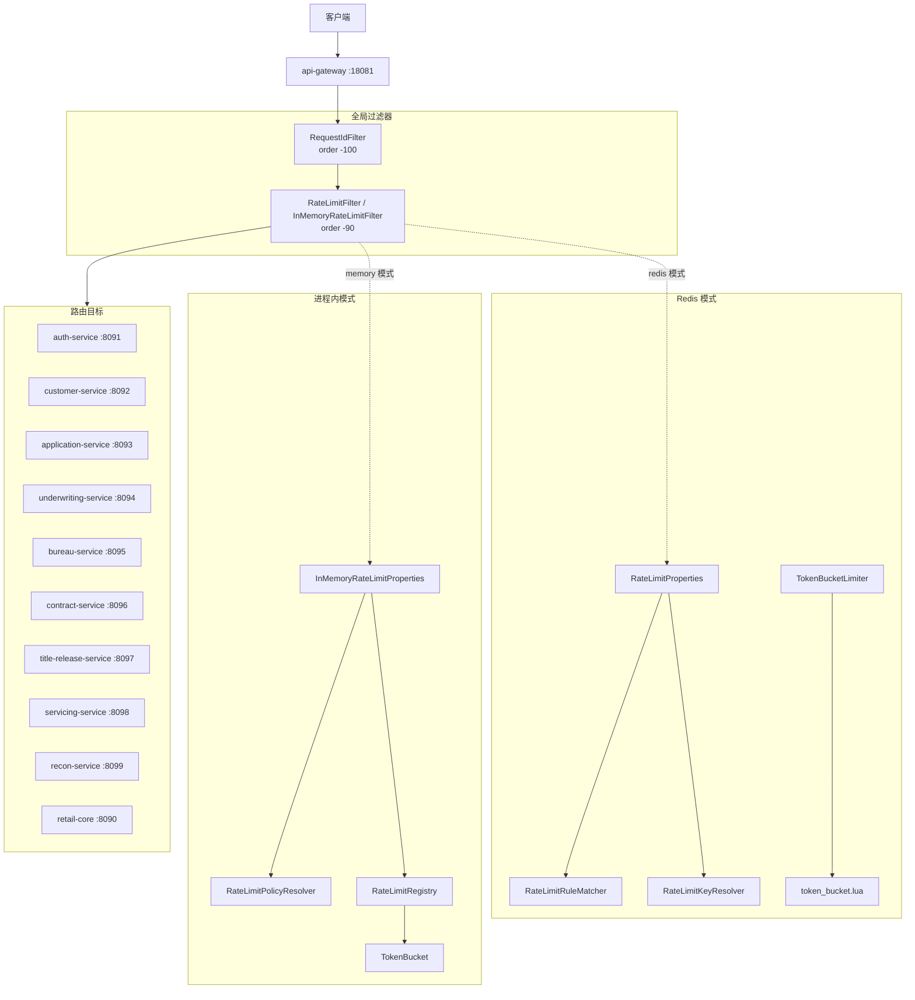
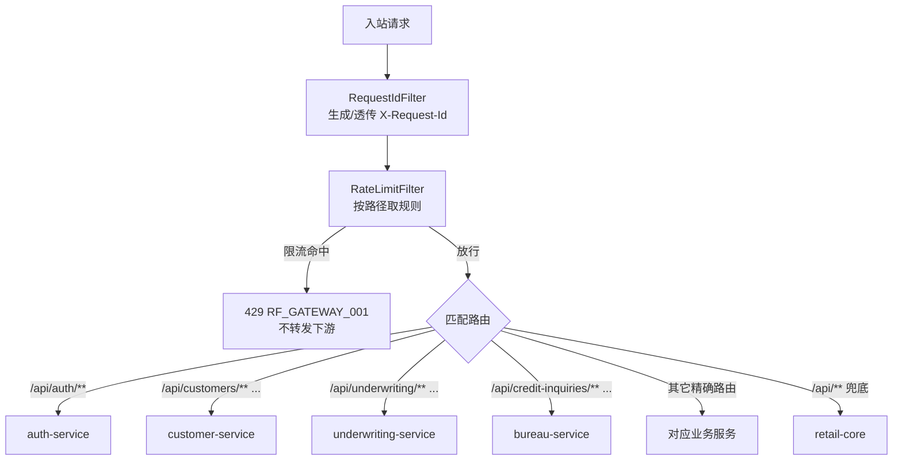
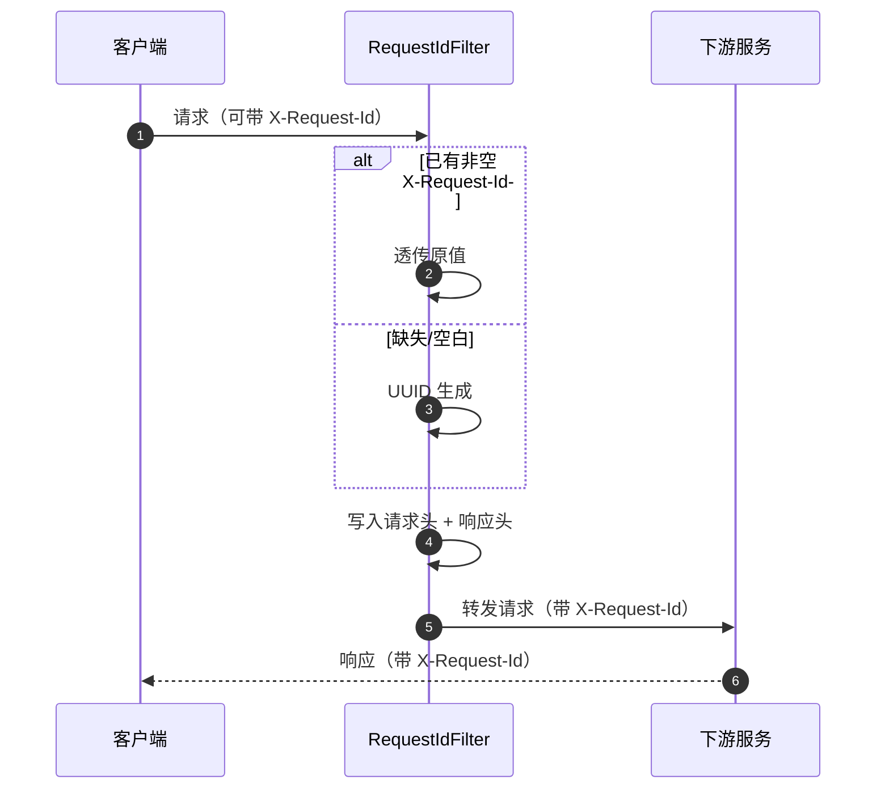
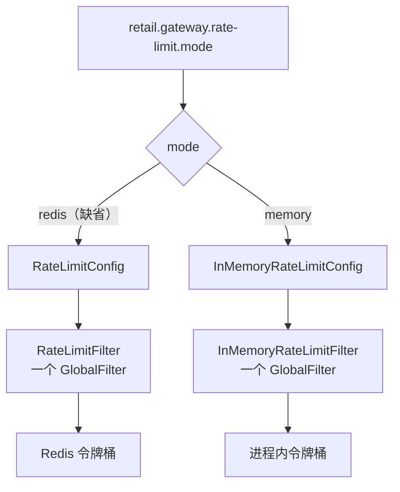
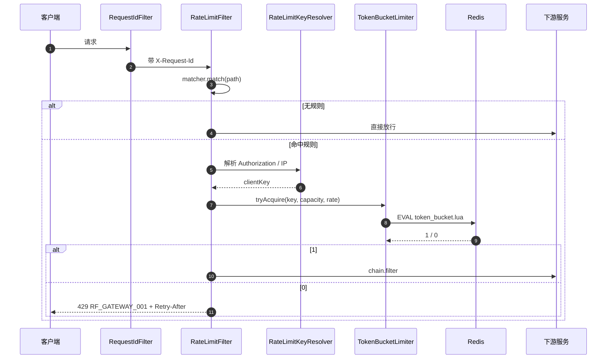
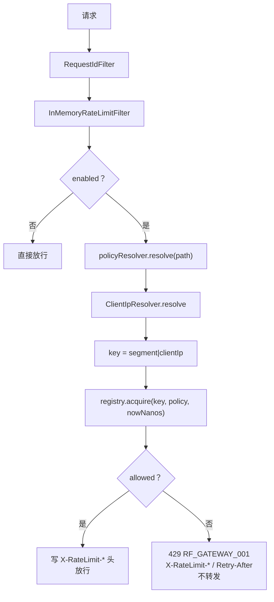
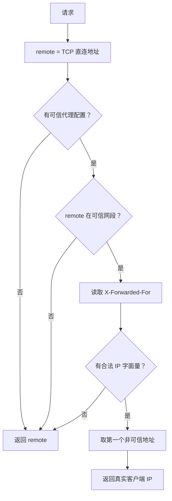

# gateway-service 代码流程：路径切流、请求号与双模式限流

> **文档性质**：代码走读 / 流程图材料，不是设计定源。
> **依据**：当前 `master` 工作区代码（`gateway/` 模块，2026-11-28 走读）。
> **放置说明**：本文件放在 `interview/` 下，属于代码讲解材料，**不纳入 `docs/` 的 R00–R11 登记**，
> 不影响 `scripts/check_docs.py` 的文件计数护栏。
> **口径优先级**：`PROGRESS.md` > `AGENTS.md` > `docs/` > 代码与本文；本文只解释代码，不替代设计文档。
> **配套材料**：
> - HTML 图集：[gateway-service-代码流程图集.html](gateway-service-代码流程图集.html)
>   （图目录可向左收起为窄栏，右侧流程图区域自动加宽；收起后点左侧「目录」恢复）
> - 参照材料：[retail-core-代码流程.md](retail-core-代码流程.md)、
>   [网关请求链路详解.md](网关请求链路详解.md)

---

## 0. 一句话定位

`gateway-service` 的代码目录是 `gateway/`，应用名 `api-gateway`，端口 `18081`。

它是内部统一入口，负责三件事：

```text
路径切流：按路径把请求转发到 10 个业务服务
请求号：X-Request-Id 透传/生成/回显
限流：Redis 令牌桶（默认）/ 进程内令牌桶，二选一
```

它**不负责**：

- JWT 验签 / 权限判断 —— 下沉到各业务服务本地验签
- 业务逻辑、数据库读写 —— 网关不连业务库
- 身份认证 —— `/api/auth/**` 只负责转发到 auth-service
- 业务幂等、账务一致性 —— 各服务自己保证

核心边界：

> **网关是统一入口和限流保护层，不是安全边界；JWT 鉴权在各服务内完成。**

### 0.1 请求链路

```text
客户端
  → api-gateway :18081
      ├─ RequestIdFilter：生成/透传 X-Request-Id
      ├─ RateLimitFilter：令牌桶限流
      └─ 路由匹配：精确路由优先，/api/** 兜底到 retail-core
  → auth / customer / application / underwriting / bureau /
    contract / title-release / servicing / recon / retail-core
      └─ 各服务本地验签 JWT、鉴权、业务处理
```

---

## 1. 代码地图

### 1.1 包结构与职责

| 包/类 | 职责 |
|---|---|
| `gateway.GatewayApplication` | WebFlux 网关启动类 |
| `gateway.RequestIdFilter` | 全局 `X-Request-Id` 过滤器，order `-100` |
| `gateway.ratelimit.RateLimitProperties` | Redis 模式限流参数 |
| `gateway.ratelimit.RateLimitRuleMatcher` | Ant 路径匹配，最具体规则优先 |
| `gateway.ratelimit.RateLimitKeyResolver` | Authorization 哈希 / IP 计数键 |
| `gateway.ratelimit.RateLimitFilter` | Redis 模式限流过滤器，order `-90` |
| `gateway.ratelimit.TokenBucketLimiter` | Redis + Lua 令牌桶 |
| `gateway.ratelimit.RateLimitConfig` | Redis 模式装配 |
| `gateway.ratelimit.InMemoryRateLimitProperties` | 进程内模式参数 |
| `gateway.ratelimit.RateLimitPolicyResolver` | 路径前缀 → 策略 |
| `gateway.ratelimit.RateLimitRegistry` | 进程内桶仓库、空闲回收 |
| `gateway.ratelimit.TokenBucket` | 纯 Java 令牌桶 |
| `gateway.ratelimit.InMemoryRateLimitFilter` | 进程内限流过滤器，order `-90` |
| `gateway.ratelimit.InMemoryRateLimitConfig` | 进程内模式装配 |
| `gateway.ratelimit.ClientIpResolver` | 可信代理 / X-Forwarded-For 解析 |
| `gateway/src/main/resources/lua/token_bucket.lua` | Redis 原子扣减脚本 |

网关**没有** `HealthController`，也没有业务 API；冒烟时通过网关访问各服务的 `/health`。

### 1.2 组件与依赖方向



---

## 2. 启动与路由

### 2.1 启动

`GatewayApplication`：

```java
@SpringBootApplication(scanBasePackages = "com.company.retail.gateway")
@EnableDiscoveryClient
```

要点：

- 基于 Spring Cloud Gateway / WebFlux，不是 Servlet MVC
- 不导入 `RfSecurityConfig`，**网关不验签**
- 不连业务数据库
- `discovery.locator.enabled=false`：不按服务名自动暴露路由，全部显式声明
- 路由 URI 双模：`${ROUTE_*:lb://服务名}`；本地无 Nacos 时用 `ROUTE_*` 直连

### 2.2 路由表

精确路由在前，`/api/**` 兜底在后：

| 路由 | 路径 | 目标 |
|---|---|---|
| `auth` | `/api/auth/**` | `auth-service` |
| `customer` | `/api/customers/**`、`/api/identity-verifications/**`、`/api/consents/**`、`/api/pii/**`、`/api/customer-self/**` | `customer-service` |
| `application` | `/api/applications/**`、`/api/dealer-partners/**` | `application-service` |
| `underwriting` | `/api/underwriting/**`、`/api/rules/**` | `underwriting-service` |
| `bureau` | `/api/credit-inquiries/**`、`/api/bureau-reports/**`、`/api/bureau-disputes/**` | `bureau-service` |
| `contract` | `/api/contracts/**` | `contract-service` |
| `title-release` | `/api/title-retentions/**`、`/api/release-orders/**` | `title-release-service` |
| `servicing` | `/api/collection-cases/**`、`/api/dpd-snapshots/**`、`/api/jobs/dpd-snapshot`、`/api/jobs/dpd-snapshot/**` | `servicing-service` |
| `recon` | `/api/recon/**` | `recon-service` |
| `core` | `/api/**` | `retail-core`（兜底） |

### 2.3 路由匹配流程



关键点：

- 精确路由必须排在 `/api/**` 之前；否则会被兜底截走
- `/api/**` 兜底到 `retail-core`，但 `retail-core` 只承载核心账务路径
- 路径切流本身不做 JWT 验签；各服务自己验
- `globalcors` 当前 `allowedOriginPatterns: "*"`，是开发口径，生产需收紧

---

## 3. X-Request-Id

### 3.1 时序



### 3.2 规则

- 入站有 `X-Request-Id` 且非空 → 原样透传
- 缺失或空白 → `UUID.randomUUID()`
- 同时写请求头和响应头
- order `-100`，排在限流 `-90` 之前，所以 429 响应也带请求号
- 下游各服务 `TraceIdFilter` 把它贯穿到日志、审计、outbox

---

## 4. 双模式限流总览

网关有两套限流实现，**互斥装配**：

```text
retail.gateway.rate-limit.mode = redis（缺省）
  → RateLimitConfig
  → RateLimitFilter
  → Redis + Lua 令牌桶

retail.gateway.rate-limit.mode = memory
  → InMemoryRateLimitConfig
  → InMemoryRateLimitFilter
  → 进程内令牌桶
```

同一时刻只注册一个 `GlobalFilter`，避免双重限流。



### 4.1 共同语义

- 都在 `RequestIdFilter` 之后（order `-90`）
- 都在路由转发之前执行；被限流的请求不会打到下游
- 超限返回 `429` + `RF_GATEWAY_001`
- 响应带 `Retry-After`
- 限流是保护层，不是正确性防线
- 日志不写 Authorization / 客户端 IP

### 4.2 两种模式差异

| 维度 | Redis 模式 | 进程内模式 |
|---|---|---|
| 计数位置 | Redis 共享 | JVM 内存 |
| 多实例 | 全局准确 | 单实例口径，实际额度 ≈ 单副本 × 副本数 |
| 计数键 | 规则路径 + Authorization 哈希 / IP | 路径段 + 客户端 IP |
| 规则匹配 | Ant 风格，最长 pattern 优先 | 路径前缀，最长前缀优先 |
| 失败语义 | Redis 不可用 → fail-closed 503（可显式 fail-open） | 无外部依赖 |
| 响应头 | 429 + Retry-After | 429 + `X-RateLimit-*` + Retry-After |
| 配置前缀 | `retail.gateway.rate-limit.*` | `retail.gateway.rate-limit.memory.*` |

---

## 5. Redis 模式

### 5.1 配置

`gateway/src/main/resources/application.yml`：

| 配置 | 默认 | 说明 |
|---|---|---|
| `retail.gateway.rate-limit.enabled` | `true` | 限流总开关 |
| `mode` | `redis` | `redis` / `memory` |
| `fail-open` | `false` | Redis 不可用时默认 503；本地 dev 才显式 true |
| `key-by` | `auth_or_ip` | Authorization 哈希，缺失退化 IP |
| `key-prefix` | `rf:rl:` | Redis 键前缀 |
| `trusted-proxy-cidrs` | 空 | 空 = 不采信 X-Forwarded-For |
| `spring.data.redis.port` | `6382` | 限流 Redis（与锁 Redis 6381 分开） |

规则：

```text
/api/applications/**       20/s，突发 40
/api/credit-inquiries/**   10/s，突发 20
/api/rate-limit-probe/**   1/s，突发 2
/api/**                    500/s，突发 1000
```

`auth` 没有单独规则，落 `/api/**` 全局规则。

### 5.2 计数键

`RateLimitKeyResolver`：

```text
keyBy = auth_or_ip（默认）且 Authorization 非空
  → "a:" + SHA-256(Authorization)

否则
  → "ip:" + 客户端 IP
```

Redis 键：

```text
rf:rl:{rule.path}:{clientKey}
```

例：

```text
rf:rl:/api/credit-inquiries/**:a:9f2c...（SHA-256）
rf:rl:/api/**:ip:203.0.113.10
```

要点：

- 不把 Authorization 明文写进 Redis 键
- 网关本阶段不验签，不能把 token 内容当可信主体
- 生产若网关验签，应改用验签主体 ID，避免同一主体换 token 换桶

### 5.3 Lua 令牌桶

`token_bucket.lua`：

```text
HMGET tokens, ts
初始化 capacity / now
按 elapsed 补充 tokens
tokens >= 1 → 扣 1，返回 1
否则返回 0
HSET tokens, ts
PEXPIRE = 装满时间 + 1s
```

为什么用 Lua：

```text
HGET → 计算 → HSET 不是原子的
两个并发请求会读到同一个令牌数并都放行
Redis 单线程执行脚本，脚本内天然互斥
```

### 5.4 过滤器时序



### 5.5 失败语义

```text
Redis 异常
  → log ALERT_RATE_LIMIT_REDIS_UNAVAILABLE（实例 10s 节流）
  → fail-open=true：放行
  → fail-open=false（默认）：503
```

注意：

- 生产默认 fail-closed，不允许静默绕过限流
- 本地 dev 才显式 `RETAIL_GATEWAY_RATE_LIMIT_FAIL_OPEN=true`
- 告警日志只记路径和异常类型，不记 Authorization / IP
- Redis 模式没有 `X-RateLimit-*` 响应头，只有 429 + `Retry-After: 1`

### 5.6 429 响应

```json
{
  "code": "RF_GATEWAY_001",
  "message": "请求过于频繁（网关限流）",
  "data": null,
  "traceId": "trace-...",
  "details": {
    "path": "/api/credit-inquiries"
  }
}
```

HTTP `429`，`Retry-After: 1`。

---

## 6. 进程内模式

### 6.1 配置

`retail.gateway.rate-limit.memory.*`：

| 配置 | 默认 | 说明 |
|---|---|---|
| `enabled` | `true` | 总开关 |
| `max-tracked-keys` | `50000` | 桶数量上限 |
| `idle-eviction-seconds` | `600` | 空闲回收 |
| `trusted-proxy-cidrs` | 空 | 可信代理网段 |
| `default-policy.capacity` | `600` | 默认桶容量 |
| `default-policy.refill-per-second` | `100` | 默认补充速率 |
| 规则 | `/api/auth/` 120/20、`/api/applications/` 120/20、`/api/consents/` 120/20、`/api/identity-verifications/` 60/10、`/api/customer-self/` 120/20 | 代码默认 |

这些默认值写在 `InMemoryRateLimitProperties` 代码里，不写 `gateway/application.yml`（共享禁区文件）。

### 6.2 策略解析

`RateLimitPolicyResolver`：

```text
按 pathPrefix 长度倒序
  → 最长前缀命中
  → 返回 segment + policy
无命中 → default 600/100
```

注意：进程内模式是**前缀匹配**（`startsWith`），不是 Ant 匹配。

### 6.3 令牌桶与桶仓库

`TokenBucket`：

- 容量 `capacity`
- 每秒补充 `refillPerSecond`
- 取令牌成功扣 1
- 桶空返回 `retryAfterSeconds = ceil(缺少令牌 / 速率)`
- 使用单调时钟，时钟回拨不补充
- `synchronized` 保证单桶线程安全

`RateLimitRegistry`：

- `ConcurrentHashMap<key, Bucket>`
- key = `segment|clientIp`
- 桶数量超过 `maxTrackedKeys` → 触发空闲回收
- 空闲超过 `idleEvictionSeconds` → 回收
- 后台单线程每 30–300 秒清理一次
- 进程内模式是单实例口径

### 6.4 过滤器流程



### 6.5 响应头与 429

放行时：

```text
X-RateLimit-Limit
X-RateLimit-Remaining
```

拒绝时：

```text
X-RateLimit-Limit
X-RateLimit-Remaining
X-RateLimit-Reset
Retry-After
```

429 响应体使用 `ApiResponse.fail`，包含：

```json
{
  "code": "RF_GATEWAY_001",
  "message": "请求过于频繁（网关限流）",
  "traceId": "trace-...",
  "details": {
    "limit": 2,
    "remaining": 0,
    "retryAfterSeconds": 1,
    "policy": "/api/auth/"
  }
}
```

---

## 7. 客户端 IP 与可信代理

### 7.1 计数键来源

`ClientIpResolver`：

```text
没有可信代理配置
  → 取 TCP 直连地址，忽略 X-Forwarded-For

直连来源在可信代理网段
  → 采信 X-Forwarded-For
  → 取链中第一个“非可信”地址

直连来源不在可信网段
  → 仍然取 TCP 直连地址
  → 换 X-Forwarded-For 也不能重置限流
```

### 7.2 解析流程



安全要点：

- 默认不采信任何转发头，防伪造
- 只接受 IP 字面量，不解析主机名，避免 DNS 阻塞
- 生产在网关前放 Nginx 时，必须把 Nginx 网段配进 `trusted-proxy-cidrs`
- 否则所有请求会被算成 Nginx 一个 IP，共享同一个桶

### 7.3 两种模式的键差异

| 模式 | 键 | 说明 |
|---|---|---|
| Redis | `a:<sha256(Authorization)>` 或 `ip:<ip>` | 不同 token 可能不同桶；换 token 会换桶 |
| 进程内 | `<segment>|<clientIp>` | 同一 IP 的不同用户共享桶 |

---

## 8. 路由与边界

### 8.1 路由顺序

```text
精确路由（auth / customer / application / underwriting / bureau /
          contract / title-release / servicing / recon）
  → /api/** 兜底 core
```

注意：

- 精确路由在前，兜底在后
- `/api/**` 兜底不是「所有业务都归 core」，只是 core 兜住未匹配路径
- 新增服务必须同时补：端口、路由、冒烟断言（AGENTS.md §5）

### 8.2 网关不验签

```text
网关：只按路径转发 + 限流 + 请求号
服务：JWT 验签、@RequireSubject、@RequirePermission
```

因此：

- 网关不是认证/授权边界
- 网关不解析 token 主体
- Redis 模式用 Authorization 头哈希做限流键，不做身份判断
- 真正的 401/403 由下游服务返回

### 8.3 CORS

`globalcors`：

```text
allowedOriginPatterns: "*"
allowedMethods: GET, POST, PUT, DELETE, OPTIONS
allowedHeaders: "*"
```

这是开发口径；生产必须收紧为白名单。

---

## 9. 测试

| 测试类 | 覆盖点 |
|---|---|
| `RateLimitModeSwitchTest` | redis / memory 模式互斥装配，同一时刻只有一个过滤器 |
| `RateLimitFilterTest` | Redis 模式放行/429/ fail-open / fail-closed / 告警节流 / 键隔离 / 可信代理 |
| `InMemoryRateLimitFilterTest` | 进程内放行/429/开关/键隔离/可信代理/补充恢复 |
| `TokenBucketTest` | 突发、补充、封顶、时钟回拨、非法参数 |
| `RateLimitRuleMatcherTest` | 最具体规则优先 |
| `RateLimitPolicyResolverTest` | 最长前缀优先、默认策略 |
| `RateLimitKeyResolverTest` | Authorization 哈希、IP 回退、key-by=ip |
| `ClientIpResolverTest` | 可信代理、XFF 链、伪造头、IPv6、非法 CIDR |
| `RateLimitPropertiesTest` | 默认 fail-closed、显式 fail-open |

本地验证：

```bash
mvn -B test -pl gateway -am
python scripts/check_docs.py
```

---

## 10. 建议的读代码顺序

```text
① GatewayApplication + application.yml
② RequestIdFilter
③ RateLimitConfig / InMemoryRateLimitConfig（先看装配互斥）
④ RateLimitProperties / InMemoryRateLimitProperties
⑤ RateLimitRuleMatcher / RateLimitPolicyResolver
⑥ RateLimitKeyResolver / ClientIpResolver
⑦ RateLimitFilter / TokenBucketLimiter / token_bucket.lua
⑧ InMemoryRateLimitFilter / RateLimitRegistry / TokenBucket
⑨ 测试
```

---

## 11. 当前边界与注意

1. **网关不验签**：JWT 鉴权在各服务本地完成；网关不是安全边界。
2. **Redis 模式默认 fail-closed**：Redis 不可用返回 503；本地 dev 才显式 fail-open。
3. **Redis 模式无 `X-RateLimit-*` 头**：只有 429 + `Retry-After: 1`；进程内模式才有完整头部。
4. **进程内模式是单实例口径**：多副本时实际额度约为单副本额度 × 副本数。
5. **两种模式规则配置不同**：Redis 规则在 `application.yml`；进程内规则默认在代码里。
6. **两种模式匹配语义不同**：Redis 是 Ant 最长 pattern；进程内是最长前缀。
7. **Redis 键用 Authorization 哈希**：同一主体换 token 会换桶；生产若网关验签应改用验签主体 ID。
8. **进程内键只看 IP**：同一 IP 的不同用户共享桶。
9. **可信代理默认为空**：不采信 X-Forwarded-For；生产前置 Nginx 时必须配置网段。
10. **CORS 是开发口径**：`*` 不能直接用于生产。
11. **`/api/**` 兜底到 retail-core**：未匹配路径会打到 core 再 404；新增服务要补精确路由。
12. **没有网关健康端点**：网关自身无 `HealthController`；冒烟走各服务 `/health`。

---

## 12. 自检

- 本文只解释 `gateway/` 当前代码，不新增业务口径
- 网关不验签、限流双模式、fail-closed 语义按代码与 `R02 §3.3` 描述
- Redis / 进程内两种限流的差异明确标注
- 本文放在 `interview/`，不改变 `docs/` 文件计数，不影响 `check_docs.py`
