# retail-core 代码流程：核心账务服务是怎么工作的

> **文档性质**：代码走读 / 流程图材料，不是设计定源。
> **依据**：当前 `master` 工作区代码（含工作区未提交的「还款计划查询按 loanId 解析 planId」修复）。
> **放置说明**：本文件放在 `interview/` 下，属于代码讲解材料，**不纳入 `docs/` 的 R00–R11 登记**，
> 不影响 `scripts/check_docs.py` 的文件计数护栏。
> **口径优先级**：`PROGRESS.md` > `AGENTS.md` > `docs/` > 代码与本文；本文只解释代码，不替代设计文档。
> **配套材料**：
> - HTML 图集：[retail-core-代码流程图集.html](retail-core-代码流程图集.html)
>   （图目录可向左收起为窄栏，右侧流程图区域自动加宽；收起后点左侧「目录」恢复）
> - 面试口述版：[retail-core-面试口述版.md](retail-core-面试口述版.md)

---

## 0. 一句话定位

`retail-core` 是**核心账务服务（不拆）**，端口 `8090`，负责：

```text
债权（Loan）
还款计划（RepaymentPlan / ScheduleItem）
代付（Disbursement）
入金核销（Payment / PaymentAllocation）
结清与提前结清（Settlement）
余额对拍（Reconciliation）
产品档位配置（FinancialProduct）
到期滚转批处理（schedule-due-rollup）
```

它**不负责**：

- 申请、审查、合同、征信查询、所有权解除、催收
- 这些分别属于 `application-service`、`underwriting-service`、`contract-service`、
  `bureau-service`、`title-release-service`、`servicing-service`

它的核心特征是：

> **一个用例 = 一个本地事务；账务写、状态迁移、outbox 事件写在同一事务内；对外不暴露“半截状态”。**

### 0.1 一屏总览

```text
HTTP（网关 18081 → retail-core:8090）
  │
  ▼
Controller（权限点 / Idempotency-Key / traceId）
  │
  ▼
ApplicationService（用例编排、幂等校验、参数合成）
  │
  ├─► TxExecutor（@Transactional，本地事务边界）
  │     ├─ SELECT ... FOR UPDATE（债权行锁）
  │     ├─ Domain（计息 / 核销 / 结清 / 状态机）
  │     ├─ Repository / MyBatis Mapper → PostgreSQL core schema
  │     └─ outbox（DISBURSEMENT_PAID / REPAYMENT_RECEIVED / LOAN_SETTLED）
  │
  └─► 视图返回 ApiResponse<T>

事务外：
  RfEventDispatcher（1s）→ core.outbox_events → 消费者
  ScheduleDueRollupScheduler（03:00）→ 到期滚转
  产品档位读取 → Caffeine L1 → Redis L2 → DB
```

---

## 1. 代码地图

### 1.1 包结构与职责

| 包 | 职责 | 关键类 |
|---|---|---|
| `core.web` | HTTP 端点、权限点、`Idempotency-Key` 接收、`traceId` | `LoanController`、`RepaymentPlanController`、`DisbursementController`、`PaymentController`、`SettlementController`、`FinancialProductController`、`JobController` |
| `core.application` | 用例编排、事务边界、跨领域策略调用 | `LoanApplicationService`、`RepaymentPlanApplicationService`、`DisbursementApplicationService`、`PaymentApplicationService`、`SettlementApplicationService`、`ProductCatalogService`、`ReconciliationApplicationService`、`ScheduleDueJobService` |
| `core.application.*TxExecutor` | 本地事务执行器（事务真正落点） | `DisbursementTxExecutor`、`PaymentTxExecutor`、`SettlementTxExecutor` |
| `core.domain` | 聚合、状态机、计息/核销/结清策略；**零 Spring 注解** | `Loan`、`LoanStatus`、`RepaymentScheduleGenerator`、`PaymentAllocationPlanner`、`SettlementCalculator`、`ProductTermsResolver`、`ScheduleItemStatus`、`BalanceReconciliation` |
| `core.persistence` | 仓储：Mapper 行 → 领域对象、领域对象 → Mapper 参数 | `LoanRepository`、`RepaymentPlanRepository`、`PaymentRepository`、`SettlementAdjustmentRepository`、`DisbursementRepository`、`FinancialProductRepository` |
| `core.mapper` | MyBatis 注解 SQL（无 XML、无 JPA） | `LoanMapper`、`RepaymentPlanMapper`、`PaymentMapper`、`SettlementAdjustmentMapper`、`DisbursementMapper`、`FinancialProductMapper`、`IdempotencyMapper`、`BatchRunMapper` |
| `core.integration` | 外部适配与前置校验 | `DisbursementGateChecker`、`BankPayAdapter`、`StubBankPayAdapter`、`HttpBankPayAdapter` |
| `core.application.statemachine` | 债权状态机接线 | `LoanStateMachineConfigurer`、`LoanTransitionService`、`LoanEvent` |
| `core.schedule` | 日批调度与批次抢占 | `ScheduleDueRollupScheduler`、`BatchRunGuard`、`RetailJobsScheduleConfig` |
| `core.config` | 精确装配 | `CoreMyBatisConfig`、`GateClientConfig`、`BankGatewayConfig` |
| `retail.core.common` | 本服务自有的契约访问桥 | `GateClients`、`GateShapeDecoder` |

### 1.2 组件与依赖方向

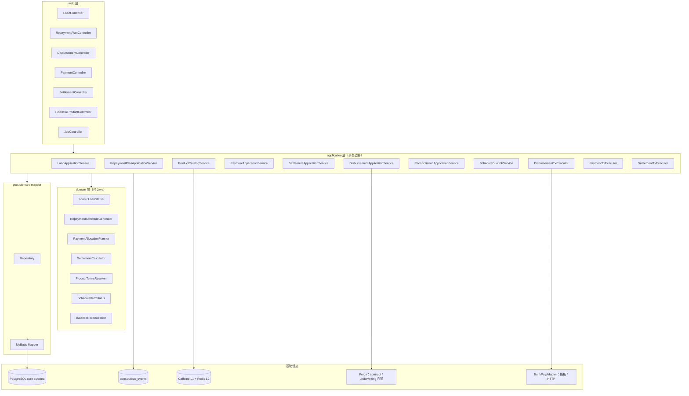

---

## 2. 启动与精确装配

### 2.1 启动类

`retail-core/src/main/java/com/company/retail/core/CoreServiceApplication.java`

```java
@SpringBootApplication(scanBasePackages = "com.company.retail.core")
@EnableDiscoveryClient
@EnableFeignClients(basePackages = "com.company.retail.common.contract")
@Import({
    RfDataSourceGuardConfig.class,
    RfSecurityConfig.class,
    RfOutboxConfig.class,
    RfCacheConfig.class,
    MqEnvelopeConfig.class,
    RfFeignConfig.class
})
public class CoreServiceApplication { ... }
```

要点：

- **只扫本服务包** `com.company.retail.core`，不做全包扫描
- 共享机制通过 `@Import` 按类注入：数据源角色守卫、安全、outbox、两级缓存、MQ、Feign
- `@EnableFeignClients` 只扫冻结契约包 `com.company.retail.common.contract`
- 运行期 **不跑 Flyway**：`spring.flyway.enabled=false`，迁移由独立 `db-migration` 作业执行（P0-10）

### 2.2 持久层装配

`CoreMyBatisConfig`：

```java
@MapperScan("com.company.retail.core.mapper")
```

只注册本服务 Mapper 包；共享 `infrastructure` 的 Mapper 由 `RfOutboxConfig` 上的 `@MapperScan` 单独注册。

### 2.3 关键配置

`retail-core/src/main/resources/application.yml`：

| 配置 | 默认值 | 说明 |
|---|---|---|
| `server.port` | `8090` | 核心账务服务端口 |
| `spring.datasource.url` | `jdbc:postgresql://localhost:5435/retail_finance` | 本地库，宿主端口 5435 |
| `spring.datasource.username` | `retail_app_rw` | 运行期受限角色，禁止超级用户 |
| `spring.flyway.enabled` | `false` | 迁移独立作业 |
| `mybatis.configuration.local-cache-scope` | `STATEMENT` | 关闭 SESSION 级一级缓存，保持“每次读落库”语义 |
| `retail.cache.*` | `enabled=true`、L1 10s、L2 60s | 产品档位两级缓存 |
| `retail.core.bank-pay-url` | 空 | 空 = 挡板；非空 = HTTP 银行通道 |
| `retail.jobs.schedule-enabled` | `false` | 到期滚转日批总开关 |
| `retail.jobs.schedule-cron` | `0 0 3 * * *` | 默认 03:00 日批 |
| `retail.mq.enabled` | `false` | MQ 削峰默认关闭，outbox 仍是真相源 |

---

## 3. 领域模型与不变式

### 3.1 聚合关系

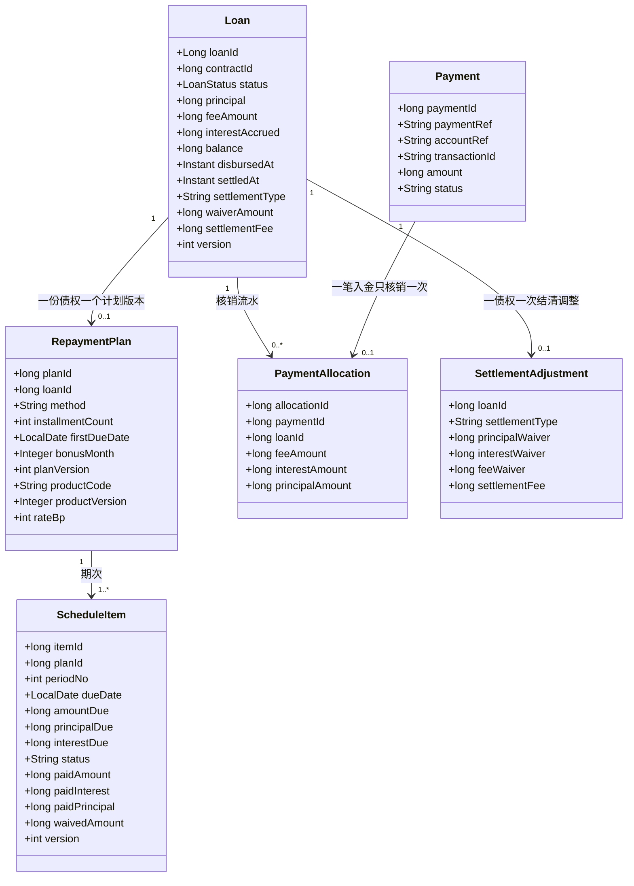

### 3.2 核心不变式

| 编号 | 不变式 | 落点 |
|---|---|---|
| INV-1 | 一份合同只允许一次成功代付 | `uk_disb_loan` + `Loan.assertDisbursementAllowed()` |
| INV-2 | `balance ≡ principal + fee + interest_accrued − Σ核销 − Σ豁免 + Σ结清手续费` | `Loan` + `BalanceReconciliation` + `ReconciliationApplicationService` |
| I-1 | `Σ principalDue == principal`（本金精确拆完） | `RepaymentScheduleGenerator` |
| I-2 | `amountDue == principalDue + interestDue` | `RepaymentScheduleGenerator` |
| I-7 | 终态不可再迁移 | `LoanStatus.ALLOWED` 终态集合为空 |

---

## 4. 主流程一：还款计划生成（计息）

### 4.1 入口

```text
POST /api/repayment-plans
权限点：CONTRACT_ISSUE
请求：loanId / method / installmentCount / firstDueDate / monthlyRateBp / bonusMonth / productCode
```

`RepaymentPlanController.generate()` → `RepaymentPlanApplicationService.generate()`。

### 4.2 时序图

```mermaid
sequenceDiagram
    autonumber
    participant C as 运营
    participant CT as RepaymentPlanController
    participant S as RepaymentPlanApplicationService
    participant PC as ProductCatalogService
    participant R as RepaymentPlanRepository
    participant G as RepaymentScheduleGenerator
    participant L as LoanRepository
    participant DB as core schema

    C->>CT: POST /api/repayment-plans
    CT->>S: generate(...)
    S->>L: findByIdForUpdate(loanId)
    L-->>S: Loan（行锁）
    S->>S: 解析 method / 校验 firstDueDate
    alt 指定 productCode
        S->>PC: findEffective(productCode)
        PC-->>S: ProductProfile（L1 → L2 → DB）
        S->>S: ProductTermsResolver.resolve(档位, 覆盖值)
    else 纯入参模式
        S->>S: ProductTermsResolver.fromDirectInput(...)
    end
    S->>R: planExistsForLoan(loanId)
    alt 已有计划
        S-->>CT: RF_CONFLICT_001
    else 无计划
        S->>G: equalPayment / equalPrincipal / bonusPayment / lumpSum
        G-->>S: List<ScheduleItem>
        S->>R: insertPlan + insertItems
        S->>S: Σ interestDue
        S->>L: loan.accrueInterest(Σ) + updateAfterPlanGeneration
        L-->>S: 乐观锁结果
        S-->>CT: PlanView（总额 / 本金 / 利息）
    end
```

### 4.3 generate 内部流程图

`generate()` 是一个 `@Transactional` 方法，整个方法在一个本地事务里完成：
锁债权 → 解析参数 → 生成期次 → 落计划/期次 → 利息入账 → 乐观锁更新 → 返回视图。

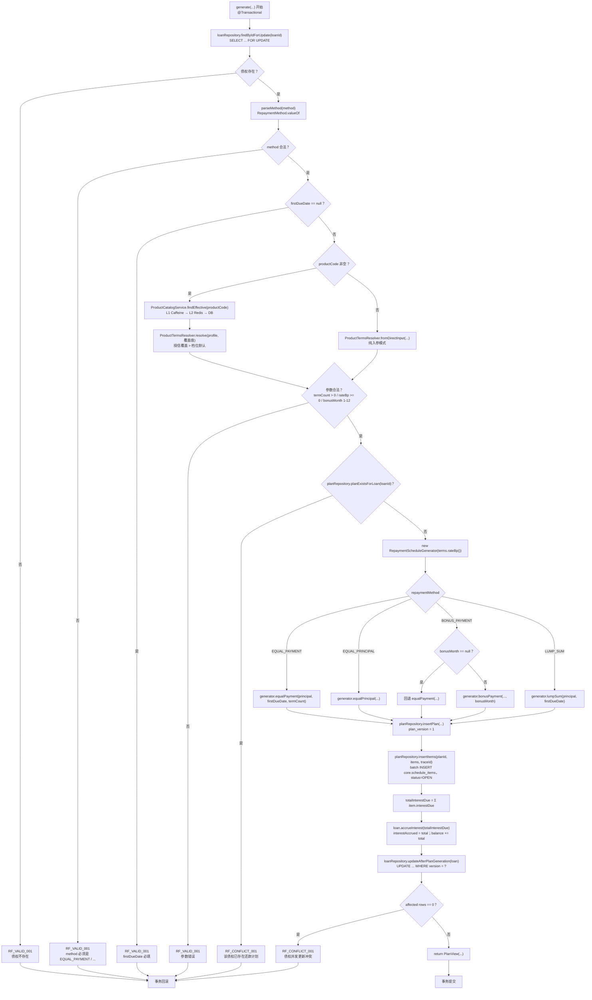

要点：

- 任一 `BusinessException` / `RuntimeException` 都会回滚，不会出现“计划写了、余额没加”的半截状态。
- `findByIdForUpdate` 先锁债权，同一债权的并发生成被串行化；`uk_plan_loan_version` 与 `loans.version` 再兜底。
- `LUMP_SUM` 不消费 `termCount`，计划头仍存 `terms.termCount()`；建议调用方传 `installmentCount=1`。
- `BONUS_PAYMENT` 且 `bonusMonth=null` 时回退 `equalPayment`，但计划头方法仍是 `BONUS_PAYMENT`。

### 4.4 步骤说明

1. **锁债权**：`LoanRepository.findByIdForUpdate(loanId)`，`SELECT ... FOR UPDATE`
2. **解析还款方式**：`EQUAL_PAYMENT / EQUAL_PRINCIPAL / BONUS_PAYMENT / LUMP_SUM`
3. **参数合成**：
   - 指定 `productCode`：`ProductCatalogService.findEffective()` 取当前生效档位；
     优先级 **授信覆盖 > 档位默认**
   - 未指定：纯入参模式，档位码/版本为 `null`
4. **幂等/唯一**：`planExistsForLoan()` 已存在 → `RF_CONFLICT_001`（`uk_plan_loan_version`）
5. **生成期次**：按还款方式调用 `RepaymentScheduleGenerator`
6. **落计划与期次**：`insertPlan`（`plan_version=1`）+ `insertItems` 批量插入
7. **利息入账**：`Σ interestDue` → `loan.accrueInterest(total)`：

```java
this.interestAccrued = totalInterestDue;
this.balance += totalInterestDue;
```

8. **乐观锁更新债权**：`updateAfterPlanGeneration` 影响行数为 0 → `RF_CONFLICT_001`，整笔回滚
9. **返回**：`PlanView(planId, loanId, method, installmentCount, firstDueDate, bonusMonth,
   monthlyRateBp, productCode, productVersion, totalAmountDue, totalPrincipalDue, totalInterestDue)`

### 4.5 计息算法

核心公式：

```text
期次利息 = floor(期初剩余本金 × 月利率基点 ÷ 10000)
```

`rate_bp = 200` 表示月利率 `2.0%`；`0` 表示零息。

| 方式 | 本金路径 | 利息 |
|---|---|---|
| `EQUAL_PAYMENT` 等额本息 | 年金公式定每期总额，逐期模拟本金 | 按期初余额递减 |
| `EQUAL_PRINCIPAL` 等额本金 | 本金均分，尾差归末期 | 按期初余额递减 |
| `BONUS_PAYMENT` 奖金还款 | 奖金月期次本金权重 ×2，按权重分摊 | 按期初余额递减 |
| `LUMP_SUM` 一次性 | 全部本金 1 期 | 单期利息 |

> `LUMP_SUM` 当前只算**一个月**利息：`floor(principal × rateBp / 10000)`；
> `firstDueDate` 就是唯一到期日，接口没有“期限”参数，不会按实际天数或期数累加。

等额本息年金公式：

```text
r = rate_bp / 10000
A = floor(P × r × (1+r)^n ÷ ((1+r)^n − 1))
```

边界：

- `rate_bp = 0` → 退化为均分 `P / n`
- 某期利息 > 每期总额 → 本金部分置 0（本金后置）
- 本金部分 > 剩余余额 → 截断到余额
- 末期吸收尾差，保证 `Σ principalDue == principal`
- 全程整数日元；只有年金系数用 `BigDecimal`，`RoundingMode.FLOOR` 量化

### 4.6 算例

本金 `2,000,000 円`、12 期、月利率 `2.0%`（200 bp）、等额本息：

```text
每期还款额 A = 189,119 円（末期 189,115 円，尾差调整）

第 1 期：利息 40,000   本金 149,119
第 2 期：利息 37,017   本金 152,102
第 3 期：利息 33,975   本金 155,144
...
第12期：利息  3,708   本金 185,407

合计利息 269,424 円
合计还款 2,269,424 円
```

> 以上数字是按当前 `RepaymentScheduleGenerator` 算法复算的示例，不是测试固定值。

### 4.7 查询

```text
GET /api/repayment-plans?loanId=...
```

`RepaymentPlanApplicationService.items()` 先用 `loanId` 解析 `planId`，再按 `planId` 查期次：

```java
long planId = planRepository.findPlanIdByLoanId(loanId)
        .orElseThrow(...);
List<ScheduleItem> items = planRepository.findItems(planId);
```

> 回归背景：`plan_id` 与 `loan_id` 是两个独立序列，不能把 `loanId` 直接当 `planId` 查。
> 工作区已补 `RepaymentPlanQueryTest` 覆盖该回归。

### 4.8 计划头、期次与总额：1 + N + 1

生成还款计划不是“一条记录”，而是：

```text
core.loans（债权，1 条）
  └─ core.repayment_plans（计划头，1 条）
       └─ core.schedule_items（期次，N 条）
```

**1 条计划头 + N 条期次（ER）**

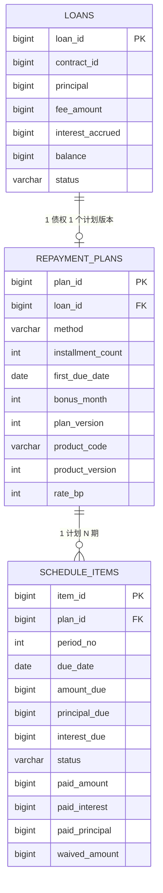

| 表 | 写入行数 | 内容 |
|---|---:|---|
| `core.repayment_plans` | **1** | 计划头：method、期数、首期到期日、利率/产品快照 |
| `core.schedule_items` | **N** | 每期一行：本金、利息、到期日、状态、已核销金额 |
| `core.loans` | **1 次 UPDATE** | `interest_accrued = Σ利息`、`balance += Σ利息`、`version + 1` |

所以准确说法是：

> **生成还款计划 = 1 条计划头 + N 条期次 + 1 次债权余额/应计利息更新，全部在同一个本地事务里完成。**

#### 4.8.1 三个对象分别存什么

| 对象 | 表 | 存什么 | 不存什么 |
|---|---|---|---|
| 债权 | `core.loans` | 本金、费用、应计利息、余额、状态、结清信息 | 每期本金/利息明细 |
| 计划头 | `core.repayment_plans` | 还款方式、期数、首期到期日、奖金月、计划版本、产品/利率快照 | 每期金额、总利息、总还款额 |
| 期次 | `core.schedule_items` | 期号、到期日、应还本金/利息/合计、状态、已核销/已豁免 | 计划级参数 |

#### 4.8.2 计划头为什么不存总利息/总还款额

计划头存的是**参数与快照**：

```text
method / installment_count / first_due_date / bonus_month
product_code / product_version / rate_bp
```

期次存的是**计算结果**：

```text
period_no / due_date / amount_due / principal_due / interest_due / status / paid_*
```

总额只是对期次求和：

```text
计划总还款额 = Σ schedule_items.amount_due
计划总利息   = Σ schedule_items.interest_due
```

如果再在计划头存一份 `total_amount / total_interest`，就变成同一事实有两份存储；一旦期次重算、补录或数据修复，很容易漂移。所以设计上选择：

> **计划头存“怎么算”，期次存“算出来的每一期”，总额按需求和。**

另外，总利息并没有丢：

- `core.loans.interest_accrued` = `Σ interest_due`
- `core.loans.balance` = 包含利息的账务余额
- `PlanView.totalInterestDue / totalAmountDue / totalPrincipalDue` 是生成时对期次求和后返回的**视图值**，不是计划头字段

#### 4.8.3 计划总额 vs 实际总额

| 想看的总额 | 从哪里算 | 会变吗 |
|---|---|---|
| 计划总还款额 | `Σ schedule_items.amount_due` | 不变（生成时定） |
| 计划总利息 | `Σ schedule_items.interest_due`；同时 `core.loans.interest_accrued` | 不变 |
| 实际已还 | `Σ paid_amount / paid_interest / paid_principal` | 随核销变 |
| 未还 | `Σ (amount_due − paid_amount − waived_amount)` | 随核销/豁免变 |
| 账务余额 | `core.loans.balance` | 随核销/豁免/手续费变 |
| 提前结清减免 | `schedule_items.waived_amount` + `core.settlement_adjustments` | 结清时定 |

#### 4.8.4 逾期 / 提前结清 / 部分还款分别改什么

| 事件 | 改什么 | 不改什么 |
|---|---|---|
| 逾期 | 期次 `status`（`DUE → OVERDUE`）、`dpd_snapshots` | `amount_due / principal_due / interest_due`；当前无罚息 |
| 部分还款 | `paid_amount / paid_interest / paid_principal`、`status=PARTIAL` | `amount_due / interest_due` |
| 提前结清 | `paid_principal / paid_amount / waived_amount`、`status=PAID/WAIVED`、`settlement_adjustments` | 原期次的 `interest_due`；未付利息作为豁免冲销 |
| 全部结清 | 期次已全 `PAID/WAIVED`、债权 `SETTLED`、余额 0 | 计划期次金额 |

所以：

> **不是“因为总额会变所以不存”，而是“计划总额是派生值；真正会变的是实际已还、未还、豁免和余额”。**

#### 4.8.5 返回示例

`POST /api/repayment-plans` → `PlanView`（3 期 0 息）：

```json
{
  "planId": 8001,
  "loanId": 5001,
  "method": "EQUAL_PAYMENT",
  "installmentCount": 3,
  "firstDueDate": "2026-12-10",
  "bonusMonth": null,
  "monthlyRateBp": 0,
  "productCode": "AUTO_LOAN_36_0",
  "productVersion": 1,
  "totalAmountDue": 1230000,
  "totalPrincipalDue": 1230000,
  "totalInterestDue": 0
}
```

`GET /api/repayment-plans?loanId=5001` → `PlanItemsView`：

```json
{
  "loanId": 5001,
  "items": [
    {"periodNo": 1, "dueDate": "2026-12-10", "amountDue": 410000,
     "principalDue": 410000, "interestDue": 0, "status": "OPEN", "paidAmount": 0},
    {"periodNo": 2, "dueDate": "2027-01-10", "amountDue": 410000,
     "principalDue": 410000, "interestDue": 0, "status": "OPEN", "paidAmount": 0},
    {"periodNo": 3, "dueDate": "2027-02-10", "amountDue": 410000,
     "principalDue": 410000, "interestDue": 0, "status": "OPEN", "paidAmount": 0}
  ]
}
```

#### 4.8.6 约束与常见坑

| 约束/坑 | 说明 |
|---|---|
| `uk_plan_loan_version` | 一份债权一个计划版本；当前 `plan_version = 1` |
| `uk_sched_plan_period` | 同一计划下 `(plan_id, period_no)` 唯一 |
| `plan_id` ≠ `loan_id` | 两个独立序列；先按 `loanId` 解析 `planId` |
| `PlanView` 不是一条数据库记录 | 它是计划头 + 汇总值的视图 |
| `LUMP_SUM` 不消费 `termCount` | 只生成 1 条期次；建议传 `installmentCount=1` |
| `BONUS_PAYMENT` 无奖金月 | 回退等额本息，但计划头 method 仍是 `BONUS_PAYMENT` |
| 计划与代付顺序 | 代码不强制计划早于代付；但入金核销前必须已有计划 |

### 4.9 generate 入参：method / firstDueDate / productCode

#### 4.9.1 参数总览

| 参数 | 类型 | 必填 | 作用 | 默认/来源 |
|---|---|---|---|---|
| `loanId` | long | 是 | 债权 ID；先锁债权 | — |
| `method` | string | 是 | 还款方式枚举 | — |
| `installmentCount` | int | 条件 | 期数 | 指定 `productCode` 时可省略；纯入参模式必填 |
| `firstDueDate` | date | 是 | 首期到期日 | — |
| `monthlyRateBp` | int | 否 | 月利率基点 | 档位默认；纯入参默认 0 |
| `bonusMonth` | int | 否 | 奖金月（1–12） | 档位默认 |
| `productCode` | string | 否 | 产品档位码 | 空 = 纯入参模式 |

#### 4.9.2 method：还款方式

请求里传字符串，`parseMethod()` 转成枚举：

```java
public enum RepaymentMethod {
    EQUAL_PAYMENT,    // 等额本息
    EQUAL_PRINCIPAL,  // 等额本金
    BONUS_PAYMENT,    // 奖金还款
    LUMP_SUM          // 一次性还本付息
}
```

| method | 中文 | 生成器调用 | 说明 |
|---|---|---|---|
| `EQUAL_PAYMENT` | 等额本息 | `generator.equalPayment(...)` | 年金公式定每期总额，逐期模拟本金 |
| `EQUAL_PRINCIPAL` | 等额本金 | `generator.equalPrincipal(...)` | 本金均分，利息按递减余额 |
| `BONUS_PAYMENT` | 奖金还款 | `generator.bonusPayment(...)` | 奖金月本金权重 ×2；`bonusMonth=null` 时回退等额本息 |
| `LUMP_SUM` | 一次性 | `generator.lumpSum(...)` | 只生成 1 期；不消费 `termCount` |

错误口径：

```text
method 非法 / null
→ RF_VALID_001
→ "method 必须是 EQUAL_PAYMENT / EQUAL_PRINCIPAL / BONUS_PAYMENT / LUMP_SUM"
```

注意：

- **大小写敏感**：必须传大写下划线枚举名，`equal_payment` 会报 `RF_VALID_001`。
- `method` 只决定还款方式，不决定期数、利率、首期到期日。
- `BONUS_PAYMENT` 未传 `bonusMonth` 时回退等额本息，但计划头 `method` 仍记 `BONUS_PAYMENT`。
- `LUMP_SUM` 只生成 1 条期次；计划头仍存 `terms.termCount()`，建议调用方传 `installmentCount=1`。

#### 4.9.3 firstDueDate：首期到期日

`firstDueDate` 是**首期还款到期日**，不是合同日、不是代付日：

```text
2026-11-28 代付
2026-12-10 首期到期
→ 第 1 期 2026-12-10
→ 第 2 期 2027-01-10
→ 第 3 期 2027-02-10
```

规则：

- 格式 `yyyy-MM-dd`
- `firstDueDate == null` → `RF_VALID_001`，`firstDueDate 必填（yyyy-MM-dd）`
- 所有还款方式都必须传
- 后续期次按月 `plusMonths(1)` 递增
- `LUMP_SUM` 只有一期，`firstDueDate` 就是唯一到期日
- `BONUS_PAYMENT` 按 `dueDate` 的月份判断是否命中奖金月，所以首期日期会影响哪些期次落在奖金月

它不从产品档位取，也不是 `installmentCount` 的替代：一个决定“什么时候开始还”，一个决定“分几期”。

#### 4.9.4 productCode：产品档位

`productCode` 是可选的产品档位码，提供**默认还款口径**：

```text
productCode 非空
  → ProductCatalogService.findEffective(productCode)
  → ProductTermsResolver.resolve(profile, 请求覆盖值)
  → 合成 PlanTerms

productCode 为空/null
  → ProductTermsResolver.fromDirectInput(...)
  → 纯入参模式，productCode/productVersion = null
```

合成优先级：

```text
期数：    installmentCount ?? profile.termCount
月利率：  monthlyRateBp   ?? profile.rateBp
奖金月：  bonusMonth      ?? profile.bonusMonth
```

即：

```text
请求覆盖值 > 产品档位默认值
```

示例：

| 档位默认 | 请求覆盖 | 实际生效 |
|---|---|---|
| 36 期 / 200 bp | 不传 | 36 期 / 200 bp |
| 36 期 / 200 bp | `installmentCount=12` | 12 期 / 200 bp |
| 36 期 / 200 bp | `monthlyRateBp=100` | 36 期 / 100 bp |
| 36 期 / 200 bp | 12 期 + 100 bp | 12 期 / 100 bp |

计划表快照：

```text
product_code
product_version
rate_bp          ← 实际采用的利率（可能是覆盖值）
installment_count
bonus_month
```

例：档位 `INSTALMENT_36_200` version 1（36 期 / 200 bp），请求覆盖 12 期 / 100 bp：

```text
core.repayment_plans:
  product_code      = INSTALMENT_36_200
  product_version   = 1
  rate_bp           = 100
  installment_count = 12
```

`product_version` 记录“用了哪个档位版本”，`rate_bp` 记录“实际用了多少利率”；**改档位不回改历史计划**。

`productCode` 不负责：

- 不决定 `method`；还款方式仍由 `method` 决定
- 不决定 `firstDueDate`；首期到期日必须显式传
- 不校验 `scheme` 与 `method` 是否匹配；当前 `scheme` 只是档位元数据
- 不决定费用；费用属合同条款
- 不参与结清减免上限强制校验；`waiverCapBp` 只解析，结清时未强制

常见错误：

| 情况 | 结果 |
|---|---|
| `productCode` 非空，但查不到 / 未生效 | `RF_VALID_001`，`产品档位不存在或未生效` |
| `productCode` 为 `null` / 空字符串 | 纯入参模式，不报错 |
| 纯入参模式下 `installmentCount` 为空 | `RF_VALID_001`，`期次必须为正整数` |
| 档位或覆盖后的 `rateBp < 0` | `RF_VALID_001` |
| 档位或覆盖后的 `bonusMonth` 不在 1–12 | `RF_VALID_001` |

种子档位：

```text
AUTO_LOAN_36_0        36 期，0 bp，零息
INSTALMENT_36_200     36 期，200 bp，月息 2.0%
```

#### 4.9.5 组合示例

```json
{
  "loanId": 5001,
  "method": "EQUAL_PAYMENT",
  "installmentCount": 12,
  "firstDueDate": "2026-12-10",
  "monthlyRateBp": 100,
  "bonusMonth": null,
  "productCode": "INSTALMENT_36_200"
}
```

解析结果：

```text
method           = EQUAL_PAYMENT
firstDueDate     = 2026-12-10
productCode      = INSTALMENT_36_200
productVersion   = 1
termCount        = 12（覆盖档位默认 36）
rateBp           = 100（覆盖档位默认 200）
bonusMonth       = null
生成器           = equalPayment(principal, 2026-12-10, 12)
计划快照         = product_code / product_version / rate_bp / installment_count
```

如果去掉 `productCode`：

```text
productCode      = null
productVersion   = null
termCount        = 12（必须显式传）
rateBp           = 100
生成器           = equalPayment(principal, 2026-12-10, 12)
```

---

## 5. 主流程二：从申请到债权 ACTIVE（代付）

### 5.0 前置链路：申请 → 合同 → 债权记录 → 代付 → ACTIVE

`retail-core` 不是从“用户申请”开始建模的。申请、审查、合同分别在
`application-service` / `underwriting-service` / `contract-service`；
`retail-core` 从“合同生效后建立债权记录”开始接管。

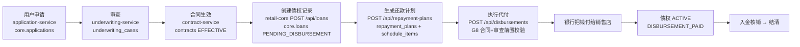

| 阶段 | 服务 | 写什么 | 债权是否产生 |
|---|---|---|---|
| 用户申请 | `application-service` | `core.applications` | ❌ 只是申请 |
| 审查 | `underwriting-service` | `underwriting_cases` | ❌ 只是决定 |
| 合同签订/生效 | `contract-service` | `core.contracts` | ❌ 合同义务，尚未代付 |
| **创建债权** | **`retail-core`** | **`core.loans`，状态 `PENDING_DISBURSEMENT`** | ✅ **债权记录产生** |
| 生成还款计划 | `retail-core` | `core.repayment_plans` / `core.schedule_items` | 计划不是债权；利息开始计入余额 |
| **代付成功** | **`retail-core`** | `core.disbursements`；债权 `ACTIVE`；`DISBURSEMENT_PAID` | ✅ **债权生效/存续** |
| 入金核销 | `retail-core` | `core.payments` / `payment_allocations` | 余额递减 |
| 结清 | `retail-core` | `settlement_adjustments`；债权终态 | 债权结束 |

> 顺序说明：上图是演示/推荐顺序（建债权 → 生成计划 → 代付）。
> 代码不强制“计划必须早于代付”；但**入金核销前必须已有计划**，否则 `RF_PAY_001`。

四个容易混淆的点：

1. **申请 ≠ 债权**：申请可能被拒/撤回，不产生 `core.loans`。
2. **合同生效 ≠ 债权记录创建**：合同是协议；债权记录是账务侧单独调用 `POST /api/loans` 创建的。
3. **债权记录创建 ≠ 债权生效**：创建后是 `PENDING_DISBURSEMENT`；代付成功才进入 `ACTIVE`。
4. **创建债权不校验合同状态**：`LoanApplicationService.create()` 只校验金额与 `uk_loan_contract`；
   合同/审查状态在代付的 G8 前置校验里 fail-closed 拦截（`RF_LOAN_001`）。

代码证据：

```java
// Loan.create()：建记录时只是 PENDING_DISBURSEMENT，利息为 0，余额 = 本金 + 费用
return new Loan(null, contractId, LoanStatus.PENDING_DISBURSEMENT,
        principal, feeAmount, 0, principal + feeAmount, null, null, null, 0, 0, 0);
```

- `uk_loan_contract`：一份合同只允许一条债权记录。
- `DisbursementTxExecutor`：`PENDING_DISBURSEMENT / DISBURSE_FAILED → DISBURSING → ACTIVE`，
  成功后写 `DISBURSEMENT_PAID` outbox。
- 状态图见 §10.1。

### 5.1 入口

```text
POST /api/disbursements
权限点：DISBURSEMENT_EXEC
Header：Idempotency-Key（必填）
请求：loanId / contractId / underwritingCaseId / payeeAccountRef
```

### 5.2 时序图

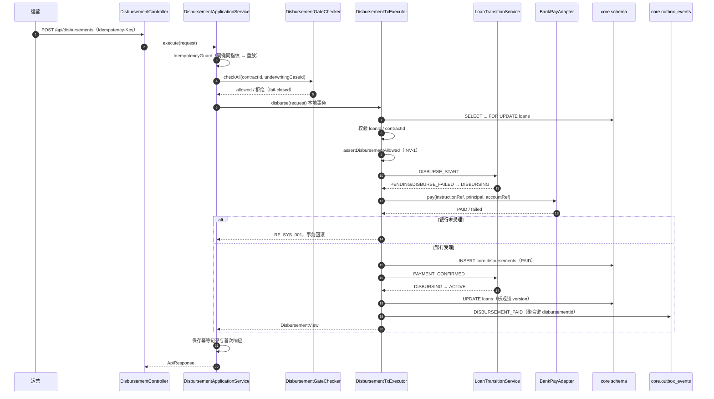

### 5.3 三道幂等

| 层 | 机制 | 落点 |
|---|---|---|
| ① | `Idempotency-Key` + 请求指纹 | `IdempotencyGuard` + `core.idempotency_records` |
| ② | `uk_disb_idempotency` | `core.disbursements.idempotency_key` |
| ③ | `uk_disb_loan` | 一份债权只一次代付（INV-1） |

### 5.4 G8 代付前置校验（fail-closed）

`DisbursementGateChecker.checkAll(contractId, underwritingCaseId)`：

- 合同前置校验：合同 `EFFECTIVE` 且法定书面文件已交付
- 审查前置校验：审查已批准且未撤回
- 任一项：
  - 查不到 / 超时 / 异常 / 非 2xx / `code != OK` / `allowed != true`
  - → `RF_LOAN_001`，**拒绝代付**
- UNKNOWN **不视为通过**，没有 fallback 放行

### 5.5 本地事务与银行外呼

`DisbursementTxExecutor.disburse()` 是事务落点：

```text
锁债权 → 校验 → 状态机 DISBURSING → 调银行 → 插代付记录
→ 状态机 ACTIVE → 更新债权 → 写 outbox
```

银行适配器双模：

- `retail.core.bank-pay-url` 为空 → `StubBankPayAdapter`（同步假成功）
- 非空 → `HttpBankPayAdapter`（提议协议 v1，`POST /bank/v1/disbursements`）
- 走 `OutboundProfile.FINANCIAL`：**资金动作强制不自动重试**
- 幂等键由 `instructionRef` 派生，重试共享同一幂等键

> **边界**：银行外呼发生在本地事务内，但外部副作用无法随数据库回滚。
> 若银行已受理而本地提交失败，靠 `instructionRef` + 银行幂等键 + 对账收敛，
> 不是分布式事务（项目明确不引入 Seata）。

---

## 6. 主流程三：入金核销

### 6.1 入口

```text
POST /api/payments
权限点：PAYMENT_ALLOCATE
Header：Idempotency-Key（必填）
请求：loanId / accountRef / transactionId / amount / channel / paymentRef
```

`loanId <= 0` → `UNMATCHED`，人工匹配：

```text
POST /api/payments/{id}/manual-match
权限点：PAYMENT_MANUAL_MATCH
```

### 6.2 时序图

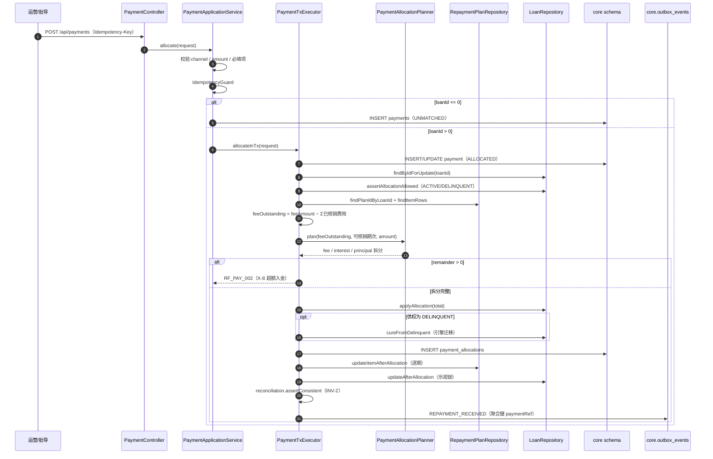

### 6.3 核销顺序

`PaymentAllocationPlanner.plan()`：

```text
① 债权级未核销费用
② 按期次顺序（period_no 升序）
   ③ 期内先利息
   ④ 后本金
```

约束：

- 只有 `DUE / PARTIAL / OVERDUE` 且仍有未清偿的期次可核销
- `OPEN`（未到期）不可核销
- 拆完仍有剩余 → `RF_PAY_002`，转工单/退款，不自动分摊
- 一笔入金只核销一次（`uk_alloc_payment`）
- 重复入金明细按 `uk_payment_account_txn` 去重

### 6.4 期次状态机

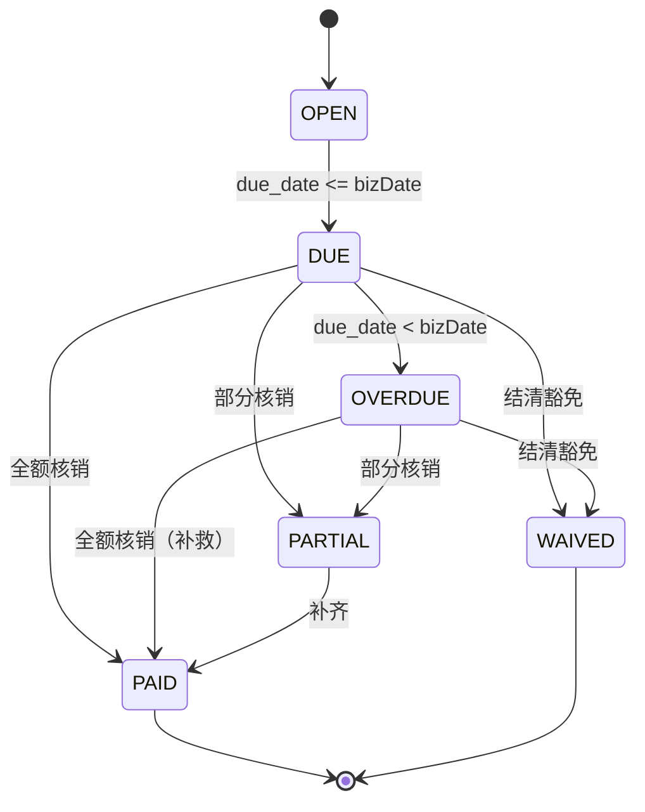

实现：`ScheduleItemStatus.afterPayment()` / `shouldBecomeDue()` / `shouldBecomeOverdue()`。
`PARTIAL` 不会自动转 `OVERDUE`，只有 `DUE → OVERDUE` 由批量推进。

> 上图是**常规核销 / 到期路径**。结清关闭（`SettlementTxExecutor.closeItems`）对未清偿期次
> 可直接落 `PAID` / `WAIVED`，不受常规核销边的限制；这是结清路径的专用关闭口径。

### 6.5 期次已还字段：paid_interest / paid_principal / paid_amount

`PaymentTxExecutor` 对本次被分配到的每一期更新：

```sql
UPDATE core.schedule_items
SET paid_interest  = ?,
    paid_principal = ?,
    paid_amount    = ?,
    status         = ?,
    version        = version + 1,
    updated_at     = now()
WHERE item_id = ? AND version = ?
```

这三个字段都是**累计已核销金额**，不是单笔入金金额：

| 字段 | 含义 | 计算 |
|---|---|---|
| `interest_due` | 本期应还利息 | 计划生成时算定 |
| `principal_due` | 本期应还本金 | 计划生成时算定 |
| `amount_due` | 本期应还合计 | `interest_due + principal_due` |
| `paid_interest` | 本期累计已核销利息 | `Σ 各笔入金分到本期的利息` |
| `paid_principal` | 本期累计已核销本金 | `Σ 各笔入金分到本期的本金` |
| `paid_amount` | 本期累计已核销合计 | `paid_interest + paid_principal` |
| `waived_amount` | 本期豁免金额 | 结清时写入 |

本期未清偿：

```text
amount_due − paid_amount − waived_amount
```

更新方式（累计，而不是覆盖成单笔金额）：

```java
long paidInterestTotal  = row.paidInterest()  + a.interestPart();
long paidPrincipalTotal = row.paidPrincipal() + a.principalPart();
long paidAmountTotal    = paidInterestTotal + paidPrincipalTotal;
```

- 只有本次实际分到利息/本金的期次才更新（`a == null` 的期次跳过）
- 状态由 `ScheduleItemStatus.afterPayment()` 判定：全额 `PAID`，部分 `PARTIAL`
- `paid_amount` 不含费用；费用是债权级的，记在 `payment_allocations.fee_amount`

示例：

```text
初始：
  interest_due   = 24,600
  principal_due  = 91,708
  paid_interest  = 0
  paid_principal = 0
  paid_amount    = 0
  status         = DUE

第 1 笔入金 100,000：利息 24,600 + 本金 75,400
  → paid_interest  = 24,600
  → paid_principal = 75,400
  → paid_amount    = 100,000
  → status         = PARTIAL

第 2 笔入金 16,308：利息 0 + 本金 16,308
  → paid_interest  = 24,600
  → paid_principal = 91,708
  → paid_amount    = 116,308
  → status         = PAID
```

事务与并发：

- 期次更新与入金入账、`payment_allocations`、债权余额、INV-2 对拍、`REPAYMENT_RECEIVED` outbox 在**同一本地事务**
- 期次更新带乐观锁：`WHERE item_id = ? AND version = ?`
- 影响行数 0 → `RF_CONFLICT_001`，整笔回滚

与 `payment_allocations` 的区别：

| 表 | 粒度 | 存什么 |
|---|---|---|
| `core.payment_allocations` | 一笔入金一行 | 这笔入金总共分到多少费用/利息/本金 |
| `core.schedule_items.paid_*` | 一期一行 | 这一期累计已核销多少利息/本金/合计 |

> 结清路径（`SettlementTxExecutor.closeItems`）更新的是 `paid_principal / paid_amount / waived_amount / status`，
> 同样**不改** `interest_due / principal_due / amount_due`。

### 6.6 余额更新与对拍

`PaymentTxExecutor` 在事务尾部调用：

```java
reconciliation.assertConsistent(loanId);
```

三口径必须精确相等：

```text
loan.balance
= principal + fee + interest_accrued
  − Σ核销（fee/interest/principal）
  − Σ豁免（principal/interest/fee）
  + Σ结清手续费

= Σ期次未清偿（amount_due − paid_amount − waived_amount）
  + 费用未清偿
```

不相等 → `RF_SYS_001`，事务回滚。

### 6.7 事件

核销成功写：

```text
REPAYMENT_RECEIVED
aggregate_key = paymentRef
payload = paymentRef / loanId / amount / currency / status / traceId
```

> 当前代码里 `REPAYMENT_RECEIVED` **没有消费者**。
> `servicing-service` 的 DPD 不是靠这个事件实时更新，而是下一轮 DPD 日批
> 直接只读 `core.schedule_items` 的最新状态。

---

## 7. 主流程四：结清

### 7.1 入口

```text
POST /api/loans/{id}/settle
权限点：SETTLEMENT_CONFIRM
Header：Idempotency-Key（必填）
请求：type（NORMAL / EARLY）/ waiverAmount / settlementFee
```

试算：

```text
GET /api/loans/{id}/settlement-quote?waiverAmount=...&settlementFee=...
```

### 7.2 流程图

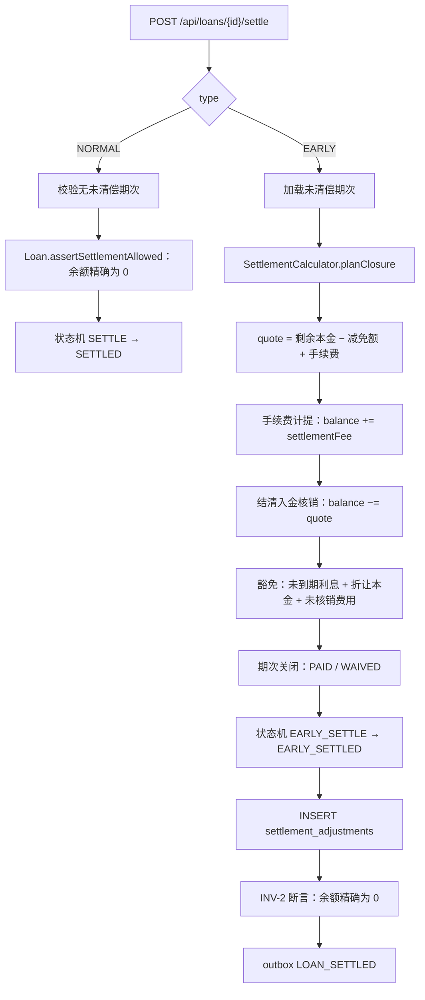

### 7.3 正常结清（NORMAL）

前置条件：

- `assertNoUnpaidItems(loanId)`：`Σ(amountDue − paidAmount − waivedAmount) == 0`
- 必须存在还款计划
- `Loan.assertSettlementAllowed()`：债权状态为 `ACTIVE/DELINQUENT` 且 `balance == 0`

执行：

- 只做状态迁移 `ACTIVE/DELINQUENT → SETTLED`
- 不产生减免与手续费
- 写 `LOAN_SETTLED` outbox

### 7.4 提前结清（EARLY）

C-10 公式：

```text
提前结清金额 = 剩余本金 − 减免额 + 事务手续费
```

守卫：

- 剩余本金 / 减免额 / 手续费非负
- 减免额 ≤ 剩余本金
- 减免上限 `waiver_cap_bp` 当前只存在产品档位，结清时未强制校验

事务内三步：

```text
① 手续费计提
② 结清入金核销（只覆盖实收本金部分）
③ 豁免记账（未到期利息 + 折让本金 + 未核销费用）
```

结果：

- 余额精确归零
- 期次：有实收本金 → `PAID`；全额豁免 → `WAIVED`
- 债权 → `EARLY_SETTLED`
- 写 `core.settlement_adjustments`
- 发 `LOAN_SETTLED`

### 7.5 结清事件

```text
LOAN_SETTLED
aggregate_key = loanId
payload = loanId / contractId / status / amount / currency / traceId
```

消费方：

- `bureau-service`：结清报送
- `title-release-service`：创建 ReleaseOrder（解除八步第 1–2 步）

---

## 8. 批处理：到期滚转与逾期判断

### 8.1 入口

```text
POST /api/jobs/schedule-due-rollup
权限点：JOB_TRIGGER
body：{"bizDate": "yyyy-MM-dd"}（缺省当天）
```

### 8.2 调度

`ScheduleDueRollupScheduler`：

- `@ConditionalOnProperty(retail.jobs.schedule-enabled=true)`
- `@Scheduled(cron = "${retail.jobs.schedule-cron:0 0 3 * * *}")`
- 执行前 `BatchRunGuard.tryClaim(jobName, bizDate, traceId, staleMinutes=30)`
- 抢到后调用 `ScheduleDueJobService.rollUp()`
- 结束 `markFinished(DONE/FAILED)`
- 同日已有 `SUCCESS` 或活跃 `RUNNING` → 跳过
- `RUNNING` 超过 30 分钟视为卡死，允许接管

### 8.3 判定

```text
OPEN 且 due_date <= bizDate  → DUE
DUE  且 due_date <  bizDate  → OVERDUE
```

`core.batch_runs` 以 `(job_name, biz_date)` 唯一留痕，同日重跑幂等。

> 注意：`PARTIAL` 不自动转 `OVERDUE`；逾期状态只推进 `DUE → OVERDUE`。

### 8.4 逾期判断：期次状态 vs DPD

逾期判断**不看 `PaymentAllocation`**，只看 `due_date`、`status` 和是否 `PAID/WAIVED`。
它分两层：

| 层 | 服务 | 作业 | 写什么 |
|---|---|---|---|
| 期次状态 | `retail-core` | `schedule-due-rollup` | `core.schedule_items.status` |
| DPD / 催收 | `servicing-service` | `dpd-snapshot` | `core.dpd_snapshots`、`core.collection_cases`、`DPD_CHANGED` |

**逾期判断：期次状态 + DPD（不对比 PaymentAllocation）**

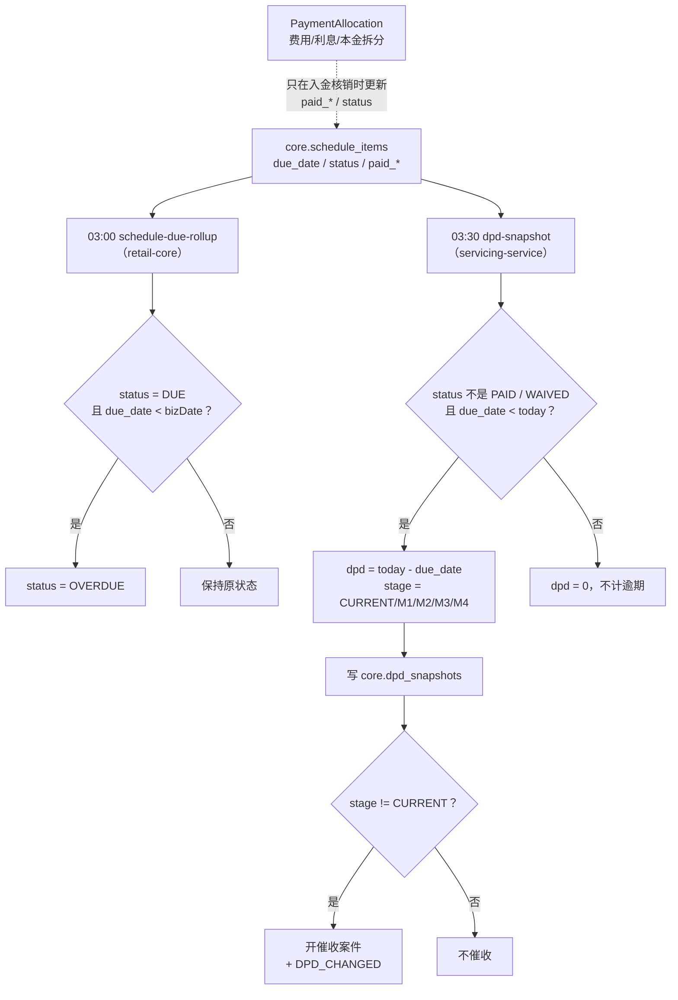

#### 8.4.1 第一层：期次状态（retail-core）

`ScheduleDueJobService.rollUp(bizDate)` 的 SQL：

```sql
-- 1) 到期转 DUE
UPDATE core.schedule_items
SET status = 'DUE'
WHERE status = 'OPEN' AND due_date <= bizDate;

-- 2) 逾期转 OVERDUE
UPDATE core.schedule_items
SET status = 'OVERDUE'
WHERE status = 'DUE' AND due_date < bizDate;
```

判定口径：

```text
到期日当天：due_date = bizDate → 不逾期，DUE / DPD=0
到期日次日：due_date < bizDate → DUE → OVERDUE
```

注意：

- 这一层**完全不看** `payment_allocations`，也不看 `paid_amount`；只看 `status + due_date`。
- `PARTIAL` 不会被自动转 `OVERDUE`；逾期状态只推进 `DUE → OVERDUE`。
- 如果 `OPEN` 期次已经过期，`rollDue` 先把它转 `DUE`，同一次 `rollOverdue` 再把它转 `OVERDUE`。

#### 8.4.2 第二层：DPD / 催收（servicing-service）

`DpdCalculator.compute(items, today)`：

```text
跳过 status ∈ {PAID, WAIVED}
跳过 due_date >= today
dpd = DAYS.between(due_date, today)
取所有逾期期次的最大 dpd
```

分层：

| 自然日 DPD | 分层 |
|---:|---|
| 0 | `CURRENT` |
| 1–30 | `M1` |
| 31–60 | `M2` |
| 61–90 | `M3` |
| 91+ | `M4` |

宽限期：

```text
retail.servicing.dpd-grace-days = 0   // 默认
effective = max(0, dpd - grace)
stage = DpdStage.fromDays(effective)
```

`dpd_days` 快照仍记自然日；宽限期只影响 `stage`，不影响 `schedule_items.status`。

`DpdBatchAppService` 在 `stage != CURRENT` 时：

- 写 `core.dpd_snapshots`
- 分层变化发 `DPD_CHANGED`
- 无在途案件时开 `core.collection_cases`

这一层**不看** `payment_allocations`，只看 `due_date / status`；它容忍 `OPEN/DUE/PARTIAL`，所以不依赖 rollup 一定先跑。

#### 8.4.3 PaymentAllocation 在逾期中的角色

`PaymentAllocation` 只在入金核销时使用：

```text
PaymentAllocationPlanner
  → 费用 → 利息 → 本金
  → 每期算 interestPart / principalPart

PaymentTxExecutor
  → 更新 schedule_items.paid_* / paid_amount
  → 按 unpaidBefore / paidNow 判定 PAID / PARTIAL
```

所以：

- **全额还款**：`status=PAID`，DPD 计算跳过该期
- **部分还款**：`status=PARTIAL`，DPD 仍按 `due_date < today` 计入逾期
- **逾期后还款**：`OVERDUE → PAID` 允许补救

但它不会“创建逾期记录”，也不会被后台任务拿来和期次做对比。

#### 8.4.4 “逾期记录”到底是什么

当前没有一张叫 `overdue_records` 的表。逾期由以下记录组成：

| 记录 | 表 | 谁写 | 含义 |
|---|---|---|---|
| 期次状态 | `core.schedule_items.status` | `retail-core` 的 `schedule-due-rollup` | 这一期在账务上是否 `OVERDUE` |
| DPD 快照 | `core.dpd_snapshots` | `servicing-service` 的 `dpd-snapshot` | 这一债权今天 DPD 多少、M1–M4 哪一层 |
| 催收案件 | `core.collection_cases` | `servicing-service` | 进入催收的案件 |
| 事件 | `core.outbox_events` 的 `DPD_CHANGED` | `servicing-service` | 分层变化通知 |

#### 8.4.5 时间线

```text
11/23 到期
11/23 03:00 rollup：OPEN → DUE（due_date <= bizDate）
11/23 03:30 DPD：due_date 不早于 today → DPD=0，不逾期

11/24 03:00 rollup：DUE → OVERDUE（due_date < bizDate）
11/24 03:30 DPD：DPD=1，M1
             → 写 dpd_snapshots
             → 开 collection_cases
             → 发 DPD_CHANGED
```

> 两个日批默认关闭（`retail.jobs.schedule-enabled=false`），可分别通过
> `POST /api/jobs/schedule-due-rollup` 与 `POST /api/jobs/dpd-snapshot` 手工触发。

---

## 9. 余额对拍

### 9.1 三口径

`ReconciliationApplicationService.reconcile(loanId)`：

| 口径 | 公式 |
|---|---|
| 存量余额 `loanBalance` | `core.loans.balance` |
| 流水推导 `ledgerBalance` | `principal + fee + interest_accrued − Σ核销 − Σ豁免 + Σ结清手续费` |
| 义务面 `outstandingBalance` | `Σ期次未清偿 + 费用未清偿` |

其中：

```text
期次未清偿 = Σ(amount_due − paid_amount − waived_amount)
费用未清偿 = fee_amount − Σ核销费用 − Σ费用豁免 + Σ结清手续费
```

### 9.2 断言

`BalanceReconciliation.of()`：

```text
consistent = (loanBalance == ledgerBalance) && (loanBalance == outstandingBalance)
```

`assertConsistent()` 在以下事务内调用：

- `PaymentTxExecutor`（核销后）
- `SettlementTxExecutor`（结清后）

不一致 → `RF_SYS_001`，事务回滚。

查询端点：

```text
GET /api/loans/{id}/reconciliation
```

---

## 10. 状态机接线

### 10.1 债权状态图

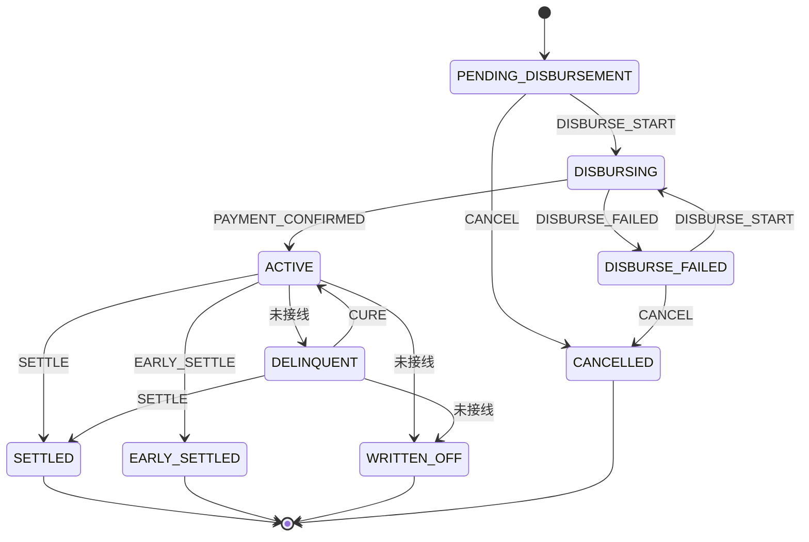

### 10.2 引擎接线

- 领域枚举 `LoanStatus.graph()` 是**唯一事实源**
- `LoanStateMachineConfigurer` 由领域图生成迁移边
- `LoanStateMachineConfig` 创建 `StateMachineFactory`，启动期 fail-fast
- `LoanTransitionService` 是用例层唯一迁移入口：
  - 投递事件给引擎
  - 引擎拒绝 → 调用领域方法复现既有异常语义，再抛 `IllegalStateException`
- 引擎进程内运行，不落库；状态权威始终在数据库

### 10.3 未接线边

`LoanStateMachineConfigurer.unsupportedEdges()` 显式登记：

```text
ACTIVE -> DELINQUENT       // 领域无「标记逾期」变更入口
ACTIVE -> WRITTEN_OFF      // 领域无「坏账核销」变更入口
DELINQUENT -> WRITTEN_OFF  // 同上
```

含义：

- 这些边**没有对应用例**
- 不是“忘了接”，而是显式登记为未接线
- 未登记又未接事件 → 启动装配期 fail-fast

---

## 11. 幂等与并发清单

| 层次 | 机制 | 代码/表 |
|---|---|---|
| API 幂等 | `Idempotency-Key` + 请求指纹 + 重放响应 | `IdempotencyGuard`、`core.idempotency_records` |
| 代付唯一 | `uk_disb_loan` / `uk_disb_idempotency` | `core.disbursements` |
| 计划唯一 | `uk_plan_loan_version` | `core.repayment_plans` |
| 期次唯一 | `uk_sched_plan_period` | `core.schedule_items` |
| 入金去重 | `uk_payment_account_txn` | `core.payments` |
| 核销唯一 | `uk_alloc_payment` | `core.payment_allocations` |
| 结清唯一 | `uk_settlement_loan` | `core.settlement_adjustments` |
| 行锁 | `SELECT ... FOR UPDATE` | `LoanRepository.findByIdForUpdate` |
| 乐观锁 | `version` 条件更新 | `core.loans` / `core.schedule_items` |
| 批次抢占 | `uk_batch_job_date` + `ON CONFLICT DO UPDATE ... WHERE` | `core.batch_runs`、`BatchRunGuard` |
| outbox 去重 | `(event_type, aggregate_key)` 已有 PENDING/SENT 不重复插入 | `core.outbox_events` |
| 事件消费幂等 | `event_consumptions(event_id, consumer)` 原子认领 + 租约 | `EventConsumptionService` |
| 消费游标 | `consumer_offsets.last_event_id` 用 `GREATEST` 只前进 | `core.consumer_offsets` |

---

## 12. 数据表与迁移

| 表 | 用途 | 迁移 |
|---|---|---|
| `core.loans` | 债权聚合、余额、应计利息、结清字段 | V6 + V13 |
| `core.repayment_plans` | 还款计划头、产品档位快照 | V6 + V18 |
| `core.schedule_items` | 还款期次、本金/利息拆分、核销/豁免列 | V6 + V13 |
| `core.disbursements` | 代付记录、幂等键 | V6 |
| `core.payments` | 入金明细 | V7 |
| `core.payment_allocations` | 核销拆分（费用/利息/本金） | V7 |
| `core.settlement_adjustments` | 结清豁免/手续费流水 | V13 |
| `core.financial_products` | 产品档位目录（同码多版本 + 生效区间） | V18 |
| `core.idempotency_records` | API 幂等记录 | V12 |
| `core.batch_runs` | 批处理留痕/抢占 | V1 |
| `core.outbox_events` | 事务性事件表 | V1 + V20 |
| `core.event_consumptions` | 消费幂等/认领 | V1 |
| `core.consumer_offsets` | 消费游标 | V1 |
| `integration.mq_envelope_inbox` | MQ 密文信封收件箱（开启 MQ 时） | V20 |

---

## 13. 对外接口

| 方法 | 路径 | 权限点 | 幂等 |
|---|---|---|---|
| `POST` | `/api/loans` | `DISBURSEMENT_EXEC` | `uk_loan_contract` |
| `GET` | `/api/loans/{id}` | 员工主体 | — |
| `GET` | `/api/loans/{id}/balance` | 员工主体 | — |
| `POST` | `/api/repayment-plans` | `CONTRACT_ISSUE` | `uk_plan_loan_version` |
| `GET` | `/api/repayment-plans?loanId=` | 员工主体 | — |
| `POST` | `/api/disbursements` | `DISBURSEMENT_EXEC` | `Idempotency-Key` + `uk_disb_loan` + `uk_disb_idempotency` |
| `POST` | `/api/payments` | `PAYMENT_ALLOCATE` | `Idempotency-Key` + `uk_payment_account_txn` + `uk_alloc_payment` |
| `POST` | `/api/payments/{id}/manual-match` | `PAYMENT_MANUAL_MATCH` | `uk_alloc_payment` |
| `GET` | `/api/payments/{id}` | 员工主体 | — |
| `GET` | `/api/loans/{id}/settlement-quote` | 员工主体 | — |
| `POST` | `/api/loans/{id}/settle` | `SETTLEMENT_CONFIRM` | `Idempotency-Key` + `uk_settlement_loan` |
| `GET` | `/api/loans/{id}/reconciliation` | 员工主体 | — |
| `POST` | `/api/financial-products` | `CONFIG_MAINTAIN` | `uk_fin_product_ver` |
| `PUT` | `/api/financial-products/{code}` | `CONFIG_MAINTAIN` | 乐观锁 `version` |
| `GET` | `/api/financial-products/{code}` | 员工主体 | — |
| `GET` | `/api/financial-products/{code}/versions` | 员工主体 | — |
| `POST` | `/api/jobs/schedule-due-rollup` | `JOB_TRIGGER` | `uk_batch_job_date` |

---

## 14. 测试与验证

`retail-core` 的重点单测：

| 测试类 | 覆盖点 |
|---|---|
| `RepaymentScheduleGeneratorTest` | 四种还款方式、尾差、零利率、不可整除本金 |
| `ProductTermsResolverTest` | 授信覆盖 > 档位默认的参数合成 |
| `PaymentAllocationOrderTest` | 费用 → 利息 → 本金顺序、超额入金、期次状态 |
| `ScheduleItemStatusMachineTest` | 期次状态迁移 |
| `SettlementCalculationTest` | C-10 公式、提前结清余额归零、B-7 终态互斥 |
| `LoanDisbursementDomainTest` | INV-1 代付守卫、状态迁移 |
| `DisbursementGateFailClosedTest` | G8 前置校验 fail-closed |
| `DisbursementIdempotencyTest` | 代付幂等三层 |
| `HttpBankPayAdapterTest` | 银行 HTTP 适配器失败语义 |
| `BalanceReconciliationTest` | INV-2 三口径对拍 |
| `LoanStateMachineEngineTest` | 状态机引擎接线、非法迁移拒绝 |
| `ProductCatalogServiceTest` | 档位版本、缓存失效、改配置不改历史计划 |
| `RepaymentPlanQueryTest` | 按 loanId 解析 planId 的查询回归 |
| `BatchRunGuardTest` | 批次抢占 / 卡死接管 |
| `ScheduleDueRollupSchedulerTest` | 到期滚转日批调度 |
| `W6EventPayloadNoPiiTest` / `EventPayloadNoPiiTest` | outbox 事件载荷禁 PII |

本地验证命令（按 `AGENTS.md §5`）：

```bash
mvn -B clean package
bash run-microservices.sh smoke
python scripts/check_docs.py
```

> 本文不重复记录测试结果；当前权威口径见 `PROGRESS.md`。

---

## 15. 建议的读代码顺序

```text
①  CoreServiceApplication
②  Loan / LoanStatus / LoanMapper
③  RepaymentScheduleGenerator + RepaymentScheduleGeneratorTest
④  RepaymentPlanApplicationService + RepaymentPlanMapper
⑤  PaymentAllocationPlanner + PaymentAllocationOrderTest
⑥  PaymentTxExecutor + PaymentMapper
⑦  SettlementCalculator + SettlementTxExecutor
⑧  DisbursementGateChecker + DisbursementTxExecutor
⑨  BalanceReconciliation + ReconciliationApplicationService
⑩  LoanStateMachineConfigurer + LoanTransitionService
⑪  ScheduleDueJobService + ScheduleDueRollupScheduler
```

---

## 16. 当前实现边界与注意

1. **不是分布式事务**：项目明确不引入 Seata；跨服务一致性靠 outbox、唯一索引、消费幂等、对拍。
2. **银行外呼在本地事务内**：外部已受理而本地提交失败时，靠 `instructionRef` + 银行幂等键 + 对账收敛。
3. **`ACTIVE → DELINQUENT` 未接线**：`LoanStatus` 有边，但领域没有“标记逾期”入口；
   DPD/催收由 `servicing-service` 的 `dpd_snapshots` / `collection_cases` 承载，不回写 `core.loans.status`。
4. **`REPAYMENT_RECEIVED` 当前没有消费者**：servicing 的 DPD 是下一轮日批直接读 `core.schedule_items`。
5. **计划只有 version 1**：`uk_plan_loan_version`；本波次不支持计划改版/重算。
6. **改产品配置不回改历史计划**：`product_code / product_version / rate_bp` 快照在 `core.repayment_plans`。
7. **提前结清减免上限未强制**：`waiver_cap_bp` 已存储，但结清只校验“非负 + 减免 ≤ 剩余本金”。
8. **代码注释与现状差异**：
   - `CoreServiceApplication` 类注释仍写“唯一跑 Flyway”，现状是 `flyway.enabled=false` + 独立 `db-migration` 作业。
   - `RepaymentScheduleGenerator` 类注释仍写“利率本身不落库”，V18 后 `repayment_plans.rate_bp` 已落快照。
   - `SettlementTxExecutor` 提前结清注释写“ACTIVE / DELINQUENT → EARLY_SETTLED”，
     但 `LoanStatus.graph()` 的 `DELINQUENT` 只允许 `ACTIVE / WRITTEN_OFF / SETTLED`，
     **不含 `EARLY_SETTLED`**；DELINQUENT 提前结清会被状态机拒绝，以领域图为准。

---

## 17. 自检

- 本文只解释 `retail-core` 当前代码，不新增业务口径
- 所有金额为整数日元；计息公式与 `RepaymentScheduleGenerator` 一致
- 所有状态迁移以领域枚举 `LoanStatus.graph()` / `ScheduleItemStatus` 为准
- 本文放在 `interview/`，不改变 `docs/` 文件计数，不影响 `check_docs.py`
