# servicing-service 代码流程：贷后服务是怎么工作的

> **文档性质**：代码走读 / 流程图材料，不是设计定源。
> **依据**：当前 `master` 工作区代码（`servicing-service` 模块，2026-11-28 走读）。
> **放置说明**：本文件放在 `interview/` 下，属于代码讲解材料，**不纳入 `docs/` 的 R00–R11 登记**，
> 不影响 `scripts/check_docs.py` 的文件计数护栏。
> **口径优先级**：`PROGRESS.md` > `AGENTS.md` > `docs/` > 代码与本文；本文只解释代码，不替代设计文档。
> **配套材料**：
> - HTML 图集：[servicing-service-代码流程图集.html](servicing-service-代码流程图集.html)
>   （图目录可向左收起为窄栏，右侧流程图区域自动加宽；收起后点左侧「目录」恢复）
> - 参照材料：[retail-core-代码流程.md](retail-core-代码流程.md)

---

## 0. 一句话定位

`servicing-service` 是**贷后服务**，端口 `8098`，负责三件事：

```text
逾期天数快照（DPD Snapshot，日批作业 DPD_SNAPSHOT）
催收案件与动作留痕（CollectionCase / CollectionAction）
征信报送触发登记与状态跟踪（BureauReportTrigger）
```

它**不负责**：

- 债权、还款计划、代付、入金核销、结清、余额对拍 —— 这些属于 `retail-core`
- 征信查询、征信报送的**执行** —— 执行方是 `bureau-service`
- 客户身份、同意书、个人信息 —— 属于 `customer-service`
- 所有权保留解除与登记 —— 属于 `title-release-service`

它的核心特征是：

> **只读核心账务表，只写贷后自有表；一个用例一个本地事务；所有幂等都靠数据库唯一索引，不靠内存状态或分布式锁；DPD 批处理不修改 `core.loans.status`。**

### 0.1 一屏总览

```text
HTTP（网关 18081 → servicing-service:8098）
  │
  ▼
Controller（权限点 / JWT 验签身份 / traceId）
  │
  ▼
ApplicationService（用例编排、事务边界）
  │
  ├─► DPD 批处理（@Transactional）
  │     ├─ 只读 core.loans + core.schedule_items（JOIN repayment_plans）
  │     ├─ DpdCalculator（自然日 / 宽限期 / M1–M4）
  │     ├─ INSERT core.dpd_snapshots（uk_dpd_loan_date 幂等）
  │     ├─ outbox DPD_CHANGED（聚合键 loanId）
  │     ├─ INSERT core.collection_cases（部分唯一索引 uk_coll_loan_open）
  │     └─ audit.audit_events + core.batch_runs
  │
  ├─► 催收案件处置（@Transactional）
  │     ├─ 时段窗口（JST 09:00–20:00，fail-closed）
  │     ├─ 聚合状态机（OPEN → ASSIGNED → IN_CONTACT → PROMISED → CLOSED）
  │     ├─ UPDATE core.collection_cases（乐观锁 version）
  │     ├─ INSERT core.collection_actions（append-only）
  │     └─ audit.audit_events
  │
  └─► 征信报送触发登记（@Transactional）
        ├─ customer-service 同意前置校验（fail-closed，不缓存）
        ├─ BusinessCalendar.plusBusinessDays(今天, 1)
        ├─ INSERT core.bureau_report_triggers（uk_brt_loan_type 幂等）
        └─ audit.audit_events

事务外：
  RfEventDispatcher（1s）→ core.outbox_events → bureau-service 等消费者
  DpdSnapshotScheduler（03:30，默认关闭）→ BatchRunGuard → DPD 批处理
```

---

## 1. 代码地图

### 1.1 包结构与职责

| 包 | 职责 | 关键类 |
|---|---|---|
| `servicing.web` | HTTP 端点、权限点、验签身份解析、`traceId` | `ServicingJobController`、`CollectionCaseController`、`BureauReportTriggerController`、`WebSubjects` |
| `servicing.application` | 用例编排、事务边界、端口接口 | `DpdBatchAppService`、`CollectionCaseAppService`、`BureauReportTriggerAppService`、各 `*Repository` / `*Port` / `AuditWriter` |
| `servicing.domain` | 领域聚合、状态机、DPD 计算、时段策略；**零 Spring 注解** | `DpdCalculator`、`DpdStage`、`CollectionCase`、`CollectionCaseStatus`、`CollectionActionType`、`CollectionTimePolicy` |
| `servicing.infrastructure` | 端口 → MyBatis 实现、行映射 | `MyBatisLoanScheduleQueryPort`、`MyBatisDpdSnapshotRepository`、`MyBatisCollectionCaseRepository`、`MyBatisBureauReportTriggerRepository`、`MyBatisAuditWriter` |
| `servicing.mapper` | MyBatis 注解 SQL（无 XML、无 JPA） | `DpdSnapshotMapper`、`CollectionCaseMapper`、`CollectionActionMapper`、`BureauReportTriggerMapper`、`LoanScheduleQueryMapper`、`BatchRunMapper`、`AuditMapper`、`OutboxTrackingMapper` |
| `servicing.schedule` | 日批调度、批次抢占护栏 | `DpdSnapshotScheduler`、`BatchRunGuard`、`ServicingJobsScheduleConfig` |
| `servicing.config` | 精确装配：端口 → 实现、领域策略 Bean | `ServicingServiceConfig`、`ServicingMyBatisConfig` |
| `retail.common.contract`（本服务模块内） | 同意前置校验适配器（Feign + 原始 HTTP 兜底） | `ServicingConsentGate`、`ServicingGateConfig` |

### 1.2 组件与依赖方向

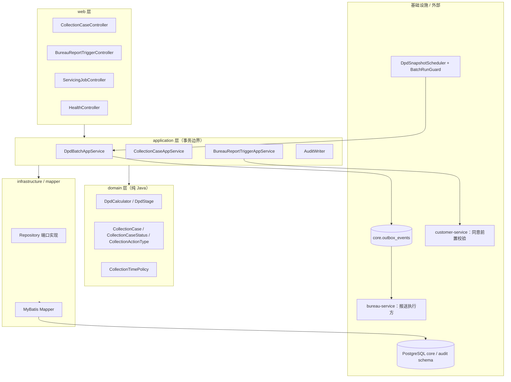

---

## 2. 启动与精确装配

### 2.1 启动类

`servicing-service/src/main/java/com/company/retail/servicing/ServicingServiceApplication.java`

```java
@SpringBootApplication(scanBasePackages = "com.company.retail.servicing")
@EnableDiscoveryClient
@EnableFeignClients(basePackages = "com.company.retail.common.contract")
@Import({RfDataSourceGuardConfig.class, RfSecurityConfig.class, RfOutboxConfig.class,
        RfFeignConfig.class,
        ServicingServiceConfig.class,
        ServicingGateConfig.class})
public class ServicingServiceApplication { ... }
```

要点：

- **只扫本服务包** `com.company.retail.servicing`，不做全包扫描
- 共享机制通过 `@Import` 按类注入：数据源角色守卫、安全、outbox、Feign、本服务装配、同意前置校验
- `@EnableFeignClients` 只扫冻结契约包 `com.company.retail.common.contract`
- 运行期**不跑 Flyway**：`spring.flyway.enabled=false`，迁移由独立 `db-migration` 作业执行

### 2.2 持久层装配

`ServicingMyBatisConfig`：

```java
@MapperScan("com.company.retail.servicing.mapper")
```

只注册本服务 Mapper 包。共享 `infrastructure` 的 Mapper（`OutboxMapper`、`BusinessCalendarMapper`）由 `RfOutboxConfig` 上的 `@MapperScan("com.company.retail.infrastructure.mapper")` 单独注册——`ServicingServiceConfig` 里的营业日历 Bean 正是依赖这个扫描。

### 2.3 关键配置

`servicing-service/src/main/resources/application.yml`：

| 配置 | 默认值 | 说明 |
|---|---|---|
| `server.port` | `8098` | 贷后服务端口 |
| `spring.datasource.url` | `jdbc:postgresql://localhost:5435/retail_finance` | 与核心账务共库，按 schema 分区 |
| `spring.datasource.username` | `retail_app_rw` | 运行期受限角色，禁止超管 |
| `spring.datasource.password` | 环境变量 `${RETAIL_DB_APP_PASSWORD}` | 无默认值 |
| `spring.flyway.enabled` | `false` | 迁移独立作业 |
| `spring.jackson.time-zone` | `Asia/Tokyo` | 只影响 JSON 序列化时区 |
| `mybatis.configuration.local-cache-scope` | `STATEMENT` | 一级缓存降为语句级，保持“每次读落库”语义 |
| `retail.auth.secret` | 环境变量 `${RETAIL_JWT_SECRET}` | 员工 JWT 密钥，无默认值 |
| `retail.customer-auth.secret` | 环境变量 `${RETAIL_CUSTOMER_JWT_SECRET}` | 客户 JWT 密钥，无默认值 |
| `retail.clients.customer.url` | 空 | Feign 双模；空串回退 `lb://`，本地直连用环境变量 |
| `retail.jobs.schedule-enabled` | `false` | DPD 日批调度总开关 |
| `retail.jobs.schedule-cron` | `0 30 3 * * *` | 默认 03:30，晚于 `retail-core` 的 03:00 到期滚转 |
| `retail.jobs.stale-minutes` | `30` | RUNNING 超过该分钟数可被接管 |
| `retail.servicing.dpd-grace-days` | `0` | DPD 宽限期，代码 `@Value` 默认，yml 未列 |
| `retail.servicing.collection-window-start` | `09:00` | 催收时段起点（JST），代码 `@Value` 默认 |
| `retail.servicing.collection-window-end` | `20:00` | 催收时段终点（JST，不含），代码 `@Value` 默认 |
| `retail.servicing.report-lead-days` | `1` | 报送 T+1 提前天数；构造器拒绝小于 1 |

---

## 3. 领域模型与不变式

### 3.1 聚合与值对象

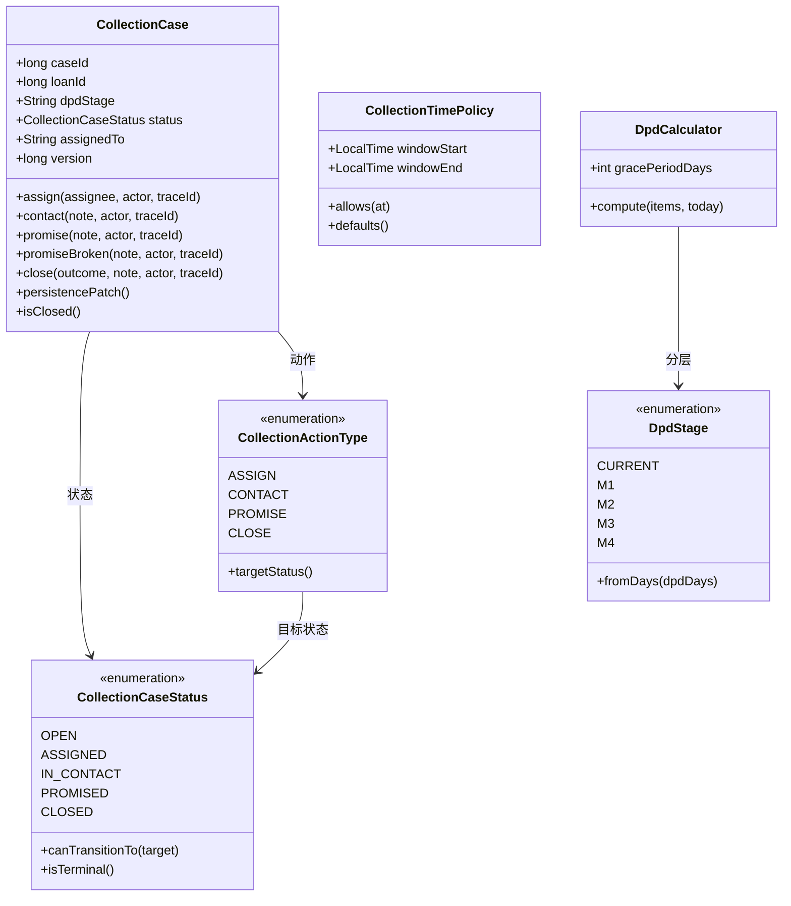

`CollectionCase` 的聚合方法返回 `CollectionAction` 值对象（`actionType / outcome / note / actor / traceId`），由 application 层落 `core.collection_actions`。

### 3.2 核心不变式

| 编号 | 不变式 | 落点 |
|---|---|---|
| INV-S1 | 同一债权同一业务日只有一份 DPD 快照 | `uk_dpd_loan_date` + `ON CONFLICT DO NOTHING` |
| INV-S2 | 同一债权最多一个在途催收案件 | `uk_coll_loan_open` 部分唯一索引（`status <> 'CLOSED'`） |
| INV-S3 | 同一债权同一触发类型只有一条报送触发 | `uk_brt_loan_type` + `ON CONFLICT DO NOTHING` |
| INV-S4 | 催收案件终态 `CLOSED` 不可再迁移 | `CollectionCaseStatus.ALLOWED` 终态集合为空 |
| INV-S5 | 关案必须登记结果 `REPAID` / `UNRECOVERABLE` | `CollectionCase.close()` |
| INV-S6 | 催收动作必须锚定已存在案件，无配置旁路 | `CollectionCaseAppService.executeAction()` |
| INV-S7 | 催收动作留痕 append-only；审计 `actor` 取验签身份 | `core.collection_actions`、`audit.audit_events`、`WebSubjects` |
| INV-S8 | DPD 批处理只读 `core.loans` / `core.schedule_items`，不写回债权状态 | `LoanScheduleQueryMapper` 只有 `SELECT` |
| INV-S9 | `DPD_CHANGED` 载荷只含白名单键，禁个人信息 | `EventPayloadGuard` + `MyBatisOutboxPublisher` |
| INV-S10 | 批次同日重跑不产生第二份快照 / 第二条案件 / 第二条事件 | 快照唯一键 + 案件部分唯一索引 + outbox 去重 |

### 3.3 DPD 分层口径

`DpdStage.fromDays(int)` 的映射是硬编码在领域枚举里的：

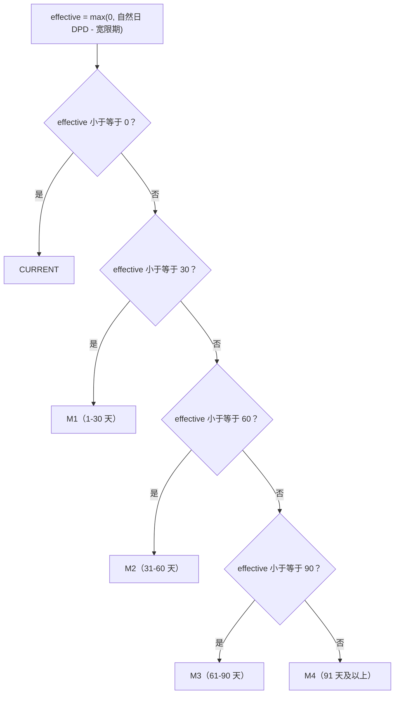

| 宽限后逾期天数 `effective` | 分层 |
|---:|---|
| `<= 0` | `CURRENT` |
| `1–30` | `M1` |
| `31–60` | `M2` |
| `61–90` | `M3` |
| `>= 91` | `M4` |

注意两个口径：

- 快照里的 `dpd_days` 存的是**自然日**，没有扣宽限期；
- `stage` 按**宽限后**的 `effective` 计算。

---

## 4. 主流程一：DPD 快照日批（dpd-snapshot）

### 4.0 dpd-snapshot 是什么

**DPD（Days Past Due）是逾期天数**。`dpd-snapshot` 是本服务的日批作业 `DPD_SNAPSHOT`：对每一笔**非终态债权**，在某个业务日计算一次“逾期多少天、处在哪个催收分层”，并把结果写入 `core.dpd_snapshots`。

一句话：

> **把“今天每笔债权逾期几天”固化成一个带日期的快照行，供催收、报送、审计和复盘使用。**

为什么需要快照，而不是每次临时算：

1. `core.schedule_items` 只反映**当前**期次状态，一旦核销 / 减免 / 结清，历史逾期轨迹就被当前状态覆盖；快照保留每个业务日的时点值。
2. 催收分层变化是事件（`DPD_CHANGED`）和自动开案的依据；用“今日快照”和“今日之前最近一次快照”比较，避免重复发事件、重复开案。
3. 批处理必须可重跑：`(loan_id, biz_date)` 唯一键保证同日重跑不产生第二份快照。

输入与输出：

| 方向 | 对象 | 说明 |
|---|---|---|
| 读 | `core.loans` | 只读；筛掉 `SETTLED` / `EARLY_SETTLED` / `WRITTEN_OFF` / `CANCELLED` |
| 读 | `core.schedule_items` + `core.repayment_plans` | 只读；按 `plan_id` 关联取 `loan_id`、`due_date`、`status` |
| 读 | 配置 `retail.servicing.dpd-grace-days` | 宽限期，默认 0 |
| 写 | `core.dpd_snapshots` | 每笔非终态债权每天一行 |
| 写 | `core.outbox_events` | 分层变化时发 `DPD_CHANGED`，聚合键 `loanId` |
| 写 | `core.collection_cases` | 逾期且无在途案件时自动开 `OPEN` 案件 |
| 写 | `core.batch_runs` | `job_name=DPD_SNAPSHOT` 的运行留痕 |
| 写 | `audit.audit_events` | `action=DPD_BATCH_RUN` 的批次审计 |

它**不做什么**：

- 不修改 `core.loans.status`（不会把债权改成 `DELINQUENT`）；
- 不修改 `core.schedule_items`（期次状态由 `retail-core` 的核销流程维护）；
- 不自动关闭已经恢复的催收案件（恢复只产生 `CURRENT` 快照，关案仍走人工 `CLOSE`）；
- 不写 `integration.credit_bureau_reports`（那是 `bureau-service` 的真相源）；
- 不自动登记征信报送触发（登记是独立的 `POST /api/bureau-report-triggers`）。

### 4.1 入口与触发方式

```text
手工触发：
POST /api/jobs/dpd-snapshot
权限点：JOB_TRIGGER
请求体（可选）：{ "bizDate": "2026-11-23" }
不传 bizDate → LocalDate.now()

调度触发：
DpdSnapshotScheduler.runScheduled()
开关：retail.jobs.schedule-enabled=true（默认 false）
cron：retail.jobs.schedule-cron（默认 0 30 3 * * *）
业务日：LocalDate.now()
actor：SYSTEM
```

两条路径最终都调用：

```java
DpdBatchAppService.run(bizDate, actor, traceId)
```

手工路径经过 `ServicingJobController`，调度路径先经过 `BatchRunGuard.tryClaim()` 抢占批次。

### 4.2 时序图

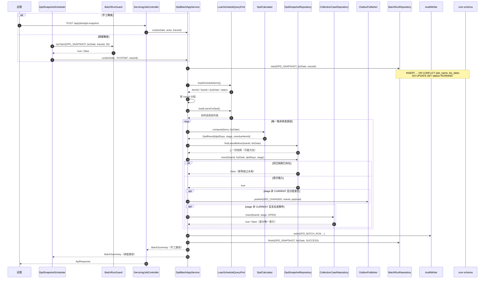

### 4.3 run / doRun 内部流程图

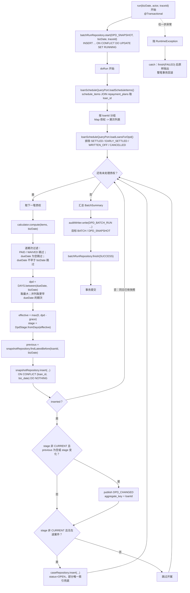

要点：

- 整个批次在一个 `@Transactional` 方法里：快照、事件、案件、审计、`batch_runs` 的 SUCCESS 一起提交，要么全有要么全无。
- 同日重跑时，`insert` 返回 false 的那笔债权会直接 `continue`——不再发事件、不再开案。
- `summary.loanCount` 是本次加载到的非终态债权数；`snapshotCount` 只统计真正插入的快照；`eventCount` 统计“检测到分层变化”的次数；`casesOpened` 只统计真正插入的案件。

### 4.4 DPD 计算规则

`DpdCalculator.compute(List<ScheduleItemView> items, LocalDate today)`：

```java
for (ScheduleItemView item : items) {
    if (isSettled(item.status()) || item.dueDate() == null
            || !item.dueDate().isBefore(today)) {
        continue;
    }
    int dpd = (int) ChronoUnit.DAYS.between(item.dueDate(), today);
    // 取最大 DPD；并列时取更早的 dueDate 作为主导期次
}
int effective = Math.max(0, maxDpd - gracePeriodDays);
return new DpdResult(maxDpd, DpdStage.fromDays(effective), dominantItem);
```

口径细节：

| 规则 | 代码行为 |
|---|---|
| 逾期判定 | `due_date` **早于**业务日才逾期；到期日当天不算逾期 |
| 天数口径 | 自然日，跨周末 / 节假日连续计数（`day_basis=NATURAL`） |
| 已结期次 | `PAID` / `WAIVED` 不参与计算 |
| 其他状态 | `OPEN` / `DUE` / `PARTIAL`（含 `null`）都按未结处理，容忍 W6 并行期的状态枚举 |
| 多期次 | 取所有未结逾期期次的最大 DPD；最大 DPD 并列时取更早到期的期次 |
| 宽限期 | `effective = max(0, dpd - grace)`；`dpd_days` 仍存自然日，`stage` 用宽限后口径 |
| 无逾期期次 | `dpd=0`、`CURRENT`、`overdueItemId=null` |

### 4.5 算例

业务日固定为 `2026-11-23`（周一），宽限期默认 `0`：

| 期次到期日 | 自然日 DPD | 宽限后 | 分层 | 说明 |
|---|---:|---:|---|---|
| `2026-11-23` | 0 | 0 | `CURRENT` | 到期日当天不算逾期 |
| `2026-11-22` | 1 | 1 | `M1` | 周日到期，周一快照 |
| `2026-11-20` | 3 | 3 | `M1` | 周五到期，周末连续计数 |
| `2026-10-24` | 30 | 30 | `M1` | M1 上边界 |
| `2026-10-23` | 31 | 31 | `M2` | M2 起点 |
| `2026-09-24` | 60 | 60 | `M2` | M2 上边界 |
| `2026-09-23` | 61 | 61 | `M3` | M3 起点 |
| `2026-08-25` | 90 | 90 | `M3` | M3 上边界 |
| `2026-08-24` | 91 | 91 | `M4` | M4 起点 |

宽限期算例：

```text
宽限期 grace = 5
到期日 2026-11-13，业务日 2026-11-23
自然日 dpd = 10
effective  = max(0, 10 - 5) = 5
快照：dpd_days = 10，stage = M1
```

```text
宽限期 grace = 7
到期日 2026-11-18，业务日 2026-11-23
自然日 dpd = 5
effective  = max(0, 5 - 7) = 0
快照：dpd_days = 5，stage = CURRENT
```

多期次算例：

```text
期次 A：due_date = 2026-11-01，status = OPEN   → dpd = 22
期次 B：due_date = 2026-11-10，status = DUE    → dpd = 13
期次 C：due_date = 2026-10-01，status = PAID   → 跳过

结果：dpd_days = 22，overdueItemId = A，stage = M1
```

### 4.6 幂等与同日重跑

| 机制 | SQL / 代码 | 效果 |
|---|---|---|
| 快照唯一键 | `uk_dpd_loan_date (loan_id, biz_date)` + `ON CONFLICT DO NOTHING` | 同一债权同一天只有一行 |
| 同日重跑短路 | `insert` 返回 0 行 → `continue` | 不重复发事件、不重复开案 |
| 批次留痕 | `uk_batch_job_date (job_name, biz_date)` + `start` upsert | 同日重跑复用同一行，不留第二行 |
| 案件唯一 | `uk_coll_loan_open` 部分唯一索引 + `ON CONFLICT DO NOTHING` | 一债权一在途案件 |
| 事件去重 | outbox `(event_type, aggregate_key)` 已有 PENDING/SENT 不插入 | 同一债权不会重复入箱同类型事件 |

同日重跑的实际效果（`DpdBatchAppServiceTest.rerunSameDay_noSecondSnapshotNoSecondEvent_noSecondCase`）：

```text
第 1 次 run：snapshotCount=1，eventCount=1，casesOpened=1
第 2 次 run：snapshotCount=0，eventCount=0，casesOpened=0
```

跨日重跑：新业务日会插入新快照；分层变化用 `findLatestBefore` 与“今天之前最近一次”比较。

### 4.7 事件 DPD_CHANGED

触发条件：

```java
boolean stageChanged = result.stage() != DpdStage.CURRENT
        && (previous.isEmpty() || !previous.get().stage().equals(result.stage().name()));
```

即：**今天逾期、且今天是首次逾期或分层相对上一份快照发生变化**。恢复为 `CURRENT` 不发事件。

载荷（`DpdBatchAppService.publishDpdChanged`）：

| 键 | 示例 | 说明 |
|---|---|---|
| `loanId` | `1` | 业务主键，同时是 outbox `aggregate_key` |
| `stage` | `M1` | 今日分层 |
| `status` | `M1` | 与 `stage` 同值，兼容既有消费者 |
| `bizDate` | `2026-11-23` | 业务日 |
| `source` | `AUTO` | 批处理来源 |
| `occurredAt` | `2026-11-23T03:30:12.345+09:00` | 发生时间 |
| `schemaVersion` | `1.0` | 载荷版本 |
| `traceId` | `...` | 链路追踪 |

发布与投递过程：

1. `OutboxPublisher.publish(DPD_CHANGED, String.valueOf(loanId), payload)`
2. `MyBatisOutboxPublisher.publish` 先调用 `EventPayloadGuard.validate`
3. 白名单检查通过后执行 `INSERT ... WHERE NOT EXISTS (...)`，同 `(event_type, aggregate_key)` 已有 `PENDING`/`SENT` 则跳过
4. 事务提交后，事件留在 `core.outbox_events`。各服务进程的 `RfEventDispatcher`（`fixedDelay=1000ms`）只轮询自己消费者声明的事件类型；`servicing` 自身没有 `EventConsumer`，本服务的 dispatcher 直接空转
5. `bureau-service` 的 dispatcher 取到 `DPD_CHANGED`，交给 `DpdChangedReportConsumer`；处理完成后由该 dispatcher 调用 `markSent`
6. 开启 MQ 时，`MqOutboxRelay` 先把事件封成密文信封投到 `RF_EVENT_RELAY`，成功后写 `relayed_at`；消费端由 `MqEventRelayConsumer` 执行，但它**不回写** outbox 的 `status`

白名单只允许 `EventPayloadGuard.ALLOWED_KEYS` 中的键；`loanId`、`stage`、`status`、`bizDate`、`source`、`occurredAt`、`schemaVersion`、`traceId` 都在白名单内。姓名、地址、电话、证件号等个人信息键会被拒绝，事件不会落库。

#### 4.7.1 core.outbox_events 行示例

以下示例按当前代码构造（**不是数据库实查**）：一笔债权 `301` 在 `2026-11-23` 的日批中首次进入 `M1`。

| 列 | 示例值 | 来源 / 说明 |
|---|---|---|
| `event_id` | `1042` | `BIGSERIAL` 主键，示例值 |
| `event_type` | `DPD_CHANGED` | 本服务唯一发布的事件类型 |
| `aggregate_key` | `301` | `String.valueOf(loanId)`，同时是 outbox 去重键 |
| `payload` | 下面的 JSON | 列类型是 `TEXT`，存 JSON 字符串 |
| `status` | `PENDING` | 插入时固定 `PENDING` |
| `created_at` | `2026-11-23 03:30:12.345+09` | 默认 `now()` |
| `sent_at` | `NULL` | 消费方处理完成前为空 |
| `updated_at` | `2026-11-23 03:30:12.345+09` | 默认 `now()`；`markSent` 不改此列 |
| `relayed_at` | `NULL` | V20 新增；MQ 中继后才有值 |

`payload` 展开后：

```json
{
  "loanId": 301,
  "stage": "M1",
  "status": "M1",
  "bizDate": "2026-11-23",
  "source": "AUTO",
  "occurredAt": "2026-11-23T03:30:12.345678+09:00",
  "schemaVersion": "1.0",
  "traceId": "SCHED-7f3a9c21"
}
```

数据库中实际存的是一行文本：

```text
{"loanId":301,"stage":"M1","status":"M1","bizDate":"2026-11-23","source":"AUTO","occurredAt":"2026-11-23T03:30:12.345678+09:00","schemaVersion":"1.0","traceId":"SCHED-7f3a9c21"}
```

写入 SQL（`OutboxMapper.insertEventIfAbsent` 同构）：

```sql
INSERT INTO core.outbox_events (event_type, aggregate_key, payload, status)
SELECT #{eventType}, #{aggregateKey}, #{payload}, 'PENDING'
WHERE NOT EXISTS (
    SELECT 1 FROM core.outbox_events
    WHERE event_type = #{eventType}
      AND aggregate_key = #{aggregateKey}
      AND status IN ('PENDING', 'SENT')
);
```

本示例中：`#{eventType}=DPD_CHANGED`、`#{aggregateKey}=301`、`#{payload}` 是上文的 JSON 文本。

同一行在两条投递路径下的状态变化：

| 时点 | `status` | `sent_at` | `relayed_at` |
|---|---|---|---|
| 插入后 | `PENDING` | `NULL` | `NULL` |
| 直投：消费方处理完成 | `SENT` | `now()` | `NULL` |
| MQ：中继完成 | `PENDING`（仍） | `NULL` | `now()` |
| MQ：消费端处理完成 | `PENDING`（不回写） | `NULL` | `now()` |

理解要点：

- `servicing-service` 只负责插入 `PENDING` 行；把它改成 `SENT` 的是**消费方**（`bureau-service`）的 dispatcher。
- `(event_type, aggregate_key)` 去重意味着同一债权通常只有一条 `DPD_CHANGED`；后续 `M1 → M2` 再发布会被跳过。`BatchSummary.eventCount` 统计的是“检测到分层变化”的次数，不是实际新增行数。
- `/track` 只读 `status`；在 MQ 路径下，事件可能已中继但仍显示 `PENDING`，判断是否中继要看 `relayed_at`。
- 消费幂等另有 `core.event_consumptions(event_id, consumer)` 表，与 outbox 行是一对多关系。

### 4.8 自动开立催收案件

条件（三个同时满足）：

```text
result.stage() != CURRENT
且 caseRepository.findOpenByLoan(loanId) 为空
且 caseRepository.insert(loanId, stage, traceId) 返回 true
```

开案 SQL：

```sql
INSERT INTO core.collection_cases (loan_id, dpd_stage, status, trace_id)
VALUES (?, ?, 'OPEN', ?)
ON CONFLICT (loan_id) WHERE status <> 'CLOSED' DO NOTHING
```

注意：

- 冲突时返回 0 行，**不抛唯一键异常**。PostgreSQL 事务内一旦触发唯一键错误，整笔事务会被置为 aborted，后续 SQL 全部失败；所以这里必须用 `ON CONFLICT DO NOTHING`。
- 自动开案只在 `stage != CURRENT` 时发生；恢复为 `CURRENT` 不会自动关案。
- 案件上的 `dpd_stage` 是**开案时**的分层快照；后续分层变化不会更新这个字段（`updateStatus` 只更新状态、负责人、关案时间）。

### 4.9 快照查询

```text
GET /api/dpd-snapshots?loanId=...
```

- `loanId` 必填；缺失返回 `RF_VALID_001`（`reason=LOAN_ID_REQUIRED`）
- 返回该债权最近 200 条快照，按 `biz_date DESC`
- 只读，不设权限点；走员工 JWT 鉴权

---

## 5. 主流程二：催收案件处置

### 5.1 入口

```text
POST /api/collection-cases/{id}/actions
权限点：COLLECTION_HANDLE
请求体：
{
  "actionType": "ASSIGN | CONTACT | PROMISE | CLOSE",
  "assignee": "分案负责人（ASSIGN 必填）",
  "outcome": "REPAID | UNRECOVERABLE（CLOSE 必填）",
  "note": "备注留痕"
}
```

查询端点：

```text
GET /api/collection-cases?status=...
GET /api/collection-cases/{id}
GET /api/collection-cases/{id}/actions
```

`actor` 与 `actorSubject` 由 `WebSubjects` 从 JWT 验签后的请求属性读取，**禁止从请求体或客户端头取**。

### 5.2 时序图

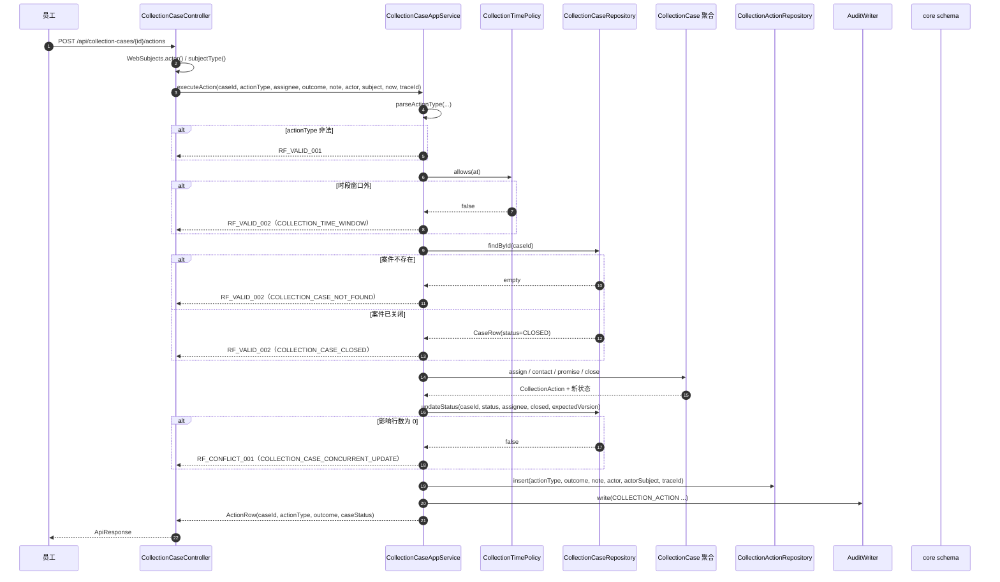

### 5.3 executeAction 流程图

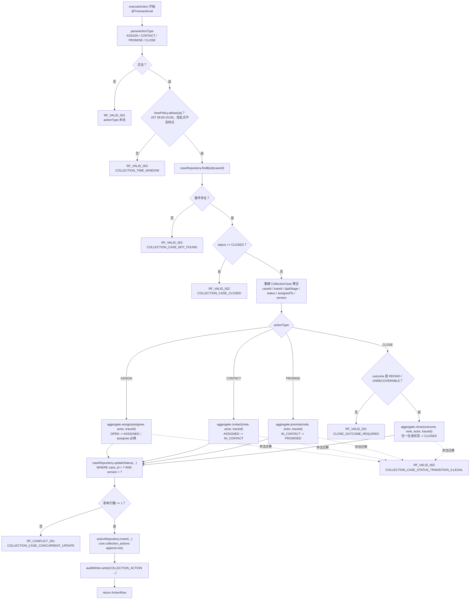

细节：

- 时段校验在案件查询**之前**：窗口外即使案件不存在，也先返回 `COLLECTION_TIME_WINDOW`。
- `CLOSE` 的结果校验在聚合方法内：先校验 `REPAID` / `UNRECOVERABLE`，再校验状态迁移。
- 状态更新用 `version` 乐观锁；并发下只有一个请求能成功，其余返回 `RF_CONFLICT_001`。
- 状态更新成功后，动作留痕与审计在**同一事务**内写入。

### 5.4 催收案件状态机

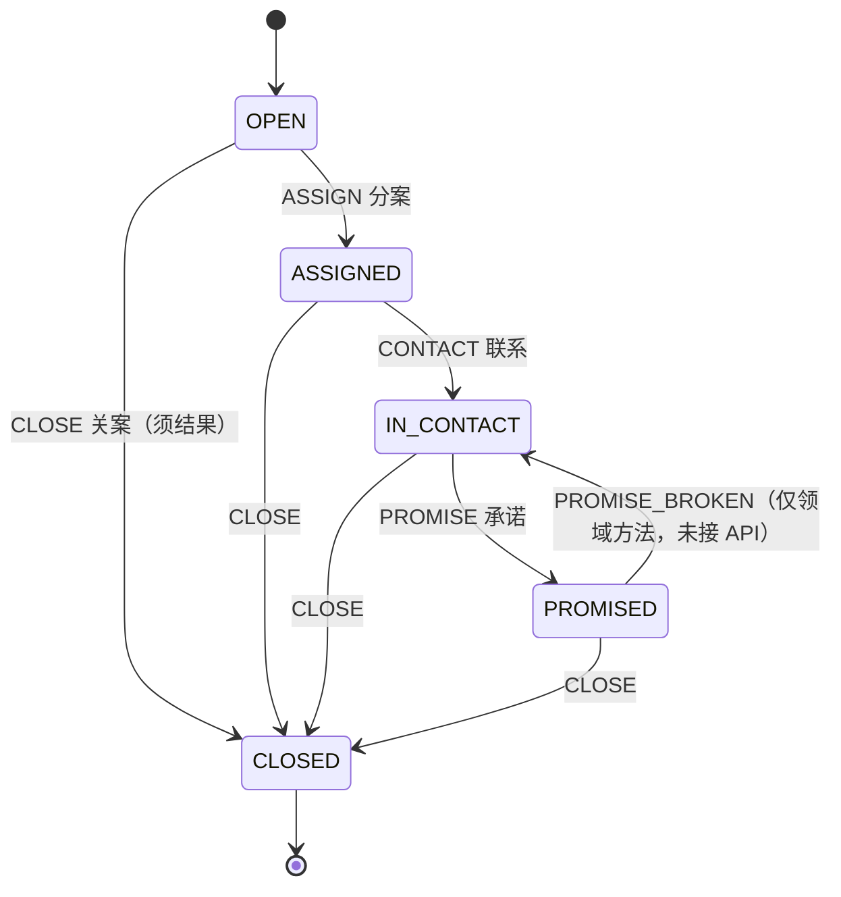

迁移表：

| 当前状态 | 动作 | 目标状态 | 入口 |
|---|---|---|---|
| `OPEN` | `ASSIGN` | `ASSIGNED` | API |
| `OPEN` | `CLOSE` | `CLOSED` | API |
| `ASSIGNED` | `CONTACT` | `IN_CONTACT` | API |
| `ASSIGNED` | `CLOSE` | `CLOSED` | API |
| `IN_CONTACT` | `PROMISE` | `PROMISED` | API |
| `IN_CONTACT` | `CLOSE` | `CLOSED` | API |
| `PROMISED` | `PROMISE_BROKEN` | `IN_CONTACT` | 仅领域方法，API 未接线 |
| `PROMISED` | `CLOSE` | `CLOSED` | API |
| `CLOSED` | 任意 | 拒绝 | — |

非法迁移统一抛：

```text
RF_VALID_002
reason = COLLECTION_CASE_STATUS_TRANSITION_ILLEGAL
from / to / operation / caseId
```

### 5.5 催收时段约束

`CollectionTimePolicy`：

```java
public static final ZoneId ZONE_JST = ZoneId.of("Asia/Tokyo");

public boolean allows(OffsetDateTime at) {
    LocalTime t = at.atZoneSameInstant(ZONE_JST).toLocalTime();
    return !t.isBefore(windowStart) && t.isBefore(windowEnd);
}
```

- 默认窗口 `09:00–20:00 JST`，含起点、不含终点。
- 窗口可以通过 `retail.servicing.collection-window-start/end` 调整，但**约束本身不可关闭**——没有 `enabled=false` 之类的开关。
- 构造器拒绝 `start >= end` 或空值。
- 窗口外一律 `RF_VALID_002`（`reason=COLLECTION_TIME_WINDOW`），宁可误拒，不可放过。

### 5.6 留痕与审计

一次成功的催收动作写入两层记录：

| 层 | 表 | 内容 |
|---|---|---|
| 动作留痕 | `core.collection_actions` | `action_type`、`outcome`、`note`、`actor`、`actor_subject`、`trace_id` |
| 安全审计 | `audit.audit_events` | `action=COLLECTION_ACTION`、`target_type=COLLECTION_CASE`、`target_id=caseId`、动作前后状态、`outcome` |

约束：

- `collection_actions` 只有 `INSERT` 与 `SELECT`，没有 update / delete（append-only）。
- 审计 `actor` 来自 `WebSubjects.actor()`，即 JWT 验签后的 `authSubject`；无请求上下文时按 `SYSTEM`。
- `note` 是备注字段，代码注释明确要求不落个人信息明文；审计快照只含业务键和状态。

### 5.7 未接线：承诺未履约回退

领域聚合有 `promiseBroken()`：

```java
public CollectionAction promiseBroken(String note, String actor, String traceId) {
    requireTransitionTo(CollectionCaseStatus.IN_CONTACT, "PROMISE_BROKEN");
    this.status = CollectionCaseStatus.IN_CONTACT;
    return new CollectionAction(CollectionActionType.CONTACT, null, note, actor, traceId);
}
```

但 `CollectionActionType` 只有 `ASSIGN / CONTACT / PROMISE / CLOSE`，接口的 `actionType` 也只能取这四个值。因此：

- `PROMISED → IN_CONTACT` 这条边**只有领域方法，没有 API 入口**；
- 即使走到领域方法，留痕的动作类型也记成 `CONTACT`，没有独立的 `PROMISE_BROKEN` 动作码；
- 当前通过 HTTP 只能让 `PROMISED` 走向 `CLOSED`。

这是一条显式的“未接线边”，不是“忘了写”。

---

## 6. 主流程三：征信报送触发

### 6.1 入口

```text
POST /api/bureau-report-triggers
权限点：BUREAU_REPORT_EXEC
请求体：
{
  "loanId": 1,
  "consentId": 5001,
  "dpdStage": "M1"
}
```

分工边界：

- `servicing-service` 只做**触发登记与状态跟踪**，是 `core.bureau_report_triggers` 的登记侧真相源；
- `bureau-service` 是**报送执行方**，写 `integration.credit_bureau_reports`，并把触发状态推进到 `CONSUMED` / `BLOCKED`。

查询端点：

```text
GET /api/bureau-report-triggers?status=...
GET /api/bureau-report-triggers/{id}
GET /api/bureau-report-triggers/{id}/track
```

### 6.2 时序图

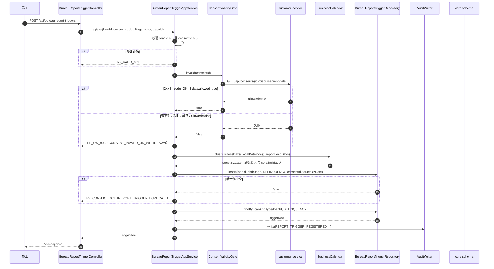

### 6.3 register 流程图

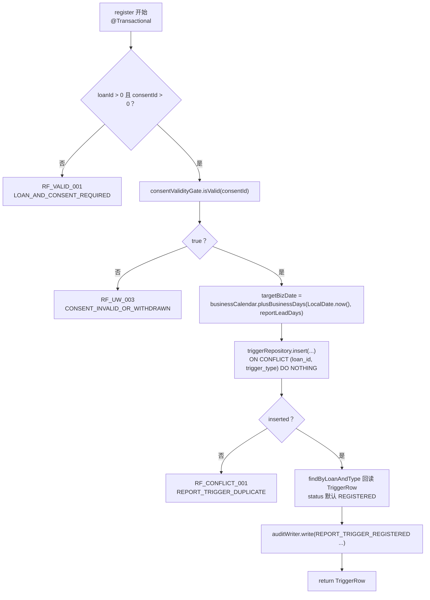

细节：

- `dpdStage` 为空时默认 `M1`；触发类型固定 `DELINQUENCY`。
- 唯一键冲突用 `ON CONFLICT DO NOTHING` 处理，返回 0 行后抛 `RF_CONFLICT_001`，不捕获唯一键异常。
- 登记只写 `core.bureau_report_triggers`，不写 `integration.credit_bureau_reports`，也不发 outbox 事件。
- `reportLeadDays` 构造器拒绝小于 1，保证至少 T+1。

### 6.4 同意前置校验（fail-closed）

同意校验由本服务模块内的 `ServicingConsentGate` 实现，端口是 application 层的 `ConsentValidityGate`：

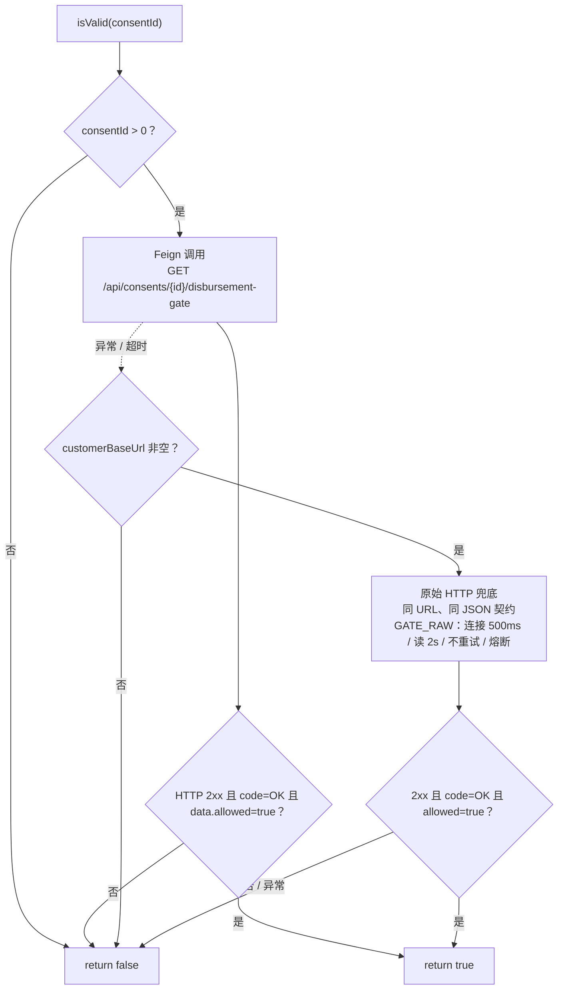

要点：

- **fail-closed**：查不到、超时、非 2xx、`allowed` 不为 true，一律 `false`，调用方拒绝登记触发。
- **不缓存结果**：同意可以秒级撤回（INV-5），每次登记都实时查。
- Feign 失败后走原始 HTTP 兜底；兜底不重试（`GATE_RAW`），避免在已经失败一次后再放大外部压力。
- 原始 HTTP 兜底会透传当前请求的 `Authorization`；没有请求上下文时不透传，由下游拒绝。
- 兜底只支持配置了 `retail.clients.customer.url` 的直连模式；空串回退 `lb://` 时直接 fail-closed。

### 6.5 T+1 营业日

```java
LocalDate targetBizDate = businessCalendar.plusBusinessDays(LocalDate.now(), reportLeadDays);
```

`MyBatisBusinessCalendar` 的口径：

- 周六、周日不是营业日；
- `core.holidays` 中登记的日期不是营业日；
- 从今天开始逐日前进，跳过非营业日，最多前进 3660 天（死循环护栏）。

算例：

```text
今天 = 2026-11-20（周五），reportLeadDays = 1
2026-11-21 周六 → 跳过
2026-11-22 周日 → 跳过
2026-11-23 周一 → 营业日
targetBizDate = 2026-11-23
```

```text
如果 2026-11-23 在 core.holidays 中登记为节假日
targetBizDate = 2026-11-24
```

### 6.6 状态跟踪

```text
GET /api/bureau-report-triggers/{id}/track
```

返回：

| 字段 | 来源 |
|---|---|
| `triggerId` / `loanId` / `dpdStage` / `triggerType` / `targetBizDate` / `status` | `core.bureau_report_triggers` |
| `outboxEventStatus` | `core.outbox_events` 中该 `loanId` 最近一条 `DPD_CHANGED` 的 `status`（`PENDING` / `SENT`），没有事件时 `NO_EVENT` |

`servicing` 不跨域读 `integration.credit_bureau_reports`；触发是否送达以 outbox 事件状态为锚点。触发状态的 `CONSUMED` / `BLOCKED` 由 `bureau-service` 推进，`servicing` 侧只读展示。

---

## 7. 日批调度与批次护栏

### 7.1 调度开关

```java
@Configuration
@ConditionalOnProperty(name = "retail.jobs.schedule-enabled", havingValue = "true")
@EnableScheduling
public class ServicingJobsScheduleConfig { }
```

```java
@Component
@ConditionalOnProperty(name = "retail.jobs.schedule-enabled", havingValue = "true")
public class DpdSnapshotScheduler { ... }
```

- 默认 `false`：不产生任何调度 Bean，手工 `POST /api/jobs/dpd-snapshot` 不受影响。
- 开启后 `@Scheduled(cron = "${retail.jobs.schedule-cron:0 30 3 * * *}")` 每天 03:30 执行。
- 03:30 晚于 `retail-core` 的 03:00 到期滚转，DPD 口径使用当日已滚转的期次状态。

### 7.2 抢占与失败处理

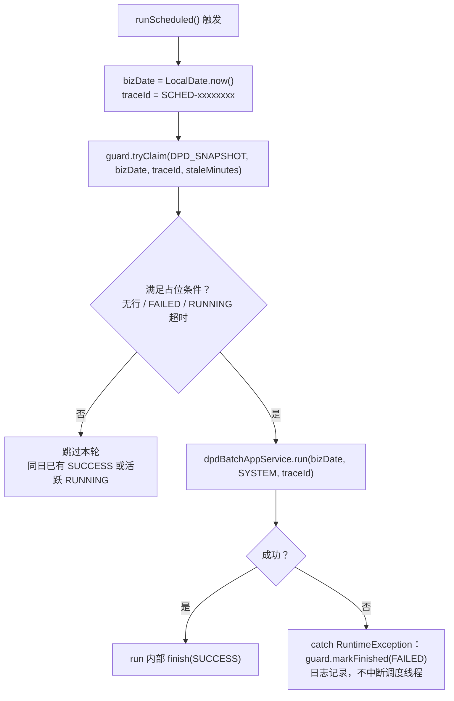

`BatchRunMapper.tryClaim` 的原子语义：

```sql
INSERT INTO core.batch_runs (job_name, biz_date, status, trace_id)
VALUES (?, ?, 'RUNNING', ?)
ON CONFLICT (job_name, biz_date) DO UPDATE
SET status = 'RUNNING', started_at = now(), finished_at = NULL,
    trace_id = EXCLUDED.trace_id
WHERE core.batch_runs.status = 'FAILED'
   OR (core.batch_runs.status = 'RUNNING'
       AND core.batch_runs.started_at < now() - make_interval(mins => ?))
```

一次 SQL 完成：

- 没有行 → 占位成功；
- 已有 `FAILED` → 允许重试；
- 已有活跃 `RUNNING` 或同日 `SUCCESS` → 不更新，返回 0 行，调度跳过。

### 7.3 手工触发与调度触发的差异

| 维度 | 手工触发 | 调度触发 |
|---|---|---|
| 入口 | `ServicingJobController` | `DpdSnapshotScheduler` |
| 开关 | 不受 `retail.jobs.schedule-enabled` 影响 | 默认关闭，需显式开启 |
| 业务日 | 请求体 `bizDate`，不传取 `LocalDate.now()` | `LocalDate.now()` |
| actor | JWT 验签身份 | `SYSTEM` |
| traceId | 请求 `traceId` | `SCHED-` + 8 位 UUID |
| 批次抢占 | 不用 `BatchRunGuard`；`run()` 内 `batch_runs.start` upsert | `BatchRunGuard.tryClaim` 抢占 |
| 同日 SUCCESS 后 | 允许重跑（快照唯一键保证数据幂等） | 跳过 |
| 执行异常 | 异常返回调用方，事务回滚 | catch 后 `markFinished(FAILED)`，不抛 |

手工触发没有抢占锁，但数据层仍有四道兜底：快照唯一键、案件部分唯一索引、outbox 去重、批次 upsert。并发手工触发最多是重复计算，不会重复落数据。

---

## 8. 状态机口径与接线

### 8.1 领域是唯一事实源

`CollectionCaseStatus.ALLOWED` 是催收案件状态图的唯一事实源：

```java
private static final Map<CollectionCaseStatus, Set<CollectionCaseStatus>> ALLOWED = Map.of(
        OPEN, Set.of(ASSIGNED, CLOSED),
        ASSIGNED, Set.of(IN_CONTACT, CLOSED),
        IN_CONTACT, Set.of(PROMISED, CLOSED),
        PROMISED, Set.of(IN_CONTACT, CLOSED),
        CLOSED, Set.of());
```

`CollectionActionType.targetStatus()` 只做“动作 → 目标状态”的映射，不另写一份迁移表。真正的合法性判断在 `CollectionCase.requireTransitionTo()`，非法迁移抛 `RF_VALID_002`。

### 8.2 未接入共享状态机引擎

`servicing-service` 的 `pom.xml` 没有依赖共享 `statemachine` 模块，也没有 Spring StateMachine 配置。当前实现是：

```text
领域枚举 ALLOWED 图（唯一事实源）
  + 聚合方法（唯一变更入口）
  + application 层重建聚合并调用方法
  + 数据库 version 乐观锁兜底并发
```

这与 `B-14` 的要求一致：**领域是状态图唯一事实源**；只是本服务尚未把图接到共享引擎上。后续若接入引擎，迁移边仍必须由 `CollectionCaseStatus.ALLOWED` 生成，不得在引擎侧另写一份状态图。

---

## 9. 幂等与并发清单

| 层次 | 机制 | 代码 / 表 |
|---|---|---|
| DPD 快照 | `uk_dpd_loan_date` + `ON CONFLICT DO NOTHING` | `core.dpd_snapshots`、`DpdSnapshotMapper.insert` |
| 催收案件开案 | `uk_coll_loan_open` 部分唯一索引 + `ON CONFLICT DO NOTHING` | `core.collection_cases`、`CollectionCaseMapper.insert` |
| 催收状态更新 | `version` 条件更新（`WHERE case_id = ? AND version = ?`） | `core.collection_cases`、`CollectionCaseMapper.updateStatus` |
| 催收动作重复提交 | 状态机天然拒绝：同一动作第二次提交时当前状态已不满足迁移前置 | `CollectionCaseStatus.ALLOWED` |
| 报送触发 | `uk_brt_loan_type` + `ON CONFLICT DO NOTHING` | `core.bureau_report_triggers`、`BureauReportTriggerMapper.insert` |
| 批次留痕 | `uk_batch_job_date` + `start` upsert / `tryClaim` 条件更新 | `core.batch_runs`、`BatchRunMapper` |
| outbox 去重 | `(event_type, aggregate_key)` 已有 `PENDING`/`SENT` 不插入 | `core.outbox_events`、`MyBatisOutboxPublisher` |
| 审计 | append-only 仅 `INSERT` | `audit.audit_events`、`AuditMapper` |
| 同意校验 | 不缓存，每次实时查；失败一律拒绝 | `ServicingConsentGate` |

本服务**没有**使用 Redis 分布式锁、`Idempotency-Key` 或内存状态做幂等；正确性来源始终是数据库唯一索引与状态机。

---

## 10. 数据表与迁移

### 10.1 表关系

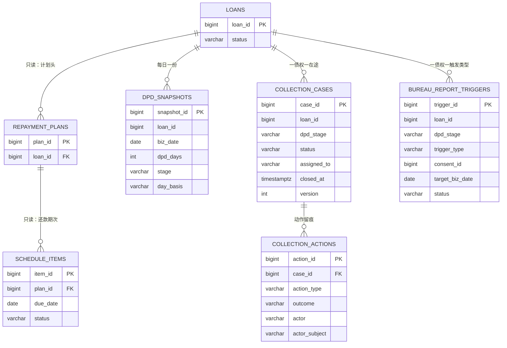

### 10.2 迁移清单

| 表 | 用途 | 迁移 |
|---|---|---|
| `core.dpd_snapshots` | DPD 每日快照，唯一键 `(loan_id, biz_date)` | V9 |
| `core.collection_cases` | 催收案件，部分唯一索引 `uk_coll_loan_open` | V9 |
| `core.collection_actions` | 催收动作留痕（append-only） | V14 |
| `core.bureau_report_triggers` | 报送触发登记，唯一键 `(loan_id, trigger_type)` | V14；V15 加到期扫描索引 |
| `core.batch_runs` | 批处理留痕 / 抢占 | V1 |
| `audit.audit_events` | 安全审计（append-only） | V1 |
| `core.outbox_events` | 事务性事件表 | V1 + V20 |
| `core.loans` | 债权（只读） | V6 + V13 |
| `core.repayment_plans` | 还款计划头（只读） | V6 + V18 |
| `core.schedule_items` | 还款期次（只读） | V6 + V13 |
| `core.holidays` | 营业日历节假日（只读，共享 `BusinessCalendar`） | V1 + V9 种子 |

> 已执行的迁移字节不改；号段占用见 `PROGRESS.md §2` 与 `R06 §6`。

### 10.3 三张表联动：一笔债权的完整记录

`dpd_snapshots`、`collection_cases`、`collection_actions` 回答的是同一笔债权的三个层次：

| 表 | 角色 | 粒度 |
|---|---|---|
| `core.dpd_snapshots` | 这笔债权**每天**的 DPD 与分层 | 一债权一天一行 |
| `core.collection_cases` | 这笔债权**当前 / 历史**的催收案件 | 一个案件一行，可能多行 |
| `core.collection_actions` | 某个案件**做过的动作** | 一次动作一行，append-only |

三张表之间**没有数据库外键**，靠业务键关联：

```text
dpd_snapshots.loan_id
        │
        ▼
collection_cases.loan_id      ← collection_cases.opened_at 落在某个 biz_date
        │ case_id
        ▼
collection_actions.case_id    ← 每个动作归属一个案件
```

#### 10.3.1 示例背景

```text
债权 301，期次 due_date = 2026-11-20，status = OPEN
```

#### 10.3.2 时间线

| 时间 | 发生了什么 | `dpd_snapshots` | `collection_cases` | `collection_actions` |
|---|---|---|---|---|
| 11-24 03:30 | DPD 日批：dpd=4，M1 | 新增 `snapshot_id=7001` | 无在途案件 → 自动开案 `case_id=88`，`OPEN` | — |
| 11-24 10:00 | 员工分案 | — | `ASSIGNED`，`assigned_to=staff-c1`，`version=1` | 新增 `action_id=5001`，`ASSIGN` |
| 11-25 03:30 | 次日快照：dpd=5，仍是 M1 | 新增 `7002` | — | — |
| 11-25 14:00 | 员工联系客户 | — | `IN_CONTACT`，`version=2` | 新增 `5002`，`CONTACT` |
| 11-26 03:30 | 次日快照：dpd=6，M1 | 新增 `7003` | — | — |
| 11-26 09:30 | 客户承诺还款 | — | `PROMISED`，`version=3` | 新增 `5003`，`PROMISE` |
| 12-05 03:30 | 快照：dpd=15，M1 | 新增 `7004` | — | — |
| 12-05 11:00 | 客户还款，员工关案 | — | `CLOSED`，写 `closed_at`，`version=4` | 新增 `5004`，`CLOSE`，`outcome=REPAID` |
| 12-06 03:30 | 期次已 `PAID`，dpd=0 | 新增 `7005`，`CURRENT` | 案件仍是 `CLOSED`，不自动关 / 不重开 | — |

#### 10.3.3 三张表的实际行

`core.dpd_snapshots`：

| snapshot_id | loan_id | biz_date | dpd_days | stage | day_basis |
|---|---|---|---|---|---|
| 7001 | 301 | 2026-11-24 | 4 | M1 | NATURAL |
| 7002 | 301 | 2026-11-25 | 5 | M1 | NATURAL |
| 7003 | 301 | 2026-11-26 | 6 | M1 | NATURAL |
| 7004 | 301 | 2026-12-05 | 15 | M1 | NATURAL |
| 7005 | 301 | 2026-12-06 | 0 | CURRENT | NATURAL |

`core.collection_cases`：

| case_id | loan_id | dpd_stage | status | opened_at | closed_at | assigned_to | version |
|---|---|---|---|---|---|---|---|
| 88 | 301 | M1 | CLOSED | 2026-11-24 03:30:15+09 | 2026-12-05 11:00:04+09 | staff-c1 | 4 |

注意：`dpd_stage` 是**开案时**的 M1；后面即使分层变化，这个字段也不更新。

`core.collection_actions`：

| action_id | case_id | action_type | outcome | note | actor | actor_subject |
|---|---|---|---|---|---|---|
| 5001 | 88 | ASSIGN | NULL | NULL | staff-001 | STAFF |
| 5002 | 88 | CONTACT | NULL | 电话联系，客户表示月底前还款 | staff-001 | STAFF |
| 5003 | 88 | PROMISE | NULL | 承诺 12-05 前还款 | staff-001 | STAFF |
| 5004 | 88 | CLOSE | REPAID | 已回收 | staff-001 | STAFF |

#### 10.3.4 关联口径与查询示意

一笔债权的贷后历史：

```text
loan 301
├─ dpd_snapshots：7001(11-24 M1) → 7002(11-25 M1) → ... → 7005(12-06 CURRENT)
└─ collection_cases：case 88（11-24 开案，12-05 关案）
      └─ collection_actions：5001 ASSIGN → 5002 CONTACT → 5003 PROMISE → 5004 CLOSE
```

查询时注意：

1. **案件要按日期关联**：直接用 `dpd_snapshots.loan_id = collection_cases.loan_id` JOIN 会一对多放大；一笔债权一生可能有多个案件（关案后再次逾期会开新案），必须按 `opened_at` / `closed_at` 限定案件存续期。
2. **快照没有 `case_id`**：想知道“案件是哪天因为哪份快照开的”，用 `collection_cases.opened_at` 的日期去对 `dpd_snapshots.biz_date`，或比对 `collection_cases.dpd_stage` 与当天 `stage`。
3. **动作没有前后状态**：`collection_actions` 只记“做了什么”；`fromStatus / toStatus` 在 `audit.audit_events` 的 `COLLECTION_ACTION` 快照里。

示意查询（按案件存续期关联当天的快照）：

```sql
SELECT s.biz_date, s.dpd_days, s.stage,
       c.case_id, c.status AS case_status, c.dpd_stage AS case_stage
FROM core.dpd_snapshots s
LEFT JOIN core.collection_cases c
       ON c.loan_id = s.loan_id
      AND c.opened_at::date <= s.biz_date
      AND (c.closed_at IS NULL OR c.closed_at::date >= s.biz_date)
WHERE s.loan_id = 301
ORDER BY s.biz_date;
```

完整的贷后证据链：

```text
dpd_snapshots（每日逾期事实）
  + collection_cases（案件当前状态）
  + collection_actions（动作流水）
  + audit.audit_events（动作前后状态、操作人）
  + outbox_events（DPD_CHANGED 事件是否发出）
```

---

## 11. 对外接口

| 方法 | 路径 | 权限点 | 幂等 / 说明 |
|---|---|---|---|
| `POST` | `/api/jobs/dpd-snapshot` | `JOB_TRIGGER` | `uk_dpd_loan_date`，同日重跑幂等 |
| `GET` | `/api/dpd-snapshots?loanId=` | 员工主体 | 只读，最近 200 条 |
| `GET` | `/api/collection-cases?status=` | 员工主体 | 只读，按状态过滤 |
| `GET` | `/api/collection-cases/{id}` | 员工主体 | 只读 |
| `GET` | `/api/collection-cases/{id}/actions` | 员工主体 | 只读，动作留痕 |
| `POST` | `/api/collection-cases/{id}/actions` | `COLLECTION_HANDLE` | 状态机 + 乐观锁 |
| `POST` | `/api/bureau-report-triggers` | `BUREAU_REPORT_EXEC` | `uk_brt_loan_type` |
| `GET` | `/api/bureau-report-triggers?status=` | 员工主体 | 只读 |
| `GET` | `/api/bureau-report-triggers/{id}` | 员工主体 | 只读 |
| `GET` | `/api/bureau-report-triggers/{id}/track` | 员工主体 | 只读，含 outbox 送达锚点 |
| `GET` | `/api/collection-cases/health` | 免鉴权 | 健康检查 |
| `GET` | `/api/collection-cases/whoami` | 员工主体 | 回显验签结果 |

网关路由（`gateway/src/main/resources/application.yml`）只显式登记了：

```text
/api/collection-cases/**
/api/dpd-snapshots/**
/api/jobs/dpd-snapshot
/api/jobs/dpd-snapshot/**
```

`/api/bureau-report-triggers/**` 当前**没有**显式路由，会落到最后的 `/api/**` 核心兜底。直连 `8098` 可以访问，走网关的路径可达性见 §15。

---

## 12. 事件与外部依赖

### 12.1 依赖方向

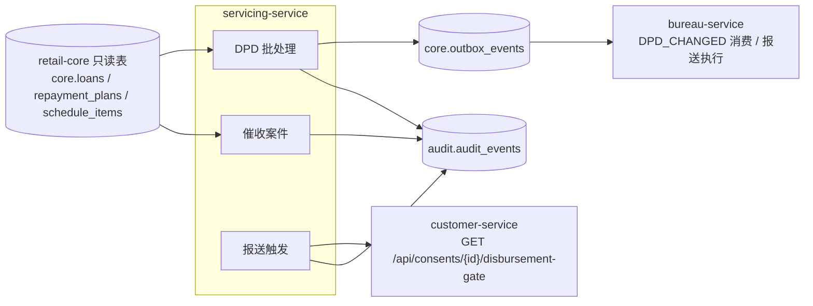

### 12.2 事件与外部调用清单

| 方向 | 对象 | 说明 |
|---|---|---|
| 生产事件 | `DPD_CHANGED` | 聚合键 `loanId`；分层变化时由 DPD 批处理发布 |
| 消费事件 | 无 | 本服务当前没有 `EventConsumer` 实现 |
| 同步外部调用 | `customer-service` | 同意前置校验，Feign + 原始 HTTP 兜底，fail-closed |
| 只读他域表 | `core.loans` / `core.repayment_plans` / `core.schedule_items` | `retail-core` 是权威写者 |
| 只读横切表 | `core.outbox_events` | 报送触发状态跟踪锚点 |
| 只读共享日历 | `core.holidays` | 通过共享 `MyBatisBusinessCalendar` |
| 写共享表 | `core.batch_runs` | 本服务用自己的 `job_name=DPD_SNAPSHOT` |
| 写共享表 | `audit.audit_events` | append-only |
| 跨服务状态推进 | `core.bureau_report_triggers.status` | `bureau-service` 推进 `CONSUMED` / `BLOCKED`，servicing 只读展示 |

### 12.3 audit.audit_events 行示例（三类用例）

三个用例都通过 `AuditWriter.write(...)` 落 `audit.audit_events`；实现是 `MyBatisAuditWriter` + `AuditMapper.insert`。公共列口径：

| 列 | 口径 |
|---|---|
| `actor` | 验签身份（B-9）；无请求上下文时 `SYSTEM` |
| `actor_subject` | `STAFF` / `SYSTEM`，按用例不同，见下 |
| `actor_role` | 当前实现固定 `NULL` |
| `before_snapshot` | 当前实现不写入，为 `NULL` |
| `after_snapshot` | 业务字段快照，`JSONB`；禁个人信息 |
| `trace_id` | 请求 traceId 或调度 traceId |
| `created_at` | 数据库默认 `now()` |
| `event_id` | 审计表自增主键，与 outbox 的 `event_id` 无关 |

三类用例的差异：

| 模块 | `action` | `target_type` | `target_id` | `actor` | `actor_subject` | `after_snapshot` 关键字段 |
|---|---|---|---|---|---|---|
| DPD 批处理 | `DPD_BATCH_RUN` | `BATCH` | `DPD_SNAPSHOT` | 手工=验签身份；调度=`SYSTEM` | `SYSTEM` / `STAFF` | `jobName`、`bizDate`、`loanCount`、`snapshotCount`、`eventCount`、`casesOpened` |
| 催收处置 | `COLLECTION_ACTION` | `COLLECTION_CASE` | `caseId` | 验签身份 | `STAFF`（来自 `authSubjectType`） | `caseId`、`loanId`、`actionType`、`fromStatus`、`toStatus`、`outcome` |
| 报送触发 | `REPORT_TRIGGER_REGISTERED` | `BUREAU_REPORT_TRIGGER` | `triggerId` | 验签身份 | 固定 `STAFF` | `triggerId`、`loanId`、`dpdStage`、`triggerType`、`targetBizDate` |

#### 12.3.1 DPD 批处理：DPD_BATCH_RUN

```java
auditWriter.write(actor, actorSubjectOf(actor), "DPD_BATCH_RUN", "BATCH", JOB_NAME,
        auditSnapshot, traceId);
```

示例行（手工触发，执行人 `staff-001`）：

| 列 | 示例值 |
|---|---|
| `event_id` | `9001` |
| `actor` | `staff-001` |
| `actor_subject` | `STAFF` |
| `actor_role` | `NULL` |
| `action` | `DPD_BATCH_RUN` |
| `target_type` | `BATCH` |
| `target_id` | `DPD_SNAPSHOT` |
| `before_snapshot` | `NULL` |
| `after_snapshot` | 下面 JSON |
| `trace_id` | `b0c1d2e3-...` |
| `created_at` | `2026-11-23 03:30:15.120+09` |

```json
{
  "jobName": "DPD_SNAPSHOT",
  "bizDate": "2026-11-23",
  "loanCount": 128,
  "snapshotCount": 120,
  "eventCount": 3,
  "casesOpened": 2
}
```

说明：

- 一个批次只写**一条**审计行，不是每笔债权一条。
- 调度触发时 `actor=SYSTEM`、`actor_subject=SYSTEM`、`trace_id=SCHED-xxxxxxxx`。
- 批处理抛异常时不写 `DPD_BATCH_RUN` 审计（`DpdBatchAppServiceTest.batchRunFailure_markedFailed_noAudit`）。

#### 12.3.2 催收处置：COLLECTION_ACTION

```java
auditWriter.write(actor, actorSubject, "COLLECTION_ACTION", "COLLECTION_CASE",
        String.valueOf(caseId), auditSnapshot, traceId);
```

示例行（分案动作）：

| 列 | 示例值 |
|---|---|
| `event_id` | `9002` |
| `actor` | `staff-001` |
| `actor_subject` | `STAFF` |
| `actor_role` | `NULL` |
| `action` | `COLLECTION_ACTION` |
| `target_type` | `COLLECTION_CASE` |
| `target_id` | `88` |
| `before_snapshot` | `NULL` |
| `after_snapshot` | 下面 JSON |
| `trace_id` | `f4a5b6c7-...` |
| `created_at` | `2026-11-23 10:12:33.450+09` |

```json
{
  "caseId": 88,
  "loanId": 301,
  "actionType": "ASSIGN",
  "fromStatus": "OPEN",
  "toStatus": "ASSIGNED",
  "outcome": null
}
```

关案动作的 `after_snapshot` 示例：

```json
{
  "caseId": 88,
  "loanId": 301,
  "actionType": "CLOSE",
  "fromStatus": "PROMISED",
  "toStatus": "CLOSED",
  "outcome": "REPAID"
}
```

说明：

- 每成功执行一个催收动作写**一条**审计行；同时在 `core.collection_actions` 写一条动作留痕。
- `fromStatus` 来自更新前的 `CaseRow`，`toStatus` 来自聚合方法执行后的状态。
- `outcome` 只有 `CLOSE` 有值（`REPAID` / `UNRECOVERABLE`）；`ASSIGN` / `CONTACT` / `PROMISE` 为 `null`（JSON 里保留该键）。
- `actor_subject` 由 `WebSubjects.subjectType()` 从验签属性读取；催收端点要求员工权限，正常为 `STAFF`。

#### 12.3.3 报送触发：REPORT_TRIGGER_REGISTERED

```java
auditWriter.write(actor, "STAFF", "REPORT_TRIGGER_REGISTERED", "BUREAU_REPORT_TRIGGER",
        String.valueOf(row.triggerId()), auditSnapshot, traceId);
```

示例行：

| 列 | 示例值 |
|---|---|
| `event_id` | `9003` |
| `actor` | `staff-001` |
| `actor_subject` | `STAFF` |
| `actor_role` | `NULL` |
| `action` | `REPORT_TRIGGER_REGISTERED` |
| `target_type` | `BUREAU_REPORT_TRIGGER` |
| `target_id` | `6001` |
| `before_snapshot` | `NULL` |
| `after_snapshot` | 下面 JSON |
| `trace_id` | `a1b2c3d4-...` |
| `created_at` | `2026-11-23 11:05:08.900+09` |

```json
{
  "triggerId": 6001,
  "loanId": 301,
  "dpdStage": "M1",
  "triggerType": "DELINQUENCY",
  "targetBizDate": "2026-11-23"
}
```

说明：

- 只有 `register()` 成功时写审计；`GET` / `track` / `list` 不写。
- `actor_subject` 由服务层固定为 `STAFF`（该端点要求 `BUREAU_REPORT_EXEC` 员工权限）。
- 重复登记（`uk_brt_loan_type` 冲突）在写审计之前就抛 `RF_CONFLICT_001`，不会留下审计行。

#### 12.3.4 共同注意

- 三个用例的 `after_snapshot` 都只含业务 ID、状态、日期、计数，不含姓名、电话、地址、证件号等个人信息。
- `actor_role` 与 `before_snapshot` 当前实现不写；若以后需要“变更前 / 变更后”对比，必须在 `MyBatisAuditWriter` 或调用方补齐，不能指望数据库默认值。
- `audit.audit_events` 是 append-only：V1 已 `REVOKE UPDATE, DELETE`；V21 给 `retail_app_rw` 补 `INSERT` / `SELECT`，并显式 `REVOKE UPDATE, DELETE, TRUNCATE`。
- `actor` 一律取验签身份；请求体、客户端头里的 actor 不会被采用（B-9）。

---

## 13. 测试与验证

| 测试类 | 覆盖点 |
|---|---|
| `DpdCalculatorTest` | 到期日边界、自然日跨周末、`PAID` / `WAIVED` 不算逾期、多期次取最大、M1–M4 边界、宽限期只延迟分层不改自然日 |
| `DpdBatchAppServiceTest` | 快照幂等（同日重跑）、`DPD_CHANGED` 载荷白名单、自动开案、终态债权跳过、批次失败标记、审计 actor |
| `CollectionCaseStateMachineTest` | 合法全流程、非法迁移穷举、终态不可迁移、关案必填结果、分案必填负责人、无案件硬拒绝、时段窗口、动作留痕与审计 |
| `BureauReportTriggerAppServiceTest` | T+1 营业日、周末/节假日跳过、同意撤回/未知 fail-closed、重复触发、参数校验、状态跟踪、审计快照禁个人信息 |
| `DpdSnapshotSchedulerTest` | 开关默认关、开启后 Bean 存在、抢占成功才执行、`SYSTEM` actor、执行异常不中断调度线程 |

本地验证：

```bash
mvn -B test -pl servicing-service -am
python scripts/check_docs.py
```

> 本文不记录测试结果；当前权威口径见 `PROGRESS.md`。

---

## 14. 建议的读代码顺序

```text
①  ServicingServiceApplication
②  application.yml + ServicingServiceConfig + ServicingMyBatisConfig
③  DpdCalculator + DpdStage + DpdCalculatorTest
④  DpdBatchAppService + DpdSnapshotMapper + DpdBatchAppServiceTest
⑤  DpdSnapshotScheduler + BatchRunGuard + DpdSnapshotSchedulerTest
⑥  CollectionCase + CollectionCaseStatus + CollectionActionType + CollectionCaseStateMachineTest
⑦  CollectionCaseAppService + CollectionCaseMapper + CollectionActionMapper
⑧  ServicingConsentGate + BureauReportTriggerAppService + BureauReportTriggerMapper
⑨  WebSubjects + 三个 Controller
⑩  MyBatisBusinessCalendar（共享 infrastructure，T+1 口径）
```

---

## 15. 当前实现边界与注意

1. **`/api/bureau-report-triggers/**` 未在网关显式路由**：网关 `servicing` 段只登记 `collection-cases`、`dpd-snapshots`、`jobs/dpd-snapshot`；该路径会落到最后的核心兜底 `/api/**`。直连 `8098` 可用，走网关的可达性需要补路由或由调用方直连（这与 `AGENTS.md §5`「必须验证从网关可达」的要求存在差距）。
2. **DPD 批处理不回写 `core.loans.status`**：`DELINQUENT` 状态没有被本服务设置；DPD 与催收是旁路记录，债权状态仍由 `retail-core` 维护。
3. **DPD 批处理不自动关案**：债权恢复为 `CURRENT` 只产生快照，不会关闭已开的催收案件；关案必须人工 `CLOSE`。
4. **`PROMISED → IN_CONTACT` 未接线**：领域有 `promiseBroken()`，但 API 动作枚举没有 `PROMISE_BROKEN`，HTTP 走不到这条边。
5. **分层阈值未配置化**：`DpdStage.fromDays` 的 30 / 60 / 90 天硬编码；`DpdCalculator` 注释提到“分层阈值可走配置”，当前只有宽限期 `retail.servicing.dpd-grace-days` 可配。
6. **outbox 去重会抑制后续 `DPD_CHANGED`**：`MyBatisOutboxPublisher` 按 `(event_type, aggregate_key)` 去重，同一债权只要已有一条 `PENDING`/`SENT` 的 `DPD_CHANGED`，后续分层变化不会再入箱。`BatchSummary.eventCount` 统计的是“检测到分层变化”的次数，不等于实际新增的 outbox 行数。
7. **`run()` 失败时 `batch_runs` 的 FAILED 会随事务回滚**：`DpdBatchAppService.run` 是 `@Transactional`，catch 里 `finish(FAILED)` 后原样抛出，整个事务回滚；调度路径另由 `BatchRunGuard.markFinished(FAILED)` 在事务外补偿。手工触发失败时，如果同日此前已有 `SUCCESS` 行，回滚后仍可能看到旧的 `SUCCESS`。
8. **`BureauReportTriggerRepository.updateStatus` 在 servicing 内没有调用方**：触发状态由 `bureau-service` 用它自己的 Mapper 推进到 `CONSUMED` / `BLOCKED`；servicing 侧该端口方法目前只是备用。
9. **DPD 批处理是整批一个事务**：所有债权、快照、事件、案件、审计在同一事务内；单笔异常会导致整批回滚。批处理窗口和单批数据量需要关注。
10. **`LocalDate.now()` / `OffsetDateTime.now()` 取 JVM 默认时区**：`spring.jackson.time-zone: Asia/Tokyo` 只影响 JSON 序列化；启动脚本未显式设置 `user.timezone`。部署环境必须保证 JVM 时区为 JST，否则 03:30 调度和“今天”的业务日可能偏移。
11. **时段校验先于案件查询**：窗口外即使 `caseId` 不存在，也会先返回 `COLLECTION_TIME_WINDOW`；调用方排查时不要误以为案件存在。
12. **`DpdCalculator` 对未结状态很宽容**：除 `PAID` / `WAIVED` 外的状态（含 `null`）都按未结处理；这是为 W6 并行期保留的容忍口径，不是“任何状态都逾期”的业务承诺。
13. **快照查询最多返回 200 条**：`DpdSnapshotMapper.listByLoan` 固定 `LIMIT 200`，更早历史需要另加查询。
14. **报送触发的事件路径与到期扫描路径口径不同**：`servicing` 只负责登记 `target_biz_date`；`bureau-service` 的 `DPD_CHANGED` 消费者在触发状态为 `REGISTERED` 时即执行（不校验目标日），到期扫描路径才按 `target_biz_date <= today` 执行。这是 `bureau-service` 侧的口径，本文只标注边界。

---

## 16. 自检

- 本文只解释 `servicing-service` 当前代码，不新增业务口径
- DPD 采用自然日口径；`dpd_days` 存自然日，`stage` 按宽限期后口径
- 所有催收状态迁移以 `CollectionCaseStatus.ALLOWED` 为准
- 所有写入都落在贷后自有表或共享横切表（outbox / audit / batch_runs）；`core.loans` / `core.repayment_plans` / `core.schedule_items` 只读
- `DPD_CHANGED` 载荷只含白名单键，不含个人信息
