# underwriting-service 代码流程：审查授信、支付能力评估与职责分离

> **文档性质**：代码走读 / 流程图材料，不是设计定源。
> **依据**：当前 `master` 工作区代码（`underwriting-service` 模块，2026-11-28 走读）。
> **放置说明**：本文件放在 `interview/` 下，属于代码讲解材料，**不纳入 `docs/` 的 R00–R11 登记**，
> 不影响 `scripts/check_docs.py` 的文件计数护栏。
> **口径优先级**：`PROGRESS.md` > `AGENTS.md` > `docs/` > 代码与本文；本文只解释代码，不替代设计文档。
> **配套材料**：
> - HTML 图集：[underwriting-service-代码流程图集.html](underwriting-service-代码流程图集.html)
>   （图目录可向左收起为窄栏，右侧流程图区域自动加宽；收起后点左侧「目录」恢复）
> - 参照材料：[retail-core-代码流程.md](retail-core-代码流程.md)、
>   [bureau-service-代码流程.md](bureau-service-代码流程.md)、
>   [customer-service-代码流程.md](customer-service-代码流程.md)

---

## 0. 一句话定位

`underwriting-service` 是 **BC-3 审查授信上下文**，端口 `8094`。

它负责把一笔申请从「待审查」推进到「批准 / 拒绝 / 转人工复核」：

```text
审查案件（UnderwritingCase）
征信查询状态衔接（Listening CREDIT_INQUIRY_COMPLETED）
支付能力评估（AffordabilityAssessment）
审查决定（Decision）
人工复核 / override（SOD）
代付前审查前置校验（disbursement-gate）
审查结果通知 DMS（I-02，可选）
```

它**不负责**：

- 申请受理、申请状态机 —— `application-service`
- 征信查询执行、征信报送、异议 —— `bureau-service`
- 合同、债权、放款、入金核销 —— `contract-service` / `retail-core`
- 客户个人信息、同意登记 —— `customer-service`

### 0.1 一条完整链路

```text
application-service 受理申请
        │
        ▼
underwriting-service 建立审查案件（PENDING）
        │
        ├─ start-inquiry → INQUIRY_IN_PROGRESS
        │       │
        │       └─ 调用 bureau-service 发起征信查询
        │              └─ CREDIT_INQUIRY_COMPLETED
        │                     └─ 本服务消费 → INQUIRY_DONE / INQUIRY_FAILED
        │
        ├─ assess-affordability → ASSESSING
        │       └─ 支付能力评估快照 append-only
        │
        ├─ decision → APPROVED / DECLINED / REFERRED
        │       └─ 发 UNDERWRITING_APPROVED / UNDERWRITING_DECLINED
        │
        └─ override（仅 REFERRED）→ APPROVED / DECLINED
                └─ 复核人 ≠ 决定人（SOD 硬阻断）

APPROVED
  ├─ retail-core 代付前查 disbursement-gate
  ├─ DMS 结果通知（可选）
  └─ 可转 EXPIRED（当前只有领域/应用服务方法，未接 HTTP/定时任务）
```

### 0.2 先说明「实现到哪一步」

当前代码实现的是**审查案件闭环 + 决定 + 复核 + 前置校验**：

- 案件建立、征信事件衔接、支付能力评估、决定、override、代付前置校验已落地
- 支付能力评估是 **C-03 挡板实现** `StubAffordabilityPolicy`，不是官方公式
- DMS 结果通知是**可选双模**：`outbound-url` 为空时 no-op；非空时 HTTP 推送，失败落 `integration.outbound_tasks`
- MQ 只作为事件消费中继，本服务没有自己的 MQ 业务信封生产逻辑
- 真实 C-03 公式、承認有効期的自动过期任务尚未落地

### 0.3 业务与逻辑总览

可以把它看成一条审查流水线：**六条主链路 + 一条 DMS 旁路**。

| # | 业务 | 入口 | 核心逻辑 | 详细 |
|---|---|---|---|---|
| 1 | 建立审查案件 | `POST /api/underwriting/cases` | 同意前置校验 → `UnderwritingCase.start` → `PENDING`；`uk_uwc_app` 一申请一案 | §4 |
| 2 | 征信查询状态衔接 | `POST /cases/{id}/start-inquiry` + 消费 `CREDIT_INQUIRY_COMPLETED` | 本服务只推进状态；查询由 `bureau-service` 执行；事件推进到 `INQUIRY_DONE` / `INQUIRY_FAILED` | §5 |
| 3 | 支付能力评估 | `POST /cases/{id}/affordability` | `INQUIRY_DONE → ASSESSING`；C-03 挡板评估；快照 append-only | §6 |
| 4 | 审查决定 | `POST /cases/{id}/decision` | 再次校验同意；`APPROVED / DECLINED / REFERRED`；前两者发事件 | §7 |
| 5 | 人工复核 / override | `POST /cases/{id}/override` | 仅 `REFERRED`；复核人 ≠ 决定人（SOD 硬阻断） | §7.2 |
| 6 | 代付前审查前置校验 | `GET /cases/{id}/disbursement-gate` | 仅 `APPROVED` 放行；其余一律 `allowed=false` | §8 |
| 7 | DMS 结果通知（旁路） | 消费 `UNDERWRITING_APPROVED / DECLINED` | `outbound-url` 为空 no-op；非空 HTTP 推送；失败落 `outbound_tasks` 重试 | §9 |

**主干状态机**：

```text
PENDING
  → INQUIRY_IN_PROGRESS
      → INQUIRY_DONE
          → ASSESSING
              → APPROVED / DECLINED / REFERRED
      → INQUIRY_FAILED
          → INQUIRY_IN_PROGRESS（重试）
REFERRED
  → APPROVED / DECLINED（人工复核）
APPROVED
  → EXPIRED（承認有効期过）
DECLINED / EXPIRED
  → 终态
```

**七条业务规则**：

1. **同意前置校验不缓存**：建案、决定、复核各自实时调用 customer-service；查不到/超时/已撤回一律 `RF_UW_003`。
2. **状态机是唯一入口**：所有状态变更只走 `UnderwritingCase` 聚合方法；不能跳过 `INQUIRY_DONE`，不能直接 `UPDATE status`。
3. **决定人必须来自验签身份**：`decidedBy` 取 `authSubject`，禁止从请求体或客户端头取。
4. **职责分离**：`UNDERWRITING_DECIDE` 与 `UNDERWRITING_OVERRIDE` 是两个权限点；复核人 = 决定人 → `RF_AUTH_003`，不可配置豁免。
5. **评估快照 append-only**：一个案件已有评估快照后，再次评估 → `RF_CONFLICT_001`；收入只存加密引用码。
6. **代付前置校验 fail-closed**：只有 `APPROVED` 放行；案件不存在、查询中、评估中、复核中、拒绝、过期全部 false。
7. **DMS 是咨询性副本**：推送失败落 `integration.outbound_tasks`，不阻断审查主链路；系统权威状态在 `core.underwriting_cases`。

**读文档的抓手**：

```text
建案看 §4；征信状态看 §5；支付能力看 §6；
决定/复核看 §7；代付前置校验看 §8；DMS 看 §9；
数据表看 §12；接口示例看 §13；当前边界看 §16。
```

---

## 1. 代码地图

### 1.1 包结构与职责

| 包 | 职责 | 关键类 |
|---|---|---|
| `underwriting.web` | HTTP 端点、权限点、actor 取值 | `UnderwritingCaseController`、`OutboundTaskRetryController` |
| `underwriting.application` | 用例编排、事件消费、前置校验、重试 | `UnderwritingCaseAppService`、`UnderwritingGateProvider`、`InquiryCompletedConsumer`、`DmsResultNotificationConsumer`、`OutboundTaskRetryService`、`ConsentGateGuard` |
| `underwriting.domain` | 纯领域：聚合、状态机、策略点 | `UnderwritingCase`、`UnderwritingStatus`、`DecisionOutcome`、`AffordabilityInput`、`AffordabilityPolicy`、`StubAffordabilityPolicy`、`AssessmentOutput`、`AssessmentResult` |
| `underwriting.mapper` | MyBatis 注解 SQL | `UnderwritingCaseMapper`、`AffordabilityAssessmentMapper`、`OutboundTaskMapper` |
| `underwriting.infrastructure` | 仓储实现、行映射 | `UnderwritingCaseRepository`、`AffordabilityAssessmentRepository` |
| `underwriting.integration` | DMS 出站适配 | `DmsResultSender`、`HttpDmsOutboundAdapter` |
| `underwriting.schedule` | outbound_tasks 重试调度 | `DmsOutboundTaskScheduler`、`OutboundTask`、`DmsPayload` |
| `underwriting.config` | 精确装配 | `UnderwritingServiceConfig`、`UnderwritingMqConfig` |
| `common.contract` | 同意前置校验桥接（本服务自持） | `ConsentGateFacade`、`W4GateFacadeConfig` |

`HealthController` 在 `underwriting` 根包，提供 `/api/underwriting/health` 与 `/whoami`。

### 1.2 组件与依赖方向

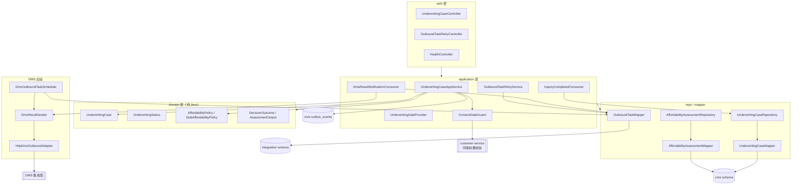

---

## 2. 启动与装配

`UnderwritingServiceApplication`：

```java
@SpringBootApplication(scanBasePackages = "com.company.retail.underwriting")
@EnableDiscoveryClient
@EnableFeignClients(basePackages = "com.company.retail.common.contract")
@Import({
    RfDataSourceGuardConfig.class,
    RfSecurityConfig.class,
    RfOutboxConfig.class,
    MqEnvelopeConfig.class,
    UnderwritingMqConfig.class,
    RfFeignConfig.class,
    W4GateFacadeConfig.class
})
```

要点：

- 只扫本服务包，共享机制通过 `@Import` 精确装配
- `UnderwritingServiceConfig` 显式 `@MapperScan("com.company.retail.underwriting.mapper")`
- 运行期不跑 Flyway：`spring.flyway.enabled=false`
- 数据源角色 `retail_app_rw`，不是 `postgres` 超管

### 2.1 启动配置

`underwriting-service/src/main/resources/application.yml`：

| 配置 | 默认 | 说明 |
|---|---|---|
| `server.port` | `8094` | 服务端口 |
| `spring.datasource.username` | `retail_app_rw` | 运行期受限角色 |
| `retail.underwriting.affordability.enabled` | `true` | C-03 策略点开关；关闭时全部 `REFER` |
| `retail.dms.outbound-url` | 空 | 空 = DMS 挡板 no-op；非空 = HTTP 推送 |
| `retail.mq.relay-consumer-enabled` | `false` | 是否由 `RF_EVENT_RELAY` 接管事件消费 |
| `server` 时区 | `Asia/Tokyo` | Jackson 时间口径 |

### 2.2 关键 Bean

`UnderwritingServiceConfig`：

- `UnderwritingCaseRepository`：MyBatis 实现
- `AffordabilityAssessmentRepository`：MyBatis 实现
- `AffordabilityPolicy`：`StubAffordabilityPolicy`（C-03 挡板）
- `ConsentGateGuard`：包 `ConsentGateFacade`
- `UnderwritingCaseAppService`
- `UnderwritingGateProvider`
- `InquiryCompletedConsumer`
- `DmsResultSender`：`outbound-url` 为空返回 null，非空装配 `HttpDmsOutboundAdapter`
- `DmsResultNotificationConsumer`
- `OutboundTaskRetryService`
- `DmsOutboundTaskScheduler`：仅当 DMS sender 存在且 `outbound.tasks.enabled=true` 时启动

### 2.3 双模说明

```text
DMS：
  retail.dms.outbound-url 空     → DmsResultSender = null
                                  → DmsResultNotificationConsumer 直接 no-op
                                  → 结果只落 outbox，人工导出

  retail.dms.outbound-url 非空   → HttpDmsOutboundAdapter
                                  → 事件消费时 HTTP 推送
                                  → 失败落 integration.outbound_tasks
                                  → DmsOutboundTaskScheduler 重试

MQ：
  retail.mq.relay-consumer-enabled=true
    → UnderwritingMqConfig 注册 MqEventRelayConsumer
    → 共用 core.event_consumptions 幂等
  本服务没有自建 MQ 业务信封生产逻辑
```

---

## 3. 领域模型与数据表

### 3.1 审查状态机

`UnderwritingStatus`：

```text
PENDING
  → INQUIRY_IN_PROGRESS
      → INQUIRY_DONE
          → ASSESSING
              → APPROVED / DECLINED / REFERRED
      → INQUIRY_FAILED
          → INQUIRY_IN_PROGRESS（重试）
REFERRED
  → APPROVED / DECLINED（人工复核）
APPROVED
  → EXPIRED（承認有効期过，终态）
DECLINED / EXPIRED
  → 终态
```

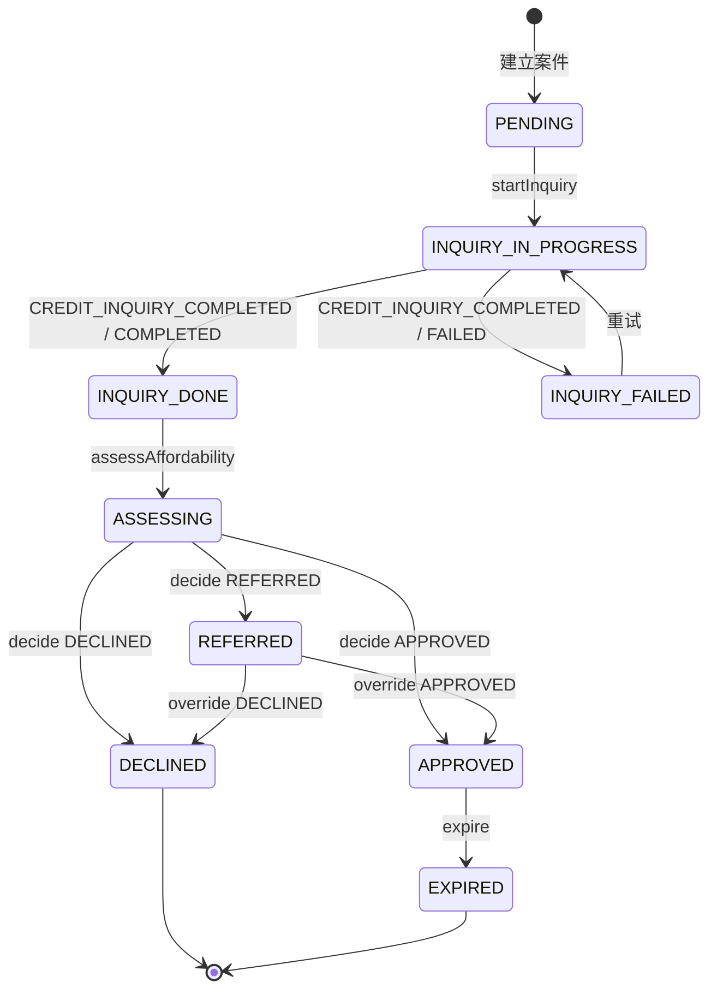

要点：

- `APPROVED` **不是终态**，可以转 `EXPIRED`
- `DECLINED`、`EXPIRED` 是终态
- `REFERRED` 不是终态，是人工复核中间态
- 所有迁移只走 `UnderwritingCase` 聚合方法，禁止直接 `UPDATE status`

### 3.2 决定结果

`DecisionOutcome`：

```text
APPROVED    批准，发 UNDERWRITING_APPROVED
DECLINED    拒绝，发 UNDERWRITING_DECLINED
REFERRED    转人工复核，不发事件
```

`REFERRED` 之后必须由另一个自然人 `override`：

```text
reviewedBy != decidedBy
否则 RF_AUTH_003（SOD 硬阻断）
```

### 3.3 支付能力评估

`AffordabilityInput`：

| 字段 | 含义 |
|---|---|
| `scheme` | 交易形态；每笔必填，无兜底默认 |
| `annualIncomeEncRef` | 收入证明加密引用码，不传明文 |
| `existingDebtTotal` | 他社借入余额合计，整数日元 |
| `thresholdAmount` | 支付能力预估额 / 总量规制上限，整数日元 |
| `requestedAmount` | 本笔申请金额，整数日元 |

`StubAffordabilityPolicy` 的挡板口径：

```text
enabled=false                  → REFER / POLICY_DISABLED
scheme 为空                    → RF_DMS_003
annualIncomeEncRef 为空        → REFER / INCOME_DOCUMENT_MISSING
thresholdAmount <= 0           → REFER / THRESHOLD_NOT_CONFIGURED
requestedAmount > threshold    → FAIL / OVER_AFFORDABILITY_THRESHOLD
其余                           → PASS / WITHIN_THRESHOLD
```

注意：

- 这是**挡板口径**，不是 C-03 官方公式
- 金额一律 `long` 整数日元，禁止浮点
- 评估快照 append-only，不覆盖历史
- `FAIL` 不抛异常到调用方之外，由决定环节人工判断；可以转 `REFERRED`

### 3.4 数据表关系（ER）

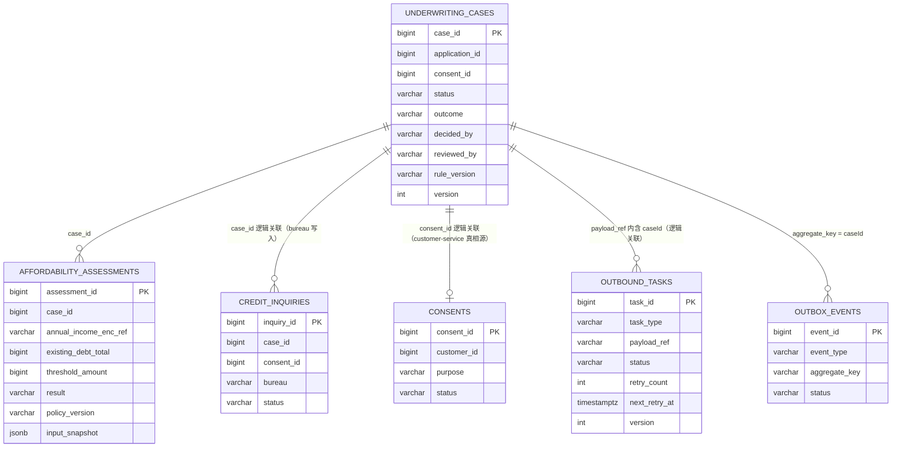

> ER 表达业务关系；当前迁移没有给这些跨表关系建物理外键。
> `CREDIT_INQUIRIES` 归 bureau-service 写；`CONSENTS` 归 customer-service 写；
> 本服务只通过事件 / 前置校验读取语义，不跨域直写他表。

### 3.5 表数量与真相源边界

| 类别 | 数量 | 表 |
|---|---:|---|
| 本服务直接写的业务表 | 3 | `core.underwriting_cases`、`core.affordability_assessments`、`integration.outbound_tasks` |
| 共享事件表 | 1 | `core.outbox_events` |
| MQ 共享表 | 1 | `integration.mq_envelope_inbox`（开启 MQ 中继时） |
| 跨域逻辑关联（不直读/直写） | 2 | `core.credit_inquiries`（bureau 真相源）、`pii.consents`（customer-service 真相源） |

关键边界：

- `core.underwriting_cases` 的唯一键 `uk_uwc_app (application_id)` 保证一申请一案
- `core.affordability_assessments` 的唯一键 `uk_aff_case_version (case_id, policy_version)`
- `integration.outbound_tasks` 的状态机由出站调度器推进
- `pii.consents` 不在本服务落库；每次建案/决定/复核都实时调用 customer-service

---

## 4. 主流程一：建立审查案件

### 4.1 入口

```text
POST /api/underwriting/cases
权限点：UNDERWRITING_DECIDE
请求：applicationId / consentId / ruleVersion
```

### 4.2 时序图

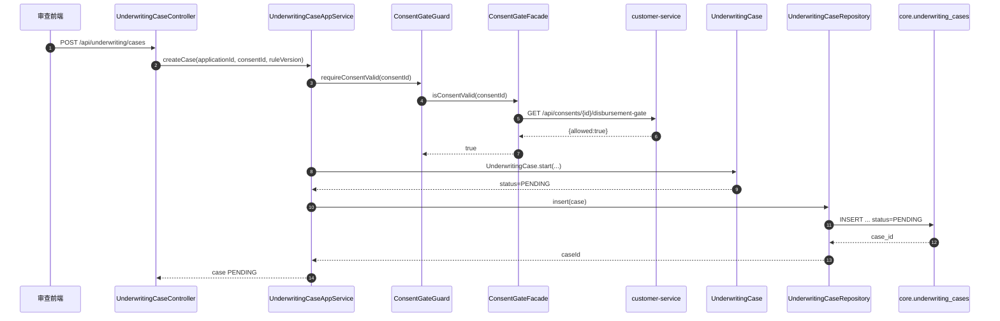

### 4.3 步骤与错误

`UnderwritingCaseAppService.createCase`：

1. `ConsentGateGuard.requireConsentValid(consentId)`：G3 同意前置校验，fail-closed
2. `UnderwritingCase.start(applicationId, consentId, ruleVersion)`：
   - `applicationId > 0`
   - `consentId > 0`
   - 状态 `PENDING`
3. `caseRepository.insert`：
   - `uk_uwc_app` 冲突 → `RF_CONFLICT_001`（`CASE_DUPLICATE`）
4. 返回 `caseId`

注意：

- 建案**不校验 application 是否存在**，只校验 `applicationId > 0`
- 建案**不发事件**
- 同一 `applicationId` 只能有一个审查案件

### 4.4 幂等

```text
uk_uwc_app (application_id)
```

重复建案由唯一键拦截，仓储层把 `DuplicateKeyException` 转成：

```text
RF_CONFLICT_001 / CASE_DUPLICATE
```

---

## 5. 主流程二：征信查询状态衔接

### 5.1 入口

```text
POST /api/underwriting/cases/{id}/start-inquiry
权限点：CREDIT_INQUIRY_EXEC
```

### 5.2 本服务只推进状态，不执行查询

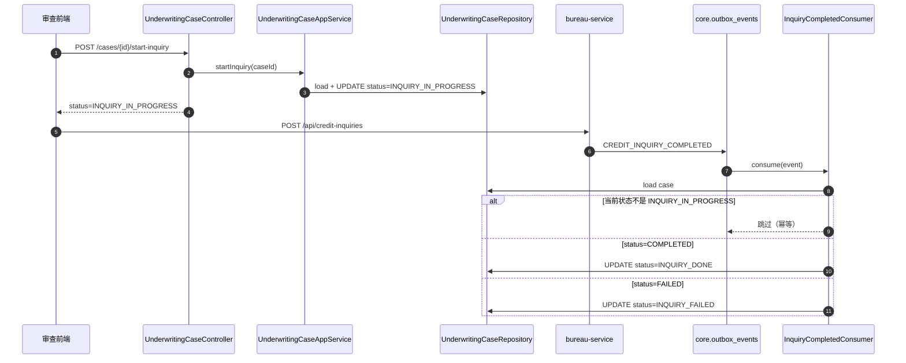

### 5.3 状态规则

`UnderwritingCase.startInquiry`：

```text
PENDING / INQUIRY_FAILED
  → INQUIRY_IN_PROGRESS
```

`InquiryCompletedConsumer`：

```text
event.status = COMPLETED → completeInquiry() → INQUIRY_DONE
event.status = FAILED    → failInquiry()     → INQUIRY_FAILED
其它 status              → IllegalStateException（不吞）
```

幂等：

- 事件重放时，若案件已不在 `INQUIRY_IN_PROGRESS`，直接跳过
- 缺 `caseId` 直接抛异常，不吞
- 案件不存在直接抛异常，不吞

注意：

- `startInquiry` **不重新校验同意**；同意前置校验在建案和决定时做
- 真正调用 bureau-service 的是调用方（前端/编排），不是 `startInquiry`
- `caseRepository.update` 的布尔返回值当前未检查；乐观锁失败时事件可能被静默忽略（见 §16）

---

## 6. 主流程三：支付能力评估

### 6.1 入口

```text
POST /api/underwriting/cases/{id}/affordability
权限点：UNDERWRITING_DECIDE
请求：scheme / annualIncomeEncRef / existingDebtTotal / thresholdAmount / requestedAmount
```

### 6.2 判定流程

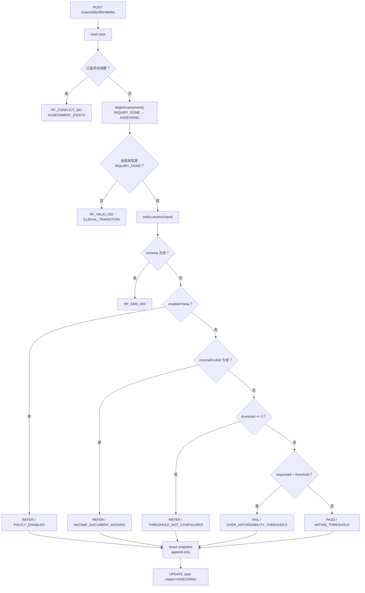

### 6.3 快照

`core.affordability_assessments`：

```text
case_id
annual_income_enc_ref   // 只存加密引用码，不存明文收入
existing_debt_total
threshold_amount
result                  // PASS / FAIL / REFER
policy_version          // STUB-1.0
input_snapshot          // JSONB，只含输入与结果码
```

规则：

- `uk_aff_case_version (case_id, policy_version)` 唯一
- `findLatest` 已存在 → `RF_CONFLICT_001`，不覆盖历史
- `input_snapshot` 不存姓名/电话/收入明文
- `FAIL` 不抛异常；决定人可据此选择 `DECLINED` 或 `REFERRED`
- `beginAssessment` 只能从 `INQUIRY_DONE` 进入；跳过 `INQUIRY_DONE` → `RF_VALID_002`

### 6.4 与决定的关系

```text
INQUIRY_DONE
  → assessAffordability
  → ASSESSING
  → decide（APPROVED / DECLINED / REFERRED）
```

注意：`decide` 不强制要求评估结果为 `PASS`；`FAIL` 只是快照结果，最终由人工决定。

---

## 7. 主流程四：审查决定与人工复核

### 7.1 决定

```text
POST /api/underwriting/cases/{id}/decision
权限点：UNDERWRITING_DECIDE
请求：outcome / reasonCode
```

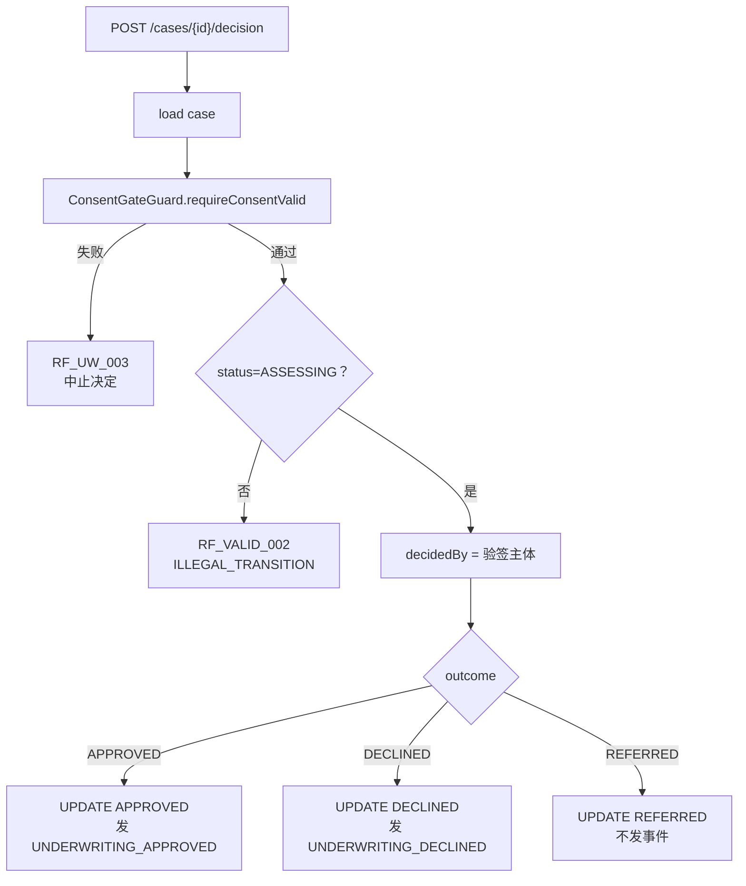

关键点：

- `decidedBy` 取 `request.getAttribute("authSubject")`，**不从请求体取**
- 决定前再次校验同意（X-3：审查中撤回 → 中止）
- 只有 `APPROVED` / `DECLINED` 发事件；`REFERRED` 是中间态，不发
- 事件与案件更新在同一个 `@Transactional` 内

### 7.2 人工复核 / override

```text
POST /api/underwriting/cases/{id}/override
权限点：UNDERWRITING_OVERRIDE
请求：outcome / reasonCode
```

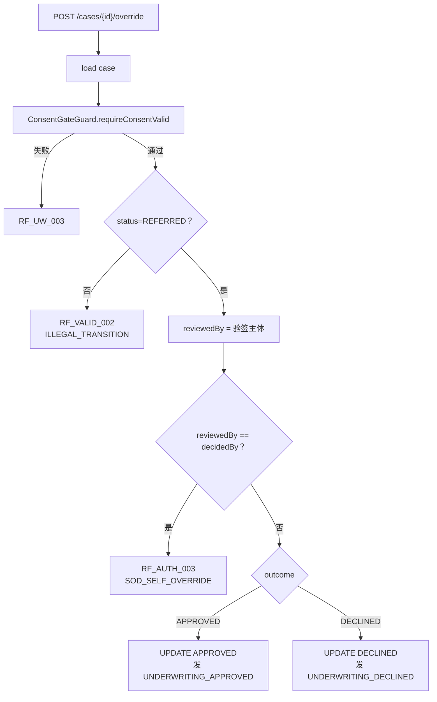

SOD：

```text
reviewedBy != decidedBy
```

这条由 `UnderwritingCase.overrideDecision` 硬阻断，**不可用配置白名单豁免**。

### 7.3 事件 payload

`UNDERWRITING_APPROVED` / `UNDERWRITING_DECLINED`：

```json
{
  "caseId": 6001,
  "applicationId": 5001,
  "status": "APPROVED",
  "outcomeCode": "APPROVED",
  "reasonCode": "WITHIN_THRESHOLD",
  "ruleVersion": "W4-DEFAULT",
  "occurredAt": "2026-11-28T10:00:00+09:00",
  "schemaVersion": "1.0",
  "traceId": "trace-20261128-0001"
}
```

`aggregate_key = caseId`；payload 禁 PII。

---

## 8. 代付前审查前置校验

### 8.1 端点

```text
GET /api/underwriting/cases/{id}/disbursement-gate
员工 JWT；retail-core 代付前调用
```

### 8.2 判定

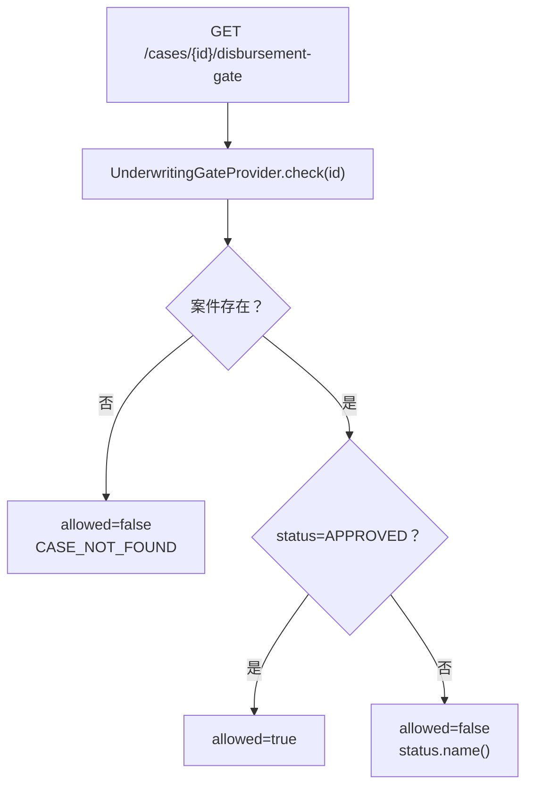

响应：

```json
{
  "code": "OK",
  "data": {
    "allowed": true,
    "reasonCode": "APPROVED"
  },
  "traceId": "trace-20261128-0002"
}
```

要点：

- 只有 `APPROVED` 才是 `allowed=true`
- 不存在、`PENDING`、`INQUIRY_*`、`ASSESSING`、`REFERRED`、`DECLINED`、`EXPIRED` 全部 false
- 这是 fail-closed：调用方只认 `allowed==true`
- 当前没有独立的「批准有效期」判断；`EXPIRED` 依赖 `expire()` 被调用（见 §16）

---

## 9. DMS 结果通知与出站任务

### 9.1 事件链

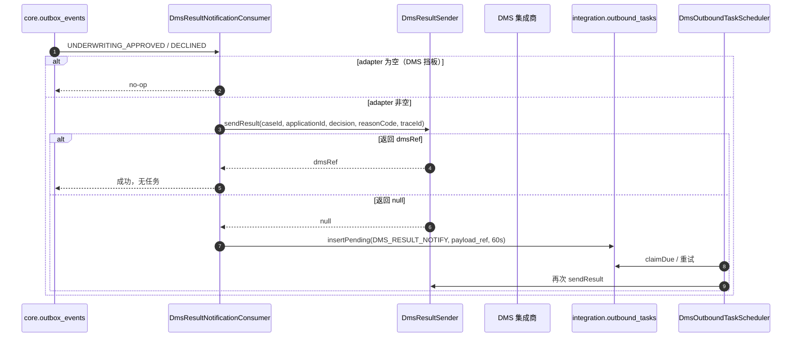

### 9.2 DMS 出站适配器

`HttpDmsOutboundAdapter`：

```text
路径：POST {outbound-url}/dms/v1/underwriting-result
档位：OutboundProfile.ADVISORY（单次尝试）
幂等键：DMS-UW-RESULT:{caseId}:{decision}
```

请求信封：

```json
{
  "protocolVersion": "1.0",
  "messageId": "<由 idempotencyKey 派生的 UUID>",
  "idempotencyKey": "DMS-UW-RESULT:6001:APPROVED",
  "timestamp": "2026-11-28T10:00:00+09:00",
  "payload": {
    "caseId": 6001,
    "applicationId": 5001,
    "decision": "APPROVED",
    "reasonCode": "WITHIN_THRESHOLD"
  }
}
```

响应：

- HTTP 200 且能解析出 `dmsRef` → 返回该引用
- HTTP 200 但无 `dmsRef` → 返回 `DMS-UNREF`（按成功处理）
- 非 200 / 超时 / 异常 → 返回 null，由消费者落 outbound_tasks

### 9.3 outbound_tasks 状态机

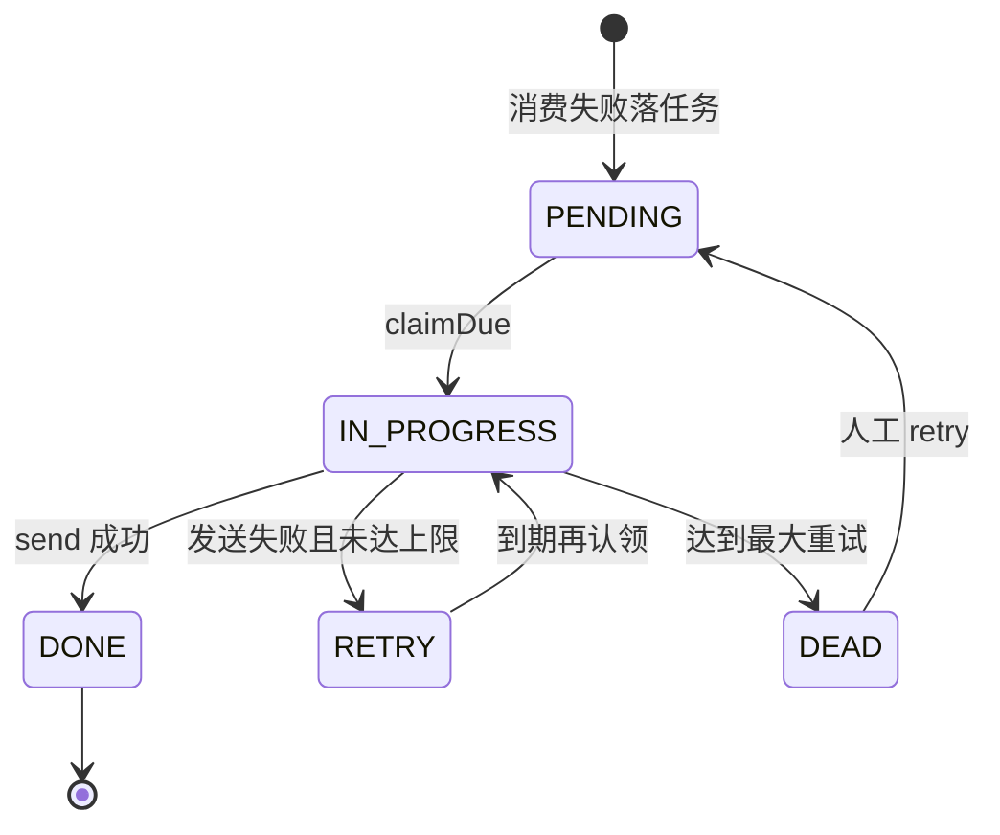

调度器参数：

| 项 | 默认 |
|---|---|
| 扫描间隔 | 30 秒 |
| 单次认领 | 10 条 |
| 租约 | 120 秒 |
| 退避 | 1m / 5m / 30m / 2h / 6h |
| 最大重试 | 5 次 |
| 达到上限 | DEAD，人工重触发 |

调度器纪律：

- 独立单线程执行器，不占用 outbox 调度器
- `FOR UPDATE SKIP LOCKED` 认领，多实例安全
- 所有状态写带 `version` 乐观锁
- 未知任务类型 / 坏 payload 直接 DEAD
- `DEAD` 只能通过人工端点重置为 `PENDING`

### 9.4 人工重触发

```text
POST /api/underwriting/outbound-tasks/{taskId}/retry
权限点：JOB_TRIGGER
```

状态语义：

| 当前状态 | 行为 |
|---|---|
| `DEAD` | 重置为 `PENDING` |
| `PENDING` | 幂等返回 `PENDING` |
| `RETRY` | 幂等返回 `RETRY` |
| `DONE` | `RF_CONFLICT_001` |
| `IN_PROGRESS` | `RF_CONFLICT_001` |
| 不存在 | `RF_VALID_001` |

---

## 10. 事件与 outbox

### 10.1 本服务发布的事件

| 事件 | 触发 | 聚合键 | payload 关键字段 |
|---|---|---|---|
| `UNDERWRITING_APPROVED` | `decide` / `override` 为 `APPROVED` | `caseId` | `caseId` / `applicationId` / `status` / `outcomeCode` / `reasonCode` / `ruleVersion` / `occurredAt` / `schemaVersion` / `traceId` |
| `UNDERWRITING_DECLINED` | `decide` / `override` 为 `DECLINED` | `caseId` | 同上，`status=DECLINED` |

规则：

- `REFERRED` 不发事件
- `EXPIRED` 不发事件
- payload 过 `EventPayloadGuard` 白名单，禁 PII
- 业务写与 outbox 行同一本地事务
- `DmsResultNotificationConsumer` 消费这两个事件，向 DMS 推送结果

### 10.2 本服务消费的事件

| 事件 | 消费者 | 行为 |
|---|---|---|
| `CREDIT_INQUIRY_COMPLETED` | `InquiryCompletedConsumer` | `INQUIRY_IN_PROGRESS → INQUIRY_DONE / INQUIRY_FAILED` |
| `UNDERWRITING_APPROVED` | `DmsResultNotificationConsumer` | 可选择推 DMS |
| `UNDERWRITING_DECLINED` | `DmsResultNotificationConsumer` | 可选择推 DMS |

### 10.3 MQ 口径

- `UnderwritingMqConfig` 只在 `retail.mq.relay-consumer-enabled=true` 时注册 `MqEventRelayConsumer`
- 本服务没有自己的 MQ 业务信封生产逻辑
- 事件仍以 `core.outbox_events` 为真相源；MQ 只接管消费中继
- `retail.mq.direct-consumers` 可保留秒级刚性事件直投

---

## 11. 幂等 / 并发 / 安全

| 机制 | 落点 |
|---|---|
| 一申请一案 | `core.underwriting_cases.uk_uwc_app (application_id)` |
| 案件乐观锁 | `UPDATE ... WHERE case_id = ? AND version = ?` |
| 评估快照唯一 | `core.affordability_assessments.uk_aff_case_version (case_id, policy_version)` |
| 评估重复请求 | `findLatest` 先查，存在即 `RF_CONFLICT_001` |
| 出站任务认领 | `FOR UPDATE SKIP LOCKED` + `version` |
| 出站任务去重 | `task_type + payload_ref` 活跃任务 `NOT EXISTS` |
| 事件消费幂等 | `core.event_consumptions`（MQ 中继共用） |
| 同意校验 | 建案、决定、复核前实时调用 customer-service；不缓存 |
| actor 取值 | 只从验签主体 `authSubject` 取，禁止请求体/客户端头 |
| PII | `annualIncomeEncRef` 只存引用码；事件、任务 payload 不含 PII |

并发注意：

- `UnderwritingCaseRepository.update` 返回 `false` 表示 version 冲突；当前应用服务多处**未检查返回值**，见 §16
- `InquiryCompletedConsumer` 也未检查 update 返回值
- `OutboundTaskMapper.insertPending` 用 `NOT EXISTS` 去重，不是数据库唯一约束；极端并发下可能插入重复活跃任务
- `assessAffordability` 的 `findLatest` 与唯一键是双兜底，但 `findLatest` 会阻止同一案件换 `policy_version` 再评估

---

## 12. 数据表、迁移与关联示例

### 12.1 迁移

| 迁移 | 内容 |
|---|---|
| `V4` | `core.underwriting_cases`、`core.affordability_assessments`、`core.credit_inquiries` 等 |
| `V11` | `core.underwriting_cases.consent_id`（决定时同意锚点） |
| `V9` | `integration.outbound_tasks`（出站任务） |
| `V22` | 运行期角色对 `integration` 业务表的最小授权 |

### 12.2 示例数据

`core.underwriting_cases`

| 字段 | 示例值 |
|---|---|
| `case_id` | `6001` |
| `application_id` | `5001` |
| `consent_id` | `4001` |
| `status` | `APPROVED` |
| `outcome` | `APPROVED` |
| `decided_by` | `EMP-100` |
| `reviewed_by` | null |
| `rule_version` | `W4-DEFAULT` |
| `version` | `7` |

`core.affordability_assessments`

| 字段 | 示例值 |
|---|---|
| `assessment_id` | `6501` |
| `case_id` | `6001` |
| `annual_income_enc_ref` | `INC-REF-001` |
| `existing_debt_total` | `0` |
| `threshold_amount` | `3000000` |
| `result` | `PASS` |
| `policy_version` | `STUB-1.0` |
| `input_snapshot` | `{"scheme":"INSTALLMENT_CREDIT",...}` |

`integration.outbound_tasks`（DMS 推送失败时）

| 字段 | 示例值 |
|---|---|
| `task_id` | `9501` |
| `task_type` | `DMS_RESULT_NOTIFY` |
| `payload_ref` | `6001\|5001\|APPROVED\|WITHIN_THRESHOLD` |
| `status` | `RETRY` |
| `retry_count` | `1` |
| `next_retry_at` | `2026-11-28T10:05:00+09:00` |
| `version` | `3` |

`core.outbox_events`

| 事件 | `aggregate_key` | 说明 |
|---|---|---|
| `UNDERWRITING_APPROVED` | `6001` | 决定通过，DMS 可选消费 |
| `CREDIT_INQUIRY_COMPLETED` | `7001` | bureau 发出，本服务消费 |

### 12.3 关联视图

```text
申请 5001
  └── 审查案件 6001
        ├── 同意 4001（customer-service 真相源）
        ├── 征信查询 7001（bureau 真相源）
        │     └── CREDIT_INQUIRY_COMPLETED
        ├── 评估快照 6501（append-only）
        ├── 决定 APPROVED / decidedBy=EMP-100
        └── outbox UNDERWRITING_APPROVED
              └── DMS 结果通知（可选）
                    └── outbound_tasks（失败时）
```

---

## 13. 对外接口

| 方法 | 路径 | 权限/身份 | 说明 |
|---|---|---|---|
| GET | `/api/underwriting/health` | 免鉴权 | 健康检查 |
| GET | `/api/underwriting/whoami` | 员工 JWT | 回显验签主体 |
| POST | `/api/underwriting/cases` | `UNDERWRITING_DECIDE` | 建立审查案件 |
| POST | `/api/underwriting/cases/{id}/start-inquiry` | `CREDIT_INQUIRY_EXEC` | 推进到 `INQUIRY_IN_PROGRESS` |
| POST | `/api/underwriting/cases/{id}/affordability` | `UNDERWRITING_DECIDE` | 支付能力评估 |
| POST | `/api/underwriting/cases/{id}/decision` | `UNDERWRITING_DECIDE` | 审查决定 |
| POST | `/api/underwriting/cases/{id}/override` | `UNDERWRITING_OVERRIDE` | 人工复核 / override |
| GET | `/api/underwriting/cases/{id}/disbursement-gate` | 员工 JWT | 代付前审查前置校验 |
| GET | `/api/underwriting/cases/{id}` | 员工 JWT | 案件查询 |
| POST | `/api/underwriting/outbound-tasks/{taskId}/retry` | `JOB_TRIGGER` | 出站任务人工重触发 |

### 13.1 建案

```json
POST /api/underwriting/cases
{
  "applicationId": 5001,
  "consentId": 4001,
  "ruleVersion": "W4-DEFAULT"
}
```

```json
{
  "code": "OK",
  "data": {
    "caseId": 6001,
    "applicationId": 5001,
    "consentId": 4001,
    "status": "PENDING",
    "outcome": null,
    "decidedBy": null,
    "reviewedBy": null,
    "ruleVersion": "W4-DEFAULT"
  },
  "traceId": "trace-20261128-0001"
}
```

### 13.2 支付能力评估

```json
POST /api/underwriting/cases/6001/affordability
{
  "scheme": "INSTALLMENT_CREDIT",
  "annualIncomeEncRef": "INC-REF-001",
  "existingDebtTotal": 0,
  "thresholdAmount": 3000000,
  "requestedAmount": 2000000
}
```

```json
{
  "code": "OK",
  "data": {
    "result": "PASS",
    "reasonCode": "WITHIN_THRESHOLD",
    "policyVersion": "STUB-1.0"
  },
  "traceId": "trace-20261128-0002"
}
```

### 13.3 决定

```json
POST /api/underwriting/cases/6001/decision
{
  "outcome": "APPROVED",
  "reasonCode": "WITHIN_THRESHOLD"
}
```

```json
{
  "code": "OK",
  "data": {
    "caseId": 6001,
    "applicationId": 5001,
    "consentId": 4001,
    "status": "APPROVED",
    "outcome": "APPROVED",
    "decidedBy": "EMP-100",
    "reviewedBy": null,
    "ruleVersion": "W4-DEFAULT"
  },
  "traceId": "trace-20261128-0003"
}
```

### 13.4 代付前置校验

```json
GET /api/underwriting/cases/6001/disbursement-gate
```

```json
{
  "code": "OK",
  "data": {
    "allowed": true,
    "reasonCode": "APPROVED"
  },
  "traceId": "trace-20261128-0004"
}
```

### 13.5 出站任务重触发

```json
POST /api/underwriting/outbound-tasks/9501/retry
```

```json
{
  "code": "OK",
  "data": {
    "taskId": 9501,
    "status": "PENDING"
  },
  "traceId": "trace-20261128-0005"
}
```

---

## 14. 测试

| 测试类 | 覆盖点 |
|---|---|
| `UnderwritingCaseTest` | 状态机、终态、SOD、跳过 INQUIRY_DONE、重试 |
| `UnderwritingCaseAppServiceTest` | 建案、决定、复核、同意撤回、事件、评估快照 |
| `UnderwritingGateProviderTest` | 仅 APPROVED 放行、其他状态拒绝、案件不存在 |
| `InquiryCompletedConsumerTest` | COMPLETED / FAILED / 重放幂等 / 缺字段 |
| `StubAffordabilityPolicyTest` | PASS / FAIL / REFER、策略点关闭、缺 scheme |
| `DmsResultNotificationConsumerTest` | 成功不落任务、失败落结构化任务、挡板 no-op |
| `HttpDmsOutboundAdapterTest` | ADVISORY 单次、幂等键、非 200/超时返回 null |
| `DmsOutboundTaskSchedulerTest` | 成功 DONE、退避、第五次 DEAD、坏 payload |
| `OutboundTaskRetryServiceTest` | DEAD→PENDING、PENDING/RETRY 幂等、DONE/IN_PROGRESS 冲突 |
| `EventPayloadGuardTest` | 事件 payload 禁 PII、白名单键 |

本地验证：

```bash
mvn -B test -pl underwriting-service -am
python scripts/check_docs.py
```

---

## 15. 建议的读代码顺序

```text
① UnderwritingServiceApplication + UnderwritingServiceConfig
② UnderwritingCaseController + UnderwritingCaseAppService
③ UnderwritingCase + UnderwritingStatus
④ ConsentGateGuard + ConsentGateFacade
⑤ StubAffordabilityPolicy + AffordabilityAssessmentRepository
⑥ InquiryCompletedConsumer
⑦ UnderwritingGateProvider
⑧ DmsResultNotificationConsumer + HttpDmsOutboundAdapter
⑨ DmsOutboundTaskScheduler + OutboundTaskRetryService
⑩ V4 / V11 / V9 迁移
```

---

## 16. 当前边界与注意

1. **C-03 只是挡板**：`StubAffordabilityPolicy` 不是官方支付能力公式；真实公式落地时替换 `AffordabilityPolicy` 实现。
2. **建案不校验申请存在**：`createCase` 只校验 `applicationId > 0`，不查 `core.applications`；传错 ID 也能建案。
3. **`startInquiry` / `assessAffordability` 不重新校验同意**：同意前置校验只在建案、决定、复核时做；真正查询由 bureau-service 再校验。
4. **乐观锁返回值被忽略**：`UnderwritingCaseAppService` 的 `caseRepository.update(...)` 返回布尔值未被检查；`InquiryCompletedConsumer` 也未检查。并发冲突时可能出现「事件已发、状态未落库」或「状态未推进但事件被吞」。这是当前最需要关注的并发缺口。
5. **`expire()` 没有入口**：领域和应用服务有 `expire`，但没有 HTTP 端点、定时任务或事件调用；`APPROVED` 案件实际不会自动转 `EXPIRED`。
6. **批准有效期没有独立字段**：`disbursement-gate` 只判断 `status=APPROVED`，没有 `approvedUntil` 之类的日期判断；过期依赖外部调用 `expire()`。
7. **评估重复判定偏严**：`assessAffordability` 先 `findLatest`，存在任何快照就 `RF_CONFLICT_001`；即使换了 `policy_version`，当前也不能再次评估。DB 的 `uk_aff_case_version` 只约束同一 case+policy_version。
8. **`FAIL` 不阻断决定**：支付能力评估 `FAIL` 只落快照，`decide` 仍可 `APPROVED`；最终由人工判断，代码不做硬拦截。
9. **DMS 是咨询性副本**：DMS 推送失败落 `outbound_tasks`，不阻断审查主链路；系统权威状态在 `core.underwriting_cases`。
10. **DMS 无 `dmsRef` 视为成功**：HTTP 200 但响应没有 `dmsRef` 时返回 `DMS-UNREF`，不会落任务；若对端语义要求必须有引用，需要收紧。
11. **outbound_tasks 去重不是唯一约束**：`insertPending` 用 `NOT EXISTS` 防止重复活跃任务，但极端并发下仍可能插入两条；需要时补唯一索引。
12. **MQ 只接管消费**：本服务没有自己的 MQ 业务信封生产逻辑；`retail.mq` 只影响事件中继/消费。
13. **`REFERRED` / `EXPIRED` 不发事件**：下游若需要感知这两个状态，需要额外事件或查询。

---

## 17. 自检

- 本文只解释 `underwriting-service` 当前代码，不新增业务口径
- C-03 明确标注为挡板，不冒充官方公式
- 同意前置校验、SOD、事件 payload、PII 边界按代码与 `R08` / `R09` 口径描述
- 本文放在 `interview/`，不改变 `docs/` 文件计数，不影响 `check_docs.py`
- 真实 DMS / C-03 / 自动过期状态明确标注为当前边界
